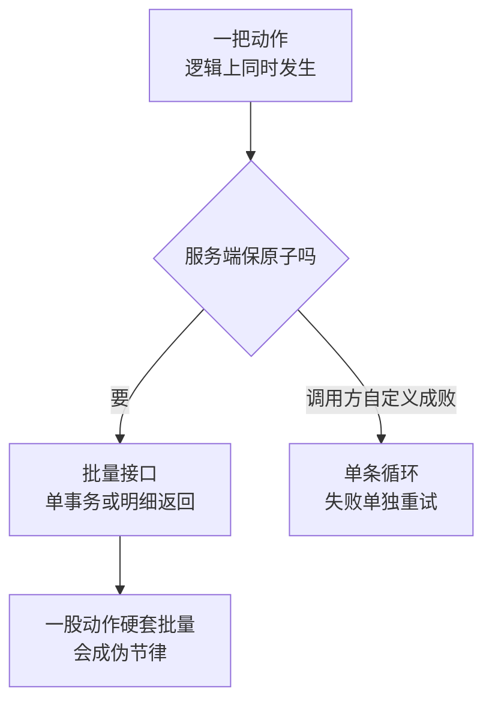
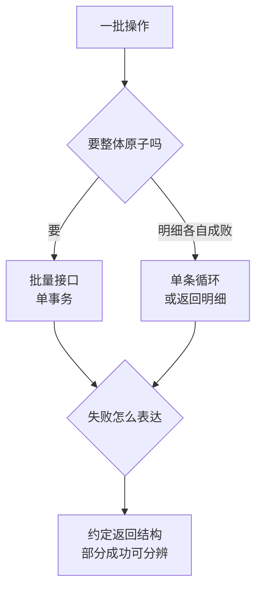
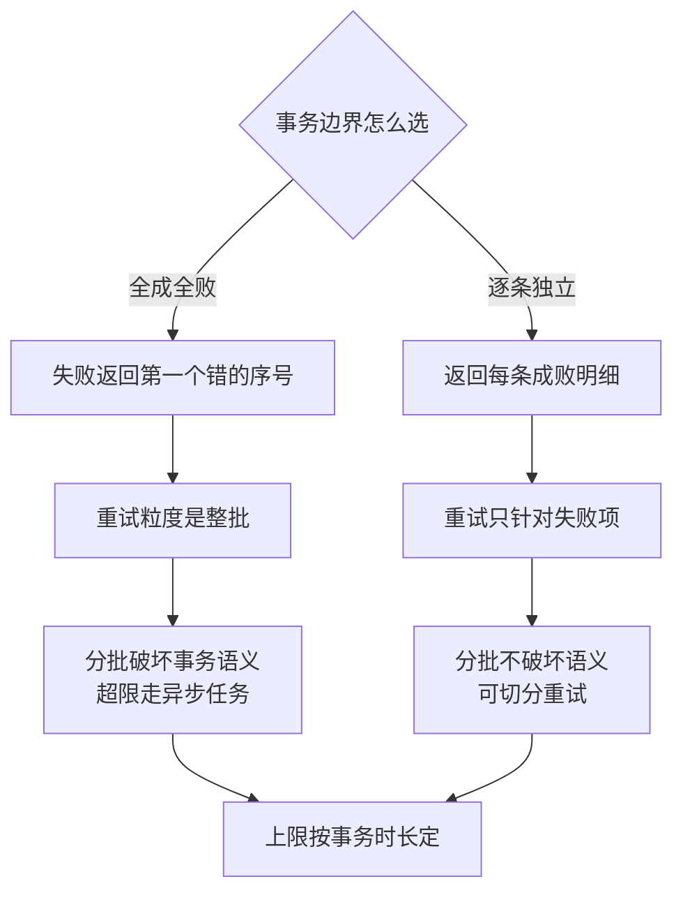

# 批量与单条接口的取舍分界：按调用方节律与平台职责定边界

常见的困境：调用方把同一个接口循环调一百次，客户端堆出一百次往返延迟，服务端收到的却是一百条互不相干的单条请求，看不出这原本是一批关联操作。读完这一页你能判断：**手上的场景该不该开批量接口；开了之后事务边界、部分失败返回、大小上限这三件事该怎么写进接口约定**。

> **要点**：单条接口的 N 次调用在客户端堆出循环与延迟，服务端却在感知不了一把调用的事务与审计语义——提供批量接口的判据按调用方节律与服务端职责推，批量的事务边界、部分失败与大小上限三件事在接口约定里显式化。

## 什么时候该为某个调用方加批量接口

平台接口有一类高频争论：**要不要为某个调用方加批量接口**。为什么不能一直用单条：客户端发起 N 次单条调用，**网络往返 × N、延迟叠加 × N**，调用方在应用层拼装"事务感"（前 49 条已生效，第 50 条失败后要自己去撤销它们，做不到）；为什么不能随手就加：批量接口引入新的语义面——**部分失败怎么办、批量大小上限在哪、事务边界到哪条记录**。

**接口设计的判断在这组代价间摇摆——每次争论都靠嗓门与职级收场，因为缺一条能摆上桌的判据**。本库后端域"幂等性的完整谱系"讲过调用语义的精确性；本篇给批量接口的决策骨架：**按调用方节律（是一把动作还是流式动作）与服务端职责（事务、配额、审计谁来做）推边界，把批量的三个语义问题在接口约定里显式化**。

## 它是怎么做到的：两把尺子怎么量

**第一把尺：调用方的节律**。调用方发起的这组操作是"一把"还是"一股"——**一把**指**逻辑上一次性发生的成组动作**：导入一个含 200 行的文件、一次给 50 个用户授权，都属于一把；对一把动作，中断后整组作废重来是合理语义；**一股**指**持续发生的动作**（消息处理循环里逐条上报），天然逐条、没有"整组"语义。一把的动作缺批量接口时，调用方用循环模拟"一把"，代价是 N 倍往返与残缺的事务感；一股的动作套批量接口，服务端被迫替一段本来连续的流定义"批多大、超时多久"——这个节律在调用方那里并不存在，**是批量接口凭空造出来的伪节律**。**节律判断错，批量接口要么没人用、要么用错**：把一股动作做成批量，调用方本就逐条处理，批量接口用不上；把一把动作做成单条，调用方要自己拼循环与补偿，必然用错。

**第二把尺：服务端的职责边界**。这组操作的原子性应该由谁保证——如果业务语义要求"要么全成要么全败"（一批配置项必须整体生效），原子性是服务端职责，**批量接口 + 单事务（整批操作包进同一个数据库事务，全成或全败）是正确形态**；如果调用方自己定义成败（每条独立记账，失败单独重试），**逐条调用 + 客户端编排反而干净**。**必须开批量接口的只有一种组合："一把 + 服务端原子"**。**判断顺序：先看动作是不是一把；是的话，再看原子性是不是归服务端**。**两问都答是，批量接口才是唯一干净的解法；任何一问答否，用单条接口加循环照样成立**。

判据的反面同样有用：**不加批量接口的理由清单**——调用方节律是一股、服务端无需原子性、单条已配重试与幂等（同一操作执行一次和执行多次结果相同）、批量的部分失败语义说不清楚。四条里有两条成立，**批量接口的需求通常是伪需求**（调用方缺的其实是连接复用与并发能力——那个问题由本库后端域的"连接池的容量数学"一篇专门解，不该由批量接口承担责任）。



两把尺怎么合在一起用？画一张组合表：横轴问调用方节律——动作是一把还是一股；纵轴问原子性归属——**成败由服务端还是调用方保证**——「一把 + 服务端原子」才是批量接口的必然位置；一把但调用方自定义成败的，**单条循环加独立重试更干净**；**一股动作硬套批量，服务端要替连续的流凭空造出一个批次的边界，这个硬造的节律就是伪节律**。两个条件缺一个，加批量接口的争论都可以**先回到这张组合表核对**。


图解：**批量接口在服务端往往落在一类队列结构上排队执行**。七种阻塞队列按有界与无界、排序方式两个维度排开，各有适用场景，对照着看能理解「批」在服务端的实现形态不止一种。

来源：[美团技术团队《Java线程池实现原理及其在美团业务中的实践》](https://tech.meituan.com/2020/04/02/java-pooling-pratice-in-meituan.html)（CC 4.0 BY-SA）


## 读完这一段你能判断什么：批量接口的三个约定问题



**取舍的分岔在原子性要求上**：业务要求全成全败的，走单事务批量；允许部分成功的，走逐条独立。随后的约定问题集中在一点——**部分成功怎么表达**：


决定提供批量接口后，三个语义问题在接口约定里显式化，缺一不可：

**事务边界**：全批单事务（全成全败，失败返回第一个错的序号）还是逐条独立（返回每条的成败明细）——两种都合法，判别标准是**业务不变量**（业务必须始终守住的约束，比如"配置项要么全部生效、要么全部不变"就是一条不变量）："配置项整体生效"这类不变量选前者，"导入数据允许部分成功"选后者。不声明的批量接口会把它自己的默认行为强加给所有调用方——服务端总要给一个确定行为，**接口不写清，就等于用实现者的默认值约束所有调用方**。"一把 + 服务端原子"的组合落到实现上，事务发件箱（outbox）是标准形态：**业务数据与待发事件写进同一个数据库事务，后台中继进程再从发件箱表取条目发往消息系统——业务写入与事件发布因此获得同一份提交结果**。整条链路如下图：


*图源：Microsoft Learn《使用 Azure Cosmos DB 实现事务发件箱模式》官方架构图（CC BY 4.0），https://learn.microsoft.com/zh-cn/azure/architecture/databases/guide/transactional-out-box-cosmos。图面标记为中文：业务对象与事件先写入数据存储（同一事务），中继服务从中取出未处理条目，发布到服务总线再由订阅方接收——「同一份提交结果」绑定在左侧的事务框上。*

**部分失败的返回形态**：逐条独立的批量必须返回**每条的定位信息**（序号、业务键、失败原因），调用方能精确重试失败子集；只返回"整体失败/成功"的批量接口**把重试粒度逼回整批**，部分成功的数据在重试时要靠幂等性挡重复（幂等指同一操作重复执行多次结果一致——幂等键是调用方为每次操作生成的唯一编号，服务端凭它识别重复请求）的约定随之必要。

**大小上限与分批规则**：**批量上限按服务端的事务时长与内存画像定（不是拍一个数），超限返回明确错误码**；超过上限的调用方只能自行分批，把一批 300 条拆成三次各 100 条来调——但**分批的边界会破坏事务语义：全成全败要求整批在同一事务，分批后每批各自提交，整体就不再能全成全败，所以全成全败型批量在文档里必须写明"超过 N 条请走异步任务接口"**，用任务接口承接大容量而不是放宽上限。

**三个约定环环相扣：事务边界怎么选，直接决定部分失败能返回什么；部分失败的返回形态，又决定调用方怎么分批与重试**。前一个的选择会限制后一个的取值范围：



**选了全成全败，重试粒度就被锁死在整批，于是超限时的分批会直接破坏事务语义**——这就是为什么全成全败型批量必须额外准备一条异步任务通道。逐条独立没有这个连带问题，**代价是调用方要自己处理明细**。

## 这套说法在哪儿会失效

三条边界各自防止一种防线走形：计量口径被刷、限流（限制单位时间内放行的请求数量）被绕过、错误语义被混淆。

**批量接口不改变配额与限流的计量规则**。**限流挡的是逻辑操作数，不是请求数**：一次批量请求装 100 条，就按 100 个操作计量（或给批量接口单独计价）。若按"一次调用"计量，刷接口的人一次塞一万条也只占一次配额，**计量就形同虚设**——所以计量口径与上限必须在接口约定里写明。

**异步任务接口是批量的近亲但语义不同**：超过同步上限的批量走任务接口（提交 → 轮询/回调 → 结果明细），任务是"一把"的大号形态，它有自己的幂等与断点续跑语义（本库正确性域"可恢复批处理的幂等与断点续跑"）——把大批量硬塞进同步接口与把小批量塞进任务接口是**同一种判断错误**。

**REST（Representational State Transfer，用 HTTP 动词操作资源的接口风格）语义的批量不必削足适履**（不必为了批量破坏 REST 的资源建模习惯）：批量端点把"批"本身当作一个资源来建模——要么开 POST（HTTP 提交数据的请求方法） /users:batch 这类专用端点，要么把整批建成一个独立资源——与单条端点并存——强行用 PATCH（HTTP 局部更新的请求方法）数组（用一次 PATCH 请求携带一个资源列表来代表批量）模拟批量会丢掉部分失败的明细语义。

## 怎么自己动手验证

验证路径要可复现，照着下面的顺序走一遍就能核对结论：

1. **节律核对**：调用方场景清单逐条标注"一把/一股 + 原子性归属"，**批量接口的需求只对"一把 + 服务端原子"成立**——清单进设计文档；
2. **部分失败验证**：构造含非法条目的批量请求（逐条独立型），预期返回逐条明细、非法条目定位精确、合法条目已生效；**重试失败子集预期成功且已生效条目不重复（幂等键生效）**；
3. **上限验证**：超限请求预期收到明确错误码与分批指引；全成全败型批量在事务超时场景下**预期整批回滚**（把系统恢复到上一个可用版本）；
4. 断言锚点：**约定三要素（事务边界、明细返回、上限）在接口文档齐备**，缺任一的批量接口不发布。

```text
节律断言 = 一把 + 服务端原子 才有批量
明细断言 = 部分失败可定位可重试
上限断言 = 超限错误码明确，分批指引可达
```

**批量接口的判断链很短：节律定需求、职责定形态、三要素定约定**——三步推完，加不加批量从争论变成核对。

## 接着读哪几篇：批量重试的幂等键约定来源

- [[工程知识/后端系统：在并发、失败与变化中维持服务/任务与并发/幂等性的完整谱系：从操作语义到删除接口的天然陷阱]] —— 批量重试的幂等键约定来源
- [[工程知识/后端系统：在并发、失败与变化中维持服务/服务设计/连接池的容量数学：池大小与排队等待的权衡]] —— "一股"调用方的 N 次往返优化路径（连接复用与并发）
- [[工程知识/软件构建：让变化可以理解、验证与交付/架构与代码/API演进的兼容性纪律：废弃流程与版本策略]] —— 批量接口约定自身的演进纪律
- [[工程知识/数据系统：在并发与故障中保存事实/事务与存储/事务隔离决定并发读写能观察到什么]] —— 批量单事务的隔离背景
