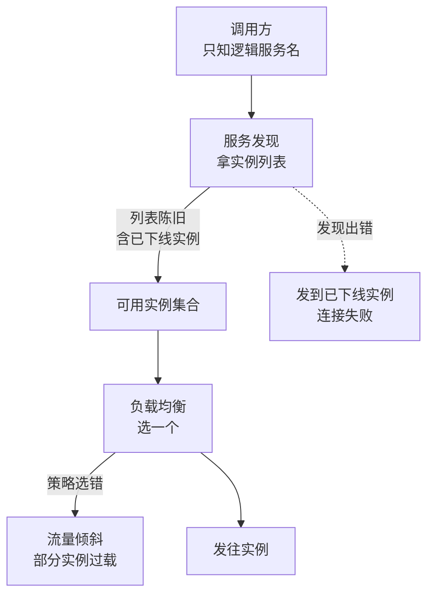
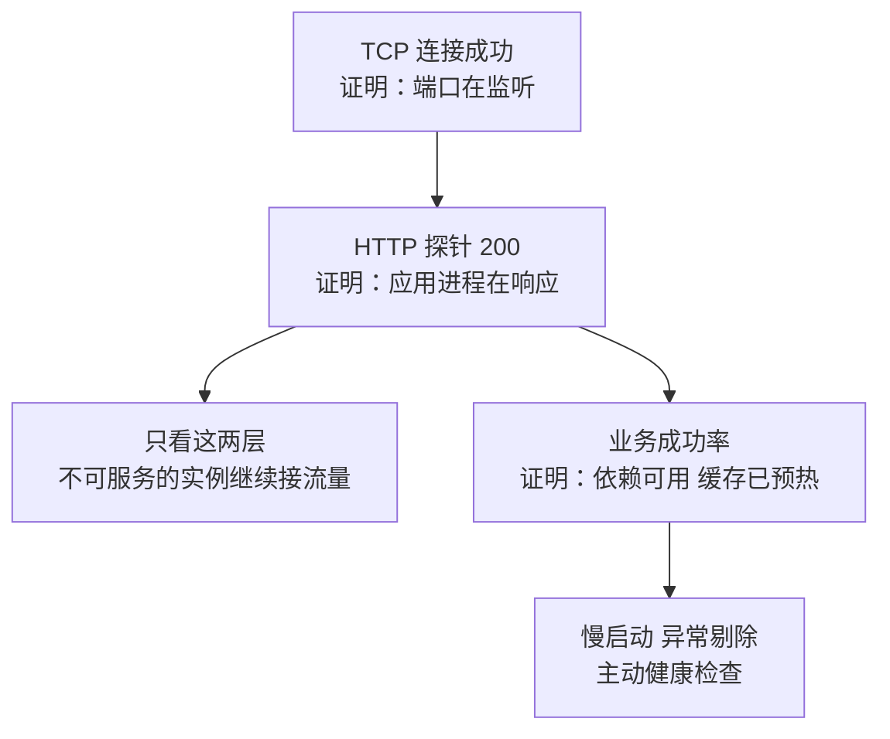

# 服务发现与负载均衡决定请求发往哪里

调用方只知道**逻辑服务名**（`order-service`），但请求必须发往一个**当前可达、就绪、有容量**的实例。这个过程分两部分，出错后果不同：**服务发现**回答"现在有哪些实例"（错了就发到已下线的实例），**负载均衡**回答"选哪一个"（错了就流量倾斜、部分实例过载）。

关键前提是：**实例列表永远是陈旧的。**为什么必然陈旧？实例列表像手机通讯录：有人换了号码，你存的还是旧号，必须假设通讯录会滞后于真实世界。**设计上必须假设它会陈旧，并让系统能容忍**——下面所有设计都建立在这个前提上。这个比喻只讲清「找谁的信息会滞后」，覆盖不到「对方此刻能不能接」——那是健康检查的事。

还要区分**三个容易混为一谈的信号**：**可达**只证明端口能连上、**就绪**证明应用能响应探针（向系统注入的检测点或检测请求）、**可服务**才证明业务能正确完成——三个信号一个比一个强。一个实例可以"TCP 可达但完全不可服务"——连接池（预先建好连接反复取用、省去反复握手建连的开销）耗尽、模型没加载完都会这样，而这正是**发布期间请求失败的常见原因**。

发现侧与均衡侧各自出错，后果落在不同环节，对照如下：

| 环节 | 回答 | 出错的后果 |
| --- | --- | --- |
| **服务发现** | 现在有哪些实例？ | 请求发到已下线的实例 → 连接失败 |
| **负载均衡** | 选哪一个？ | 流量倾斜 → 部分实例过载 |

两个环节在调用路径上前后相接，也各有各的失效点：发现拿到的是一份可能含已下线实例的陈旧列表，出错时请求发到已下线的实例；均衡在这个集合里挑一个，策略选错则流量倾斜（数据或负载集中到少数节点）——两条失效分支挂在链上的不同位置：


**发现侧错的是「发给谁」，均衡侧错的是「发多少」**，两处失效挂在链的不同环节，所以两处的修复手段也不同：**发现侧要容忍陈旧列表**——短超时快速失败，连续失败就临时拉黑，让陈旧列表的伤害止于一次失败；**均衡侧要让策略感知实际负载**（P2C 或最少连接），不再按次数盲分。把两条失效分支挂在各自环节上，**才不会用重试去掩盖发现侧的问题**。

## 要解决的问题是什么：发布时 5% 的请求为什么失败

一个服务做滚动发布，用户侧监控显示：**发布期间约 5% 的请求 500**，发布结束后恢复。

排查后发现这次故障是四个问题叠加出来的，一层一层看：

| 现象 | 真因 |
| --- | --- |
| 请求发到已停止的实例 | **注册信息陈旧**：实例已下线，但调用方缓存里还有 |
| 请求发到正在启动的实例 | **没区分 liveness 和 readiness**：进程起来了但配置还没加载完 |
| 个别实例 CPU 打满 | **负载均衡按轮询**，不感知实例实际负载 |
| 故障被放大 | **重试没有总 deadline**，一个慢实例引发连锁重试 |

**四件事分别对应服务发现、健康检查、负载均衡、重试设计。**

## 服务发现如何把逻辑名变成可达实例

### 有哪两种模式

**客户端发现**指调用方自己去服务注册表拉取实例列表、自己选实例直连，流程如下：

上面说的代价「每个语言都要实现一套」落在客户端头上：**客户端自己连注册中心、自己维护实例列表、自己挑实例发请求**，这套逻辑用 Go 写一遍、用 Java 还要再写一遍。注册中心在拓扑里的位置决定了这笔成本落在哪里：etcd（分布式键值存储，Kubernetes 用它存集群状态）官方文档给出的客户端负载均衡图正是这个形状——客户端经 gRPC resolver 从 etcd 拉取端点，再用 balancer 在本地挑选：


*图源：etcd 官方文档《Client-side load balancing》，Apache-2.0，https://etcd.io/docs/v3.5/learning/。选在后端列表的维护落在每个调用方进程里，因此选策略能做得比集中式均衡器更贴近业务，代价是每种语言各写一遍。*

```
调用方 → 查注册中心 → 得到实例列表 → 自己选 → 直连
```

优点：**少一跳，延迟低，LB（Load Balancer，负载均衡器）策略由客户端控制**。
缺点：**每个语言都要实现一套**。

**服务端发现**（更常见）指调用方只把请求发给一个中间层，由中间层查表选实例，流程如下：

```
调用方 → 负载均衡器（k8s Service / Nginx / Envoy）→ 选一个实例 → 转发
```

优点：**调用方无感，语言无关**。
缺点：多一跳；**LB 本身要高可用**。

均衡器在拓扑里站在哪一跳、两侧各隔着什么网络边界？一张图看清：它骑在调用方网络与服务方网络的分界线上，**调用方只见它的地址、看不到后端真实地址**：


*图示：负载均衡把请求分发到多个后端实例。图源：Wikimedia Commons《Load Balancing Cluster (NAT).svg》，作者 HFWMan，CC BY-SA 4.0，https://commons.wikimedia.org/wiki/File:Load_Balancing_Cluster_%28NAT%29.svg。*
来源：Wikimedia Commons「Load Balancing Cluster (NAT)」。图里还有一个回程细节：NAT（网络地址转换，在内外网之间改写地址与端口）模式下，后端回的包要再经均衡器改一次地址才能回到客户端——**回程也压在均衡器身上，这是它成为单点（没有备份、一坏全局受影响的组件）与瓶颈的另一个来源**。

**Kubernetes 的做法**（k8s）：Service 提供稳定的虚拟 IP，kube-proxy（每个节点上维护转发规则的组件）或 Ingress（七层入口网关）做转发。**调用方只看到 Service 名。**

这套机制落在 Kubernetes（容器编排平台，负责容器的部署、调度与自愈）的整体结构里长什么样——控制平面（API 服务器、etcd、调度器、控制器）负责决策与状态存储，每个节点的 kube-proxy 维护转发规则、kubelet 管容器生命周期，官方中文架构图一图看全：


*图源：Kubernetes 官方中文文档《集群架构》，CC BY 4.0，https://kubernetes.io/zh-cn/docs/concepts/architecture/。*

这张图怎么读？Service 的稳定入口之所以成立，靠的是**控制平面把「哪些 Pod 就绪」记进 etcd，再由每个节点的 kube-proxy 把虚拟 IP 的规则同步到本机**——kubelet（每个节点上管理容器生命周期的代理）负责上报 Pod（k8s 中最小的部署单元，对应一个应用实例）的就绪状态——**服务发现在这里被拆成了「控制面定状态、数据面转流量」两层**，任何一层滞后都会表现为文章开头四件事里的某一件事出错。

省掉控制平面之后，调用方到后端之间还隔着一个均衡器——这就是「多一跳」。这笔账在商业负载均衡的图里更直白：调用方先到均衡器、均衡器再到后端，两跳各自增加延迟。阿里云传统型负载均衡的四层集群由多台 LVS（Linux 虚拟服务器，四层负载均衡软件）机器组成，每台持有 VIP（Virtual IP，虚拟 IP，对外暴露的那个地址）并互相同步会话，后端排布的是 ECS（云服务器实例）——一台维护时流量转到另一台，用户侧不感知：


*图源：阿里云帮助中心《负载均衡产品架构》，https://intl.aliyun.com/help/zh/slb/classic-load-balancer/product-overview/architecture。*

客户端请求经 VIP 到四层集群，**集群按策略把请求分给后端服务器**，响应再经内网返回集群：


*图源：阿里云帮助中心《什么是负载均衡》，https://help.aliyun.com/document_detail/2669803.htm。*

这两张图给出了「服务端发现」在工程上的真实形态：**均衡集群自己承担高可用（会话同步、集群部署），后端服务器的选择依据是健康状态与负载情况**——正是本文开头「四件事」里健康检查与负载感知那两件的落点。代价也在这两张图里：客户端只认得 VIP，后端真实地址被藏在集群另一侧，**均衡层因此成为请求路径上必须自己做到高可用的一个环节**。

### 注册与注销为什么最容易出问题

```
实例启动 → 注册 → 定期心跳 → 优雅下线时注销
```

注册与注销为什么最容易出问题？因为**注销不及时的三种情形各有各的堵点**：靠心跳超时（节点定期互发的存活信号，超时收不到就判定故障）才注销的，超时窗口内实例已失效却仍在列表里；进程被 kill -9 的，来不及主动注销；网络分区的，实例活着但注册中心联系不上。三种情形的成因与后果见下表。

| 坑 | 后果 |
| --- | --- |
| 靠心跳超时才注销 | 实例已失效但还在列表里（默认可能 30 秒以上） |
| 进程被 `kill -9` | 来不及注销，只能等心跳超时 |
| 网络分区 | 实例活着但注册中心联系不上 → 被误判失效 |

**设计结论：调用方必须容忍列表里有已失效的实例。**

**调用方必须把连接失败当作常态**：用短超时快速失败，**重试以幂等（同一操作执行多次与执行一次效果相同）为前提**。**这两条是操作纪律**，不是比喻能说清的，按下面各节的具体做法执行。

- **连接失败要快速失败**（短超时，等待时长控制在秒级）
- **要有重试**（但必须幂等）
- **要有主动剔除**：连续失败 N 次就临时拉黑该实例（outlier detection）

### 为什么 liveness 和 readiness 必须分开

| 探针 | 回答 | 失败时 |
| --- | --- | --- |
| **liveness** | 进程还活着吗？ | **重启容器** |
| **readiness** | 能处理请求吗？ | **从负载均衡摘除**（不重启） |

**最经典的误配置：readiness 检查下游依赖。**

```
❌ readiness = "数据库能连上吗"
   → 数据库抖动 3 秒 → 所有实例 readiness 失败 → 全部被摘除
   → 服务整体不可用（本来只是降级）

✅ readiness = "自身是否就绪"
   → 数据库不可用时仍接收请求，返回降级结果或缓存
```

**这条规则值得反复强调**：探针只检查**自身**，**不检查下游**。

### 为什么可达不等于可服务

**这是最小实验要验证的核心**，验证点有两个：**一是逻辑名能否解析成实时列表，二是列表滞后时请求会怎样失败**：

```
端口能连上（TCP 可达）
  ≠ 应用能处理请求（HTTP 200）
  ≠ 业务能正确响应（依赖可用、缓存已预热）
```

三个信号逐级靠近真相——注意**这是证据强度的递进，不是采集的先后顺序**：TCP 连上只证明端口在监听，HTTP 200 证明进程在响应，业务成功率才证明依赖可用且缓存已预热（上线前提前加载数据或建立连接，避免初期变慢）。关键在于，能采到的动作也随层级增加：


所以**「可用」的证据强度决定了能做什么**：只采到 TCP 层的实例会继续接流量且无从剔除，**采到业务成功率才有慢启动与异常剔除的依据**——这正是连接池耗尽、模型未加载完的实例能长期留在列表里的原因。

| 信号 | 说明什么 |
| --- | --- |
| TCP 连接成功 | 只能说明端口在监听 |
| HTTP 探针 200 | 应用进程响应了 |
| 业务成功率 | 能真正服务（业务侧事实） |

**一个实例可以"TCP 可达但完全不可服务"**：连接池耗尽、模型未加载完、缓存未预热都会这样。**探针只能证明「进程还活着」，业务能不能接住请求要靠真实流量的结果说话**，两层证据管的是两件不同的事。

所以负载均衡层需要两个机制：**慢启动让新实例渐进增加流量，异常剔除以实际成功率为摘除依据**。

- **慢启动**：新实例渐进加流量（不做一次全量）
- **异常剔除**：观测实际成功率，而不只看探针
- **主动健康检查**：调用方自己统计失败率

## 负载均衡怎样在多个实例间分配请求

一次用户请求往往要扇出（一个请求同时触发对多个后端的调用）到多个后端，网关负责把这几通调用聚合成一次响应：


*图源：Microsoft Learn 中文文档（Azure 体系结构模式），CC BY 4.0，https://learn.microsoft.com/zh-cn/azure/architecture/patterns/gateway-aggregation。*

这张图对负载均衡的直接含义是：**扇出的每一条支路都要各自选一个实例**，负载均衡每个扇出分支上各做一次，而不是「把请求分给谁」的一次决策。分支越多，单次请求命中某个坏实例的概率越高——扇出把一次请求拆成多次独立调用，每次各选一个实例，任何一次撞上坏实例整个请求就失败，失败概率是各次叠加的，所以**扇出型接口的错误率总是高于单个后端实例的错误率**。


### 有哪五种策略

| 策略 | 做法 | 适用 | 问题 |
| --- | --- | --- | --- |
| **轮询** | 依次分配 | 实例同构、请求均匀 | 实例性能不同时会倾斜 |
| **最少连接** | 选当前连接数最少的 | 请求耗时差异大 | 需要共享状态 |
| **一致性哈希（节点增减时只迁移少量数据的分片路由）** | 按 key 哈希 | 需要会话粘性/缓存亲和 | 实例变化时部分 key 迁移 |
| **加权** | 按权重 | 实例配置不同 | 权重需人工调 |
| **P2C** | 随机选两个，选较好的 | **通用推荐** | 需要能感知负载 |

**P2C（Power of Two Choices）值得单说**：

```
随机挑 2 个实例 → 选其中"当前请求数较少"的那个
```

**为什么有效**：**两次随机的信息量足够避免极端倾斜**，而且**不需要全局状态**（每个调用方本地判断即可）。

**实测效果**：P2C 比纯轮询在高负载下 P99（把所有请求响应时间从小到大排，第 99 百分位的值，99% 的请求比它快）明显更低——**它能自动避开正在变慢的实例**。P2C 的有效性有理论支撑：Mitzenmacher 的超市模型把它画成一个顾客在 n 台服务器里随机看两台、排进人少的那一队，**d=2 就能把最大负载从 log n 量级压到 log log n 量级——每多看一眼的收益是指数级的**，看第三眼开始只赚常数倍：


*图源：Michael Mitzenmacher《The Power of Two Choices in Randomized Load Balancing》（IEEE TPDS 2001），Figure 1，[论文 PDF](https://www.eecs.harvard.edu/~michaelm/postscripts/tpds2001.pdf)。实线是两次采样（只采集一部分数据以控制记录开销）中较短的那队，虚线是被放弃的候选——这个「看两眼挑短的」动作不需要任何全局状态，是它能在客户端负载均衡里普及的原因。*

### 为什么长连接让负载均衡失效

```
每次新建连接 → 握手 + TLS → 延迟高、端口耗尽
保持长连接  → 延迟低，但连接建立后流量就固定在某个实例上了
```

**这是 gRPC（Google 开源的跨语言远程过程调用框架，RPC 即 Remote Procedure Call：像调本地函数一样调远端服务）场景的核心矛盾：一条 HTTP/2（HTTP 第二版，多条流复用一条连接）长连接（建立后保持不断开、多次通信复用同一条连接）复用所有请求，连接层的均衡看不见请求层的分布。**

长连接与 LB 的分配僵化，有四种现成解法，方案与做法见下表。

| 方案 | 做法 |
| --- | --- |
| **客户端侧 LB** | 客户端持连接池，自己按 P2C 分发（gRPC 的做法） |
| **限制连接寿命** | 定期重建，让 LB 重新分配 |
| **L4 代理** | 每次新连接重新选（但长连接就失效了） |

**gRPC 场景下，服务端发现 + 客户端 LB 通常比 L4 代理更有效。**为什么？L4 是传输层代理，只按地址与端口转发、看不到请求内容，而 gRPC 的所有请求挤在同一条 HTTP/2 长连接上，**L4 均衡器看不见连接里的一条条流，只能按连接粗分；客户端 LB 则能按请求挑实例**。

### 超时预算为什么必须分层

- 用户可接受：3 秒
- 网关超时：2.5 秒
- A 到 B：1.5 秒
- B 到 C：800 毫秒
- 数据库查询：300 毫秒

**每层必须小于上层**，留出处理时间。

**错误做法**：所有层都设 3 秒 → 最坏情况总耗时是各层累加 → 远超用户可接受时间。

**必须有总 deadline**（逐层减小，不做每跳独立超时）：请求带一个 deadline 一路传递下去，**任何一层发现 deadline 已过就直接失败，不再继续调用**。

### 重试有哪三条纪律

1. **只重试幂等的操作**（不幂等的重试会重复副作用）
2. **指数退避 + 抖动（性能指标不稳定的起伏）**（避免同步重试风暴）
3. **重试预算**：**重试量超过总请求的 10% 就停止重试**——这说明系统已过载，继续重试会雪上加霜

**还要：记录重试代际**（retry generation），**防止重试链无限嵌套**。

## AI 服务有哪些特殊性

**LLM（大语言模型）请求不能按"HTTP 请求数"均衡。**

```
请求 A：100 个 token  → 占用 GPU 0.5 秒
请求 B：32000 个 token → 占用 GPU 30 秒（含 prefill——预填充，模型处理输入 prompt 的阶段）+ KV cache（键值缓存，存注意力计算的中间结果，占显存）
```

**按请求数轮询会把长请求集中到同一个副本**：轮询按次数均分，**长请求在计数上只算一次、却长时间占着 GPU**，下一个长请求又被轮到它，于是长请求全堆在同一副本 → **那个副本过载，其他空闲**。

LLM 路由（把请求分给哪个模型）**要同时权衡多个维度：成本、时延、当前显存（GPU 上的内存、模型参数与计算中间结果都存这里）余量**。各维度的含义与取舍见下表。

| 维度 | 说明 |
| --- | --- |
| **输入/输出长度** | 预估计算量 |
| **KV cache 占用** | 显存是硬约束 |
| **前缀缓存命中** | 命中可大幅降低 prefill 成本 |
| **模型版本 / LoRA** | 不同副本可能加载不同适配器 |
| **GPU 型号** | 异构集群下性能差异大 |
| **优先级 / 租户** | 需要隔离高优先级流量 |

**这就是"token 感知的路由"**，**比传统 LB 复杂得多**。详见 [[工程知识/AI 系统工程：从模型能力到生产能力/推理服务与平台/模型服务架构从单进程到分布式副本]]。

## 验证：怎么测

**关键实验**：让一个实例**TCP 可达但不可服务**（连接池耗尽或停止加载模型），比较三种配置的表现：

| 配置 | 预期 |
| --- | --- |
| 只做端口探活 | 请求持续被送进这个实例 |
| 加 readiness | 摘除生效，但探针更新前仍有窗口 |
| 按队列/token 负载路由 | 主动避开无容量实例 |

**摘除是否真正生效，取决于两个观测点**：请求是否仍被送入无容量实例，以及摘除的传播时间（从故障到不再发请求）。

- 请求是否仍被送入无容量实例
- 摘除的传播时间
- 重试次数和是否重复副作用（操作对外部状态产生的额外影响）
- 是否在 deadline 内失败

故障注入的清单里还有半故障实例：**让 50% 的请求慢 10 倍**，配置如下。

```yaml
- 半故障实例（50% 请求慢 10 倍）
- 陈旧端点（直接 kill -9）
- 连接耗尽
- DNS 延迟 / 缓存过期
- 单节点丢失
- 拓扑变化（跨区延迟）
```

## 有哪些常见错误

**错误 1：readiness 检查下游依赖**

数据库抖动 → 全站实例被摘除。**探针只检查自身。**

**错误 2：以为负载均衡能感知负载**

默认轮询不感知。**用 P2C 或最少连接。**

**错误 3：长连接让 LB 失效**

gRPC 连接建立后流量固定。**用客户端侧 LB。**

**错误 4：重试没有总 deadline**

重试累加超过用户耐心。**设总 deadline，逐层减小。**

**错误 5：所有操作都重试**

不幂等的重试会重复副作用。**只重试幂等的。**

**错误 6：滚动更新不等 readiness**

新实例未就绪就接流量。**必须先 readiness 通过，再摘旧实例。**

**错误 7：不优雅关闭**

直接 kill → 在途请求失败。**先摘除、等在途请求完成、再关闭。**

**错误 8：AI 服务按请求数均衡**

长请求集中到单个副本。**按 token/负载路由。**

关系：[[工程知识/后端系统：在并发、失败与变化中维持服务/分布式可靠性/部分失败决定分布式系统的设计]] · [[工程知识/后端系统：在并发、失败与变化中维持服务/分布式可靠性/健康检查只能提供有时效的失败证据]] · [[工程知识/后端系统：在并发、失败与变化中维持服务/任务与并发/限流熔断与隔离控制故障半径]]
- [[工程知识/后端系统：在并发、失败与变化中维持服务/服务设计/HTTP语义的分层：方法、状态码与头部的约定角色.md]] —— 请求去向与语义约定的分界
- [[工程知识/后端系统：在并发、失败与变化中维持服务/基础设施/DNS解析的全链路：递归缓存与失效传播.md]] —— DNS（Domain Name System，域名系统：把域名解析成 IP 地址） 的最终一致不满足实时路由时的替代
- [[工程知识/后端系统：在并发、失败与变化中维持服务/基础设施/代理与网关的谱系：正向反向与sidecar各自解决什么.md]] —— 反向代理（替后端服务器接收请求、再转发的中间层）执行的"决定"动作
- [[工程知识/后端系统：在并发、失败与变化中维持服务/服务设计/健康检查的三层语义：存活就绪与深度.md]] —— 摘除决策的下游机制

## 这套说法在哪儿会失效

负载均衡不修复实例本身的慢与坏：它按健康证据分流，**健康检查的时效决定了摘除的滞后窗口**——窗口内的失败要靠调用方超时与重试兜住，**均衡策略不承担兜底责任**。

## 效果从哪儿来，要付什么代价

成熟的发现与均衡层的**收益是发布与故障的流量动作可编排**（摘流、灰度即新版本先放一小部分流量验证再逐步放大到全量、回滚即把系统状态退回到改动之前的版本，都变成流量指令），代价是**发现链路本身要维护**——注册中心的高可用、健康检查的误判治理；裸直连省掉这层，代价是每次发布与摘除都要改配置重启，**规模上去后这层成本必然要付**。
