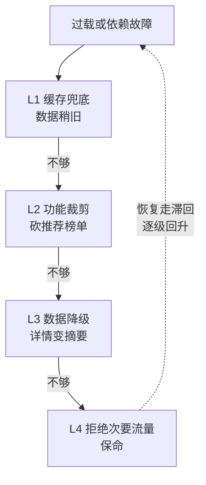
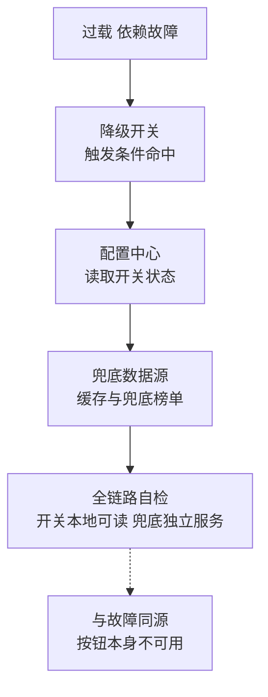

# 服务降级是有损服务，损什么损多少要变成业务决策

过载或依赖故障降临时，系统手里只剩两个选项。**选项一：什么都不砍，超载的部分全量拒绝，用户看到整个服务不可用。**

**选项二：主动砍掉次要功能，把省下的资源让给主路径，用户至少还能完成下单这类核心操作。**读完这篇你能带走三样东西：**一份给自己服务排好的降级阶梯、每个开关的触发条件与损失声明模板、以及把「损什么」交给业务拍板的协作方式。**

降级这一步做的交换是**拿功能完整性换可用性**——推荐列表换成兜底榜单、实时库存显示变成"有货"占位、个性化关闭改用通用策略。**这是一项业务决策：损哪个功能、损多久、损到什么程度，答案在业务侧，技术侧的责任是把选项与代价摆出来，并把执行做成可配置。**

降级与限流（限制单位时间内放行的请求数量）的关系要先分清：限流——控制单位时间放进来的请求数量、超过配额就拒绝，详见 [[工程知识/后端系统：在并发、失败与变化中维持服务/任务与并发/限流熔断与隔离控制故障半径]]——**管门口，控制进来多少；降级管门里，控制进来的怎么处理。两者配合使用：限流保系统不崩溃，降级保核心路径在限流后仍有意义。**

## 降级到底在解决什么问题：损失的是哪一类完整性

系统在过载或依赖故障面前只有全量拒绝与主动降级两条路，**选择哪条、降掉哪一部分功能、降到什么程度，往往由技术侧临时决定，事后才发现业务上不可接受。**本篇回答：**降级损失的是哪一类完整性、哪些选项需要业务侧决定、降级开关与阈值怎样配置、以及降级期间用什么判断是否恢复。**

## 降级阶梯怎么分层

打个比方：降级像洪水时决定先保哪几个村子——保不了全部，只能提前排好顺序：先保有人住的（下单），放弃观赏性的（推荐、排行榜）。牺牲的顺序要在晴天就排好：洪水来的时候没有时间想，工程师临时想的顺序也不替业务对损失负责。这个比喻只讲「顺序必须提前定」一件事。降级点怎么列全、开关怎么演练、恢复后数据怎么回填，供电预案没有答案，要按正文的方法做。

拿一部分功能换整体活着，这个交换现实里早有人做过。机房备用电源就是最直白的一个：市电中断时，机房不追求「什么都照常」，而是按负载等级逐级让渡——照明与制冷先降（关闭一列空调、调高温度设定），IT 负载里只保核心设备，发电机油量按核心负载能撑的小时数计算。损什么、损多少，是供电预案里预先写死的等级表：核心交易设备全保，非核心的办公区插座直接断——这正对应降级阶梯里「次要流量先被牺牲」的顺序。这个类比到「按等级预先排好牺牲顺序」为止：机房供电是物理容量问题，降级是业务取舍问题，具体怎么列降级点、怎么演练，要看正文，不能照搬供电预案。

降级阶梯的每一级，本质是**在决定"谁的请求先被牺牲"**。优先级队列把等级问题摆得很直白：平时资源够，所有任务都过；过载那一刻资源不够，低优先级任务被排到队尾等待，高优先级任务插队先被处理：


*图源：Wikimedia Commons，Rsparks3，CC0 1.0，https://commons.wikimedia.org/wiki/File:Data_center_backup_generators.jpg。*

这个结构正是降级阶梯的第一级——只区分等级、还没动手扔请求：不重要的请求进慢队或等待，重要的照常走。往下一级比一级狠：第二级直接拒绝低等级请求，第三级给剩下的请求返回兜底内容，最后一级才关掉整个功能。阶梯的设计要点是：


| 级别 | 动作 | 用户感知 | 触发条件 |
| --- | --- | --- | --- |
| L1 缓存兜底 | 新鲜度降级：实时数据换缓存数据 | 轻微（数据稍旧） | 依赖超时率上升 |
| L2 功能裁剪 | 砍非核心计算（推荐、榜单、个性化） | 部分功能变简单 | 资源利用率阈值 |
| L3 数据降级 | 详细页变摘要、列表变短 | 明显变简 | 容量缺口大 |
| L4 拒绝次要流量 | 非核心场景直接拒绝 | 次要场景不可用 | 保命 |

阶梯的意义是**损失的可控递进**：能停在 L1 不进 L2，**每升一级都是独立的业务确认点**（预授权过的规则，不是临时拍板）。**没有阶梯的降级只有"全开/全关"，过载时要么不敢降（拖垮核心）、要么一降到底（损毁体验）。**



降级阶梯的递进结构：从 L1（新鲜度换可用性，用户几乎无感）到 L4（拒绝次要流量保命），每升一级损失加重一档，每级都是预授权过的独立业务确认点——过载时按级递进，能停在 L1 不进 L2。虚线是恢复侧：条件回落走滞回逐级回升，避免临界点**在开与关之间震荡**；没有这张阶梯，降级只剩「全开或全关」两种极端。


来源：[美团技术团队《Java线程池实现原理及其在美团业务中的实践》](https://tech.meituan.com/2020/04/02/java-pooling-pratice-in-meituan.html)（CC 4.0 BY-SA）


## 每个降级开关有哪三要素

一个可用的降级开关要写清楚三件事：**什么时候触发（指标阈值加持续时间）、触发后做什么（返回什么兜底内容）、损了什么（哪些数据与体验受影响）。缺了任何一件，开关在事故里都不可用：**

1. **触发条件**：指标阈值（依赖错误率超过 10%，或 P99 响应时间超过 2 秒）加持续时间（**条件要连续成立一段时间才触发——指标总在上下抖动，只看瞬时值会让降级开关在开与关之间来回切换，系统跟着抖**），**触发条件必须是能观测到的指标（错误率、延迟），并且能在平时人为压出来演练，不能是「感觉不行了就降」。**
2. **恢复条件**：阈值**回落多少、观察多久才恢复。恢复条件要比触发保守（滞回），否则在临界点震荡。**
3. **损失声明**：**降级期间哪些数据是旧的/简的/错的，影响哪些报表与结算。损失声明是业务对账的依据。**对账指事后把降级期间的数据与正常数据逐笔核对：**偏差是否出现、出现在哪几项、是否超出声明的范围——这三问答完，这次降级的账才算清**——**降级期间的数据质量变化若不声明，下游会把它当真实数据处理**（静默失真的变体，见 [[工程知识/缺陷分析：从个案到体系/正确性/静默失真的检测靠对账与不变量而不是报错]]）。

## 为什么降级路径不能依赖被降级的依赖

降级链最常见的自杀设计：**降级开关依赖的配置中心、兜底数据源、通知通道，本身又依赖正在故障的那个依赖。最要命的是同源故障：开关依赖的东西和正在故障的依赖是同一个，开关读不到、兜底也取不到——降级偏偏在最需要它的那一刻失效。所以降级路径要在设计时全链路检查一遍：兜底缓存能独立服务、开关状态本地可读、降级页不加载故障组件。**混沌工程是验证这一点的标准手段（见 [[工程知识/软件构建：让变化可以理解、验证与交付/测试与交付/混沌工程验证系统是否真的能处理故障]]）。

故障的传播是沿调用链走的：Sentinel 官方的拓扑图里，Service A 与 Service B 各自带着一串下游依赖，一条链路被标红的部分就是故障从上游蔓延到下游的路径。降级点的作用就是在红路径的中间掐断——上游保住核心调用，把红链上的次要依赖先砍掉，避免整条链一起沉没：


*图源：[Sentinel 官网](https://sentinelguard.io/)（sentinelguard.io），Alibaba Sentinel 项目，Apache 2.0。*

## 动手跑一遍能看到什么账

```text
同一电商大促预案，降级清单变成业务决策的形态：

降级项          关闭什么        用户感知        业务代价       谁拍板
  推荐位降级     随机热门代替    推荐不准        GMV（成交总额）-2%       业务负责人
  评论暂存       发评论进队列    延迟可见        无直接损失     产品
  库存校验简化   预扣代替实扣    无感            少量超卖风险  运营+技术
  退款异步化     延迟到次日      延迟到账        合规窗口确认  法务确认过

反面：技术单方面决定"都关了吧"——超卖合规风险与退款延迟的
  业务后果不在技术的决策范围里，损什么损多少必须业务署名
```

降级开关自身读到的每一个依赖是否落在故障域里，这张图把自杀链拆开：开关状态、兜底数据源、通知通道三条线各自指向哪里。



按钮本身也要高可用（即使依赖故障也读得到、按得动）：图里任何一条虚线成立，降级就在最需要它的那一刻失效，所以预案要连同开关读到的每个依赖一起演练。

**无预案降级的实录：大促当晚数据库过载，没有预演过的团队现场临时拍板关掉评论功能——用户毫无预期、界面突然变化，投诉暴涨**，现场紧急决策的代价体现在两头：**"损什么"没挑过——有更值得先关的功能没关、不该关的先关了；"损多少"无人评估——关到什么程度、影响多少用户，没人算过；下一年预案化（清单预审、开关预演、按钮在人）后同场景按清单逐项降级，投诉为零。降级预演的实录——开关写了没演过，真降级时发现推荐开关依赖的配置中心也在过载（降级按钮本身不可用），预案要连同"按钮本身的高可用"一起演练**——实验纪律与 [[工程知识/软件构建：让变化可以理解、验证与交付/测试与交付/混沌工程验证系统是否真的能处理故障.md]] 衔接，开关治理与 [[工程知识/软件构建：让变化可以理解、验证与交付/测试与交付/配置与特性开关分离部署与发布.md]] 衔接。

## 这套说法在哪儿会失效

降级不适用于**数据正确性敏感**的核心路径：**支付、账务、合规场景没有"有损"选项**，过载时的正确答案是**排队、限流、拒绝**，而不是**给一个可能错的数据**。判据是可撤回性：**出错的动作能不能退回去。错的推荐能撤回——事后修正推荐结果，用户最多看到几条不准的榜单；错的扣款撤不回——钱已经扣走，道歉与退款追不回用户的信任。所以扣款链路不许降级，推荐链路可以。**

降级预案的维护成本常被低估：**依赖与功能每季度都在变，降级开关会腐化（触发条件里的指标改名、兜底数据源下线）。所以降级开关要有定期演练机制——每个开关每季度真实触发一次（低峰期），失效开关在演练中暴露，好过在事故中暴露。**

## 怎么自己动手验证

**降级效果要与损失声明对账——预写依赖故障后用户侧实际表现应与声明的损失一致，若下游没按损失声明把降级期间的数据标记出来，就会把它当真实数据入库，与声明的损失对不上。**

**演练验证**：对依赖注入故障（超时/错误率），**观察 L1→L2 的自动切换是否符合触发条件、用户侧实际表现是否与损失声明一致、恢复是否走滞回。**用混沌工程的方式定期重跑。

**降级数据的下游验证：降级期间采样数据，确认下游消费方按损失声明处理（标记为降级数据）而非当真实数据入库。**

## 读完这篇该接着读哪几篇

- 关系：[[工程知识/后端系统：在并发、失败与变化中维持服务/任务与并发/限流熔断与隔离控制故障半径]] · [[工程知识/软件构建：让变化可以理解、验证与交付/测试与交付/混沌工程验证系统是否真的能处理故障]] · [[工程知识/缺陷分析：从个案到体系/正确性/静默失真的检测靠对账与不变量而不是报错]]
- [[工程知识/后端系统：在并发、失败与变化中维持服务/服务设计/缓存改变读写路径、一致性与故障模式]] —— L1 缓存兜底的一致性代价
- [[工程知识/后端系统：在并发、失败与变化中维持服务/基础设施/容量规划与压测要用同一个负载模型说话]] —— 降级触发阈值的容量依据
- [[工程知识/AI 系统工程：从模型能力到生产能力/推理服务与平台/推理服务的核心矛盾是延迟、吞吐、显存与质量]] —— AI 服务里质量换吞吐的同构取舍
- [[工程知识/后端系统：在并发、失败与变化中维持服务/服务设计/流量入口只负责路由与连接，不负责业务正确性]] —— 降级执行的位置分层
- [[工程知识/后端系统：在并发、失败与变化中维持服务/服务设计/容量估算的通用骨架：从峰值QPS到机器数的推导演练.md]] —— 估算失守、过载发生时的降级阶梯
- [[工程知识/软件构建：让变化可以理解、验证与交付/测试与交付/灰度与功能开关的边界：交付节奏与配置漂移.md]] —— 运维开关背后的降级决策
