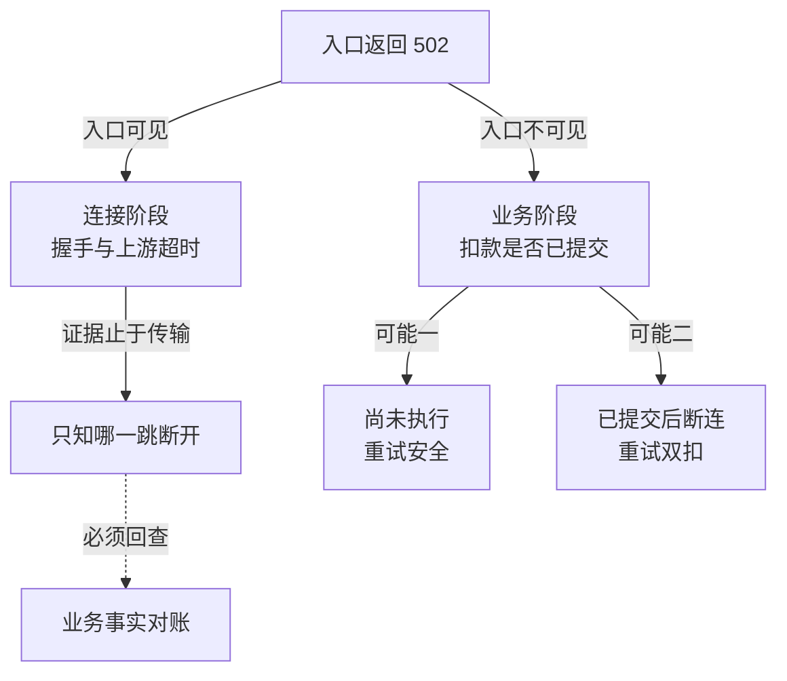
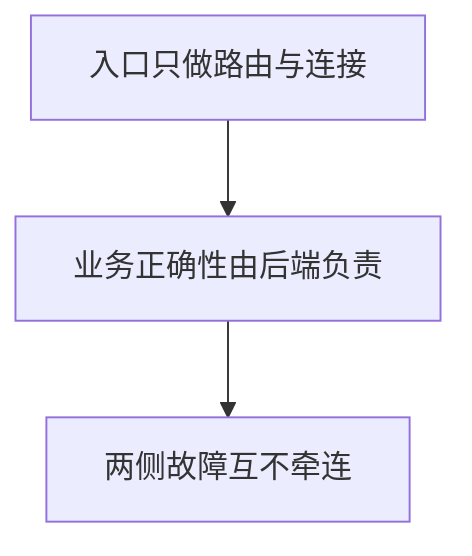

# 流量入口只负责路由与连接，不负责业务正确性

**CLB（云负载均衡）是云厂商托管的入口服务，Nginx 是需要自行部署和运维的代理软件。两者不是同一层面的「性能产品」，应按责任边界和故障模型选择。**读完你能按责任边界和故障模型在 CLB 与 Nginx 之间做选择，并知道哪一类问题不该找入口层解决。

**入口层可以摘除坏实例、终止 TLS（传输层安全协议，HTTPS 的加密层）和限制连接，却不知道一次扣款是否已经提交，也不能替应用决定重复 POST（HTTP 提交数据的请求方法）是否安全。把业务重试、权限和一致性塞进入口，真实副作用（扣了款、发了消息、改了状态）就被藏到入口层里，排障要跨层翻找，回滚（把系统状态退回到改动之前的版本）也找不到业务证据——入口层不存这些证据。**

入口断开连接时无从判断后端有没有执行，也就无法替应用认定一次写入的结果，因此入口配置应只承诺连接和路由事实；业务服务必须自己保存提交状态、幂等（同一请求重复执行与执行一次效果相同）身份和授权证据，并把它们暴露给可观测链路。

**当入口返回 502 时，后端可能尚未执行，也可能已经提交后连接才断；入口日志只能定位传输阶段，不能取代业务事实查询和对账。**



图的两侧是同一时刻的两套事实：入口那侧只有连接阶段的信息，够定位「哪一跳断了」，不够回答「业务做没做」；业务那侧最关键的一点是 502 对应两种可能——后端没执行，或者执行完提交了、响应回程才断。同样是重试，幂等操作重发一遍安全无损，非幂等操作重发一遍就是双扣款——后果相反，而入口拿不到区分两者的证据（它在连接层，看不见业务语义），所以排障路径要从「查入口日志」转向「查业务事实」：订单表、幂等表、对账流水。这也是入口配置只承诺连接与路由事实的原因——把业务语义放进入口，等于要求分拣机回答包裹里装了什么。

## 入口层实际负责哪些动作，要解决的问题是什么

入口在网络拓扑上站在客户端与后端之间，客户端只认识入口这一个地址，由它把请求分给后端并原样回传响应。这个中转位置长什么样，一张图看完：


*图源：Wikimedia Commons《Reverse proxy h2g2bob》，作者 h2g2bob，CC BY-SA 3.0。*



这条责任边界怎么划？划在「连接的事」与「业务的事」之间——连接的事归入口，业务的事归后端：


常见的误用场景：CLB 与 Nginx 被当成同类产品、放同一张表里只比性能参数，选定上线后才发现两者的运维归属、故障表现与扩容方式完全不同。本篇回答四个问题：入口层实际负责哪些动作、业务正确性由哪一侧承担、托管服务与自建软件在责任边界与故障模型上的差别，以及按什么条件选择。

先看流量入口的机制与本质：入口层是一台分拣机，按路由规则把连接送到后端、按连接策略管理握手与断开——它看得见每个请求发往哪里，看不见请求里装的是什么业务。这个比喻只到「按规则分派连接」为止，能否判定业务结果不在比喻范围内；
**本质问题是业务语义（鉴权、按用户限流——控制单位时间放进来的请求数量，超过配额就拒绝、幂等）进入入口层之后，入口从分拣机变成业务系统：入口层原本只管连接、没有业务状态与回滚证据，一旦承担业务语义，出错就要回到业务层排查，变更的爆炸半径随之变大**：原来入口改坏了只影响流量可达（请求进不来，现在还能影响扣款、下单、鉴权等全部业务逻辑）。

## 入口层的责任边界画在哪里

打个比方：流量入口像大楼的前台——负责告诉你几楼怎么走、电梯够不够用、有人闹事先拦下来（路由、限流、鉴权），但你那笔业务批不批，得楼上办公室说了算。这个比喻到"前台管什么"为止：哪些逻辑放错层会出什么问题，要看正文。


| 维度 | CLB | Nginx |
| --- | --- | --- |
| 运维责任 | 云厂商负责实例底层、高可用和部分升级 | 使用方负责部署、配置、升级、容量和高可用 |
| 流量层次 | 依厂商提供 L4/L7 能力，配置受产品边界约束 | 可做 L4/L7 代理，规则和模块更灵活 |
| 常见能力 | 监听器、健康检查、基础路由、TLS、访问控制等 | 路由、重写、缓存、限速、认证衔接和请求处理 |
| 可观测性 | 依赖云平台指标、日志和配额 | 可自定义日志、指标、模块和部署拓扑 |
| 成本模型 | 实例、流量、规则和跨区费用以厂商计费为准 | 软件许可通常不是主要成本，运维和机器成本由团队承担 |
| 失效方式 | 配额、区域、厂商控制面或网络边界故障 | 配置错误、证书过期、容量不足、单点和升级风险 |


来源：[小林coding《TCP 三次握手与四次挥手面试题》](https://www.xiaolincoding.com/os/1_hardware/tcp_interview.html)（CC 4.0 BY-NC-SA）


## 入口层的典型架构长什么样

**入口层的职责是把流量分发到多个后端实例，并能在实例不可用时把它从分发目标里摘除。这是它能给出的全部保证：路由、连接与摘除——判断返回的内容对不对，不在这一层。**

这套职责画成拓扑，就是一台负载均衡器立在公网与后端之间：终端流量经交换机（在局域网内按地址转发数据帧的设备）汇到负载均衡器，由它按策略分给后面的多台服务器——图里它左右两侧各是一套网络（公用侧收流量，专用侧发往服务），职责边界与正文说的「路由、连接、摘除」一一对应：


*入口层的分发位置与网络边界（图源：Wikimedia Commons，Rowe Wilson Frederisk Holme 绘，CC BY-SA 4.0）*


```text
互联网 -> CLB -> Nginx/网关集群 -> 服务
```

组合时各管一段：CLB 站最外圈，负责稳定的公网入口、基础健康检查和跨节点分发；Nginx 或网关（站在客户端与后端服务之间的入口层，集中处理路由、鉴权与协议转换）站在它后面，负责需要频繁演进的应用层路由、请求改写、限速或协议适配——要变的归自建层，稳定的托管能力归 CLB。每增加一层都要问两个问题：这一层新保证了什么？又新付出了什么？代价清单包括连接数上限、超时叠加、TLS 终止位置、日志断点、故障转移顺序和排障时要穿越的路径。入口层为什么要管限速而不是**只管转发？因为到达速率的尖峰先打在入口**，后端自己的限流（限制单位时间内放行的请求数量）只护得住自己、护不住前面排队与连接的堆积；官方队列过载模式图给了直观答案——任务到达速率超过队列与消费者承受力时，系统从「正常排队」直接跳到「全量失败」，入口层的限流与背压（用反向推力让上游放慢发送）就是在曲线拐点前主动削峰：


*图源：Microsoft Azure Architecture Center《Queue-Based Load Leveling pattern》，CC BY 4.0，https://learn.microsoft.com/en-us/azure/architecture/patterns/queue-based-load-leveling。入口只负责路由与连接的边界前提，是它的限速能把到达速率削到后端承受线以内——削峰（用队列把瞬时高峰摊平到更长的时间段）失败时业务层的故障形态就是图里那条垂直跌落线。*

## 怎样在 CLB、Nginx 与两者组合之间做选择

### 什么情况下优先选 CLB

- 团队希望减少入口层的主机、补丁和高可用运维。
- 业务主要需要标准的 TCP/UDP/HTTP(S) 转发、健康检查和基础 TLS。
- 已经深度使用某云网络、证书（CA 签发的公钥凭证、证明持有者身份）、DNS（Domain Name System，域名系统：把域名解析成 IP 地址）、监控和安全产品。
- 能接受厂商的区域、配额、计费和迁移约束。

### 什么情况下优先选 Nginx

- 需要复杂的 Header（HTTP 请求头）/Cookie/路径路由、重写、缓存或精细限速。
- 需要完全控制配置发布、日志格式、模块和网络拓扑。
- 运行环境不适合使用托管负载均衡（把请求分摊到多台服务器、避免单点过载），或需要跨云/本地统一代理层。
- 团队具备配置校验、灰度（新版本先放一小部分流量验证，逐步放大到全量）、回滚、证书轮换和多实例故障演练能力。

### 两者什么时候组合使用

当公网入口的托管高可用和应用层的灵活策略都需要时组合使用。避免重复做同一件事：例如两层都重试、两层都改写协议、两层都做会话粘滞，容易放大延迟并造成排障歧义。

## 设计要点是什么，怎么验证预期

- 健康检查应验证「能否接收业务流量」，而不只是进程存活；区分存活、就绪和依赖健康。
- 明确连接超时、读取超时、上游超时、重试次数和请求是否可重试；写请求必须有幂等约束。
- 记录真实客户端 IP、请求 ID、上游耗时和状态码，并确保多层日志可以关联。
- 证书、密钥、访问控制和管理面权限不写入仓库；轮换和回滚要有演练记录。
- 用压测和故障注入（主动向系统注入故障来验证容错能力的测试方法）验证连接耗尽、后端摘除、单节点故障、跨区切换和配置回滚。
- 会话保持（同一用户的请求固定发到同一后端）只解决「这个用户的请求都去哪儿」，不解决「多个后端的数据何时一致」，把它当一致性方案是常见误用；正路是让服务无状态、把会话放进合适的共享存储。

## 相关

- 基础设施职责矩阵：[[工程知识/后端系统：在并发、失败与变化中维持服务/基础设施/基础设施选型先比较责任边界与故障模型]]
- 网络性能与连接诊断：[[工程知识/性能工程：从用户等待到资源瓶颈/存储与网络/端到端网络延迟来自排队、协议、传输与处理]]
- 超时、重试与幂等：[[工程知识/后端系统：在并发、失败与变化中维持服务/分布式可靠性/部分失败决定分布式系统的设计]]
