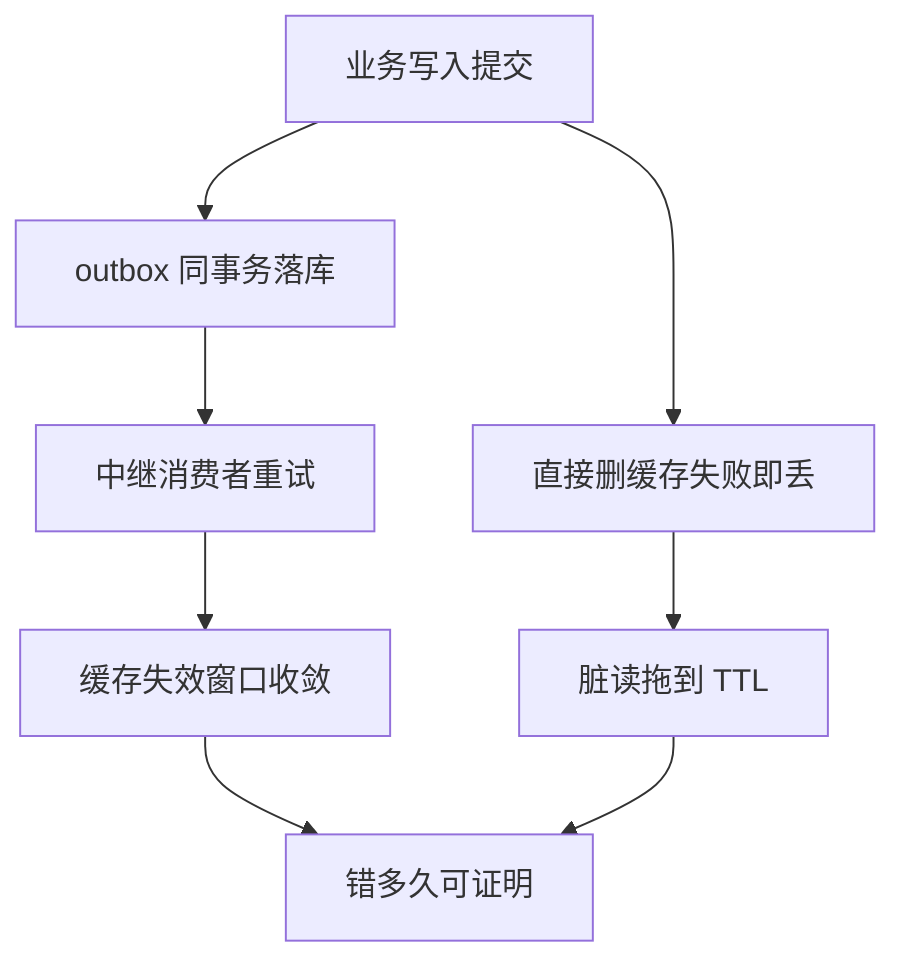
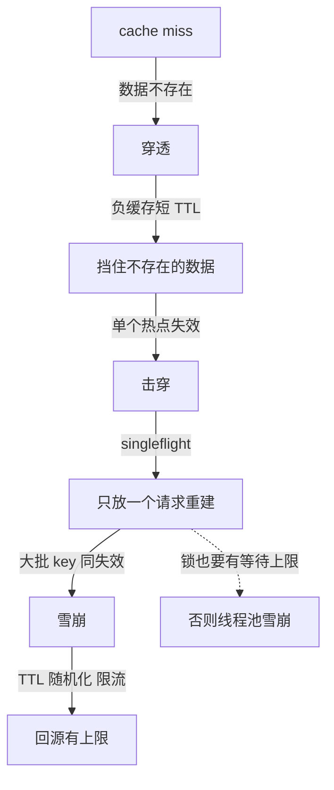

# 缓存改变读写路径、一致性与故障模式

**加缓存把读取路径改短，同时换来陈旧、失效和回源竞争三件新事。**读完这篇你能定出允许陈旧多久、键里该带哪些身份维度、写入和失效谁先谁后，也能判断缓存该在什么条件下回退到事实源。

## 哪些结论要先记住

打个比方：缓存像办公桌上的便签本——常用的号码抄在上面，抬手就有（快），但通讯录改了便签不会自己变（一致性），而且便签丢了你会以为自己记着，其实已经记错了（故障模式）。这个比喻到"引入缓存带来三件事"为止：写穿、写回、失效各自怎么选、击穿（热点缓存过期瞬间，大量请求同时涌向存储）怎么防，要看正文。

**缓存把读写路径改写了，而不是"加一层就变快"。**先看缓存在链路上落在哪个位置：


*图源：MDN Web Docs 中文版（Mozilla 贡献者），CC BY-SA 2.5，https://developer.mozilla.org/zh-CN/docs/Web/HTTP/Caching。*

共享缓存还会把多个客户端同时发起的同一次请求合并掉——十万个客户端同时要同一个 key，缓存只放一个请求去回源。这让"缓存命中率"（请求直接从缓存拿到答案的比例）和"回源次数"不再是同一个概念：合并后一次回源能服务多个未命中的客户端，回源次数少于未命中次数：


*图源：同上（MDN Web Docs 中文版），（Mozilla 贡献者）。*

**位置决定了一致性窗口的大小，位置选错是后面所有故障模式的根源：位置还决定缓存键带哪些身份维度——维度漏了租户或权限，后面撤权不生效、跨用户污染这两种故障就有了可乘之机。**要点

| 维度 | 回答 |
| --- | --- |
| 要解决的问题 | 事实源读取成本或延迟过高，且相同请求会重复读取相同结果。 |
| 本质 | 复制一份可丢弃的读取状态，缩短路径，但引入陈旧、失效、淘汰和回源竞争。 |
| 做法 | 先定义事实源、允许陈旧窗口、键的身份维度、写入/失效顺序、击穿保护、容量和故障回退，再选择 cache-aside（旁路缓存，应用自己管读路径与回填）等模式。 |
| 效果与代价 | 降低命中请求的延迟和源站负载；代价是额外内存、失效复杂度、回源峰值和数据不一致窗口。 |
| 边界 | TTL 只限制最晚陈旧时间，不保证立即一致；缓存不能绕过租户、权限、版本和删除语义。 |
| 验证 | 测命中率、陈旧窗口、回源 QPS、热点、重启、网络分区、撤权和版本切换，确认故障时仍不会读到越权数据。 |

**缓存用空间和失效复杂度换取更短读取路径。它不是「加一个 Redis（常用的内存键值存储）」这么简单：必须明确事实来源、可接受陈旧度、键的身份范围、失效触发、淘汰（空间不足时按策略移除部分条目）、并发击穿和故障时的回退。**

**例如用户刚撤销权限后，旧的「用户 + 资源」缓存仍可能返回可见内容；根因落在权限版本没有成为缓存身份、撤销事件没有进入失效路径，与 TTL（Time To Live，存活时间：到期后自动失效或删除） 长短和 Redis 性能无关。缓存设计要先回答「错多久、错给谁、错了如何收敛」。**

常见路径里最基础的一条是 cache-aside：应用先查缓存，未命中再查数据存储，拿到结果后回填缓存再返回；写入路径则直写数据存储、顺手让缓存里旧值失效。微软 Azure 架构中心的官方模式图把两条路径画在同一张图上：


*图源：Microsoft Azure Architecture Center《Cache-Aside pattern》，CC BY 4.0，https://learn.microsoft.com/en-us/azure/architecture/patterns/cache-aside。图里应用与缓存、数据存储的交互顺序就是「读写路径」的最小定义：读路径决定一致性窗口从哪一刻开始计时，写路径决定旧值何时被逐出。*

## 缓存挂在常见路径的哪一环

| 模式 | 读取 | 写入 | 适用边界 |
| --- | --- | --- | --- |
| cache-aside | 先查缓存，未命中查源并回填 | 先写源再删/更新缓存 | 灵活，需处理并发和失效窗口 |
| read-through | 缓存代理加载源 | 由缓存层协调 | 简化调用方，控制面更集中 |
| write-through | 同步写缓存和源 | 成功后返回 | 一致性较强，写延迟更高 |
| write-behind | 先写缓存，异步写回数据源 | 需要持久队列 | 适合可接受延迟的数据，丢失风险高 |

**TTL 只限制最晚陈旧时间，不保证更新立即可见；主动失效、版本键和事件通知各有传播延迟。键必须含租户、权限、语言、模型/索引版本等维度，避免跨主体污染。**


来源：[腾讯云开发者社区《Redis系列：Redis主从、哨兵、集群介绍》](https://cloud.tencent.com/developer/article/2183910)（CC 4.0 BY-SA）


## 写入路径怎么决定一致性窗口

最常用的 cache-aside 写路径是「先提交事实源，再删除缓存」。小林coding 的中文时序图把读、写两条策略各画一列：写策略是「更新数据库 + 删除缓存」两步，读策略是「未命中 → 读库 → 回写缓存」三步，两列合起来就是 cache-aside 的完整契约：


*图源同上（小林coding《数据库和缓存如何保证一致性？》）。*

顺序反过来时，另一个读请求可能在数据库提交前把旧值重新写回缓存。小林coding 的时序图给了这个窗口的逐条消息：请求 A 删缓存后、更新数据库前，请求 B 未命中、读库旧值 20、回写缓存——旧值 20 在 A 更新数据库为 21 之后仍留在缓存里，脏读（读到别的事务尚未提交的数据）窗口与写库耗时同量级：


*图源：小林coding《数据库和缓存如何保证一致性？》删除缓存时序图。*

即便顺序正确，删除也可能失败，因此高一致性场景要把失效事件放进与业务写入一致的消息发件箱（outbox，与业务写入同一事务入库、由后台消费者重试的事件表），再由消费者重试删除或推进版本键。

「先更库后删缓存」仍有一个失效会丢失的缺口，可证明的传播要靠 outbox 把失效与业务写入绑进同一个事务：



有传播机制兜底，才谈得上「允许错多久、错了如何收敛」；延迟双删只缩小窗口，替代不了它。

延迟双删只能缩小特定并发窗口，不能替代可证明的传播机制；同步双写（迁移期间同一份数据同时写入新旧两个存储）数据库和缓存则会引入两个事实源——两个写请求交错时，缓存里的值可能被旧请求最后覆盖。小林coding 的时序图里，请求 A「更新数据库为 1」与请求 B「更新数据库为 2、更新缓存为 2」交错，A 落在最后的一步「更新缓存为 1」把缓存打回旧值，数据库与缓存从此各说各话：


*图源：[小林coding《数据库和缓存如何保证一致性？》](https://www.xiaolincoding.com/redis/architecture/mysql_redis_consistency.html)，站内教程截图引用，中文标签。*

任何方案都应明确：允许错多久、对谁可见、失效丢失后如何收敛，以及数据库成功但缓存操作失败时由谁恢复。

## 缓存的失败模式有哪几种

| 模式 | 本质 | 常用保护 |
| --- | --- | --- |
| 穿透（查询的数据在缓存和存储里都不存在，请求全部打到存储） | 请求的数据根本不存在，每次都回源 | 输入校验、负缓存（把「查过、确实没有」也缓存一小会儿）、Bloom Filter（布隆过滤器，用位数组快速判断元素是否可能存在，用来拦掉不存在的键）；负缓存 TTL 要短 |
| 击穿 | 单个热点 key 失效，大量请求同时重建 | singleflight/互斥重建、逻辑过期（缓存项标一个逻辑到期时间，到点物理不删，访问时发现过期再异步刷新）、热点预热（上线前提前加载数据或建立连接，避免初期变慢） |
| 雪崩（一个服务故障引发连锁反应、成片服务跟着垮掉） | 大批 key 同时失效或缓存整体不可用 | TTL 随机化、分批预热、回源限流、熔断与降级（压力过大时关闭次要功能，保住主流程） |

热点（访问集中在少数键或节点上的现象）不均、淘汰抖动（性能指标不稳定的起伏）和故障回源同样会把容量压力转移到数据库。所有保护都必须有并发和队列上限；锁住重建却让十万请求无限等待，只是把数据库雪崩改成线程池（预先建好一组线程反复取用、避免频繁创建销毁）雪崩：重建锁不配等待上限时，请求全堆在应用线程上等那一个持锁者，数据库的压力没消失，只是搬到了线程身上。



三种失效的差别在「谁失效了」：穿透是数据本身不存在，负缓存用短 TTL 把「查过没有」记住；击穿是一个热点 key 过期，大量请求同时去重建同一个值，靠互斥重建或逻辑过期只放一个请求进去；雪崩是大批 key 同时失效或缓存整体不可用，TTL 随机化把过期时刻打散，回源限流（限制单位时间内放行的请求数量）给数据库兜底。虚线提醒的是保护措施自身的边界：互斥重建如果让十万个请求无限等待，压力就从数据库搬到了线程池，所有保护件都必须配等待上限。

## 动手跑一遍能验证什么

```text
同一份用户资料，加缓存前后的读写路径账：

读路径（Cache-Aside 通用形态）：
  命中：应用 → 缓存（1ms）→ 返回           ← 95% 的请求走这条
  未命中：应用 → 缓存 miss → 数据库（20ms）→ 回填缓存 → 返回
  命中率 95% 时平均读延迟 = 0.95×1 + 0.05×21 ≈ 2ms（原来 20ms）

写路径（缓存与库两步，一致性从这里开始出问题）：
  先更库后删缓存（推荐形态）：更新 DB → DEL cache
  失败窗口 1：删缓存失败 → 缓存留旧值直到过期（脏读窗口 = TTL）
  失败窗口 2：读请求在"更库后、删缓存前"读到旧缓存（毫秒级窗口）
  补偿：删除失败进重试队列 + 订阅 binlog（数据库变更日志，记录每次写入，可订阅它来兜底补删）兜底删

故障模式的账：缓存挂 = 流量全量回源
  库容量按"5% 回源"设计，100% 回源直接过载 → 限流与熔断是兜底件
```

脏读窗口实录——先删缓存后更库的旧写法，删后到更库前的并发读把旧值回填（回填窗口与写库耗时同量级），用户改了昵称刷新还是旧值；改"先更库后删"加 binlog 兜底后归零。回源过载实录——缓存集群重启未预热，100% 回源压垮数据库（库的容量假设是命中 95%），修复是重启带预热与接入限流，与 [[工程知识/后端系统：在并发、失败与变化中维持服务/服务设计/缓存穿透击穿与雪崩是三种不同的失效模式.md]] 的失效模式账互为姊妹：那篇讲 key 级失效，本篇讲路径级失效。

## 怎么自己动手验证

缓存行为要与撤权与更新对账——预写更新事实源并撤权后旧值不应再被读出，实测命中旧键返回已撤权内容，与预期对不上。

测命中率（请求直接在缓存里拿到答案的比例）、p95/p99（第 95、99 百分位延迟，95% 或 99% 的请求比这更快，越靠尾部越慢）、陈旧窗口、回源 QPS（每秒查询数，系统每秒处理的请求量）、淘汰、重启、网络分区、热点、撤权和版本切换。RAG（检索增强生成，先从外部资料里检索再让模型据此回答）缓存尤其要验证文档删除/撤权、embedding（把文字、图片等内容转成一串数字向量，机器靠向量距离算相似度）版本和 query 可见时间，不能让缓存绕过 ACL（Access Control List，访问控制列表：逐条列出谁可以对资源做什么）。（访问控制表，逐条列出谁对什么资源有什么权限）

最小实验：写入一条带权限和版本的记录，随后更新事实源、撤权、切换 schema/embedding 版本并重启缓存；分别观察命中旧键、回源、失效事件丢失和冷启动（缓存或服务刚启动、还没有数据与连接的状态）重建。通过读取主体、版本和陈旧时间断言缓存只提供允许范围内的派生结果。

关系：[[工程知识/数据系统：在并发与故障中保存事实/数据系统：在并发与故障中保存事实]] · [[工程知识/AI 系统工程：从模型能力到生产能力/知识与检索/RAG数据管道从文档到可引用证据]]

## 接着该读哪几篇

- [[工程知识/后端系统：在并发、失败与变化中维持服务/服务设计/缓存穿透击穿与雪崩是三种不同的失效模式|缓存穿透击穿与雪崩是三种不同的失效模式]]——把失效分成穿透/击穿/雪崩三种模式分别给防御，是本篇失效轴的展开
- [[工程知识/后端系统：在并发、失败与变化中维持服务/基础设施/DNS解析的全链路：递归缓存与失效传播.md]] —— DNS（Domain Name System，域名系统：把域名解析成 IP 地址） 是缓存一致性命题在命名系统的实例
- [[工程知识/后端系统：在并发、失败与变化中维持服务/基础设施/CDN的回源与边缘缓存：静态加速背后的机制]] —— CDN（Content Delivery Network，内容分发网络：把静态内容缓存到离用户更近的节点） 是缓存一致性命题的地理轴实例
