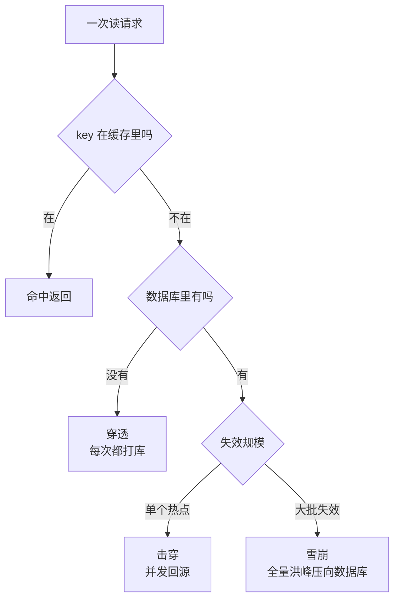
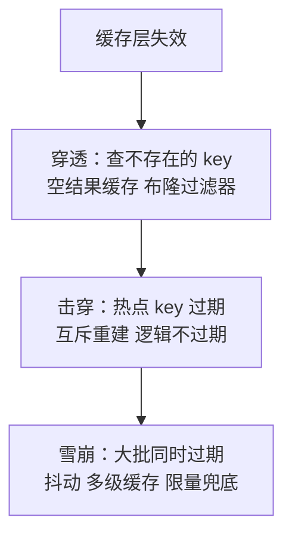

# 缓存穿透击穿与雪崩是三种不同的失效模式

**缓存穿透、击穿、雪崩是三种不同的失效模式：穿透要拦的是查询不存在的 key，击穿要拦的是热点（访问集中在少数键或节点上的现象） key 过期瞬间的集中回源，雪崩要拦的是大批 key 集体过期，三者触发条件不同、机制互不覆盖，只防一种另外两种照样发生**。读完你能按流量形状分辨三种失效并选对各自的防御手段。要解决的问题：缓存层是数据库前面的减压阀，失效模式决定了**失效瞬间流量打到数据库的形状**——是无中生有的流量、还是集中一点、还是全量洪峰，对应的防御工事完全不同。

## 三种失效各坏在哪一步？

先看一眼判定树，三种失效在同一张图上分岔（水塔比喻在下一节展开成实物）：



三种模式的判定分岔在「数据库里有没有」与「失效规模」两步：**先判定这个 key 在数据库里存不存在，再判定失效发生在单个热点 key 还是一大批 key，防御手段按这两步的判定结果分别选**：

先看一眼三种模式在同一条请求路径上的位置差：正常请求、穿透、击穿、雪崩分别在哪一步改变流向：


*图源：卡码笔记《Redis 的缓存雪崩、缓存穿透、缓存击穿（热点键过期瞬间、大量请求同时压向数据库）是什么？怎么解决？》配图，https://notes.kamacoder.com/base/redis-cache-stampeding-penetration-avalanche.html，卡码笔记原创图，转载注明出处。*

水塔把缓存层的机制演示成看得见的实物：全镇的日常用水从水塔里取，水塔就是缓存；水位（队列或资源的当前占用程度）低时泵站才启动补水，泵站就是数据库——**缓存正常工作时，数据库只需要按平均流量设计容量就够了**。**三种失效对应水塔的三种故障：每户都来问"有没有我家那种特殊接口的水"（穿透，泵站被无中生有的查询围住）、全镇同时在用的那个主阀到点检修（击穿，同一个口的请求集中砸向泵站）、水塔见底且补水管道同时停机（雪崩，泵站瞬间面对全城洪峰）**。**泵站按"平均流量"设计根本承受不了这三种形状中的任何一种——防御工事（即具体的防御手段：空值缓存、布隆过滤器、互斥重建）必须按失效形状分别选**：


*图源：Wikimedia Commons，Grendelkhan，CC BY-SA 4.0，https://commons.wikimedia.org/wiki/File:Campbell_water_tower,_aerial_view.jpg。*

**雪崩在成因上分两类：一类是大批 key 设了相同的过期时间、到点集体失效，一类是缓存集群整体宕机、全部 key 同时不可用，防御工事按这两类成因各修各的**：


*图源：小林 coding《什么是缓存雪崩、击穿、穿透？》雪崩成因一图，https://www.xiaolincoding.com/redis/cluster/cache_problem.html，小林 coding 原创图，转载注明出处。*


| 模式 | 触发条件 | 流量形状 | 数据特征 | 首选防御 |
| --- | --- | --- | --- | --- |
| 穿透（penetration） | 查询的 key 在缓存与数据库都不存在 | 恶意或爬虫制造无中生有查询 | 每次都 miss | 空结果缓存/布隆过滤器 |
| 击穿（breakdown/hotspot invalid） | 热点 key 过期瞬间 | 单 key 集中放行 | miss 集中在一个 key | 互斥重建/singleflight |
| 雪崩（avalanche） | 大批 key 同时过期或缓存整体宕机 | 全量洪峰 | 大面积 miss | 过期时间加随机抖动/多级缓存 |

三种失效都发生在缓存 miss（要查的数据不在缓存里）之后，正常路径先作对照：请求先查缓存，命中直接返回，数据库不参与这次服务——


*图源：小林 coding《什么是缓存雪崩、击穿、穿透？》命中路径一图，https://www.xiaolincoding.com/redis/cluster/cache_problem.html，小林 coding 原创图，转载注明出处。*

穿透讲的是这条命中路径永远走不通的 key：查询的 key 在缓存与数据库都不存在。防御核心是**承认"不存在的数据"也是一个可缓存的查询结果：数据库返回空也写进缓存（短 TTL，Time To Live：缓存项从写入到自动过期的时间），或前置布隆过滤器**——**位数组加多哈希（把任意长度数据压成固定长度指纹、不可逆）函数的结构，能断言"一定不存在"，有误判率但不会漏判，拦截必然 miss 的 key**。布隆过滤器「一定不存在」的判定过程见配图。


*图：布隆过滤器（来源：[Wikimedia Commons《Bloom filter.svg》](https://commons.wikimedia.org/wiki/File:Bloom_filter.svg)，作者 David Eppstein，公有领域）。x、y、z 三个元素写入时把各自的哈希位标记成 1；查询 w 时它哈希出的三个位置里有一个是 0——位数组说"我从未见过这个组合"，断言一定不存在，请求到此为止不再打库。全是 1 才放行去查缓存与数据库，误判的代价只是多查一次。*

击穿的防御核心是**让并发重建收敛成一次回源**（缓存未命中时回到数据库取数据）：**互斥锁（同一时刻只允许一个执行流持有的锁）或 singleflight（一种并发原语，保证同一 key 的回源在并发下只执行一次）让一个请求去数据库、其余等待结果**。雪崩的防御核心是**把同时性打散：TTL 加随机抖动**（给过期时间加随机偏移，错开集体过期时刻）避免集体过期，**缓存高可用（把缓存集群做成多副本、故障自动切换，避免整个缓存层同时不可用）避免整体宕机，或用多级缓存把洪峰摊薄**。

挡住无效回源后，缓存命中率（请求直接从缓存拿到结果的比例）回升，**打到数据库的流量回到正常水平，三者的收益都是压力自然归位；代价与权衡：空结果缓存占内存、布隆有误判、互斥重建让等待请求的延迟变高、抖动只是降低同时性不消除洪峰**。

**穿透、击穿、雪崩把流量打向数据库的形状各不相同——无中生有的散点、单点集中的尖峰、全量的洪峰——所以防御工事也就不通用**：



上表列出三者各自的核心机制与首选防御手段；把限流（限制单位时间内放行的请求数量）熔断（依赖持续报错时暂时不再调用它，直接走失败路径，防止拖垮自己）叠在最后一道，才覆盖住雪崩的兜底。

## 防御值不值得上、效果怎么验？

防御是否值得做，取决于缓存层失效瞬间的数据库余量：**排队论视角[[工程知识/性能工程：从用户等待到资源瓶颈/观测与诊断/排队论给容量一个可推导的模型|排队论给容量一个可推导的模型]]下，请求到达速度一旦超过数据库处理速度，积压的请求越排越长（队列发散），每个请求的等待时间跟着失控（延迟爆炸），所以全量洪峰超过数据库吞吐就是事故**。验证方法：
```bash
# 压测时故意制造三种失效再观察数据库 QPS（每秒查询数）形状
redis-cli --hotkeys                 # 找热点 key（击穿排查）
redis-cli monitor | grep -c "miss"  # miss 率观察
```
治理上与 [[工程知识/后端系统：在并发、失败与变化中维持服务/任务与并发/限流熔断与隔离控制故障半径|限流熔断与隔离控制故障半径]] 配套：**前面所有防御都失守时，限流把打到数据库的流量压回它能承受的量，是雪崩的最后防线；布隆过滤器在请求进缓存之前先拦掉必然 miss 的 key，是穿透的前置闸门，两者一个管总量、一个管入口，不可互相替代**。


## 三种失效的账怎么算？

```text
三种失效模式的对照账：

穿透（查不存在的数据，缓存与库都没有）：
  随机 key 打接口 → 每次都打到库；防御是空值缓存与布隆过滤器前置
击穿（一个热点 key 到期瞬间）：
  过期毫秒内 1000 并发同时 miss → 1000 次相同查询砸向库；防御是互斥重建
雪崩（大量 key 同时过期或集群宕机）：
  批量写入统一 1 小时过期 → 1 小时后集体 miss；防御是抖动与限流兜底

数字锚点：**一次击穿对库的冲击 = 该 key 的并发倍数（千级并发直击库）**；
  **布隆误判率 1% 时穿透流量被挡 99%**；
  **过期抖动把同一时刻的同步洪峰摊开成一段时间内的分布（比如 1 小时的过期摊到前后各 6 分钟的窗口内，洪峰时间宽度变成原来的 20%），同样总量摊在更长的时间上，单位时间承受的峰值流量降为原来的 1/5**。
```

**雪崩实录的通用形态——缓存集群重启后所有 key 同时失效（冷启动），数据库被瞬间压垮，重启脚本要带预热（上线前提前加载数据或建立连接，避免初期变慢）步骤（先读热点数据回填缓存再放量）**；**抖动的纪律与 [[工程知识/数据系统：在并发与故障中保存事实/数据管道与流处理/数据编排要保证依赖、重试与幂等.md]] 的重试抖动同源——任何"同批同时发生"的机制（过期、重试、定时任务）都是同步洪峰的候选源，都要摊开**。缓存与数据库的数据对不上（写了缓存没写库、或反过来）是失效之外的另一类问题，其失效模式见 [[工程知识/后端系统：在并发、失败与变化中维持服务/服务设计/缓存改变读写路径、一致性与故障模式.md]]。

**三失效的防御要与压测对账——穿透用随机 key 打（看布隆过滤与空值缓存拦了多少）、击穿用热 key 过期瞬间的并发打（看互斥重建生效）、雪崩用批量过期场景打（看抖动摊峰），实测拦截率与库压力与设计对账，对不上的防御是纸面防御**。

## 这三种防法管不到哪些场景：边界

本篇讲缓存层的失效模式分类与防御选型。缓存与数据库的一致性（失效之外的另一大类问题）见 [[工程知识/后端系统：在并发、失败与变化中维持服务/服务设计/缓存改变读写路径、一致性与故障模式|缓存改变读写路径、一致性与故障模式]]。本库已有 [[工程知识/后端系统：在并发、失败与变化中维持服务/服务设计/缓存改变读写路径、一致性与故障模式|缓存改变读写路径]] 总纲，本篇是它在"失效"轴上的展开。布隆过滤器的结构细节与误判率推导是独立主题，此处按概念自包含只给定义，不展开。

## 接着读哪几篇：同在后端系统里的相邻问题

- [[工程知识/后端系统：在并发、失败与变化中维持服务/服务设计/缓存改变读写路径、一致性与故障模式]]——缓存总纲，本篇是其失效轴展开
- [[工程知识/后端系统：在并发、失败与变化中维持服务/任务与并发/限流熔断与隔离控制故障半径]]——雪崩的兜底防线
