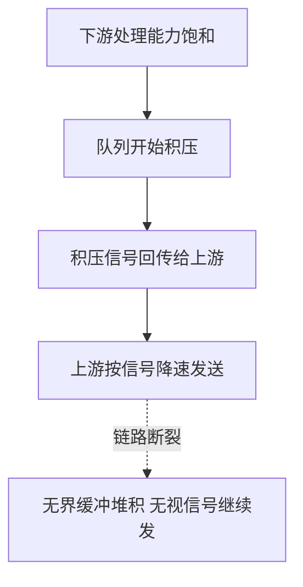
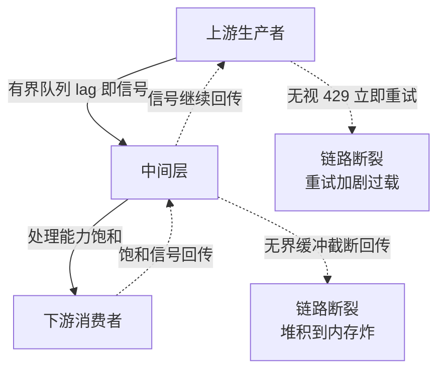

# 背压的传递链路：从下游饱和到上游减速

## 背压要解决的传递与断裂问题是什么？

系统过载时有两个选择：**继续撑下去靠无限缓冲、内存崩溃，或全部丢弃、数据丢失。**背压（backpressure）走的是第三条路：**把下游的饱和状态回传给上游，让上游减速**——**生产者的速度跟住消费者的速度，过载时系统降速运行。**

读完你能画出自己系统的背压链路、标出信号在哪层会断，并知道该在哪一层加减速信号。**要解决的问题是背压的传递机制（饱和信号怎么穿过层层调用链回传）与断裂点（哪层丢了这个信号，过载就变成局部灾难）。**

这是 socket读写缓冲区[[工程知识/后端系统：在并发、失败与变化中维持服务/基础设施/socket读写缓冲区：拥塞窗口与应用层背压的连接点.md]]的应用层续篇，与限流（控制单位时间放进来的请求数量，超过配额就拒绝）熔断（依赖持续报错时暂时不再调用它，直接走失败路径，防止拖垮自己）与隔离[[工程知识/后端系统：在并发、失败与变化中维持服务/任务与并发/限流熔断与隔离控制故障半径.md]]构成过载防御的三项配合：**限流在入口挡住超出配额的请求，熔断把持续报错的依赖路径暂时切断，背压把下游的饱和状态一层层传回上游让它减速。**

## 饱和信号怎么一路传回去：机制

先把形状说成一件事：背压像收银台前的"暂不接单"牌子——顾客即生产者源源不断下单，后厨即消费者做不过来，柜台有三种反作用方式：默默把单子越堆越高即无界缓冲，悄悄扔单即丢弃，以及把"我满了"的信号往上传——门口暂停放人进来即上游减速。信号传得越远、传得越及时，队伍越短、崩得越晚。这个比喻到"往上传"为止——现实里信号要穿过层层中转（线程池、消息队列、跨服务调用），每一层都可能把"减速"私自翻译成"扛住"或"丢弃"，这正是断裂点一节要展开的。

背压**不是**一个开关（占用率一旦超线就全拒绝），它是一条**随占用率（资源被占用的比例，如线程池在用线程数占池大小的比例）连续变化的曲线。资源占用越过预设的占用率分界线后，系统开始拒绝或延迟新请求，占用率越高拒绝得越狠**：

这条曲线解释了为什么**背压在轻载下完全测不出来——阈值以下它不存在**。反过来，一旦越过阈值，**请求开始排队积压，等待时间随负载接近处理上限而加速增长，所以响应时间的上升比负载的上升快得多**。

队列是背压的通用模型：**请求以到达率进入，服务台按处理能力消费，队列长度由两者的差值决定。**图中的 M/M/1 是排队论记号：第一个 M 表示请求到达的时间间隔服从指数分布（随机到来），第二个 M 表示每个请求的处理耗时也服从指数分布，1 表示只有一个服务台。**当到达率持续超过处理率，队列无限增长，等待时延随之发散——这正是下游饱和向上游传导的数学形态。**

*M/M/1 排队系统的状态转移速度图：λ 为到达率，μ 为服务率，队列长度无上限时状态数无限（图源：CSDN 博客）*

*图示：排队系统的到达、排队与服务。背压的本质是**让到达率受服务率约束**。*

**背压的物理层原型**。TCP（传输控制协议，负责把数据完整、有序地送达）的流控是背压的教科书模型：**接收方通告窗口 rwnd 缩小时发送方减速，接收方处理不过来时窗口归零，发送方暂停。这个模型的三个要素（饱和信号显式、传递实时、生产者强制响应）是应用层背压的设计模板。**

**应用层的传递机制**。
- 同步链路：**响应延迟即信号。调用方等响应（阻塞），被调方慢则调用方自然慢（线程被占住），过载沿调用链反向传导。**问题：**线程是昂贵资源，阻塞传导的「减速」以线程耗尽为代价**——连接池（预先建好连接反复取用、省去反复握手建连的开销）耗尽、线程池（预先建好一组线程反复取用、避免频繁创建销毁）满，见连接池 [[工程知识/后端系统：在并发、失败与变化中维持服务/服务设计/连接池的容量数学：池大小与排队等待的权衡.md]]。
- 异步链路：**队列长度即信号。**消息队列（生产者写入、消费者读取的缓冲中间层）的堆积长度是显式信号（消费 lag），**生产者可观测 lag 决定减速（暂停生产、降采样）。**Reactive Streams 的协议（request(n) 信号）把它标准化：**订阅者按消化能力 request，发布者按 request 发送，无 request 不发送——背压成为协议语义而非最佳实践。**
- 跨系统：**显式的限速回传。**下游过载时通过协议头（HTTP 429 + Retry-After、gRPC 的 RESOURCE_EXHAUSTED）告知上游，上游按信号减速（降并发、降采样）。**这要求上游「听得见」：无视 429 的上游把显式信号当错误处理（重试加剧过载）。**

**断裂点：背压在哪断**。常见断裂有三处：**上游无视信号（重试风暴，把减速信号转成更多负载）；中间层无界缓冲（「缓冲解耦」变成「缓冲藏问题」，堆积后内存崩溃或超时雪崩）；边界层无协议（服务间有背压、对外的 API 无信号，外部流量持续涌入）。**断裂的共同点是**某一层把「减速」私自翻译成了「扛住」或「丢弃」**，链路的整体弹性就在这层破产。

下面用同一份下游饱和压力分别走三条典型链路，对照看背压信号各自传到哪一层、又在哪一层断掉：

三种链路的信号载体不同：**同步链路用响应延迟当信号，代价是线程被占用**；**异步链路用队列长度当信号，Reactive Streams 把它写成 request(n) 协议**；**跨系统链路用 429 与 RESOURCE_EXHAUSTED 这类状态码当信号，要求上游认得并响应。每一类都有各自的断裂形态，画在同一张图里才能看出断裂点分布在链路的不同位置。**

图上实线是数据流向下、虚线是饱和信号回传，两个断裂点分别画在中间层与上游：**中间层用无界缓冲把回传路径截断，信号传不上去，上游继续全速生产；上游把回传信号当错误处理，收到 429 仍立即重试，减速信号反而变成更多负载。背压是链路性质，断在任何一层，整链就失去意义。**

**背压与用户路径的权衡**。**系统级减速传导到用户侧是体验损失（页面慢、请求被拒）。**设计决策：**哪些路径允许背压到用户（可降级——主动牺牲部分功能或精度，保住核心链路，后台任务直接降速）、哪些路径必须缓冲或拒绝（用户交互路径宁可明确拒绝不可悬挂）。**这是把过载保护（限流的拒绝语义）与背压（减速语义按路径组合的业务决策）。

## 这套机制从哪来、付什么价：背景与代价

背压一词源于流体力学（管道下游压力回传上游），流控与拥塞控制（TCP 1981+，Jacobson 1988）是工程原型：流控管两端之间的发送速率，拥塞控制管网络整体过载时抑制发送速率，两者的信号都沿路径回传给发送方，这正是背压的原型。应用层背压的标准化是 Reactive Streams（2013-2017，Netflix/Pivotal 等联合规范，Java 的 Flow API 成型）把 request(n) 做成协议。

分布式链路的背压实践（消息队列 lag 控制、429 生态）在微服务潮后普及。Linux 内核的 memcg（内存控制组，把进程分组并限制各组的内存用量，超限时触发回收与压制）与 write-back 背压（2010s）是 OS 层的同类机制。

**Reactive Streams 把背压从「实现细节」升成「协议语义」**。此前的背压靠各框架私约，Netty 用水位（队列或资源的当前占用程度）线，Akka 用 mailbox 限制：mailbox 是 Actor 模型里每个角色接收消息的排队信箱，信箱容量有上限，满了就是背压信号。**互操作时信号丢失。规范定义了四个接口（Publisher/Subscriber/Subscription/Processor）与最小协议（request(n) 与 cancel），任何实现只要遵守协议，背压信号就能跨框架、跨进程传递**（gRPC 侧的 flow control 与应用侧的 RS 协议对接）。**协议化把「层间私约」统一成「公共约定」，背压从每层的最佳实践变成全链路的可组合性质。**代价：**背压的传递要求链路上每一层都「听得见、传得动」——任何一层无界缓冲或无视信号，整链失效**（背压是木桶性质：木桶指整条调用链，短板指链上无视信号或缓冲无上限的那一层，**整链的背压上限由最短的那块板决定**）；**全链路背压的实现成本高（每层要实现信号语义，跨系统要协议支持），多数系统只做部分链路（入口限流 + 关键队列 lag 控制），全链路是理想形态不是默认形态；减速传导到用户是体验代价，过载时的用户路径策略——拒绝、降级（服务受限时主动放弃部分功能保住核心）、排队——要业务参与决策**，见 [[工程知识/后端系统：在并发、失败与变化中维持服务/服务设计/服务降级是有损服务，损什么损多少要变成业务决策.md]]，**纯技术不能替业务定损。**

## 背压不是万能的：它的边界在哪儿

- **背压是链路性质，实现要逐层检查**。上线前**画链路图逐层标注：这层有信号吗（队列长度、池利用率）？响应信号吗（减速或拒绝）？信号传给上游吗？标注不出的层就是断裂点。**
- **无界缓冲比直接失败更危险**。**堆积掩盖过载（延迟上升但系统「看起来正常」），堆积到内存极限时雪崩（一处故障沿依赖链放大成级联失效）更猛。队列大小一律有界，满时的行为显式设计（拒绝或降速）。**
- **429/RESOURCE_EXHAUSTED 的客户端动作要有统一实现**。**服务端发出信号只完成了一半，客户端按 Retry-After 减速、按信号降低并发，这件事才算完成。**调用方的共享 SDK（软件开发工具包）统一实现退避逻辑（指数退避 + 抖动），**跨团队的步调一致由公共库保证。**
- **背压不替代限流，两者分工**。**限流是入口的硬保护（过量直接拒），背压是链路的软调节（传导减速）。只有限流：过载阈值内的链路问题无人传导；只有背压：突发洪峰直接冲进系统。组合才是完整防御。**

*图源：bryangilbert.com《akka-stream: Akka's reactive stream implementation》（Reactive Streams 背压示意，2015）。数据向下、需求向上是背压链路的空间结构；需求信号即 Reactive Streams 协议的 request(n)——消费者每次最多承诺 n 个元素的处理能力，发布者发出量永远不超过累计需求，消费者主权体现在它决定 n。*
## 信号链路通不通怎么验证：验证

- **全链路过载演练**：下游注入慢（μ 拉长，μ 指平均处理耗时，拉长即人为把下游每步处理变慢），观测上游传导。**预期：有背压链路上游吞吐自动下降（生产减速），无背压链路（中间无界缓冲）堆积到内存告警。**传导与断裂的对照证据。
- **429 响应实验**：上游客户端在收到 429 后的行为观测（带退避的 SDK vs 无礼客户端）。**预期：带退避 SDK 的重试间隔按 Retry-After 拉长，无礼客户端立即重试加剧过载。**信号礼仪的差异实证。
- **队列 lag 控制实验**：消费 lag 超阈值触发生产降速，观测 lag 曲线。**预期：降速后 lag 从发散转为收敛（背压生效的动态证据）。**

## 接着读哪几篇：背压的传输层原型

- [[工程知识/后端系统：在并发、失败与变化中维持服务/基础设施/socket读写缓冲区：拥塞窗口与应用层背压的连接点.md]] —— 背压的传输层原型
- [[工程知识/后端系统：在并发、失败与变化中维持服务/服务设计/连接池的容量数学：池大小与排队等待的权衡.md]] —— 池耗尽的减速传导
- [[工程知识/后端系统：在并发、失败与变化中维持服务/任务与并发/限流熔断与隔离控制故障半径.md]] —— 过载防御三项配合的分工
- [[工程知识/后端系统：在并发、失败与变化中维持服务/服务设计/健康检查的三层语义：存活就绪与深度.md]] —— 过载防御的链路视角
- [[工程知识/后端系统：在并发、失败与变化中维持服务/服务设计/分布式限流的四种算法：计数漏桶令牌与滑动窗口.md]] —— 拒绝与减速的两种响应
- [[工程知识/软件构建：让变化可以理解、验证与交付/架构与代码/错误处理的分类学：错误类型与恢复策略的映射.md]] —— 429 是瞬态错误标准信号，分类先于恢复动作