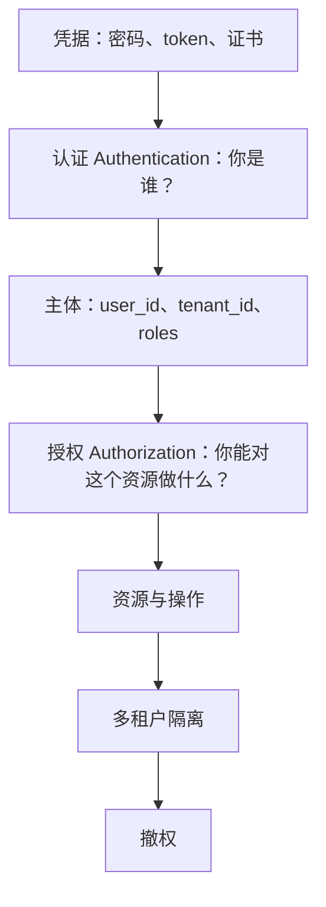
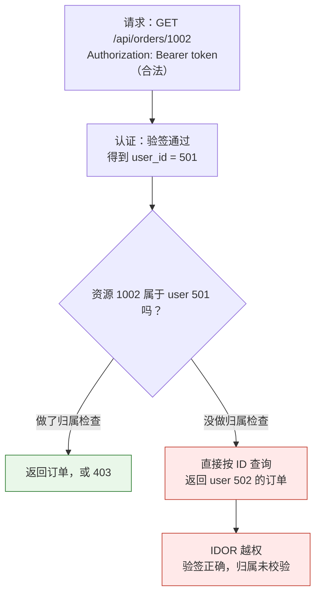
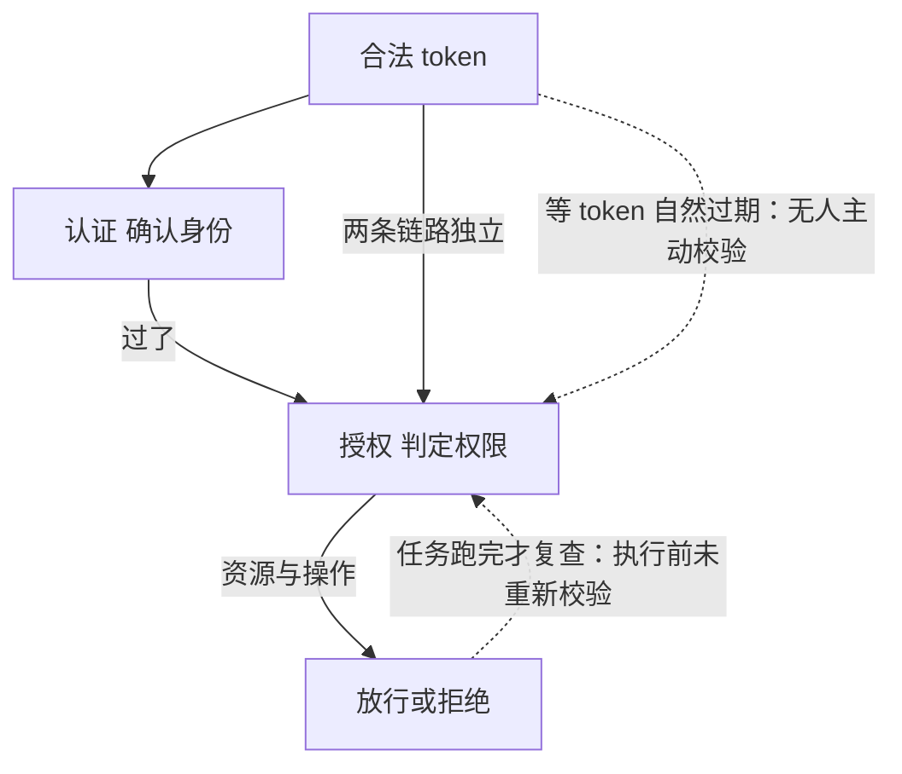

# 认证授权决定请求能看什么和做什么

**认证（Authentication）** 回答"请求代表谁"。**授权（Authorization）** 回答"这个主体能对哪个资源做什么"。读完你能分清一次越权是认证漏了还是授权漏了，并检查出多租户（多个客户共用同一套系统，各自的数据必须互相隔离）场景里**最容易漏的归属判断**。

两者完全独立，**但最常见的严重漏洞就是把认证当成授权**：token 验签通过了，就认为这个人能访问他请求的一切。

这个混淆造成的漏洞有专门的名字：**IDOR（Insecure Direct Object Reference，不安全的直接对象引用）**——把 URL 里的资源 ID 换成别人的，就能读到别人的数据。它长期排在 OWASP API 安全风险（OWASP 即开放 Web 应用安全项目）的第一位，原因正是**"验签做得很好，归属校验完全没做"**。

这一页把认证和授权彻底分开：**认证要校验哪些字段、授权有哪几种模型、多租户隔离怎么做到不漏、以及撤权为什么最难**。

## 主体身份确认要解决的问题：身份由哪些机制确认？

请求从发到收，中间要经过若干设备与若干层。认证授权要卡的，就是这条路上的具体位置。

请求到达服务端之后，系统面对**两个独立的问题**：这个请求代表谁（身份未确认）、这个身份有没有权对目标资源执行该操作（权限未判定）。两个问题混在一起实现时会**同时出现越权与误拒**：混写时为了不漏掉判断往往放行了无权限的请求（越权），为了不误放行又常拒绝了合法请求（误拒），两种相反的故障同时发生。本篇回答：要解决的问题分成五个——确认主体身份由哪些机制完成、判定操作权限依据什么、权限与资源的关系怎样表达、鉴权失败与鉴权缺失的返回为什么要区分（一个返回 403、一个返回 404 的原因），以及授权变更之后已发出的凭据怎样失效。

## 这件事发生在什么场景：合法 token，越权访问

信任是有层级的。证书（CA 签发的公钥凭证、证明持有者身份）是用来证明身份的凭证：根证书是大家都信任的源头，由它签发中间证书，中间证书再签发叶子证书，验证时从叶子一路回溯到可信根。这条链决定了**"谁能证明身份"**——认证回答的就是链上哪一环签发了这个凭证。

先看一个 SaaS 系统的接口出事的经过，案发形态是：

```
GET /api/tenants/{tenant_id}/invoices/{invoice_id}
Authorization: Bearer <合法 token>
```

某次渗透测试发现：**把 `tenant_id` 和 `invoice_id` 换成别家的，照样返回数据。**

排查这类代码缺陷时按下面的顺序检查：

```go
func GetInvoice(w, r) {
    claims := verifyJWT(r)                          // ✅ 验签通过
    if claims.UserID == "" {                        // ✅ 确认是登录用户
        return 401
    }
    invoice := db.GetInvoice(r.PathValue("invoice_id"))   // ❌ 没有校验归属！
    return json(invoice)
}
```

**这个接口的认证完全正确，授权完全没有。**

与这个案例同类的越权手法还有几种：

| 手法 | 后果 |
| --- | --- |
| 改 URL 里的 ID | 读到别人的数据（**IDOR**，最常见的 API 漏洞） |
| 改 `tenant_id` | 跨租户访问 |
| 用低权限账号调高权限接口 | 权限提升 |
| 让 Agent（能自主调用工具完成任务的程序）组合"搜索 + 导出"工具 | 用两个合法权限导出全部数据 |

**共同点：token 是合法的，请求是"认证通过"的，但资源级授权从未执行。**

## 从零开始该怎么理解：两条独立的链路

先用一个比喻建立整体形状：认证与授权像进写字楼要过的两道门禁——**认证是前台核工牌（你是谁，假工牌当场拦下）；授权是楼层闸机读卡分区（你有工牌不代表能进 42 层机房）**。两条链路各自出故障：**工牌是假的是认证问题（token 伪造）；工牌是真的但刷卡进了不该进的楼层是授权问题（越权访问）**。后者更隐蔽——**门禁日志里是一次完全合法的开门**。这个比喻到「合法的开门」为止——现实里两条链路各自的机制与故障，下面分节展开。



**关键认知：认证是授权的输入，不是结论。**

IDOR 之所以发生，正是**因为这条链被从中间截断**：认证产出主体之后，请求里自带的资源 ID 被直接用于查询，**中间那道归属检查根本不在链路上**。



**两条路径的差别只在"资源归属 user 501 吗"这一问**：问了就走到绿色分支，不问就落到红色分支。OWASP 把 IDOR 长期列为 API 风险首位，原因正在于**验签这类认证工作通常做得很完整，而归属校验这一问从来没被提出**。

### 认证验的是什么

对 JWT（JSON Web Token，服务端签名、请求方随身携带的令牌格式）来说，令牌本身可能过期、被篡改或拿错了人，所以**必须校验全部五项**：

| 校验项 | 不校验的后果 |
| --- | --- |
| **签名** | 任何人可以伪造 token |
| **issuer（iss）** | 别的系统的 token 也能用 |
| **audience（aud）** | 给服务 A 的 token 能调服务 B |
| **过期时间（exp）** | 泄露的 token 永久有效 |
| **scope** | 只该读的 token 能写 |

**最危险的错误：只 base64 解码 payload 而不验签。**

```go
// ❌ 只解码，不验签 —— 任何人可以伪造
payload, _ := base64.Decode(token)
userID := payload["sub"]

// ✅ 验签 + 校验全部字段
token, err := jwt.Parse(tokenStr, keyFunc,
    jwt.WithIssuer("https://auth.example.com"),
    jwt.WithAudience("api.example.com"),
    jwt.WithExpirationRequired(),
)
```

  **JWT 的 payload 是明文可读的**（base64 做的是编码，不含加密）。敏感信息不应该放进去，能解码出 user_id 也不构成信任它的理由。工作证的外壳是明文的（payload 可读），里面写了"总经理"不等于他真是——**真伪看的是工会钢印（签名），不是卡片上印的字**；把身份证号直接印在卡片外壳上（敏感信息放进 payload），掉一次卡就泄一次密。

认证这一步的令牌从哪来？主流做法是 OAuth（第三方授权协议、不交密码也能授权访问资源） 2.0 授权代码流（authorization code flow）——业界标准授权框架里最安全的取令牌方式：前端只拿到一次性换码，真正的令牌在服务端换取，不经过前端页面。下面这张官方时序图，给出了应用与 Web API 之间取令牌、换令牌、调接口的完整交互：


*图：Microsoft identity platform 官方授权代码流时序图（Microsoft Learn，CC BY 4.0）。Native App 到 /authorize 拿授权码、到 /token 换 access token 与 refresh token，之后每次调用 Web API 都在 Authorization 头里带上 access token，Web API 侧做 Validates token（校验令牌：核对签发方、受众、有效期、权限范围与签名）；橙色区标出 token 过期点，过期后用 refresh token 换新令牌——五项校验（iss/aud/exp/scope/签名）核对的就是 /token 端点发出的这张令牌。*

*图源：Microsoft Learn《微软身份平台和 OAuth 2.0 授权代码流》官方中文文档，CC BY 4.0，https://learn.microsoft.com/zh-cn/entra/identity-platform/v2-oauth2-auth-code-flow。*

注意图中的分界：**用户身份验证发生在授权服务器一侧，应用自始至终拿不到密码，只经手授权码与令牌**。五项校验针对的正是图里最后发出去的那张 access token——**它由谁签发（iss）、发给谁（aud）、何时过期（exp），全部写在令牌里，验证方逐项核对之后才能进入下一步授权判断**。

授权服务器一侧的两块界面把「身份验证与授权决定」的现场拍了下来：Login 页用户提交凭证，Consent 页用户逐项勾选允许应用访问的 claim（email 勾选允许、profile 勾选拒绝）——**scope 的最终决定权在用户手里**，签出来的 access token 只带被允许的部分。这是上一张时序图里 /authorize 端点背后发生的事：


*图源：Connect2id《Learn about OpenID Connect》，https://connect2id.com/learn/openid-connect。*

### 授权有哪三种模型

**ACL**（Access Control List，访问控制列表：逐条列出谁可以对资源做什么）是另一种常见形态，它把允许访问的名单直接挂在资源上：它把清单挂在**资源**上，**适合文档共享、消息主题这类「这个资源允许谁」的场景**，见 [[工程知识/后端系统：在并发、失败与变化中维持服务/服务设计/ACL 把权限挂在资源上]]。以下三种是按主体侧组织的模型。


| 模型 | 做法 | 适用 |
| --- | --- | --- |
| **RBAC（Role-Based Access Control，按角色分配权限的模型）**（角色） | 用户 → 角色 → 权限 | 权限结构稳定的系统 |
| **ABAC（Attribute-Based Access Control，按属性条件判定权限的模型）**（属性） | 根据属性（部门、时间、资源标签）判断 | 需要细粒度、动态规则 |
| **ReBAC**（关系） | 根据资源关系图判断（"文档的协作者"） | 有复杂共享关系的（如 Google Docs） |

以“只有订单的所属者能查看订单”这个需求为例，对比两种实现。

```
需求：只有订单的所属者能查看订单

RBAC:  给"买家"角色加"查看订单"权限 → ❌ 那样能看所有订单
ABAC:  规则 = "user.id == order.buyer_id" → ✅
ReBAC: 检查 user 与 order 是否有 "owner" 关系 → ✅
```

**结论：RBAC 表达不了"这个资源的拥有者"这类关系。** 涉及资源归属的，**必须用 ABAC 或 ReBAC，或者在代码里显式检查归属**。

### 为什么资源级归属检查最常见

大多数业务的授权逻辑其实很简单，**只围着三样东西转：谁（主体）、对什么（资源）、能做什么（操作）**。下面这段代码就是把三样东西写成一次查询条件。小区访客登记是这三样东西的日常版：谁（访客身份）、进哪户（资源）、送东西还是维修（操作）——保安核对的是"这位访客是不是这户业主报备的那个人"，拿着 A 栋的登记条进 B 栋（改 URL 里的 ID），**门岗在查询时就要拦下，而不是放进楼后再打电话确认（查出来再判断）**：

```go
func GetInvoice(ctx, userID, invoiceID string) (*Invoice, error) {
    // 查询时就带上归属条件，而不是查出来再判断
    invoice, err := db.QueryRow(
        `SELECT * FROM invoices WHERE id = ? AND tenant_id = ?`,
        invoiceID, tenantOf(userID),           // ← 关键：条件里带租户
    )
    if err == sql.ErrNoRows {
        return nil, ErrNotFound                // 不区分"不存在"和"无权限"
    }
    return invoice, nil
}
```

对象级授权有三个要点，贯穿查询构造与错误响应。

1. **把归属条件写进 SQL 的 WHERE**，而不是查出来再 `if` 判断（后者容易漏）
2. **"无权限"返回 404 而不是 403** —— 否则会泄漏"这个 ID 存在"的信息（可以枚举）
3. **每一条涉及资源的查询都要带** —— 漏一条就是漏洞

## 多租户最容易在哪里出事

**多租户的数据隔离必须是每次查询的约束，不能依赖 UI（User Interface，用户界面）或上层逻辑。**

| 做法 | 可靠性 |
| --- | --- |
| 每条 SQL 都带 `tenant_id` 条件 | 中（靠人记得写） |
| **行级安全（Row Level Security）** | **高（数据库强制）** |
| 每个租户一个 schema/库 | 高（物理隔离，成本高） |
| 中间件自动注入 `tenant_id` | 中高（要确保覆盖所有查询） |

**PostgreSQL（开源关系型数据库）的行级安全**是最省心的方案：

```sql
ALTER TABLE invoices ENABLE ROW LEVEL SECURITY;

CREATE POLICY tenant_isolation ON invoices
    USING (tenant_id = current_setting('app.current_tenant')::uuid);
```

**这样即使业务代码忘了写条件，数据库也不会返回别家的数据。** 多一层兜底。

隔离级别（并发事务互相可见程度的分级）的选择落在一条谱系上：**所有租户共享一张库靠行级条件约束，或每个租户独占一个库靠物理边界约束**。Microsoft Azure（微软的云服务平台）架构中心把两种形态都画了出来——共享库里租户 A、B、C 的数据同表混存，隔离完全交给行级安全（数据库按行判断访问者有没有权限，通常用策略或视图实现）；独立库里每个租户一个专属数据库，应用共享而数据物理隔离：


*图：Microsoft Learn《多租户解决方案中存储和数据的体系结构方法》官方中文文档，CC BY 4.0。*


*图源：Microsoft Learn 官方中文文档，CC BY 4.0，https://learn.microsoft.com/zh-cn/azure/architecture/guide/multitenant/approaches/storage-data。*

多租户隔离要**延伸到缓存与向量检索（按语义相似度从资料库找出相关内容的检索方式）这两处容易漏的地方**。

- **缓存键必须包含 tenant_id** —— 否则 A 租户查到 B 租户的缓存
- **向量检索必须过滤租户** —— RAG（检索增强生成：先从资料库里找出相关片段，再让模型照着这些片段回答）场景下，检索出别的租户的文档是严重事故
- **导出/搜索接口** —— 分页、聚合查询同样要带条件

## 服务间调用怎么出「糊涂代理人」问题：confused deputy

**场景**：服务 A 代表用户调用服务 B。B 该按谁的身份授权？跑腿代办是现成的场景：你委托中介（服务 A）去政务大厅（服务 B）办事，大厅只认"中介是正规机构"（B 只校验 A 的服务身份）——中介柜台上随便哪个客户递来的单子都能办（取决于 A 传的参数），**代办机构自己反而成了漏洞**；正确做法是**每单都带着委托人的身份证件与授权书（传递用户上下文）**，大厅核的是"这位委托人本人能不能办这件事"（B 侧重新授权）。

```
用户 → A（代表用户）→ B

问题：B 看到的是 A 的服务身份，还是用户身份？
```

**如果 B 只校验"A 是合法服务"** → 用户 A 能不能访问某个资源，取决于 A 传给 B 的参数。**A 就成了 confused deputy（被利用的代理人）**：

```
用户在 A 上只能看自己的数据
  → 但 A 用服务身份调 B，B 信任 A
  → 如果 A 没有正确传递用户上下文，B 会返回所有数据
```

跨服务调用的正确做法是保持用户上下文不变：**传递用户上下文，B 侧重新授权**。

OAuth 2.0 的 token exchange（令牌交换）**把这条原则做成了标准协议流程（不再靠各家自己约定）**，官方流程图把「代表谁」这件事画成显式步骤：委托方拿自己的凭证加上主体（用户）标识，向授权服务器换取一张降权后的 on-behalf-of 令牌，**下游 API 收到的令牌同时带链上两方身份**：


*图源：Microsoft Learn《OAuth 2.0 On-Behalf-Of flow》官方流程图，CC BY 4.0，https://learn.microsoft.com/zh-cn/entra/identity-platform/v2-oauth2-on-behalf-of-flow。B 侧验证的令牌同时编码了 A 的服务身份与用户身份，「信任 A」与「按用户授权」在一张令牌里分开可辨——糊涂代理人问题的协议化解法就是让代理关系显式出现在凭据里。*

1. **传递用户上下文**（token exchange、用户 token 透传）
2. **B 侧重新授权**（不因为"A 是可信服务"就跳过检查）
3. **明确标注**：这次调用代表用户，还是代表服务自身（如定时任务）

## 撤权为什么最容易漏

**用户被移出项目后，他的访问权限应该在多久内失效？**

| 位置 | 撤权滞后 |
| --- | --- |
| token 有效期 24 小时 | 最坏情况 24 小时内仍可访问 |
| 缓存的权限判断 5 分钟 | 可能多 5 分钟 |
| 搜索索引里还有数据 | 可能一直能搜到 |
| 已下发给 Agent 的工具权限 | 任务跑完前一直有效 |

**撤权必须覆盖的传播路径**是下面几条：



撤权像收回一把钥匙，但**权限在 token、缓存、索引、在途任务四处各留了一份副本**，必须每处都主动收回，任何一处漏收，旧钥匙仍然能开门（比喻只到「每处都要主动失效」为止，各处失效速度差异见下）。**四处位置的撤权滞后不在同一个量级**：token 层受剩余寿命约束，缓存层受事件传播时间约束，索引层要做到零滞后必须靠查询时实时过滤，在途任务层则靠在执行前重新校验权限。图中两条虚线旁路（token 不重验直接自然过期、任务跑完才复查权限）**是最容易被放过的地方，这两处的风险窗口远长于其余位置**。

| 位置 | 做法 |
| --- | --- |
| Token | **短有效期 + refresh token**，撤权时让 refresh 失效 |
| 权限缓存 | 主动失效（事件驱动）而不是等 TTL（Time To Live，存活时间：到期后自动失效或删除） |
| 搜索/向量索引 | 查询时**实时过滤**，不依赖索引里的副本 |
| 进行中的任务 | 执行前重新校验权限 |

**关键**：**不要依赖"TTL到了自然失效"** —— **撤权要主动传播**。

授权边界要与越权测试对账——**水平越权（A 的 token 访问 B 的资源）与垂直越权（普通用户访问管理接口）各写一组自动化用例进回归**，每个接口的 401/403 行为与权限矩阵对账，对不上的接口要么补校验要么改矩阵声明。

## 这类问题怎么测

**测试必须构造的攻击用例**是这几类：

```yaml
- name: 跨租户 ID 替换
  action: 用租户 A 的 token 请求租户 B 的资源 ID
  assert: 返回 404（不是 200，也不是 403）

- name: 资源枚举
  action: 遍历 ID 空间
  assert: 只能拿到自己有权限的，且无法判断哪些 ID 存在

- name: 过期 token
  action: 用已过期的 token
  assert: 401

- name: 签名篡改
  action: 改 payload 里的 user_id，不重签
  assert: 401

- name: audience 错配
  action: 用给服务 A 的 token 调服务 B
  assert: 401

- name: scope 缩小
  action: 用只有 read scope 的 token 执行写操作
  assert: 403

- name: 撤权传播
  action: 移除用户权限后立即用旧 token 访问
  assert: 在可接受的时间内被拒绝

- name: RAG 越权
  action: 用户提问，检索可能命中其他租户的文档
  assert: 检索结果里没有别的租户的文档

- name: Agent 工具组合
  action: 让 Agent 先"搜索全部"再"导出"
  assert: 组合后的效果不超过用户权限
```

**断言必须是实际数据和副作用（操作对外部状态产生的额外影响）**，不是"返回了 authorized"。消防验收同款：验收员不看墙上的疏散示意图（"返回了 authorized"），**是真的点烟饼、掐秒表、看人有没有从安全门出来（实际数据和副作用）——示意图画得再标准，通道锁着就是不合格**。

## 哪些认识一看就错

**错误 1：验签通过就认为有权限**

前面那个 IDOR 案例。**认证 ≠ 授权。**

**错误 2：只 base64 解码不验签**

JWT payload 是明文，谁都能伪造。**必须验签 + 校验 iss/aud/exp/scope。**

**错误 3：在客户端（UI）做权限判断**

UI 隐藏按钮 ≠ 接口拒绝。**服务端必须重新判定。**

**错误 4：查出来再判断归属**

容易漏。**把归属条件写进 SQL WHERE。**

**错误 5：无权限返回 403**

泄漏"资源存在"的信息。**返回 404。**

**错误 6：多租户靠人记得写条件**

漏写一条就是漏洞。**用行级安全或自动注入做兜底。**

**错误 7：撤权等 TTL 过期**

最坏情况能访问几小时到几天。**主动失效。**

**错误 8：RAG/搜索忘了过滤租户**

检索出别人的文档是最严重的多租户事故。**查询时实时过滤。**

关系：[[工程知识/AI 系统工程：从模型能力到生产能力/安全与治理/提示注入和工具越权是不同威胁]] · [[工程知识/AI 系统工程：从模型能力到生产能力/知识与检索/RAG数据管道从文档到可引用证据]] · [[工程知识/AI 系统工程：从模型能力到生产能力/Agent与工作流/工具是受约束的能力，不是提示词里的函数名]]

## 效果从哪来、要付什么代价

把身份确认与权限判定分开实现，**换来的是资源归属在查询条件下就被约束，越权请求返回与资源不存在相同的响应，多租户隔离由数据库或注入规则兜底**。代价是**每条查询都要带上归属条件，权限变更需要沿凭据、缓存、索引与在途任务逐条传播，服务间调用还要把用户上下文显式传递并重新授权**。

关系：[[工程知识/缺陷分析：从个案到体系/安全/最小权限把爆炸半径变成设计输入：从能力枚举到撤权闭环]] —— 授权模型的判定结果怎样收窄成可审计的能力集，撤权传播在这里展开成四步闭环。