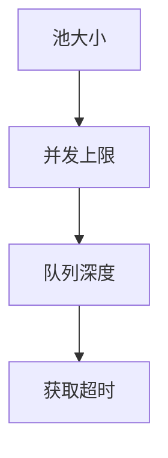
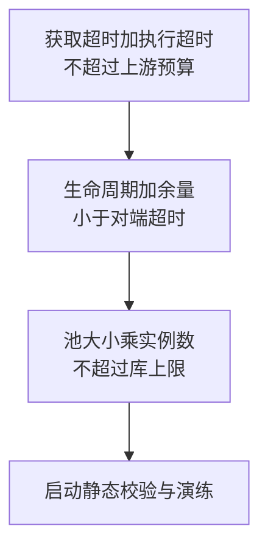
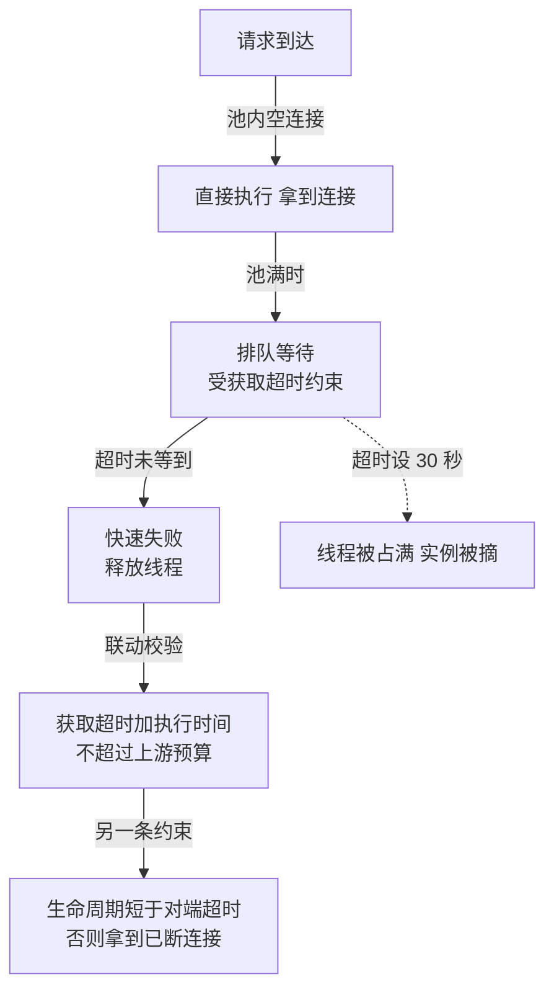

# 连接池参数的联动校验：池大小、超时与队列深度是一组约束

> **要点**：连接池的池大小、获取超时、连接最大生命周期三个参数各管一段排队论（研究请求排队等待规律的学问：请求到达、排队、被服务台处理的整个过程），单独调任何一个都会把问题挤到另一段——三者的合法组合是联动约束，配置校验要在启动时把矛盾组合拦下来。

## 参数调优的高频失误长什么样？



来源：[米诺之家《池化技术》](https://www.iminho.me/wiki/docs/note-architect/note-architect-1f7cll3q657or)（署名）

**先把结论摆出来：三个参数是一组相互约束的量，不是各自独立的旋钮**


连接池的参数调优有一类高频失误：**参数单独看都合理，合起来互相冲突**。形态一：池大小按 CPU 核数算（合理），获取超时设 30 秒（单独看合理），下游数据库抖动（性能指标不稳定的起伏） 10 秒——300 个请求线程各持一个"获取中"的空转等 30 秒，线程池（预先建好一组线程反复取用、避免频繁创建销毁）被占满后，健康检查同样需要从池里拿连接，拿不到而超时，运维系统据此判定实例不健康，把实例摘掉流量，**一次 10 秒的下游抖动放大成全面故障**。

形态二：连接最大生命周期设了 4 小时，数据库侧的空闲连接超时是 1 小时——应用池里的连接被数据库悄悄断掉，应用拿到已失效的连接报通讯错误，重试又拿到另一条失效连接，**故障在两个参数的夹缝里周期性出现**。本库后端域"连接池的容量数学"已解决"池多大"的推导；本篇要解决的问题就是这另一半：**参数之间的联动约束——合法组合的校验规则，以及矛盾组合各自的故障形态**。读完你能**用启动时的联动校验拦下这些矛盾组合，并对照每种组合的故障形态定位问题**。

## 三个参数怎么联动：各管一段排队系统


来源：[米诺之家《池化技术》池化资源分配顺序一图](https://www.iminho.me/wiki/docs/note-architect/note-architect-1f7cll3q657or)（署名）

连接池本质上是一段排队系统（请求排队等连接的过程），**三个参数分别控制排队过程的不同段落**：

**池大小管并发容量**：同时有多少请求能真正到达数据库。池太小，并发被池卡住（排队在池外，等待获取连接）；池太大，数据库被压垮（排队在数据库内，锁等待、连接数上限）。容量数学给出静态推导，这里的重点是**池大小决定"获取连接"这段等待的基线时长**。

连接调度的实物原型是电话总机：话务员面前插满线孔的面板就是池，接线绳的数量就是池大小，每通电话要等一根空闲线绳——线绳全忙时总机前的等待队列以分钟计，接线员按"先来先接、超时转接"的规矩调度。池大小、队列深度、获取超时在总机上是同一条面板上的三样东西，**谁也离不开谁单独工作**（这个比喻只讲三个参数在应用侧的耦合；数据库侧的超时是面板之外、需要单独跨系统约定的事）：


*图源：Wikimedia Commons，美国国家档案与记录管理局（NARA），公有领域，https://commons.wikimedia.org/wiki/File:Photograph_of_Women_Working_at_a_Bell_System_Telephone_Switchboard_-_NARA_-_1633445.jpg。*

**获取超时管故障的扩散半径**：等不到连接时等多久放弃。超时长，故障被"捂住"——上游线程被长时间占用，故障从数据库层扩散到应用线程池再到整个实例；超时短，故障被"释放"——请求快速失败，重试或降级（主动牺牲部分功能或精度，保住核心链路）接手。**这一个参数调的就是故障扩散速度**，它必须与上游的超时预算联动（获取超时 + 执行超时 < 上游整链路预算），**独立设置必然出事**。

**最大生命周期管连接的新鲜度**：连接用多久强制换新。它与**对端（连接的另一头，指数据库一方）的空闲/最大连接超时**构成联动——应用侧的生命周期必须短于对端的超时，否则对端在应用不知情时先动手（静默断开空闲连接），应用复用这条已断开的连接才报通讯错误。**生命周期参数是跨系统约定**，单边设置等于把对端的超时当成"未知风险"。

**校验规则按三段联合起来检查**：获取超时 + 执行超时 ≤ 上游预算的某个比例；生命周期 + 安全余量 < 对端超时；池大小 × 实例数 ≤ 数据库连接上限的合理份额。**每条规则跨了两个参数（或跨了系统边界），任何单参数视角的调优都无法发现违规**。

对照看三条约束各自被破坏时的故障形态——故障出现在什么位置、长什么样：



**三条约束的病象位置各不相同**：第一条在超时预算里，故障表现为一次下游抖动放大成实例摘除；第二条跨到对端系统，故障要等连接老化才出现；第三条跨到部署形态，单实例视角算不出问题。**三条都不会在启动时报错，要靠启动静态校验、抖动演练与部署取数三处分别拦住**。



**三段排队各由一个参数看住**：池大小决定「有多少请求能同时到达数据库」，获取超时决定「等不到时多久放弃」（放弃得快，故障就停在连接池内；放弃得慢，等待蔓延到上游线程池），生命周期决定「连接多久换新」。**联动校验是这张图的关键**——获取超时加执行时间不能超过上游预算，生命周期必须短于对端超时，池大小乘实例数不能超过数据库连接上限。**任何一条被破坏都不会在启动时报错，只会在第一次下游抖动或连接老化时变成事故**。

## 矛盾组合为什么到线上才炸：启动时不可见的原因

**矛盾要在负载下才暴露**，因为三个参数各自是否够用，取决于当时流量有多大（流量小谁都不缺、流量大谁先崩由组合决定），也就是**矛盾随负载变化**。**队列深度持续增长是第一个可见信号**——它说明消费能力已经跟不上生产速度：

池大小、超时与队列深度三个参数各自单独看都合理，但**它们共同决定同一条排队链路**（请求从进入等待队列、到拿到连接、到放弃等待的整条路径）。启动时没有流量，这条链路上空无一人，**三者之间谁也约束不到谁**：

矛盾组合为什么能一路带到线上？因为**校验时机错位**：

**配置校验按参数各查各的**：常规配置校验查单参数的合法范围（超时是正数、池大小是正整数），**跨参数关系没有检查项——矛盾组合全部通过校验**。

**故障延迟到运行时**：生命周期与对端超时的矛盾要等连接老到那个年龄才爆发（可能数小时后）；获取超时与下游抖动的矛盾要等第一次抖动——**启动时的全绿不代表运行时的正确**，**联动校验必须在启动时静态做**（配置层面可判的），动态可判的进健康检查。

**参数的"合理值"手册各写各的**：池大小的推荐文章讲池大小，超时的推荐文章讲超时——**调优知识按参数组织而不是按约束组织**，**照着各篇调出来的组合天然缺乏联动审视**。

## 矛盾组合怎么提前拦下：修复与防线

**启动时联动校验**：连接池初始化时执行约束检查——获取超时 + 最大执行时间与上游超时预算比对、生命周期与对端超时比对、总连接数与数据库上限比对，**违规即拒绝启动**（fail-fast，本库缺陷分析域的既定纪律）。检查逻辑进连接池的封装层（统一管理连接创建与获取的那一层代码），**全项目共享**。

**对端超时的显式约定**：数据库的空闲超时、代理的最大连接时长是连接池配置的**输入**——把它们查清楚写进配置注释（"对端 wait_timeout=3600s，故 maxLifetime=1800s"），**跨系统约定显式化，后人改参数时看得见依据**。

**抖动演练校验超时预算**：在预发环境（上线前的演练环境，配置贴近线上但不服务真实用户）**注入下游延迟（10 秒级），观察应用线程池与健康检查的反应**——**超时参数的组合是否正确，演练给出的答案是运行时监控给不出的**（监控看到的是已经扩散后的结果）。

**监控按排队段分列**：获取等待时长、执行时长、连接年龄分布三个指标分列监控——故障发生时按"哪段排队异常"直接定位到对应参数，**排查不再从全部参数重新猜起**。

## 这套校验管不到什么：边界

这条防线有三条边界要守住，防止防线本身走形。

**约束值不是全局常量**：不同业务的上游预算不同（同步接口 3 秒、异步任务 30 秒），**连接池约束按用途分级配置**——一套全局值必然对某些用途过紧、某些过松。

**池外并发也要算进容量**：多个实例共享一个数据库时，**"池大小 × 实例数"才是数据库侧的真实并发**——单实例视角的池大小推导在多实例部署下要重新按总量核对，约束检查按部署形态取数。

**连接池不是万能缓冲**：池的队列只是排队系统的第一段，上游的线程池、消息队列（生产者写入、消费者读取的缓冲中间层）各自是更上游的段——**排队链的每段预算相加才是整链路延迟，任何一段的超预算都会把等待挤压到别的段**。排队论给的是全链模型，连接池只是其中一段。

## 联动校验怎么验证：验证

要验证这套联动校验是否生效，按下面的步骤在预发环境完整复现一遍：

1. 静态校验验证：配置矛盾组合（生命周期 > 对端超时），启动应被联动校验拒绝并指出冲突项；
2. 演练验证：预发注入下游 10 秒延迟，确认获取超时按预算快速失败、线程池不占满、健康检查存活；
3. 老化验证：把生命周期临时调到超过对端超时（测试环境），确认通讯错误周期出现；恢复正确配置后错误消失——验证"生命周期 < 对端超时"约束的真实性；
4. 断言锚点：**联动校验在连接池封装层常驻；三个排队段指标分列；对端超时数值在配置注释中可查**。

```text
启动断言 = 矛盾组合拒绝启动并指出冲突
演练断言 = 注入延迟后快速失败，实例不被摘
老化断言 = 生命周期 + 余量 < 对端超时成立
```

**三个参数、三段排队、三条跨参数约束**——联动校验把"各查各的"配置升级为"合起来自洽"的配置，连接池的故障形态从"参数夹缝里的偶发"收敛为"可推导、可演练、可拦截"。验证时预期与实际的对照规则提前写明：**矛盾组合预期在启动时被拒绝并指出冲突项**，对不上（照常启动）即联动校验未覆盖该约束；注入下游延迟后预期获取快速失败、线程池不占满、实例不被摘，对不上（请求堆积、实例下线）即超时预算组合仍不成立，回到预算算式重推。

## 接着读哪几篇：池大小的静态推导

- [[工程知识/后端系统：在并发、失败与变化中维持服务/服务设计/连接池的容量数学：池大小与排队等待的权衡]] —— 池大小的静态推导，本篇补跨参数约束
- [[工程知识/后端系统：在并发、失败与变化中维持服务/分布式可靠性/超时的层次设计：连接、读写与整链路的预算分配]] —— 超时预算联动的总纲
- [[工程知识/后端系统：在并发、失败与变化中维持服务/服务设计/容量估算的通用骨架：从峰值QPS到机器数的推导演练]] —— 排队系统的全链视角
- [[工程知识/性能工程：从用户等待到资源瓶颈/观测与诊断/tcpdump与抓包定位网络问题的现场方法]] —— 连接类故障的现场定位方法
- [[工程知识/性能工程：从用户等待到资源瓶颈/存储与网络/TIME_WAIT是连接收尾的代价与设计]] —— 连接生命周期参数的机制背景
