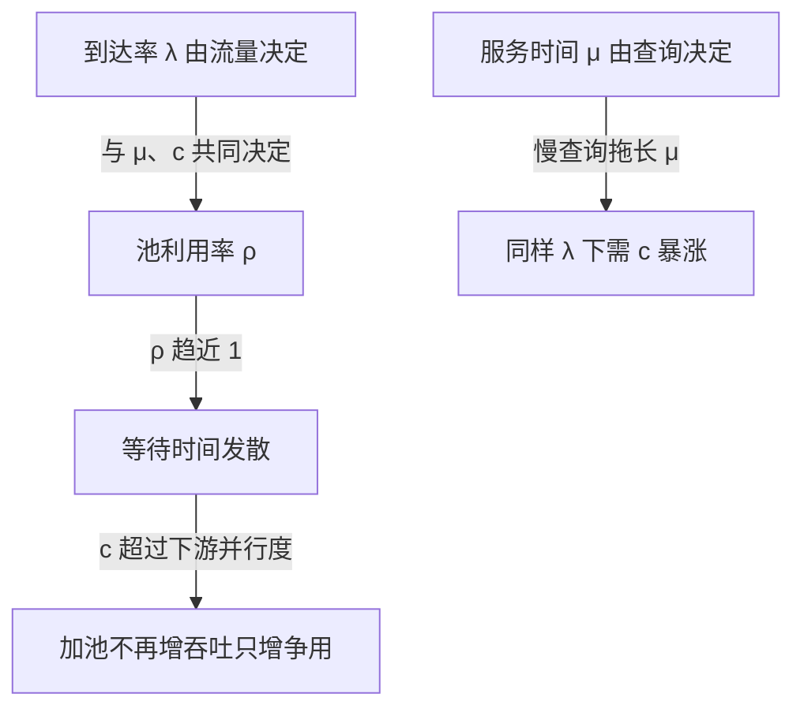
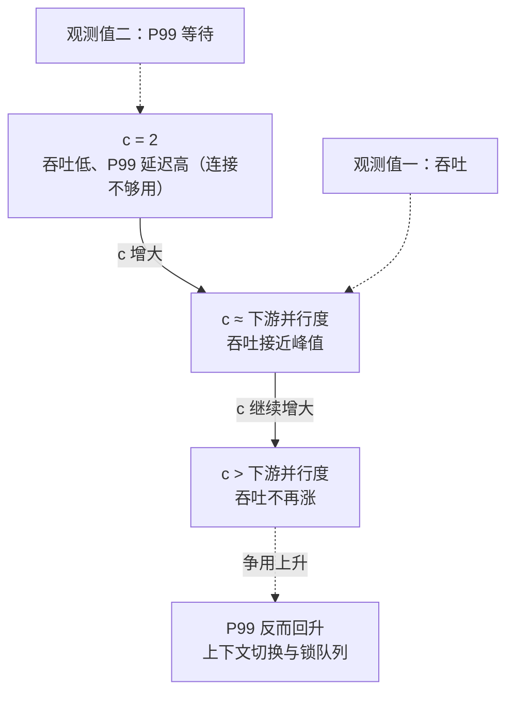

# 连接池的容量数学：池大小与排队等待的权衡

## 连接池容量到底该怎么算？

应用与数据库（或下游服务）之间的连接池，**池大小是容量决策：太大压垮下游（数据库的连接是重资源，每连接内存与切换成本），太小让请求排队（等待连接的延迟进用户路径）。**拍脑袋的「池 = CPU 核数 × 2」这类**经验传说**（folklore，没有依据、口口相传的共识）遮住了真正的数学。

要解决的问题是**把池大小从 folklore 还原成排队论的推导**：**到达率、服务时间、并行度三要素决定最优池，让扩容决策（加池子还是加机器）有可计算的依据。**读完你能**用到达率、服务时间、并行度三个数算出自己系统的池该配多大，并在池打满时知道先查什么、最后才加池。**

这是容量估算的通用骨架[[工程知识/后端系统：在并发、失败与变化中维持服务/服务设计/容量估算的通用骨架：从峰值QPS到机器数的推导演练.md]]在连接层的特化，底层是排队论[[工程知识/性能工程：从用户等待到资源瓶颈/观测与诊断/排队论给容量一个可推导的模型.md]]。

## 池大小的推导机制：三个要素怎么算出池该多大？

池的作用是在生产者与消费者之间削平突发。突发来了先入队，消费者按自己的速度取：

「小池哲学」在机房配线架上有完整的实物原型：一台 24 口配线架，每个端口后面是一条物理链路，**端口的接线容量就那么大——进出的线缆再多，配线架能同时稳定提供的也就是那 24 条链路，硬塞更多线进去只是把端口挤得接触不良。连接池对数据库的关系与此相同：池大小是配线架的端口数，按「喂饱下游并行度」配，多余连接是负资产——数据库侧的 CPU 与 IO 就那么大并行度，超配的连接挤在一起互相拖慢。**比喻到此为止——配线架的端口是固定在板上的物理端口，而连接池的连接有生命周期，可以被复用与回收，差别就在这里。

*图源：Wikimedia Commons，Robert.Harker，CC BY-SA 3.0，https://commons.wikimedia.org/wiki/File:Network_Patch_Panel_Clean_Front.jpg。*

池大小决定同时能有多少个消费者在取，排队等待决定排不上队的请求等多久。这两者共同构成排队系统：

**池的数学模型**。把池想成只有 c 个收银台的前台：顾客（请求）以 λ 的节奏到来，每位顾客结账耗时 μ⁻¹，收银台全忙时后面排的队伍就是等待时间。**写成模型：池是 M/M/c 排队系统（排队论记号：前两个 M 表示请求到达间隔与服务耗时都随机波动，c 表示同时能服务的窗口数）里的 c 个服务员：请求以 λ 到达，每个占一个连接 μ⁻¹ 时间（含网络往返 + 查询执行），c 个连接并行服务。三个推论：池未满时等待时间由利用率 ρ = λ/(cμ) 决定（ρ→1 等待时间发散）；池满时新请求排队（队列长度与等待时间同发散）；c 超过下游并行能力后加池无效（数据库的磁盘 IO 与锁让并行收益封顶）。**

**三个输入共同决定同一个利用率：λ 由流量决定，μ 由查询与下游决定，c 才是能调的旋钮。ρ 趋近 1 时等待时间发散，这是池排队的数学边界；另外两条说明两个反直觉后果——c 加到超过下游并行度就不再增吞吐，μ 一恶化需求连接数会成倍上涨。池打满的事故里八成根源是 μ 恶化，所以第一动作是查 μ，加 c 放在最后。**

**HikariCP（Java 生态里常用的数据库连接池实现）的经验公式与它的适用边界**。pool size = connections = core_count × 2 + spindle_count：**核数×2 假设任一时刻一半线程等 IO（连接闲置）+ 磁盘数（每盘一个并行 IO）。这个公式的隐含前提：单机单池、请求均匀、CPU 与 IO 均衡。超出前提（多实例共享一个数据库、突发流量、慢查询拖长 μ）时公式失效，要回到排队论重推。**

**多实例的总账**。**每个应用实例有自己的池，数据库看到的是 N × pool_size 个连接。**容量规划要**按数据库侧算总账：数据库 max_connections 是硬顶（PostgreSQL 默认 100），N 个实例各开 30 连接，4 个实例就顶满。**实例扩容（N 涨）与池扩容（c 涨）冲突时，解法是**引入集中式代理池（PgBouncer 类，事务级复用把 N×c 压成 c'），用一层间接解两层直连的加法爆炸。**

**μ（服务时间）才是隐藏的杠杆**。池大小的推导里 **μ 决定一切：慢查询（μ 大）让同样 λ 下需要的 c 暴涨（ρ = λ/cμ），修慢查询（μ 降）不新增任何硬件就把连接占用时长压下来，而扩池（c 涨）要额外消耗数据库内存与上下文切换（CPU 从一个任务换到另一个任务、保存并恢复现场的过程），所以改查询更便宜有效得多。池打满的事故里，八成根源是 μ 恶化，不是 c 不够。**

把 μ 拆开看，它并**不是"数据库在算"这一件事**——一次占用的时间里，**连接真正被用在执行上的只是一段，其余花在等锁、等 IO、等网络回包上。**Brendan Gregg 对线程状态的经典划分把这段区别画得很清楚：

*图源：Brendan Gregg《Off-CPU Analysis》线程状态划分图，https://www.brendangregg.com/blog/2017-08-08/off-cpu-analysis.html（作者个人网站公开图，引用注明出处）。*

这张图的用处在于指出 μ 的可观测部分：**等待类状态能被 off-CPU 分析（专门测量线程不在处理器上运行的这段等待时间的方法）量出来，而"运行"只是其中一段。池打满的 incident 里，八成根源正是前述的 μ 恶化（慢查询、锁等待、下游变慢），不是 c 不够——要判断等待落在哪一类，才能决定是改查询、改索引还是改池。**

「c 超过下游并行能力后加池无效」这条推论有现成的实测曲线：HikariCP 官方 wiki 挂的 PostgreSQL pgbench 基准（PostgreSQL：开源关系型数据库；pgbench 是其自带的基准测试工具）里，吞吐随客户端数（池大小）先升后平，拐点过后再加连接，曲线不再抬头：

来源：HikariCP 官方 wiki《About Pool Sizing》所引 pgbench 基准（PostgreSQL 9.1/9.2 实测），https://github.com/brettwooldridge/HikariCP/wiki/About-Pool-Sizing。这条「先升后平」的形态就是正文三个推论里第三条的实测证据：越过拐点的连接只剩争用。

## 它从哪儿来，要付什么代价

连接池与数据库连接的昂贵性（TCP 握手 + 认证 + 服务端进程/线程分配）同古，J2EE（Java 2 Enterprise Edition，Java 企业版）时代的 DataSource 池化是标配。HikariCP以性能与「小池哲学」成为 Java 生态默认，它的 README 明确反对大池（「池越大越快」是误区，连接多 = 数据库上下文切换多 = 全体变慢）。排队论在容量规划的应用是 1990s 电话网络 Erlang-C 公式（按呼叫到达强度计算需要多少接线员的那套老方法）的老传统（呼叫中心的人员配置与池大小是同构问题）。

「小池哲学」是这一组材料里最反直觉的一条：**容量有上限**。直觉是「池大 = 吞吐大」，但**数据库侧的并行能力（CPU 核 + 磁盘 IO）有上限，超过它的连接不增吞吐只增争用（上下文切换、锁队列、buffer pool 争用）。**HikariCP 的公式把池压到「恰好喂饱下游并行度」，**多余连接是负资产。这一笔把容量思维从「资源多备」转到「按下游能力配」，与排队论的 Erlang-C（服务员数按到达强度配，不盲目冗余）同构。**代价：**小池的代价是排队（ρ 高时等待时间进入请求路径），它把「下游过载的痛」前移成「池排队的痛」——这恰是保护（池是天然的限流器，限流与熔断见后文）与隔离**[[工程知识/后端系统：在并发、失败与变化中维持服务/任务与并发/限流熔断与隔离控制故障半径.md]]，但**用户侧延迟的账要算清楚：池等待时间 P99（把所有请求响应时间从小到大排，第 99 百分位的值，99% 的请求比它快）是容量 SLA（服务等级协议，对外承诺的可用性与响应目标）的一部分。**集中代理池（PgBouncer，站在应用与数据库之间统一收发连接的代理）**解多实例爆炸的同时引入新单点与事务语义边界**：**代理按事务粒度复用连接时，prepared statement（预编译语句：先在数据库注册留好空位的语句模板，之后只传参数值反复执行绑定在原连接上，换连接后失效，这就是事务级与会话级复用两种模式的陷阱）。**

## 这套说法在哪儿会失效

- **池大小没有普适公式，只有按负载推导**。**HikariCP 公式的三个前提（单机单池、均匀负载、IO 均衡）在微服务场景常破。**正确路径：**实测 μ 分布（P50/P99 查询时间）与 λ 峰值 → 排队论算 c → 灰度（新版本先放一小部分流量验证，逐步放大到全量）验证 P99 → 回归修正。**
- **池打满的第一反应是查 μ 不是加池**。**慢查询、锁等待、下游抖动（性能指标不稳定的起伏）让 μ 恶化，加池只会加速压垮下游。**故障处置手册（incident runbook，出事时的标准处置步骤）的顺序：**查 μ 分布 → 查 λ 异常 → 最后才考虑 c。**
- **等待超时与失败语义要显式设计**。**池等待超时（connection timeout）后的行为（快速失败 vs 无限等）是可用性决策：快速失败让上游重试（重试风暴风险），无限等让线程堆积。超时值与上游重试策略要联动设计。**
- **多实例总账要进容量模型**。**数据库侧的 max_connections 是共享硬顶，实例数 × 池大小 ≤ 顶的约束要在扩容评审时检查。接近顶时上代理池，别等到连接风暴。**

## 怎么自己动手验证

- **池大小扫描实验**：固定负载下 c 从 2 扫到 64，测吞吐与 P99 等待。**预期：吞吐先升后平（下游并行度封顶），P99 等待在 c 小时高、越过拐点后不再改善。拐点即下游并行能力的实测值。**

**固定同一组 λ 与 μ，把 c 沿横轴从小拉到大，观察吞吐与 P99 延迟两条曲线各自的走向：**

两条曲线共用同一横轴但拐点位置不同：**吞吐在 c 到达下游并行度时就接近峰值，此后不再上升；P99 等待下降到拐点后，继续加 c 会因为数据库侧的上下文切换与锁队列反而回升。两个观测值一起看，才能定位到那个「加池不再有效」的位置。**

- **μ 恶化模拟**：注入慢查询（让 μ 的 P99 显著拉长），观测池行为。**预期：同样 λ 下池利用率飙到 1.0、等待时间发散（ρ=λ/cμ 的数学），加池缓解有限。μ 是隐藏杠杆的直接证据。**
- **多实例总账演练**：N 实例 × c 连接的部署，数据库侧连接数与争用指标（上下文切换、锁等待）观测。**预期：N×c 超过数据库并行度后全体查询变慢（小池哲学的镜像证据）。**

## 接着读哪几篇：容量推导的通用骨架

- [[工程知识/后端系统：在并发、失败与变化中维持服务/服务设计/容量估算的通用骨架：从峰值QPS到机器数的推导演练.md]] —— 容量推导的通用骨架
- [[工程知识/性能工程：从用户等待到资源瓶颈/观测与诊断/排队论给容量一个可推导的模型.md]] —— 池数学的理论基础
- [[工程知识/后端系统：在并发、失败与变化中维持服务/任务与并发/限流熔断与隔离控制故障半径.md]] —— 池作为天然限流（限制单位时间内放行的请求数量）器
- [[工程知识/后端系统：在并发、失败与变化中维持服务/服务设计/背压的传递链路：从下游饱和到上游减速.md]] —— 池耗尽的减速传导
- [[工程知识/后端系统：在并发、失败与变化中维持服务/服务设计/分布式限流的四种算法：计数漏桶令牌与滑动窗口.md]] —— 池作为隐式限流器
- [[工程知识/缺陷分析：从个案到体系/资源与容量/资源泄漏的三段式排查法：预筛确认与归因.md]] —— 连接泄漏让池耗尽，池指标是泄漏第一观测面
- [[工程知识/性能工程：从用户等待到资源瓶颈/存储与网络/cache分配策略与命中率：LFU与LRU的实证对比.md]] —— 容量-收益拐点思维与连接池容量同构
- [[工程知识/后端系统：在并发、失败与变化中维持服务/服务设计/连接池参数的联动校验：池大小、超时与队列深度是一组约束]] —— 本篇推导池大小，续篇补池大小、超时、生命周期之间的联动约束
