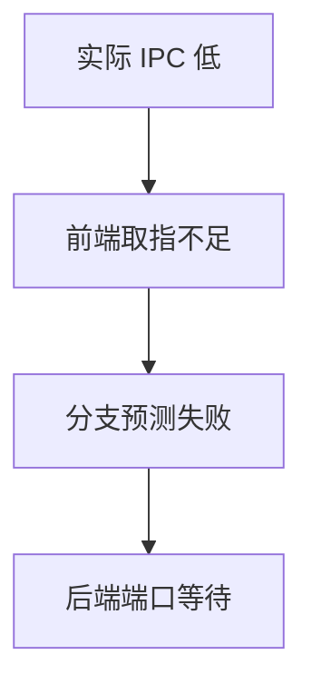
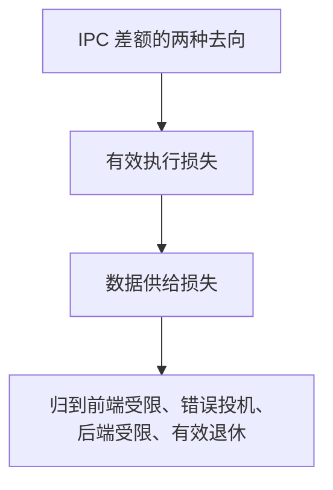

# CPU 性能来自有效执行与数据供给

**CPU 性能问题要区分计算、前端供给、内存访问、分支投机、同步和调度。主频、核心数或使用率单独都不能证明瓶颈**。读完你能**按观测特征把「CPU 忙」归到计算、前端供给、访存或同步中的一类，再决定先看哪个计数器**。

同一个服务在 CPU 使用率 60% 时也可能因为内存停顿或锁等待变慢，在 100% 时反而仍满足 SLO——**因为此时慢的根源在内存或锁上，使用率高低与是否达标没有直接因果**。先把用户感受到的延迟归到三处——**有效退休**（计算本身花的指令数）、**数据供给**（等内存送数的等待）、**等待时间**（等锁等调度的等待），再决定是否改算法、布局、线程或频率。

**性能分析因此要同时看“核心做了多少有效工作”和“为了拿到数据或获得资源等了多久”，而不是追逐一个孤立的利用率数字**。把 CPU 想成一个车间：**有效执行是工人干活，数据供给是原料送达，哪边停工哪边就是瓶颈**——工人闲着等原料是供给问题，原料堆着没人干是执行问题。

## 要解决的问题：这几种限制各自的观测特征是什么

主频、核心数与使用率都看不出异常，而服务的处理能力已经下降，无从判断是计算、数据供给、内存访问、分支投机还是调度造成了等待。本篇回答：这几种限制各自的观测特征是什么、为什么单项指标无法证明瓶颈、定位时先区分哪一层，以及验证结论需要哪些计数器与业务指标配合。

## 怎么用运行路径把瓶颈归到一类？

~~~mermaid
flowchart TD
    F[取指解码] --> S[分支与投机]
    S --> E[执行端口]
    E --> M[缓存与内存]
    M --> R[有效退休]
    R --> L[锁与调度等待]
~~~

五类瓶颈各自出现在流水线的不同位置，辨认时按位置逐一对照下面几类：

- **前端受限（Frontend bound）**：**指令缓存、解码或分支目标供给不足，取指喂不饱执行**。
- **错误投机（Bad speculation）**：**处理器猜错分支方向，已经提前算的指令全部作废，造成流水线浪费**。
- **后端受限（Backend bound）**：**执行端口、缓存未命中、内存带宽或依赖链等待**。
- **有效退休（Retiring）**：**真正产出结果的指令占比高**；**仍需判断算法和指令数量是否合理**。
- **同步/调度**：**锁、上下文切换（CPU 从一个任务换到另一个任务、保存并恢复现场的过程）、cgroup（Linux 的控制组机制：给一组进程划出 CPU、内存等资源上限）配额或虚拟化导致线程得不到运行**。

五类瓶颈在流水线上的位置各不相同，同一份低 IPC（Instructions Per Cycle，每个时钟周期实际完成的指令数：这个数低说明核心没吃饱）曲线对应的归类：



图：低 IPC 的五种归类各自的位置证据——前端与投机看流水线前段计数器，后端看端口占用与缓存未命中，退休（指令真正产出结果）占比看指令效率，同步调度看运行队列与等待时间，归类不同处置路径完全不同。

「发射宽度」这个概念落到时空图上，是两条指令并行穿过同一条五级流水线——超标量（superscalar，一条流水线每周期发射多条指令）的每一列就是前文理想 IPC 的来源，任何一格的停顿都会把同一列后面的指令一起堵住：


*Core i7 的超标量流水线：前端按序取指译码，4 发射 16 级流水，后端乱序执行引擎（Nehalem Execution Engine）以保留站与重排（布局或尺寸变化触发重新计算排版）序缓冲区调度微操作（图源：知乎专栏「超标量流水线结构设计」读书笔记）*

*双发射五级流水线的指令时空图（图源：Wikimedia Commons，Amit6 原图，Us 转 SVG，CC BY-SA 3.0）*


来源：[小林coding《进程、线程基础知识》](https://www.xiaolincoding.com/os/4_process/process_base.html)


## 定位 CPU 瓶颈要从哪几步开始？

1. **固定负载、版本、CPU 亲和性（把进程固定到指定核心，避免在不同核心间迁移）、频率策略和数据规模**，记录延迟分位数（p50 中位、p95/p99 尾部）、吞吐和错误率。
2. 用 top、vmstat（查看虚拟内存统计的命令）、sar（系统活动统计报告工具）观察运行队列、user/sys/iowait、上下文切换和频率；**不要把 load average（就绪加运行队列长度的均值，不等于使用率）当作 CPU 使用率**。
3. 用 perf（Linux 性能剖析工具，统计 CPU 采样与硬件事件）采样（只采集一部分数据以控制记录开销）调用栈，再用硬件计数器判断 **cycles、instructions、IPC、cache miss、branch miss 和 stalled cycles**。
4. 将热点（访问集中在少数键或节点上的现象）函数与调用路径、锁等待和内存/IO 证据相互对照；**一次只改变一个变量**。
5. 用相同工作负载重复基准，**确认收益是否转移到内存、网络、锁或成本**。

## 优化到哪一步该停手

- **先改算法复杂度、数据布局、批处理（把多个请求合并成一批同时计算、提高硬件利用率）和不必要的工作，再考虑编译器或绑核**。
- **绑核和 NUMA（非统一内存访问架构，访问远端内存比本地慢）本地化只在测量证明调度/远程访问是瓶颈时使用**；否则可能降低负载均衡（任务在各核间分摊的均匀度）。
- **高频率不等于高吞吐；功耗、温度、内存带宽和下游等待都会限制收益**。
- **任何优化都要保留回滚（把系统状态退回到改动之前的版本）阈值和相邻负载的回归样本**。

## 计算和数据是怎么接上的

寄存器（CPU 内部最快的存数格子）、L1/L2（核心内的小容量高速缓存）、共享缓存（多核共用的大缓存）、本地 DRAM（内存条上的主存）、远程 NUMA 内存（别的节点上的主存）和存储（磁盘）形成越来越慢的层次。容量足够不代表访问足够快：


*图源：Wikimedia Commons《Computer memory hierarchy》，CC BY-SA 3.0。*

- **随机访问和指针追逐容易造成 cache/TLB miss**（TLB 即地址翻译快表：CPU 里缓存"虚拟地址到物理地址"的小表） **与延迟停顿**；
- **多核顺序扫描可能打满内存带宽，带宽饱和后新线程只是争抢同一条内存通道、无法喂给更多计算，增加线程不再提高吞吐**；
- **频繁分配、回收、GC（垃圾回收：运行时自动回收不再使用的内存）和碎片（存储空间里零散不连续的小块）会同时增加 CPU 与尾延迟**（P99 一类的慢请求耗时指标）；
- **page fault、swap 或 cgroup reclaim 会把内存问题变成毫秒级等待**。

**区分泄漏、工作集增长、正常 page cache 和碎片**。结合 RSS（常驻内存集：进程实际占用且未被换出的物理内存大小）缺页（缺页：进程访问的内存页还不在物理内存里，需要从磁盘调入）、reclaim（内存回收：系统腾出可复用页的动作）、swap（换页：把不活跃内存页挪到磁盘）、分配 profile 和业务对象数判断，**不能只看“used 百分比”**。

## NUMA 为什么是一种局部性约束

**多 socket 系统（一颗服务器装多颗 CPU 的形态）把 CPU、内存控制器和设备划分为 NUMA 节点（非统一内存访问：每个节点有自己的本地内存，访问本地快、访问别的节点的慢）**。**线程访问本地页通常更稳定，远程访问增加延迟并消耗互连**。用 lscpu（查看 CPU 拓扑）、numactl（控制进程的内存与 CPU 绑定策略）、numastat（统计各节点的内存分配）、perf和业务 trace 对照线程、内存页和设备各自落在哪个节点。

cpuset、cpunodebind 或 membind 的启用前提是**测得调度迁移或远程访问构成瓶颈**。**绑核会减少调度选择，也可能破坏负载均衡、容错和容器配额**；**数据库或推理服务（把模型包装成可调用的在线服务）还要同时考虑网卡、GPU 和后台线程的拓扑**。

## 想继续深入还能看哪些材料？

**CPU 性能取决于每个周期能真正退休**（产出结果）**的指令数，本质问题在于有限的发射宽度（一个周期能同时送进执行端口的指令数）与访存带宽（每秒能从内存搬多少数据）被谁占用**。

## 动手跑一遍会看到什么：有效执行的账

```text
IPC（Instructions Per Cycle，每个时钟周期实际完成的指令数）的分解账（通用量级）：

理想 IPC = 4（四发射流水线），实际程序 0.5-2.0，差距去哪了：

有效执行损失（流水线停顿）：
    分支预测失败：每次 15-20 周期冲刷 → 循环内随机分支是大头
    依赖链：下一条指令要等上一条的结果 → 串行依赖链限制乱序发挥

数据供给损失（访存停顿）：
    L1 命中 4 周期、内存 200+ 周期 → 一次缓存未命中等于几十条指令的时间
    数组遍历访存连续（预取器友好）vs 链表跳转（预取失效）差一个量级

定位顺序：perf stat 看 IPC → IPC 低再看 top-down 分类
    （前端不足/后端不足/分支错误预测/访存等待，四选一往下钻）
```

理想 IPC 与实际 IPC 的差额流向两类损失，各自有独立的定位路径：



图：IPC 差额的两种去向与各自的细因——执行侧的损失查分支与依赖链，供给侧的损失查缓存层次与访问模式，两条线汇到同一个 top-down 定位入口。

**盲优化的实录——热点函数手写 SIMD（单指令多数据，一条指令同时对一批数据做同样的运算）向量化，改完性能持平（瓶颈在数据供给不在执行），profile（性能剖析：记录程序各处耗时分布的报告）显示访存等待占六成**，改成连续内存布局——结构体数组换数组结构体，即把每个对象各自存一份字段，改成每种字段各存一条数组，遍历时同种字段连在一起，**缓存一取一条后吞吐翻倍——有效执行的账要先算哪边亏再补哪边**——这笔账只对应损失的周期数：亏指执行侧或供给侧哪一边浪费的周期多，账只用来区分这两类损失，不延伸到具体优化手段。**分支的实录——热路径上按概率排分支顺序（likely 在前）拿到 5-8% 提升，零代码复杂度代价**。机制的展开见 [[工程知识/性能工程：从用户等待到资源瓶颈/处理器与内存/CPU缓存与分支决定有效执行时间.md]]（缓存行与分支预测的细节账）、与 [[工程知识/性能工程：从用户等待到资源瓶颈/观测与诊断/性能剖析与火焰图.md]] 的定位方法衔接——**先用火焰图（按调用层级堆叠的耗时分析图、越宽的块越耗时）找出最耗时的函数，再按 top-down 分型把热点归到前端受限、错误投机、后端受限、有效退休四类**。

## 怎么自己动手验证

1. **计算与供给分离**：用 `perf stat` 采集 IPC、各级缓存命中与内存带宽，同时记录主频、使用率与有效吞吐，**确认性能下降来自执行效率（计算本身慢）还是数据供给（等数据慢）**。
2. **单变量对照**：固定输入与并发，只增加线程数，记录吞吐曲线与内存带宽占用，**预期在带宽打满后吞吐不再上升**。
3. **内存压力核对**：用 RSS、缺页、reclaim、swap 与分配 profile 对照业务对象数，**区分泄漏、工作集增长与正常页缓存**（内核把磁盘数据缓存在内存里、减少重复读盘）。
4. **局部性核验**：用 `lscpu`、`numastat` 与 perf 对照线程与页所在节点，**确认跨节点访问是否构成可测量的延迟增量**。
5. **断言锚点**：**瓶颈层级有计数器支撑，单变量实验可复跑，内存判断结合多类指标而非单看使用率**。

## 接着读哪几篇：讲跨槽访问的带宽延迟代价表

- [[工程知识/性能工程：从用户等待到资源瓶颈/处理器与内存/NUMA让跨槽访问付出带宽与延迟代价|NUMA让跨槽访问付出带宽与延迟代价]]——讲跨槽访问的带宽延迟代价表，是数据供给维度在多路机器上的放大
- [[工程知识/性能工程：从用户等待到资源瓶颈/处理器与内存/SIMD与数据并行：一行代码的多个通道.md]] —— 算力批发在向量通道，有效执行要算上通道利用率
- [[工程知识/性能工程：从用户等待到资源瓶颈/存储与网络/CPU降频的三个阀门：温度墙、功耗墙与电流墙.md]] —— 算力上限还会被温度与供电整段压低，是"频率不变但吞吐掉档"的另一种来源


- [[工程知识/性能工程：从用户等待到资源瓶颈/性能工程：从用户等待到资源瓶颈]]
- [[工程知识/性能工程：从用户等待到资源瓶颈/观测与诊断/性能问题定位]]
- [[工程知识/性能工程：从用户等待到资源瓶颈/观测与诊断/性能剖析与火焰图]]
- [[工程知识/性能工程：从用户等待到资源瓶颈/处理器与内存/GPU性能取决于计算、访存、并行与通信]]
