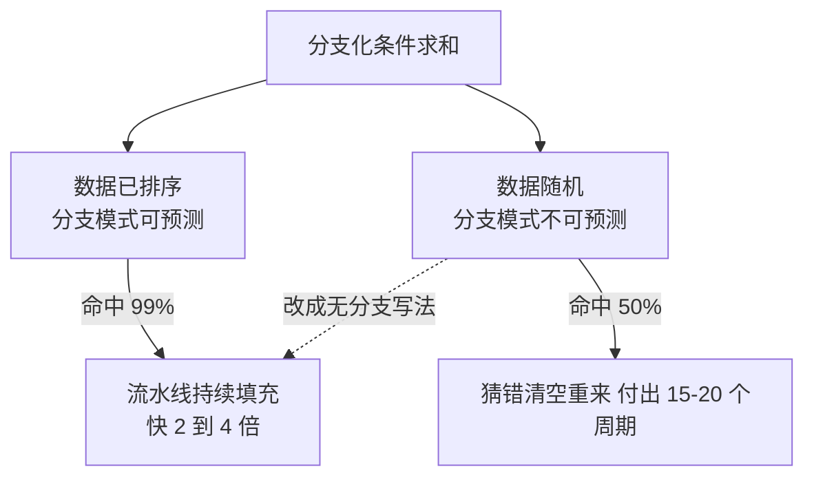
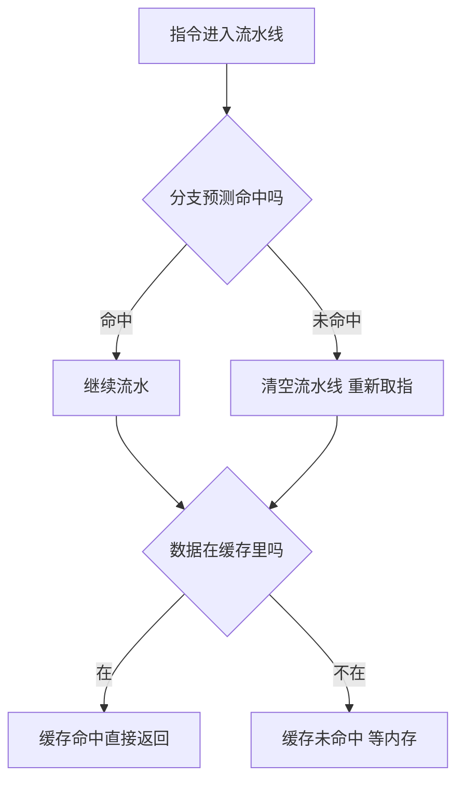

# CPU 缓存与分支决定有效执行时间

> **要点**：**一条指令的实际代价由数据能不能及时到达、流水线能不能持续填充决定。数据布局与访问局部性管数据能不能及时到达，分支形状管流水线能不能持续填充；两者都要先写成可观测假设（比如命中率提升 10%，延迟应降 8%），再用硬件计数器（CPU 里统计缓存命中、预测命中等事件的寄存器）与业务延迟同向验证。只改编译选项（编译器的优化开关）或绑核（把进程固定到指定核心），通常解释不了收益——它们影响的正是缓存与分支这两条线。**

## 为什么改了缓存和分支，延迟却常常没有变化？

**每次访存都不是直达内存的**：CPU 产出虚拟地址，MMU（Memory Management Unit，内存管理单元：CPU 里负责地址翻译的部件）把虚拟地址翻译成物理地址，这条路径上还插着 TLB（地址翻译快表：CPU 里缓存"虚拟地址到物理地址"的小表）与缓存层次。


*图源：腾讯云开发者社区《30 张图揭开「内存管理」的迷雾，瞬间豁然开朗》，CC 4.0 BY-SA，https://cloud.tencent.com/developer/article/2671629。*

把数据布局与分支形状当成可优化项去改，**改完之后延迟没有变化，或者这一项改善了另一项恶化，说不清变化来自哪里（每个量都受多项因素影响，单看一个数字归不了因）。本篇要解决的问题是：改完说不清收益归谁的困局。**具体回答四件事：**缓存层级与分支预测各自影响执行时间的哪一段；局部性与可预测性怎样写成可观测假设；单次改动的收益怎样确认没有转移到内存占用或尾延迟（P99 一类的慢请求耗时指标）上；编译选项与绑核为什么通常解释不了收益。**读完你能**判断改了缓存或分支后延迟变或没变到底来自哪里，并把收益记到正确的项上。**

## 缓存与分支是怎么把等待藏起来的？


*图示：分支预测的命中与失败路径——猜对了流水线照常往下走，猜错了要把已经取进来的一段作废重取。图源：Wikimedia Commons《Branch prediction diagram》，作者 Oğuz Ergin，CC BY-SA 4.0，https://commons.wikimedia.org/wiki/File:Branch_prediction_diagram_tr.svg。这也是"分支"能决定执行时间的原因：代价不发生在判断本身，而发生在猜错之后的清空重来。*

**处理器执行一条加法只要一个周期，从内存取一个数要一两百个周期——取一次内存的时间约是执行一条加法指令的两百倍，两者完全不成比例。**缓存层级与分支预测共同把这条差距藏进流水线：**缓存把最近用过的数据留在离核心近的地方，分支预测让流水线（像工厂装配线，指令一道道流过各工位；前一道没好，后一道只能干等）在条件跳转的结果出来之前就继续取指令。**本质是**两种"提前准备"，准备对了执行时间由算术决定，准备错了由等待决定**。

层级延迟的账要记住数量级（按 3GHz 主频、主流服务器 CPU 的典型值估，具体数字随型号变）：

| 层级 | 典型延迟 | 容量 | 一次未命中相当于 |
| --- | --- | --- | --- |
| 寄存器 | 约 0.3 ns（1 周期） | 几十个 | — |
| L1 缓存 | 约 1 ns（4 周期） | 每核 32-64 KB | 4 次加法 |
| L2 缓存 | 约 4 ns | 每核几百 KB | 十几次加法 |
| L3 缓存 | 约 15-40 ns | 多核共享几十 MB | 几十到上百次加法 |
| 内存 | 约 60-100 ns | 几十到几百 GB | 两三百次加法 |
| 远端 NUMA（Non-Uniform Memory Access，非一致内存访问：CPU 访问本地内存快、远端慢） 节点内存（要走插槽之间的互连线路去访问别的 CPU 管的内存，延迟更高） | 约 100-150 ns | — | 更多，且吃跨槽带宽 |

表中 L1/L2/L3 分别是一级缓存、二级缓存、三级缓存（一级最快最小、逐级更慢更大）。

NUMA 指多路服务器上每颗 CPU 各接一部分内存，访问别的 CPU 那部分要走互连，延迟更高。

**数据布局决定一次访问拖入多少缓存行。** 缓存以 64 字节的缓存行（缓存搬运数据的最小单位，一次搬一整行）为单位搬数据，**读一个 4 字节 int 会把同行的另外 15 个 int 一起搬进来。顺序遍历用满这 16 个，跳着访问每次只用 1 个、浪费 15 个；"结构体数组"里只改一个字段也会拖整行，热字段与冷字段分开存放是高频优化的第一刀。**多核系统里每个核心各自缓存一份数据，**同一缓存行在一个核被改写，其他核的副本就要作废重读。两个线程写同一行里的不同变量，会互相把对方的副本打失效、互相拖慢，这叫伪共享**，perf（Linux 性能剖析工具，统计 CPU 采样与硬件事件） 的 c2c 子命令（perf 是 Linux 的性能计数器分析工具，c2c 专查伪共享）直接定位，细节在 [[工程知识/性能工程：从用户等待到资源瓶颈/处理器与内存/缓存行与伪共享：64字节里的并发性能]]。

**分支形状决定流水线能否持续填充。** **分支预测器（CPU 里记录跳转历史的小电路）靠历史猜下一次跳不跳；猜对，流水线不停；猜错，已经取进来的十几条指令作废，重新取，付出 15-20 个周期。**有规律的分支（排好序的数据、循环边界）接近全中，随机数据上的分支约一半猜错。

**改哪一项有效，取决于当前哪一项先成为限制：数据供不上（缓存未命中多、等内存时间长）时改布局，供得上但流水线频繁清空（分支猜错多）时改分支。**

## 动手跑一遍会看到什么：一次遍历的时间差直接量

用行序与列序两种方式遍历同一个二维数组做对照，**缓存行的效果当场可见**：

```c
// a[8192][8192] 的 int 数组（256MB，远超 L2/L3 的有效覆盖）
// 行序遍历：内存地址连续，每 64B 缓存行用满 16 个 int
for (i = 0; i < N; i++)
    for (j = 0; j < N; j++)
        sum += a[i][j];
// 列序遍历：步长 32KB，每次访问都换缓存行，行内其余 15 个 int 浪费
for (j = 0; j < N; j++)
    for (i = 0; i < N; i++)
        sum += a[i][j];

// **常见读数：列序比行序慢 5-10 倍（数据总量不变，只换访问次序）**
// perf stat -e cache-misses 可见：列序的 cache-misses 高一个量级
```


*图示：行主序与列主序在内存中的排布差异。图源：Wikimedia Commons《Row and column major order.svg》，作者 Cmglee，CC BY-SA 4.0，https://commons.wikimedia.org/wiki/File:Row_and_column_major_order.svg。*
C 语言的二维数组按行优先存放，上半张图的走法与内存地址顺序一致，下半张每跳一步就跨过一整行的字节数。图取自 [Wikimedia Commons: Row and column major order](https://commons.wikimedia.org/wiki/File:Row_and_column_major_order.svg)，作者 Cmglee，许可 CC BY-SA 4.0。

分支预测的同场实验：排序后数组上的分支化条件求和比未排序数组明显更快（同一段代码两个数据集，perf 的 branch-misses 计数相差一个数量级）。数据有序化与无分支写法（把 `if` 改成算术或位运算）是同一问题的两条出路：



图里的虚线是第二条出路：数据无法排序时，去掉分支本身，预测器就没有可猜错的东西。

## 这套说法在哪儿会失效

缓存按虚拟地址还是物理地址查，取决于**这一趟转换发生在哪**。转换本身要查表，表项里带着段基地址（这一段内存从哪个地址开始）、段界限（到哪个地址为止）与特权级（允许访问哪类内存的权限等级）——越界就是一次段错误（操作系统发现程序访问了无权访问的内存，直接中止进程的保护机制），代价远大于缓存未命中。


*图源：同上篇腾讯云开发者社区《30 张图揭开「内存管理」的迷雾》，此为其中段表一图，CC 4.0 BY-SA。*


- **CPU 利用率高不等于**有效执行高**。** **核心可能在 cache miss、锁或自旋（原地循环等锁，不让出 CPU）上空转，利用率照样 100%。**`perf stat` 计数器、采样（只采集一部分数据以控制记录开销） profile、off-CPU 追踪（记录线程不在 CPU 上运行时在等什么，比如等锁、等 IO、等调度）与业务延迟要互相对照。
- **计数器名称和含义随架构变化。** **同一个 `cache-misses` 事件在 Intel、AMD、ARM 上映射到不同的硬件计数器，跨平台比较先把各平台的事件定义核对成同一口径。**
- **多线程可能提升吞吐，也可能因共享缓存、锁、带宽与上下文切换（CPU 从一个任务换到另一个任务、保存并恢复现场的过程）互相干扰。** **线程数翻倍吞吐没变，先查 L3（多核共享的最后一级缓存）与内存带宽是不是已经满了——公共资源满了加线程只是排队。**
- **NUMA 远端访问、CPU 亲和性、频率与热限制会改变同一程序的结果。** **绑核改善了成绩，多半是避开了远端内存或稳定了频率，功劳记在绑核上会掩盖真正的原因。**
- **收益可能转移。** **缓存命中和预测准确率（预测或判断正确的比例）改善的是等待与流水线利用率，但可能增加内存占用**——为提升局部性，常把热字段复制一份单独存放、或填充对齐到缓存行边界，这就会多吃内存、代码体积（循环展开：把循环体重复抄几份以减少跳转次数）或功耗。

## 怎么自己动手验证收益没有转移到别处？



两台机器标称频率相同，实际吞吐却差得远，差的就是缓存等待与分支作废这两处等待：


- **最小局部性实验**：用同一批数据对照顺序数组遍历、随机指针访问、可预测分支与不可预测分支四种形态，固定编译器、频率、线程数与预热（提前加载或执行，让系统进入稳定状态）；记录 cycles、instructions、cache-misses（缓存未命中次数）、branch-misses、内存带宽与 p99。**归因要求计数器变化与业务耗时同向：cache-misses 降了三成而耗时没动，说明瓶颈在别处。**
- **锚点对账**：预写同一算法在两种数据布局下各自的缺失率，**实测差距与预期对不上时先查基线（正常状态下的指标水平、用来对比异常）是否被频率或亲和性（调度时倾向把相关负载放在同一处）污染，再怀疑模型。**
- **一次只改一项**：**数据布局、批量、线程数或算法每次只动一个，确认收益没有转移到内存或尾延迟。**

## 想继续深入该读哪几篇？

本篇的上位概念是有效执行与数据供给两条线，想往深处读可以从这几篇入手：

- [[工程知识/性能工程：从用户等待到资源瓶颈/处理器与内存/CPU性能来自有效执行与数据供给]] —— 有效执行与数据供给两条线的总纲
- [[工程知识/性能工程：从用户等待到资源瓶颈/处理器与内存/缓存行与伪共享：64字节里的并发性能]] —— 缓存行既是数据供给单位也是一致性单位，并发下后者成为瓶颈
- [[工程知识/性能工程：从用户等待到资源瓶颈/处理器与内存/大页与TLB：地址翻译的隐藏成本]] —— dTLB miss（数据地址翻译快表未命中）常被 cache miss（缓存未命中）掩盖，分析供给延迟时要把两者合并计算
- [[工程知识/性能工程：从用户等待到资源瓶颈/处理器与内存/NUMA让跨槽访问付出带宽与延迟代价]] —— 远端访问的代价与伪共享的区分，承接本篇的层级表
- [[工程知识/软件构建：让变化可以理解、验证与交付/语言与运行时/CPU微架构与流水线：分支预测乱序执行对程序员的可见影响]] —— 同一机制在 JIT（Just-In-Time，即时编译：运行时把热点代码编译成机器码） 与微架构层面的实录
- [[工程知识/性能工程：从用户等待到资源瓶颈/观测与诊断/性能剖析与火焰图]] —— 采样 profile 怎么读
- [[工程知识/AI 系统工程：从模型能力到生产能力/模型基础与训练/GPU执行模型与显存层级：SIMT与合并访存]] —— 同源的内存层级优化思想


- [[工程知识/性能工程：从用户等待到资源瓶颈/操作系统与运行时/虚拟内存与文件系统把地址和持久化分层]] 里的 **TLB 账与本篇的缓存账是姐妹账：页表（虚拟地址到物理地址的映射表）项未命中与缓存行未命中是两种"地址翻译税"，`perf` 里要合并算。**
