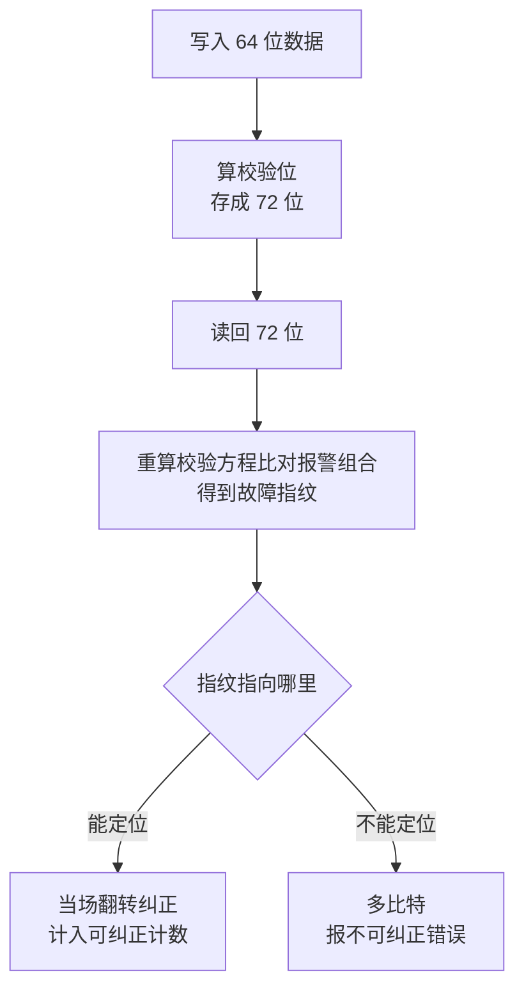
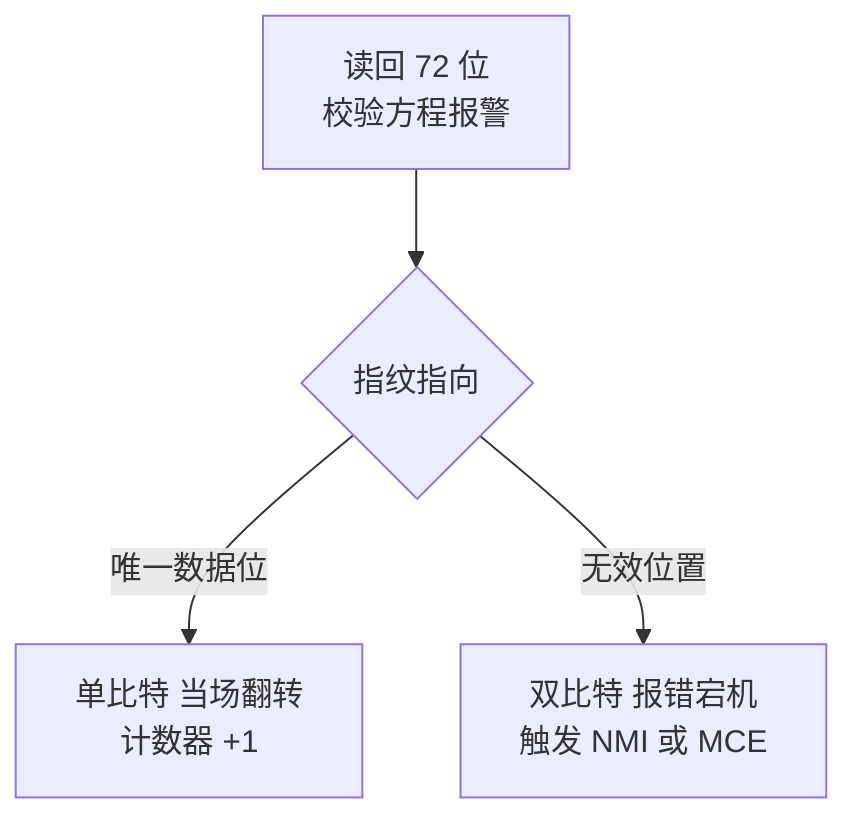

# ECC内存把单比特错误挡在报告之前

本文讲的问题是：ECC（Error-Correcting Code，能自动发现并纠正单比特错误的内存校验机制） 内存怎样把单比特错误在报告之前就纠正掉。先看一个场景——**宇宙射线打中内存翻转一个比特，没有 ECC 的机器会把错值直接交给程序**。读完你能说清 ECC 怎么把静默数据损坏变成可感知事件，也知道该盯哪些计数、什么时候该换内存条。

要解决的问题是：内存位的随机翻转（soft error，软错误）不可预防但可检测，ECC 给每 64 字节数据额外配上 8 个校验位（相当于每 8 个数据位配 1 个校验位），**把单比特错误在硬件层纠正掉、双比特错误报告出来**，**让"静默数据损坏"（程序毫不知情地吃下错值，把错当对继续算）变成"可感知事件"**（被计数与报错捕获，运维能看见）。

## ECC 怎么把错误分成检测、纠正、报告三级？



**纠正与报告的分界点在故障指纹（校验方程报警的组合，像指纹一样唯一对应一个出错位）能否定位到唯一一位**：


这套设计出自 1950 年：Richard Hamming 在贝尔实验室被打孔机的偶发读错反复折磨，于是发明了 Hamming code（汉明码），一手来源：Hamming 1950 年发表于 Bell System Technical Journal 的论文 Error Detecting and Error Correcting Codes，**这是第一个能自动纠错而非只报错的编码**。它替代的对象是"两份副本投票"式的冗余：同样扛单比特错，副本方案要翻倍买内存，**SECDED（单比特纠错双比特检错：ECC 的编码方案）只加 12.5% 位宽**。内存单价高时，副本方案多买一倍内存的花费（100% 增量）远超编码方案只加 12.5% 位宽的开销，多花的钱大约是编码方案的八倍，所以存储越贵，编码的账越划算。

| 错误形态 | ECC 行为 | 系统层后果 |
| --- | --- | --- |
| 单比特错误（SBE） | 硬件当场纠正 | 无感知，仅计数器 +1 |
| 双比特错误（DBE） | 检测到但无法纠正 | 触发 NMI（不可屏蔽中断：CPU 必须立刻处理的硬件报警）/MCE（机器检查异常：CPU 检测到自身硬件错误时抛出的异常）报错，通常宕机 |
| 芯片整条失效（chipkill） | 需 chipkill 级 ECC 纠正 | 服务器级方案可纠正，普通 ECC 宕机 |
| 校验位自身出错 | 硬件判为可纠正 | 无感知 |

错误进入 ECC 校验后，按出错位的数量分成三种形态、三种归宿，系统层的后果各不相同：



三级响应怎么分岔：同一套校验指纹把四种形态归到三条归宿，只有「指纹指向无效位置」一条通向宕机，其余都静默消化。

权衡：ECC 带来约 12.5% 的位宽与容量开销（72 位宽的 64 位数据 + 8 校验位，每 8 个数据位养 1 个校验位）、读写内存时多一步校验计算，访存延迟小幅上升、内存条价格高一档。

收益是**：原本会被程序默默吃下、逐渐累积的损坏**，现在要么当场被纠正、要么被报错拦住，**静默损坏概率因此数量级下降**。这个取舍在消费级（无 ECC，便宜快）与服务器级（必配 ECC，稳）之间由市场代做了选择，但工作站与自建机器的用户要自己面对。

Google 发表在 SIGMETRICS'09（计算机系统测量与建模领域的学术会议）的研究 DRAM Errors in the Wild（《野外 DRAM 错误实测》；DRAM 即动态随机存取内存）用大规模集群数据证明了**真实错误率远高于厂商标称的软错误模型，且错误与温度、内存条在机器里的插槽位置相关**——这是"要不要 ECC"讨论里最常被引用的一手证据。

ECC 用的是 SECDED 编码（Single Error Correction, Double Error Detection）：**每 72 位里用 8 个校验位给每个数据位编一个唯一的奇偶指纹，出错时哪个校验方程报警的组合唯一指向出错位，单比特当场翻转回来**；**双比特时指纹指向无效位置，硬件知道错在哪但回不去，只能报错**。校验位本身就是那 12.5% 开销的全部。「指纹唯一指向出错位」的原始形态就是汉明 1950 年的 7-4 编码维恩图：


*图：汉明 (7,4) 编码的维恩图（来源：[Wikimedia Commons《Hamming(7,4).svg》](https://commons.wikimedia.org/wiki/File:Hamming(7,4).svg)，作者 Cburnett，CC BY-SA 3.0）。每个数据位被唯一的一组圆圈覆盖——某一位出错时报警的校验方程组合恰好就是它所在的圆圈集合，报警方交集合唯一确定出错位置，这就是「指纹指向哪里」的几何解释。*

chipkill 在同一思路上加一条约束：**把校验位打散到不同内存芯片上，每位数据仍被多个分布在不同芯片的校验位覆盖**，所以任何一颗芯片整条失效（整字节同灭）时，报警组合依然能交叉锁定失效芯片、指纹仍能定位——代价是**地址布线更复杂**，收益从"扛单比特"扩到"扛整片"。

这 12.5% 的位宽开销最终落在实物上是带校验位的内存条。服务器用的 ECC RDIMM（Registered DIMM，带寄存器与错误校正的内存条）在普通内存条之外多出 9 颗校验芯片位（64+8 位宽的由来），颗粒上的 CRC（Cyclic Redundancy Check，循环冗余校验：检测数据传输是否出错）标识就是校验位的物理载体：


*图：服务器 ECC RDIMM 内存条实物（图源：[Wikimedia Commons《Samsung 8GB DDR4-2400 ECC Registered RDIMM M393A1G40EB1-CRC0Q - front view.jpg》](https://commons.wikimedia.org/wiki/File:Samsung_8GB_DDR4-2400_ECC_Registered_RDIMM_M393A1G40EB1-CRC0Q_-_front_view.jpg)，作者 ITEagle Europe - Sebastiaan Broekhoven，CC BY-SA 4.0）。RDIMM 通过寄存器缓冲地址与控制信号，是服务器与工作站的标配形态；ECC 型号条比同容量普通条多出的校验颗粒，就是上表里 72 位宽对 64 位数据那 8 个校验位的物理位置。*

## 怎么自己动手验证

```bash
# Linux 上看内存错误计数与 EDAC报告
edac-util -v                     # 或 cat /sys/devices/system/edac/mc/mc*/ce_count
rasdaemon                        # 后台记录 + ras-mc-ctl --summary
# 制造压力后观察 corrected error 是否随负载上升
stress-ng --vm 4 --vm-bytes 80% -t 10m（用 stress-ng 压测工具起 4 个内存工作线程、占满 80% 内存、持续 10 分钟）
ras-mc-ctl --summary
```
预期：**健康 ECC 内存的 corrected error 计数增长缓慢（个位数/天级）；计数快速增长或出现 uncorrected error 说明内存条或插槽硬件劣化，应触发更换流程**。无 ECC 的机器上这套观测不存在——错误静默发生，**这正是风险所在**。计数与压力的对应关系对不上（比如没加压也在涨、或加压了不涨，说明报错与真实负载无关）时，查是否接触不良或插槽污染。EDAC（Error Detection And Correction，Linux 的内存纠错上报框架）文档与 rasdaemon 是 Linux 侧的权威观测工具链。EDAC 即 Error Detection And Correction，是 Linux 内核里专门上报内存等硬件错误的子系统，把每次纠错和报错记成可查询的计数；rasdaemon（后台常驻，采集 RAS（Reliability/Availability/Serviceability，可靠性可用性可维护性）事件写进日志的守护进程）是 Linux 侧的权威观测工具链。

## 这套说法在哪儿会失效

本篇讲内存介质层的错误检测机制。ECC 纠不了的错误（总线错误、CPU 内部错误）与 MCE 的全貌见 [[工程知识/性能工程：从用户等待到资源瓶颈/操作系统与运行时/进程线程与系统调用构成执行边界|进程线程与系统调用构成执行边界]] 的硬件异常视角。数据链路更高层的完整性（校验和、端到端 CRC）见 [[工程知识/数据系统：在并发与故障中保存事实/可靠性与运维/备份的价值由恢复演练来验证|备份的价值由恢复演练来验证]] 的静默损坏段。存储侧的静默损坏对照见 [[工程知识/数据系统：在并发与故障中保存事实/事务与存储/崩溃一致性给文件系统补上POSIX未定义部分|崩溃一致性给文件系统补上POSIX未定义部分]]。位翻转的宇宙射线来源属于物理层背景知识，本篇按概念自包含原则不展开，只给结论：工业界与学术测量都支持"软错误真实存在且非稀有"。

## 接着读哪几篇：同为内存子系统的硬件约束

- [[工程知识/性能工程：从用户等待到资源瓶颈/处理器与内存/NUMA让跨槽访问付出带宽与延迟代价|NUMA让跨槽访问付出带宽与延迟代价]]——同为内存子系统的硬件约束
- [[工程知识/数据系统：在并发与故障中保存事实/可靠性与运维/备份的价值由恢复演练来验证|备份的价值由恢复演练来验证]]——静默损坏的下游防线
- [[工程知识/数据系统：在并发与故障中保存事实/事务与存储/SSD与HDD的IO特性差异：随机写与写放大.md]] —— 存储与内存可靠性防线的另一半
- [[工程知识/数据系统：在并发与故障中保存事实/数据建模与SQL/消失的数值：浮点格式与精度陷阱.md]] —— 硬件位翻转与数值精度的两种数值不实
- [[工程知识/缺陷分析：从个案到体系/硬件故障/静默数据损坏靠校验与副本投票检出：硬件说成功不等于数据还对]] —— 三层检出体系全景：读时校验、端到端校验和（对数据算出的指纹，用来发现传输或存储中的损坏）、副本投票的分工