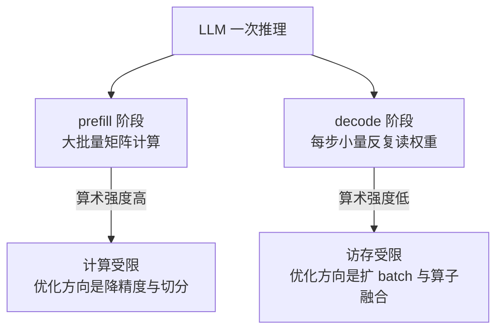

# GPU 性能取决于计算、访存、并行与通信

GPU 擅长同时处理大量相似的计算任务，速度远快于普通处理器。**它的性能受六项因素共同限制：计算吞吐、显存（GPU 专用内存）带宽、访存局部性、并行度、主机与设备传输，以及 kernel（在 GPU 上跑的一段并行函数）的调度；任何时刻性能都卡在最紧缺的那一项上。**读完你能判断一个任务卡在计算、显存、并行还是通信，并知道定位时先量哪几个计数。

## 要解决的问题：这几项各自以哪些形式限制性能

算得快不快，先看数据走多远。GPU 的 die（裸片，封装前的芯片核心）布局就是这句话的硬件版本。SM 是 GPU 里能独立调度与执行线程块的算术单元，全称 Streaming Multiprocessor、流多处理器，成排排列；L2 缓存与 HBM3（第三代高带宽内存）显存控制器分列两侧；NVLink（NVIDIA 的 GPU 间高速直连总线）与 PCIe（外设高速总线）在边缘与外界相连。每一项都对应一条性能天花板，这里天花板比喻性能上限：计算、带宽、通信各是一条独立的上限，实际速度由最矮的那条决定，各项不能互相补足：


*图源：NVIDIA H100 Tensor Core GPU 架构白皮书 Figure 6，https://resources.nvidia.com/en-us-hopper-architecture。*

上一代 A100（GA100）的完整布局同框对照，SM 数量与显存堆栈数代际差异一目了然：


*图源：NVIDIA A100 Tensor Core GPU 架构白皮书 Figure 6「GA100 Full GPU with 128 SMs」，https://images.nvidia.cn/aem-dam/en-zz/Solutions/data-center/nvidia-ampere-architecture-whitepaper.pdf。*

把任务搬到 GPU 上之后速度没有提升，或者提升了但幅度远低于预期，无法判断受限在计算、显存带宽、访存局部性、并行度、主机与设备传输还是内核调度。本篇回答：这几项各自以什么形式限制性能、哪一类任务适合交给 GPU、定位时先排除哪一项，以及验证需要比较哪些计数与耗时。

## 同一份数据被读了多少遍？机制与本质

**GPU 的速度由三者共同决定：算力管每秒能做多少次运算，显存带宽管每秒能搬多少数据进芯片，并行度管同时有多少计算单元在干活。三者中哪一项最紧，速度就由它决定。**判断卡在哪一项，看**算术强度：每从显存读 1 字节数据，算子做多少次运算**。以 A100 的公开规格为例：

```text
FP16 Tensor Core（张量核心，专做矩阵乘加的硬件单元）算力：312 TFLOPS（每秒万亿次浮点运算）
HBM（显存）带宽：约 2 TB/s
平衡点（算力与带宽的比值，衡量每读 1 字节数据该配多少次运算才不浪费）：312e12 / 2e12 ≈ 156 FLOP/byte（每秒 312 万亿次运算除以每秒 2 万亿字节）
  → 算子每读 1 字节要配 156 次运算才算不浪费：低于这个数，搬运比计算快，搬运在等计算；高于这个数，计算比搬运快，计算在等搬运算力
  GEMM（大矩阵乘）：算术强度高 → 计算受限，GPU 忙
  Softmax / 归一化 / 逐元素运算：强度低 → 访存受限，算力等数据

判定与优化对应：
  访存受限 → 算子融合（把 3 个逐元素算子合成 1 个，中间结果不写回显存）
  计算受限 → 降精度（TF32、FP16、BF16 是位宽递减的三种数值精度，位宽越低 Tensor Core 上算力越高，A100 上从 TF32 换到 FP16 算力翻倍）或切分并行
  通信受限（多卡）→ 重叠通信与计算（流水线并行里前后向交错）
```

算力与带宽两条天花板怎么夹住一个算子，Roofline 模型把它画成一条折线：横轴是算术强度，纵轴是可达性能，左边的斜线由显存带宽决定，右边的平顶由算力峰值决定，两条线的交点就是上面算出来的那个平衡点。


*图示：Roofline 模型：运算强度与可达性能上限的关系。图源：Wikimedia Commons《Roofline model example.png》，作者 Giu.natale，CC BY-SA 4.0，https://commons.wikimedia.org/wiki/File:Roofline_model_example.png。*
图取自 [Wikimedia Commons: Roofline model example](https://commons.wikimedia.org/wiki/File:Roofline_model_example.png)，作者 Giu.natale，许可 CC BY-SA 4.0。落在这条折线上的位置决定优化方向：压在斜线下方的算子补算术强度（融合、扩 batch，即扩大批规模，一次同时送进 GPU 的多个请求），顶到平顶的算子只剩降精度与换更快的核。

LLM（大语言模型）推理的两个阶段正好落在平衡点两侧。**prefill（把整段提示一次算完）是大批量矩阵计算，算术强度高；decode（逐 token 生成）每步工作小，却要反复读取全部权重和 KV cache**（Key-Value 缓存：把注意力机制里每步算出的键值对中间结果缓存下来，避免每步重算）。**把两者混成一个「GPU 利用率」会掩盖 TTFT（首 token 延迟）、ITL（token 间延迟）、吞吐和显存的真实瓶颈**：prefill 阶段计算满负荷、decode 阶段访存满负荷，方向相反，平均成一个数就分不出谁在卡。

两阶段混在同一个 GPU 上跑就会互相干扰——这条时间线是 OSDI 24 论文给出的四行调度对照：


图取自 [Sarathi-Serve 论文的 arxiv HTML 版](https://arxiv.org/html/2403.02310v2)（OSDI 24）Figure 4。上两行是只做 decode 的调度器（vLLM、Orca）：prefill 插进来时 decode 被整段停住，token（模型处理文本的最小单位，约相当于一个词或半个词） 流出现 stalls；第三行是只做 prefill 的调度器（FasterTransformer）：decode 反过来被饿死；第四行把两种请求切成小块交错（chunked prefill），时间线上 no stalls。图上四种结局对应正文的判据：decode 一侧算术强度低、被计算密集的 prefill 挤住，就要么等要么饿，交互与吞吐二选一。



**推理服务（把模型包装成可调用的在线服务）加卡不加吞吐，多半是 decode 一侧：batch 小，每读一遍权重只算一个 token，算术强度远低于平衡点，GPU 在等显存；加的卡补的是算力，而 decode 卡在显存带宽上，算力本就冗余，所以加卡不增吞吐。**扩大 batch 与连续批处理（新请求随时插入正在进行的 batch）把每次读权重摊到更多 token 上，才把强度推向计算侧：实测里利用率从两成升到七成是这条路径的常见幅度，具体到自己的模型与硬件要按本节的实验重测；batch 上限受 KV cache 显存预算约束，要与 [[工程知识/AI 系统工程：从模型能力到生产能力/推理服务与平台/GPU显存管理决定服务容量上限]] 的显存账一起算。

多卡时再加一项：梯度或激活的集合通信——all-reduce 把各卡结果求和后分发，all-to-all 让每张卡与其他所有卡交换一块数据时间占比超过两成，就该调并行策略（两成是经验起点，以实测为准），判据见 [[工程知识/AI 系统工程：从模型能力到生产能力/模型基础与训练/分布式训练与并行策略如何切分模型]]。

## 怎么判断瓶颈

| 现象 | 优先检查 |
| --- | --- |
| SM（流多处理器，GPU 的计算单元）利用率低 | 网格规模、occupancy（每个 SM 上同时驻留的线程束占上限的比例——线程束即 warp，GPU 调度的最小单位，32 线程一组）、分支发散（同一线程束内各线程走了不同分支，只能串行执行）、kernel 间空洞（两次 kernel 之间 GPU 无事可做） |
| 显存带宽接近上限 | 访问合并（把相邻线程访问的地址拼成整块传输）、数据布局、缓存、减少重复读写和降低精度 |
| 显存不足或频繁分配 | batch、激活、缓存、生命周期和内存池 |
| CPU 侧在等 GPU 干完活 | kernel 拆得是否够细、同步点放得是否恰当、PCIe/NVLink 传输与计算是否重叠成流水线 |
| 延迟抖动（性能指标不稳定的起伏） | 频率/温度、上下文切换、动态形状、后台任务 |

一次 Nsight（NVIDIA 的时间线与 kernel 剖析工具）时间线至少应能区分：CPU 侧的 tokenization 与调度、host-to-device 传输（从主机内存把数据搬到 GPU 显存的过程）、kernel、集合通信、同步空洞和流式发送。**只有 kernel profile（单个 kernel 内部的耗时剖析）而没有请求 trace（从请求进来到出去的全程时间线），就无法判断优化是否真的改善了 TTFT 或 ITL**；多 GPU 后还要区分 PCIe/NVLink 与跨节点网络的时间。

## 这套说法在哪儿会失效？

- 先减少不必要的数据搬运和同步，再调整 kernel、融合、批处理或精度。
- 更大的 batch 可能提高吞吐但增加尾延迟（P99 一类的慢请求耗时指标）和显存压力；以业务 SLO（Service Level Objective，服务等级目标：内部设定的具体指标值）选点。
- GPU 参数、驱动和 kernel 能力高度依赖具体设备，本篇用 A100 的数字只作示范（换一张卡这些数字全部会变），所有硬件数字都必须从你自己的目标环境实测取得。
- 量化（把模型权重从高精度数值压缩到低精度以省显存提速度）、批处理、算子融合、CUDA（NVIDIA 的 GPU 并行计算平台与编程模型） Graph（把一串 kernel 启动录成一张图一次提交，省掉逐个启动的开销）和并行策略改变的资源各不相同，完整关系见 [[工程知识/AI 系统工程：从模型能力到生产能力/推理服务与平台/批处理、KV缓存、量化与并行如何改变服务容量]]。

## 怎么自己动手验证

1. 固定模型、输入/输出 token 分布、精度、GPU、驱动、运行时版本和并发，分别测单请求 prefill、持续 decode、静态 batch 与连续 batch；记录 TTFT、ITL、完成吞吐、显存峰值、kernel 空洞、通信时间和输出质量。
2. 先用应用 trace 判断 CPU、数据加载、传输和 kernel 哪一段在等待，再用 Nsight、rocm tools 或框架 profiler 查看 kernel 时间、occupancy、内存吞吐、同步和空洞。

3. 只改 batch、量化或并行度中的一项，比较 warm-up（预热：正式测量前先跑几轮，让缓存与调度进入稳定状态）后的多轮分布，记录 TTFT 与 ITL 的响应方向。预期与算术强度的判定一致：访存受限时扩 batch 有效、降精度无效；对不上就回头查判定。

单次最快结果代表不了收益。
4. 多 GPU 场景单独统计 all-reduce 与 all-to-all 的时间占比，确认跨卡或跨节点通信是否成为限制。

5. 复核数值精度、稳定性、错误率和功耗；速度提升不能以错误结果为代价。指标采集口径固定，kernel profile 与请求 trace 能对应起来。

## 接着读哪几篇：本篇的瓶颈判断在服务层要平衡的四个量

- [[工程知识/性能工程：从用户等待到资源瓶颈/处理器与内存/CPU性能来自有效执行与数据供给]] —— 同一套"算力与数据供给谁更紧"的判断在 CPU 上的形态
- [[工程知识/AI 系统工程：从模型能力到生产能力/模型基础与训练/GPU执行模型与显存层级：SIMT与合并访存]] —— SM、线程束与访问合并的机制细节
- [[工程知识/AI 系统工程：从模型能力到生产能力/推理服务与平台/推理服务的核心矛盾是延迟、吞吐、显存与质量]] —— 本篇的瓶颈判断在服务层要平衡的四个量
- [[工程知识/性能工程：从用户等待到资源瓶颈/性能工程：从用户等待到资源瓶颈]] —— 域导读