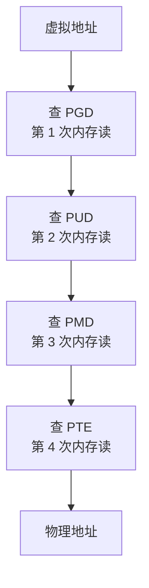
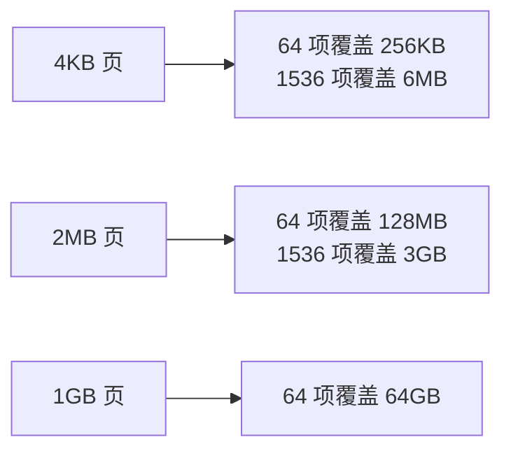

## 要解决的问题

这篇讲大页与 TLB（Translation Lookaside Buffer，地址翻译结果的小型高速缓存）——**地址翻译为何拖慢大内存程序、怎么判断要不要上大页**。程序访问内存用的虚拟地址，硬件要先翻译成物理地址才能读写。

**翻译不是免费的**：页表（记录虚拟地址到物理地址对应关系的查表结构）多级查找（x86-64 四级，48 bit 虚拟地址）每次访问最坏要 4 次内存读。为摊薄这个成本，MMU（内存管理单元，把虚拟地址翻译成物理地址的硬件）内置一小撮超快的翻译缓存 TLB。

**问题在 TLB 容量极小**——L1 数据 TLB 只有几十到几百项，L2 二级共享 TLB 也只有几千项——按 4KB 页算只能覆盖几 MB 到几十 MB 的地址空间。**大内存工作负载（数据库缓冲池、JVM 堆、大数组科学计算）的工作集远超 TLB 覆盖，每次地址翻译都可能 miss，页表走查（page walk）的内存读比数据本身的读还贵。**

问题的本质：**地址翻译是每条访存指令都要过的一道税，页大小决定 TLB 的覆盖半径，4KB 的默认页是面向小内存时代的设计，大内存工作负载要么按页粒度重配、要么为 TLB miss 付持续税**。

## 翻译为什么是每条访存指令的税：机制

先把翻译的形状说成一件事：程序用的地址是门牌号，真正放货的是货架号，中间隔一张对照表；芯片里有一本便签，查过的对应关系抄在便签上，下次直接看便签。问题出在便签只有几十条——仓库按 4KB 一个货架位编号时，几十条便签只覆盖几个货架区；把货架区改成 2MB 一个大区，同样几十条便签覆盖的面积放大五百倍。这个比喻到"便签条数固定"为止，现实里大货架位还有存放浪费的代价，机制往下看。

**页表走查为什么是翻译的完整成本？**x86-64 四级页表（PGD→PUD→PMD→PTE，依次是页全局目录、页上级目录、页中间目录、页表项），一次翻译缺 TLB 时最坏 4 次内存访问（每级一次）。**TLB hit 时翻译一两个周期，miss 走查几十到几百周期**，缺 TLB 时沿四级页表逐级走查：

一次翻译在 TLB 命中与未命中时走两条路，代价差在页表查询那几十个周期：

*图示：TLB 在虚拟地址翻译中的位置与作用。命中（TLB HIT）直接拿到物理地址，未命中（TLB MISS）要再走一轮页表查询——上面那张四级走查图说的正是这条路要走的距离。图源：Wikimedia Commons《Translation lookaside buffer.png》，作者 Matheus Rigoni Hernandes，CC BY-SA 4.0，https://commons.wikimedia.org/wiki/File:Translation_lookaside_buffer.png。*

x86 在 MMU 里用 PDE cache（Page Directory Entry，页目录项缓存）等结构把中间级结果存起来，ARM 用 walk cache（页表走查缓存）缓存中间级，两者都是为了省掉重复查中间级的开销。**数据访问的延迟里含着翻译延迟，报表里看不到"TLB miss"单独一行，它藏在 cache miss 的阴影里（一次访存 miss 可能同时是 dTLB miss）。**

**显式大页与透明大页该怎么选？——两种形态：Hugetlbfs 与 THP**。显式大页（Hugetlbfs / mmap MAP_HUGETLB）：启动时预留 2MB/1GB 物理大页池，应用显式 mmap（把文件映射进进程地址空间、以访问内存的方式读写文件），翻译项从"每 4KB 一项"降到"每 2MB 一项"，同样一项的覆盖半径从 4KB 扩到 2MB。

**大页的全部收益就在这笔账上：TLB 的项数由硬件定死，能动的是页大小。**项数不变时，页从 4KB 换到 2MB，覆盖半径同步放大——64 项时从 256KB 到 128MB，1536 项时从 6MB 到 3GB。**工作集超过覆盖半径的部分，每一次访问都要重走一遍页表。**

页越大，同一批项能覆盖的地址空间越远，这正是大页降低 miss 率的全部机制；代价是页内偏移变大、内部碎片随之变粗（页越大，分配时凑不满一整页就浪费更多页内空间），1GB 页的粒度粗到只对少数超大连续分配有意义。透明大页（THP，Transparent Huge Pages）：内核在缺页时自动尝试用 2MB 页补齐，无需应用改造；应用可以用 madvise(MADV_HUGEPAGE) 系统调用（告诉内核某段内存适合用大页）做定向引导，也可以把 THP（Transparent Huge Pages，透明大页：内核自动合并成 2MB 大页） 设为 always 全局开启。

**两种形态的取舍：显式大页可靠无碎片风险但要预留管理（数据库场景的标准配置，Oracle/PostgreSQL 文档都写明步骤）；THP 零改造但有碎片与延迟代价（分配时 compaction 停顿明显、运行中 split/merge 抖动）。**

**TLB 分层之后，大页收益在哪里到头？**L1 dTLB 几十项、L2 STLB（第二级 TLB，容量更大但更慢的二级地址翻译缓存） 几千项，2MB 页把每项的覆盖半径从 4KB 扩到 2MB，几千项 STLB 合计覆盖从 ~16MB 量级升到 ~8GB 量级。但收益只兑现在**访问的地址空间跨度大且局部性差**的工作负载：数据库随机扫描大堆、JVM（Java 虚拟机，Java 程序的运行时）大堆 GC 扫描、HPC（High Performance Computing，高性能计算） 大数组遍历。**顺序小堆的工作负载（多数 Web 服务）TLB 本来就够用，开 THP 只有管理开销。**判定靠 `perf stat -e dTLB-load-misses`（或 dtlb_load_misses/stlb_hit 比例，即数据 TLB 未命中数与二级 TLB 命中数之比）：**miss 率高且工作集大才值得上大页。**

**碎片为什么是大页的现实约束？**2MB 物理连续页在长期运行的系统上稀缺（内存碎片化），**分配失败触发 compaction（迁移内存腾连续块，代价是暂停与 IO）**。`/proc/buddyinfo` 看连续块分布，`/sys/kernel/mm/transparent_hugepage/` 看分配成功/失败统计。**THP defrag 策略（always/defer/madvise）就是在这个代价与收益间的旋钮。**

## 这项技术怎么走到今天：背景与代价

大页的作用和按区间分片（把数据按规则切开存到不同节点）是同一个思路：把一批相邻的映射合成一项，查表次数就降下来了。

虚拟内存（给每个进程独立地址空间、按需映射物理内存）与页表的思想出现在 1960s（英国 Atlas 机的 one-level store 单层存储系统最早实现），后来地址空间不断扩大，多级页表随之出现必然。TLB 作为翻译缓存从 MIPS（一种指令集架构）R2000（1986，全硬件 TLB miss 处理器）与 SPARC（软件走查）的两条路线走来。

大页需求在数据库时代显性化（Oracle 1990s 末推动 hugetlb），THP 由内核开发者 Andrea Arcangeli 设计（他在 Red Hat 工作，方案在 2010s 前后进入 Linux 主线），把大页做成了对应用透明的方案。1GB 页（x86-64 PDPE——Page Directory Pointer Entry，页目录指针项——直接映射）是 HPC 与超大内存机器的选项。

**THP 把"页大小选择"从应用决策交给内核默认**：显式大页要求每个应用懂 mmap 与预留池（部署门槛高），THP 让内核在缺页路径上自动尝试大页、失败回落 4KB，**零改造拿到大部分收益**。代价：**THP 的延迟尖刺**——compaction 与 split 在运行中发生，延迟敏感服务会被偶然 10ms 级停顿打中，Redis（内存键值数据库，常当缓存与排行榜用） 文档直接建议关闭 THP；**内存浪费**——大页内部碎片指 2MB 页只用到一小块时按整页计；**RSS（Resident Set Size，进程当前占用的物理内存量）虚高**——按整页记账使实际占用被高估，空闲余量小的机器更易在分配时触顶，放大 OOM（Out Of Memory，内存不够分配而崩溃）的风险；**分配失败率随 uptime 上升（碎片化不可逆趋势，预留池的显式大页更稳）。大页是数据库/大堆/JVM 这类"大跨度+长驻"负载的药，不是普适优化**；THP 的 always 模式在生产上争议大，**madvise 定向使用是稳妥档位**。

## 这套说法在哪儿会失效

- **收益判定先看 dTLB miss 率与工作集跨度**。**工作集 < L2 STLB 覆盖（4KB 页下约几十 MB）的负载收益趋零。**数据库缓冲池、大堆 GC、HPC 数组是典型受益者；**小堆微服务开 THP 是纯风险。**
- **延迟敏感服务慎用 THP always**。**compaction/merge 的偶发停顿对 P99（把所有请求响应时间从小到大排，第 99 百分位的值，99% 的请求比它快）是实打实的尖刺来源。**定向方案：关键路径进程 prctl(PR_SET_THP_DISABLE) 关闭或 madvise 只给大数据区开。
- **容器与大页的错配**。默认 cgroup（Linux 的控制组机制，给一组进程划定 CPU、内存等资源上限）内存记账按 4KB 页粒度，**THP 大页 charge 到首个触碰进程，容器间内存配额统计会失真**；Kata/KVM 场景反倒是 EPT（Extended Page Table，虚拟化里做两层地址翻译用的扩展页表）大页（宿主以 2MB 粒度映射到客户机）常见收益点。**虚拟化两层翻译（客户机虚拟→客户机物理→宿主物理）的 EPT TLB miss 是另一层税，大页同样缓解。**
- **1GB 页的适用面极窄**。数量级更少的 TLB 项（L2 STLB 装不下几个 1GB 项）换 TB 级覆盖，**只对超大数据集（HPC、内存数据库 TB 级堆）有意义**；预留 1GB 页对启动时内存状态要求苛刻，**一般系统不碰。**

## 怎么自己动手验证

- **dTLB miss 测量实验**：大数组（数 GB）随机访问基准，`perf stat -e dTLB-load-misses,dTLB-loads` 对比 4KB 页与 madvise 大页两版。预期：**4KB 版 miss 率显著高（页表走查吃掉延迟），大页版 miss 率塌降、吞吐上升。**TLB 成本的可复现证据。
- **THP 分配行为观测**：`cat /sys/kernel/mm/transparent_hugepage/khugepaged/pages_scanned` 与 defrag 统计，观察长时间运行系统的分配成功率变化。预期：**uptime 越长分配失败率越高（碎片化），compaction 事件集中。**THP 现实约束的运行时证据。
- **数据库案例读法**：PostgreSQL/Oracle 官方文档的大页配置章节，**读到预留池步骤与收益描述（TLB miss 降低的直接动机）。**第三方生产负载的公开证据。

## 接着读哪几篇：大页是页表机制的一个配置维度

- [[工程知识/性能工程：从用户等待到资源瓶颈/操作系统与运行时/虚拟内存与文件系统把地址和持久化分层.md]] —— 大页是页表机制的一个配置维度，本篇是翻译成本的专门展开
- [[工程知识/性能工程：从用户等待到资源瓶颈/处理器与内存/NUMA让跨槽访问付出带宽与延迟代价]] —— TLB 与 NUMA 都在物理布局层收税：一个按页覆盖半径、一个按跨槽距离
- [[工程知识/性能工程：从用户等待到资源瓶颈/处理器与内存/CPU缓存与分支决定有效执行时间.md]] —— TLB miss 藏在 cache miss 里，两级缓存的供给延迟要合并算账
