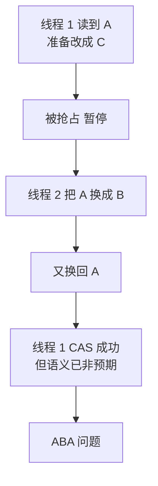
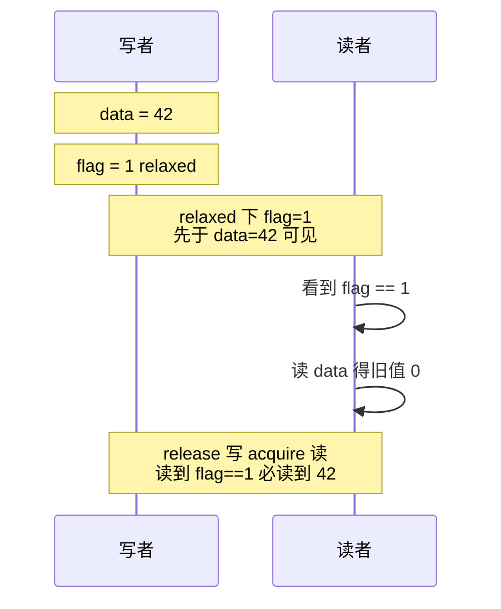
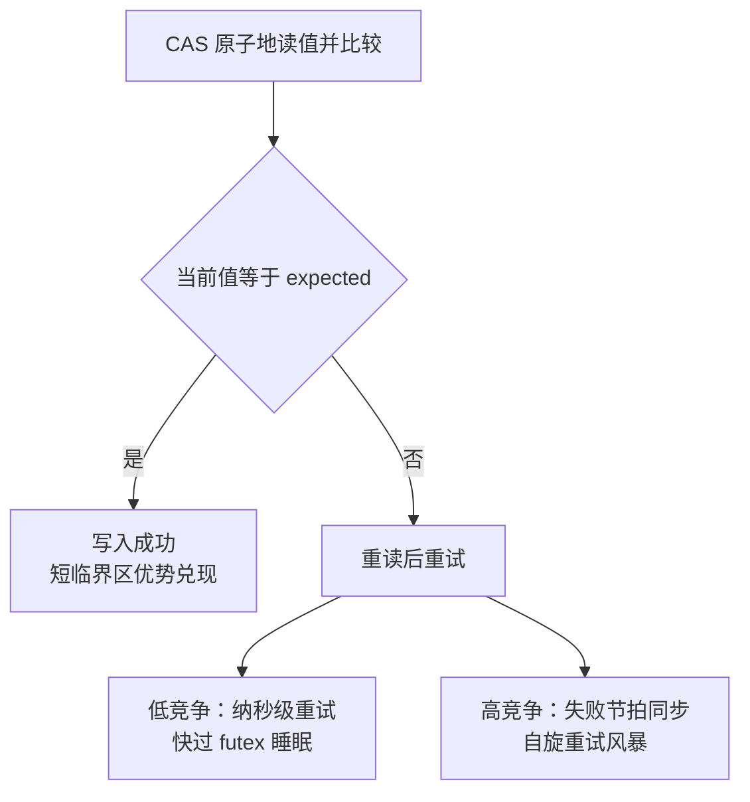

# 无锁数据结构的证据门槛：CAS与内存序

## 要解决的问题是什么

这篇讲无锁数据结构的证据门槛：什么时候把锁换成 CAS（Compare-And-Swap，比较并交换：只有**值仍等于预期时**才写入的原子操作） 才真的更快。读完你能判断自己的临界区（一段同一时刻只允许一个线程进入的代码区域）**该不该上无锁、上之前要拿哪些证据**。

**锁慢在两处**：上下文切换（等待者睡眠再唤醒，微秒级）与**缓存行乒乓**（锁竞争把锁字所在的那 64 字节缓存行在核间来回搬）。CAS 原子地读值并比较，一条指令就能"看值没变就改、变了就不改"，**CAS 循环承诺免切换的原子更新：失败就重试，不睡眠**。

但 CAS 循环的"快"要有证据支撑，没有证据的 CAS 换来的常是更慢：**自旋（原地反复重试不睡）烧 CPU、ABA（值从 A 改成 B 又改回 A，让 CAS 误以为没变过）咬坏数据、内存序错配在弱内存模型机器上随机崩溃**。

问题的本质：无锁把"等待"从调度器（睡眠）搬到指令层（重试），**快慢取决于竞争强度与回退路径**。它有明确的适用门槛，**多数临界区**（同一时刻只许一个线程执行的那段代码）仍然该用锁。

读完这一篇，你能**判断手上这段并发代码有没有换成无锁的必要，以及换了之后该用什么数据证明它真的更快**。

无锁的做法可以想成两个人在同一个窗口办事：谁先到谁办，办不成的人原地再试一次（重试），不是回家睡觉等通知。两人这么办事没有问题；多人拥挤时这个比喻就不够用了，下面接着说。这个比方只到「失败方自己重试」为止。无锁协议里没有排队、没有睡眠，一切行为都由重试与算法本身定义，CAS 怎么判冲突、内存序怎么保证可见性要看正文。

这个比喻到"冲突有多频繁"为止（不再延伸：窗口数、排队规则在真实系统里另有机制）——偶尔撞一次，原地重试确实省事；如果十几个人同时挤在窗口，所有人都在原地打转，反而比排队睡觉更浪费，**这正是无锁只在竞争不激烈时才划算的原因**。

## 无锁到底快在哪里、慢在哪里

**CAS 的协议语义**：一条指令完成"读-比-写"三步原子动作。`compare_and_swap(ptr, expected, desired)`：当前值等于 expected 才写入 desired，返回是否成功。**失败的线程重读再试**。硬件保证单条 CAS 的原子性（x86 的 `lock cmpxchg`，或 ARM 的 load-linked/store-conditional 一对指令），**线程级的不变量——每步操作后数据结构必须保持的完整状态，要靠循环与重试自己维护**。

**ABA 问题：值相等不等于没动过**。线程 1 读到 A、准备改成 C，被抢占；线程 2 把 A 改 B 再改回 A；线程 1 的 CAS 发现还是 A，成功写入——**看起来成功但语义已非预期**，中间态 B 已被别人消费或结构已被改形（链表节点被释放又复用，指针同值不同物）。解法：带版本号的 CAS、hazard pointer（危险指针：线程把正在用的指针登记出来，回收者绕开它们）、epoch-based reclamation（基于纪元的内存回收：按代次延迟释放，等所有读者离开这一代再回收）。**ABA 在无 GC 的语言里是数据正确性问题，在带 GC 语言里退化为计数语义问题**（对象不会复用同地址，但业务状态仍可能"回去了"）。

线程 1 看到的"还是那个 A"，中间经历过一轮改回。图里把两个线程与那个共享位置分开画，能看出 CAS 比较发生的时刻与它比较的东西：

**CAS 比较的是值，看不见中间那一轮历史**。带版本号的 CAS 把版本计数并进比较，延迟复用让旧地址暂时不会再出现同值，**两种解法都是把这段历史补进判据**。

**内存序：原子 ≠ 顺序**。**CAS 成功只保证被操作的字段原子，不保证周围的读写顺序**。弱内存模型（ARM、POWER 这类允许 CPU 把独立的读写重新排序的架构）上编译器与 CPU 都会重排（布局或尺寸变化触发重新计算排版）。acquire/release 语义：release 写之前的读写不许下沉到写之后，acquire 读之后的读写不许上浮到读之前——两者配对形成"发生先后"（happens-before）边。`memory_order_seq_cst` 给全局总序，也最贵——因为要在所有处理器之间维持一个统一的可见次序，需要额外的屏障与同步动作；`relaxed` 只保原子性，对周围读写不设任何边界。**经典事故：用 relaxed 更新标志位，数据写入被重排到标志之后，读者看到标志置位但数据未就绪**。**内存序是给重排划边界的约定，选错序是并发 bug 的富矿**。

技术博主 preshing（Jeff Preshing，长期写并发与内存模型文章）在真实机器上直接抓到过重排。他用的是另一段双线程程序，与上面写数据、置标志的例子不是同一段代码，抓到的也是另一类重排：x86 的 TSO（Total Store Order，全存储排序：x86 的内存模型）内存模型允许 store 与随后的 load 交换次序，这类 store-load 重排在强序机器上同样会发生。下面是他的终端输出，重排被真实捕获时的结果：

*图示：多核下内存重排序的实测输出。图源：[preshing · Memory Reordering Caught in the Act](https://preshing.com/20120515/memory-reordering-caught-in-the-act/)。输出中出现的那一次反序，就是一次被抓到的重排。*

这张图演示 preshing 抓到的 store-load 重排：源码里先写后读的两条指令，**到处理器那里是两条可以交换次序的独立指令**。注意它与上面 relaxed 标志位的事故是两类重排：那次是 store-store，两次写操作之间被换了先后；这次是 store-load，写与读之间被换了先后，x86 对 store-load 同样允许重排。**两次实验合起来说明编译与硬件都会重排，acquire/release 的作用就是在编译结果与硬件执行之间插进不许跨越的边界**。两者同属"编译与硬件会重排"这一事实，但不是同一类重排，也不冲突。

回到上面写数据、置标志的那段代码，relaxed 与 acquire/release 差在哪一步被允许重排：

relaxed 省下的是一道顺序边界，代价藏在后面：ARM（一种精简指令集的处理器架构，广泛用于手机与嵌入式设备） 这类弱序机器上读写会被重排，**错误随机出现，排错的时间远超省下的开销**，x86 因为硬件默认不重排这一对写入而"碰巧对"。**跨平台部署的默认选择是 acquire/release 配对**：写者用 release 写标志位、读者用 acquire 读，读到 flag==1 就一定读到 42（完整数据）。

**证据门槛：什么时候无锁真的快**。只有**两种情形**才值得上无锁：一种是临界区极短（里面只有几条指令，锁的获取释放开销占比过高）且竞争低（CAS 失败率低，自旋不空耗）；要么**免锁的实时性或免死锁（多个执行流互相等待对方释放资源）性质本身是硬需求**（中断上下文不能睡眠拿锁）。竞争激烈时长 CAS 自旋比互斥锁（同一时刻只允许一个执行流持有的锁）更糟：**自旋消耗整核还阻塞总线**，而 futex（Linux 的用户态快速锁：无竞争时只是一条原子指令，有竞争才进内核睡眠）**在无竞争时代价与一次 CAS 相当**。**判定靠测量**：`lock cmpxchg` 失败率、每操作纳秒数、与 std::mutex（C++ 标准库的互斥锁）对照，**不靠"无锁更快"的直觉**。

一次 CAS 尝试走向哪里，决定了**无锁结构是快过锁还是慢过锁：**

低竞争时重试路径短过一条 futex 系统调用（程序请求内核提供服务的入口）；高竞争时重试路径叠加了缓存行来回搬运：所有线程同时重试，争抢同一条缓存行的所有权，缓存行在核间反复易主，**单条 CAS 的廉价被总线争用吞掉，收益在这里转为亏损**。

来源：[美团技术团队《Java线程池实现原理及其在美团业务中的实践》](https://tech.meituan.com/2020/04/02/java-pooling-pratice-in-meituan.html)（CC 4.0 BY-SA）

来源：[腾讯云开发者社区《30 张图揭开「内存管理」的迷雾，瞬间豁然开朗》](https://cloud.tencent.cn/developer/article/2671629)（CC 4.0 BY-SA）

## 换成无锁付出了什么代价

CAS 指令源自 IBM System/370（1970 年），研究界把它推成无同步原语的基础，Herlihy 1991 年证明 CAS 是"通用"原语：**任何并发对象都能用它实现无等待版本**。Java 5（2004）的 java.util.concurrent（Doug Lea）把 CAS+内存序做成平台级并发库，"原子类替代锁"进入工业主流。C++11 标准化内存模型（2011）把内存序从方言（各编译器的 barrier 内建函数）收进语言。RCU（Read-Copy-Update，读端无锁的内核同步机制）与 hazard pointer 等内存回收方案在 Linux 内核与文献中成熟，其中 RCU 即 Read-Copy-Update 读复制更新：读者不加锁直接读，写者复制一份改完再切换指针，旧副本等所有读者离开后回收，hazard pointer 即危险指针，把正在使用的指针登记出来供回收者绕开在 Linux 内核与文献中成熟。

**把同步从"临界区"改写成"协议"**：锁定义一块互斥区域（进区睡觉出区唤醒），无锁把互斥改写成协商协议：线程反复尝试操作、失败就重读最新值再试一次，**数据结构的完整状态由算法结构保证，全程不睡眠**。这个视角让无锁队列、Treiber stack（Treiber 提出的无锁栈：入栈只需一条 CAS 指令完成）成为可能。代价：**无锁算法的设计与验证难度高一个量级，不变量证明、ABA、内存回收是三座山**，Linux 内核文档 `memory-barriers.txt` 的免责声明写的是"有疑问（疑问会很多）就来问"；弱内存模型上是测试地狱：x86 强序机器上"碰巧对"，ARM 上随机坏——这类错误只在弱序硬件或模型工具下才暴露，平常测试很难抓到，TSAN（ThreadSanitizer，运行时数据竞争检测器）能测一部分，**模型细节仍靠 litmus test（几十行的最小并发程序，跑百万次看有没有出现被禁止的结果）**；调试与观测难：**竞态（多个执行流争抢资源、结果取决于时序）偶发、难以稳定复现**，等拿到 core dump（进程崩溃时的内存快照）时各线程状态早已改变。**无锁是特种兵式的手段：只在特定场景出动，不是处处替换锁**：内核 RCU 读侧免锁、JDK（Java Development Kit，Java 开发工具包） 的 ConcurrentHashMap 分段 CAS、无锁多生产者多消费者队列这些场景验证过它值，业务代码的大多数临界区该用锁。

## 这套说法在哪儿会失效

- **单生产者单消费者（SPSC）环形队列是无锁收益最容易兑现的形态**：两个写者各写各的游标（正好用上一条缓存行对齐避免前文说的伪共享），**协议简单可证明**。多生产者多消费者（MPMC）**复杂度跳档**：要靠 helping 协议先到的线程替卡住的线程把半完成的操作做完，还要靠批量索引让一次 CAS 推进一整批序号来减少争用次数。非热点（访问集中在少数键或节点上的现象）别碰。
- **内存序错误在强序机器上测不出来**。x86 的 TSO这种强内存模型**免费给了很多顺序保证**（很多在 ARM 上必须显式声明的顺序，x86 硬件自动保证），代码迁到 ARM/Graviton 上才爆。跨平台部署的代码**内存序必须按最弱模型写（release/acquire 显式配对）**，用 litmus 工具验证：herd（内存模型模拟器，对照内存模型枚举所有允许结果）、loom（Rust 的并发交错穷举工具，在 Rust 里穷举线程交错）。
- **CAS 重试风暴（重试流量层层放大、让故障雪上加霜）是隐藏的活锁（各方不停动作却谁也进不了目标状态的循环）**。高竞争下所有线程同时失败同时重试（同步的失败节拍），**吞吐塌到比串行还低**。缓解：**退避（失败后等一小段时间再试，等待时间按指数退避拉长并加随机抖动，错开冲突）、或放弃 CAS 改用锁**。**队列长度/失败率的监控是无锁结构上线的必备观测**。
- **"无锁"有分级，宣传语不等于性质**。lock-free（系统级前进保证：至少一个线程在前进）≠ wait-free。多数"无锁"实现只是 lock-free，个别操作仍可能长期停滞。

## 怎么自己动手验证

- **CAS vs mutex 对照实验**：短临界区计数器分别用 CAS 循环与 std::mutex 实现，竞争线程数从 1 扫到 32。预期：低竞争 CAS 每操作纳秒级优势明显；高竞争区 CAS 失败率飙升、吞吐反超点出现，**mutex在重竞争下更稳**。这是适用门槛的实测证据。
- **内存序 litmus 实验**：上面时序图里那段 message passing 程序（写者 data=42 再 flag=1，读者等 flag 再读 data），做 relaxed、acquire/release、seq_cst 三版，在 ARM 机器上跑百万次迭代。预期：relaxed 版出现读到 flag==1 但 data==0 的乱序观察；acquire/release 版与 seq_cst 版都零乱序，**两者差别只在全局总序带来的额外同步开销**。这是内存序必要性的可复现证据。
- **ABA 复现实验**：Treiber stack 不带版本号，并发 pop 同一节点两次（中间被释放复用）。预期：带 GC 语言需对象池复用地址才能复现双弹；**带版本号（指针+计数一起 CAS）后双弹消失**。ABA 从传闻变成实验证据。

## 接着该读哪几篇来补 CAS 竞争的视角？

- [[工程知识/性能工程：从用户等待到资源瓶颈/处理器与内存/缓存行与伪共享：64字节里的并发性能]] —— CAS 竞争把缓存行乒乓放大，无锁队列的游标要按缓存行对齐分开存放
- [[工程知识/后端系统：在并发、失败与变化中维持服务/任务与并发/分布式锁的正确与错误用法：fencing与租约]] —— 单机的 CAS 与跨机的分布式锁是同一问题（互斥 + fencing，即用单调递增的令牌让过期持有者的写入被拒绝）的两个尺度
- [[工程知识/性能工程：从用户等待到资源瓶颈/操作系统与运行时/进程线程与系统调用构成执行边界]] —— 锁的睡眠路径经过调度器（futex），无锁把等待留在用户态（普通程序运行的低权限受限状态），边界在哪决定开销在哪
- [[工程知识/缺陷分析：从个案到体系/并发/并发缺陷的复现策略：压力放大与确定性调度]] —— 内存序与 CAS 是机制背景，那一篇是复现侧
- [[工程知识/缺陷分析：从个案到体系/并发/回调必须回到属主线程：完成通知的线程归属纪律]] —— "线程安全的容器加非串行化使用"仍会撕裂上层不变量的反面教材
- [[工程知识/缺陷分析：从个案到体系/复现与回归/内存错误的检测要靠影子内存：红区、悬垂隔离与代价账.md]] —— TSan 报出数据竞争（多个执行流同时读写同一数据且无同步，结果随时间顺序变化）之后，同类内存边界错误由 ASan 家族负责，射程与代价账在那篇对齐
