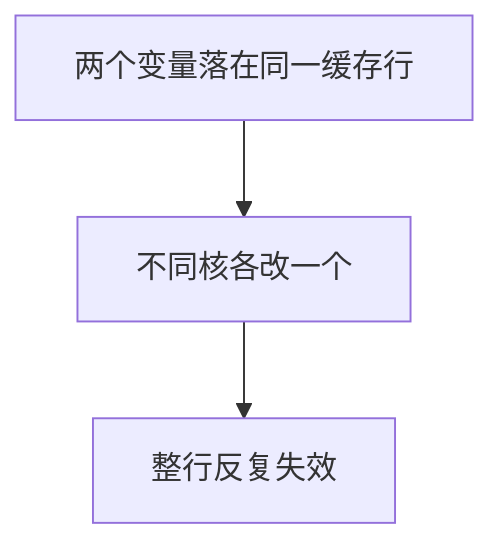
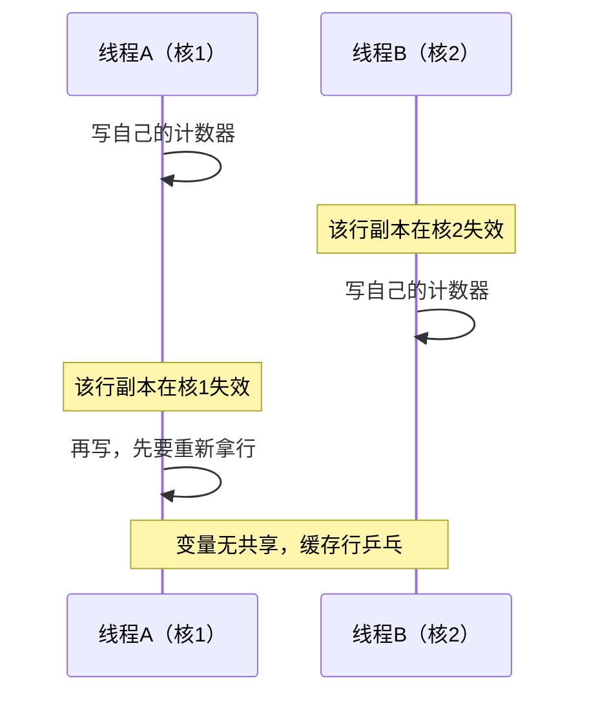
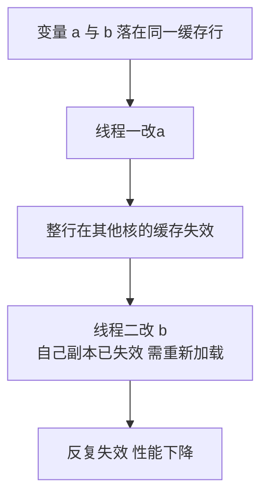

# 缓存行与伪共享：64字节里的并发性能

## 要解决的问题：伪共享为什么让逻辑独立的变量互相拖慢

本文讲伪共享：为什么逻辑独立的两个变量会因挤在同一缓存行里而拖慢多核程序。读完你能**判断程序是否中招，并用 perf c2c（perf：Linux 性能剖析工具；c2c 指缓存到缓存，专门定位伪共享）定位、用填充消除**。先看伪共享的成因：

多线程程序里，两个线程各写各的变量，逻辑上毫无共享，**性能却塌了一截**。这些变量在代码层各自独立、互不引用，**在缓存层却同住一个 64 字节的缓存行**（cache line：CPU 缓存一次搬移的最小单位）；硬件为了保证各核的缓存副本是同一份数值，**把整个缓存行当作失效与同步的最小单位**。假设两个独立计数器各自 +1：每次写都让对方的缓存副本失效，**缓存一致性协议把「独立写」翻译成两个核之间的「乒乓同步」**：每次乒乓都是一次跨核的一致性事务，带来额外的内存访问延迟；核数越多，这种无效同步越频繁，**性能随核数增加反而下降**。问题的本质：**程序的对象布局是按语言语义组织的，硬件的一致性粒度是按缓存行组织的，两层粒度错配**，**写写冲突在语义层不存在，在缓存层真实发生**。

## 独立变量为什么互相拖慢？机制拆开看

先把形状说成一件事：两个同事各拿各的文具，但文具恰好放在同一辆推车上，任何人取笔，**管理员都把整辆车推走登记，另一个人就得等车回来**。这个比喻到"登记往返"为止——现实里缓存行乒乓是纳秒级的硬件开销，量级小到**只有高并发热点（访问集中在少数键或节点上的现象）路径上才看得出来**，这也解释了它为什么平时不显形。

**缓存行：硬件管理的最小单位**。**CPU 缓存不以字节为单位管理，而以缓存行为单位**（主流 x86/ARM 为 64 字节，部分 Apple Silicon L2 为 128 字节）。一次内存读把整行搬进缓存，一致性协议以整行为单位维护各核副本状态——主流协议叫 MESI（缓存一致性协议，用四种状态维护多核之间缓存行副本的一致），名字就是一行在某个核里的四种状态：Modified（本核改过、唯一有效副本）、Exclusive（唯一副本、未改）、Shared（多核各持一份、都未改）、Invalid（副本已失效）。一个 64 字节缓存行内放 8 个 long，**任何核写其中任何一个，其他核持有的整行副本都进入 Invalid**，下次读要重新同步。一致性粒度是「行」，**行内的任何写都波及整行**。

一次读或写落到 MESI 协议上的完整路径见下图：读命中不动状态，写命中要在 Modified 与 Shared 之间广播失效，写缺失更要先问总线有没有其他副本、把别人的 Modified 版本写回主存才能拿到所有权——伪共享的每一次「乒乓」，在这张图上都是一次完整穿越：**从本地命中一路走到总线仲裁（冲突发生时裁决谁胜出的机制）、写回与重新加载，每一步都消耗额外周期**，所以一次乒乓对应一次可测量的性能代价：

*MESI 状态迁移的活动图（图源：Wikimedia Commons，Jackbrear 绘，CC0）*

**伪共享：错配的具体形态**。两个线程分别频繁写相邻的两个变量（比如各自队列的头指针、各自的统计计数器），**变量恰好位于同一缓存行**。线程 A 写自己的计数器 → 整行在 A 核为 Modified、在 B 核失效；线程 B 写自己的计数器 → 整行迁到 B 核、A 核失效。变量独立，缓存行乒乓。**MESI 在做语义上完全正确的事（保证一致性），代价由共享同一行的无关写者集体承担**。

看两个线程的独立写操作（线程一改a、线程二改 b），在缓存层如何变成一行数据的往返同步（下面按时序逐步展开）：

上面曲线的实测环境是一颗 12 代 Intel Core i7（大小核混合设计：6 个性能核加 8 个能效核，共 20 个硬件线程）：每个线程只递增属于自己的一个字节，彼此不共享数据——但这些字节在数组里紧邻存放、被塞进同一个缓存行，**每个线程的写都让别人的副本失效**；线程数从 1 加到 20 的过程中单次递增的耗时上升到单线程的约 50 倍；**把这些字节分散到不同缓存行之后（alignas(64) 对齐），耗时只比单线程增加约一倍**：

*默认布局与按 64 字节对齐的耗时对比（图源：Wikimedia Commons，Vibrant franklin 绘，CC0）*

图取自 [维基百科 False sharing 条目](https://zh.wikipedia.org/wiki/%E4%BC%AA%E5%85%B1%E4%BA%AB)，作者 Vibrant franklin，许可 CC0。

**填充（padding）：把语义独立变成物理独立**。**在热点字段间插入冗余字节，让不同的核写不同行**。Java 历史上用 `long p1,p2,...` 手工填充，后来 `@Contended` 注解（JDK 内部类之外使用需加 `-XX:-RestrictContended`）由 JVM（Java 虚拟机，Java 程序的运行时）自动填充；C/C++ 用 `alignas(64)` 或手工 padding；Go 没有自动填充机制，热点场景要手工在结构体里插入 `cpu.CacheLinePad`（官方扩展库 `golang.org/x/sys/cpu` 提供的占一行的空结构）。填充的方向要看访问模式：**写写冲突**的热点才值得填充，只读字段共享一行毫无代价（副本不失效）。

**检测：先测后填**。`perf c2c`（Linux 的 cache-to-cache 分析，采样 HITM 事件：读命中了另一个核里处于 Modified 状态的行）**直接报告伪共享热点行**；`perf stat -e cache-misses` 的**异常升高是线索但非定位**；macOS 无公开等价工具，靠 Instruments（Xcode 自带的性能分析工具）的 Cache Misses 面板推断。JVM 场景用 JMH（Java 的微基准框架，专为测小段代码性能设计）加 `-prof perfasm` 参数，看热点指令的旁证。判定标准：**多个核对同一行交替写（HITM 集中）且逻辑上变量独立**，才是伪共享；逻辑上真共享的变量同住一行反而是优化（一个一致性事务覆盖两个热点）。

来源：[美团技术团队《Java线程池实现原理及其在美团业务中的实践》](https://tech.meituan.com/2020/04/02/java-pooling-pratice-in-meituan.html)（CC 4.0 BY-SA）

## 填充技术从哪里来、要付什么价？

缓存一致性协议在 1980 年代的多处理器研究机上成型——Illinois 协议 1984 年给出 MESI 四状态的雏形，DEC Firefly 1987 年用另一套写更新协议，Intel 从 Pentium 起把 MESI 做进主流桌面 CPU；多核普及（2005 年前后）后伪共享从教科书概念变成工程问题。Disruptor（LMAX 公司 2011 年开源的高性能并发框架）**把缓存行填充做成并发框架的标志性设计**（环形队列槽位按 128 字节边界排列防伪共享），Java 社区因此广泛认识这个问题。Linux 内核的 `____cacheline_aligned` 宏是同一约定在内核代码里的落点。

**填充技术**：在语义独立的字段之间插入冗余字节，**把「逻辑独立」（代码层各自独立）翻译成「物理独立」（缓存层也各占一行）**：语义层的并发正确性由锁与原语保证，缓存层的并发效率由布局保证，两层各司其职。Disruptor 的环形缓冲把 sequence 与条目元数据填充隔离，单线程写多线程读的路径上**每个消费者游标（记录消费进度的位置标记）独占一行，吞吐显著高于传统锁队列**。代价：**填充浪费内存（每热点对象多出 56 到 120 字节，结构体数组场景浪费可达数倍）**；@Contended（让 JVM 自动为字段加填充以隔离缓存行的注解）这类自动机制只对 JVM 内部与标注字段生效，跨对象布局无能为力；**过度填充是更常见的错误**——不经测量给所有结构体对齐，**内存带宽压力（行数变多）反而损害性能**，且多数程序的多数字段没有写写冲突。**填充是测量驱动的点手术，架构层不该把它当默认动作**。

## 这套说法在哪儿会失效

- **64 字节是当前主流约定，代码不能把它当常量依赖**。Apple Silicon M 系 L2 行 128 字节，老 ARM 实现各异。跨平台性能代码**不要把 64 写成常量依赖**，要用运行时探测（Linux 用 `sysconf(_SC_LEVEL1_DCACHE_LINESIZE)` 查询）或取保守值 128 填充。
- **只读共享不是问题，填充只对写写热点**。三个线程只读同一行，**各核各持副本零同步代价。给只读字段填充是纯浪费**。
- **真共享反而该同居**。锁与其保护的数据同住一行（一次一致性事务把锁与数据一起拿到）在特定模式（自旋锁——线程拿不到锁时反复轮询而非睡眠——与数据紧邻）**下是优化；把锁单独填充反而增加一次行同步**。**是否填充取决于访问模式的实测，布局没有普适最优**。
- **工具链可能改掉你的布局**。C 结构体字段顺序由你决定，但打包选项会把填充压掉；Go 的 `fieldalignment`（静态检查工具）会建议重排（布局或尺寸变化触发重新计算排版）字段顺序来省内存空间，**如果照做，会把有意留的填充合并掉**；JVM 的对象头与字段重排由虚拟机决定。**验证填充生效要看内存布局的实测**——`pahole` 读 DWARF（调试信息格式：可执行文件里描述变量与行号的数据） 调试信息、报告结构体的填充空洞；JOL 即 Java Object Layout，打印 JVM 对象布局。

## 怎么自己动手验证

看一个反差场景：两个变量在语义上无关，在缓存行上却绑在一起（时序如下）：

- **perf c2c 实验**：多线程各自写相邻计数器，`perf c2c record`/`report`。预期：HITM 事件集中在该计数器地址区间；**填充到不同行后 HITM 峰值消失，吞吐按核数接近线性提升**。这是伪共享存在与消除的对照证据。
- **缓存行大小探测**：程序步进写数组，步长从 8 字节到 512 字节扫一遍，测吞吐拐点。预期：拐点出现在 64（x86）或 128（M 系列）附近——**缓存行大小可被公开手段复现，不依赖厂商文档**。
- **Disruptor 对照读**：LMAX 论文与 Disruptor 源码的 RingBuffer 填充段，读到填充对象与消费者游标的布局意图。**这是第三方高性能库的公开设计证据**。

## 接着读哪几篇：缓存行是缓存层级的基本单位

- [[工程知识/性能工程：从用户等待到资源瓶颈/处理器与内存/CPU缓存与分支决定有效执行时间]] —— 缓存行是缓存层级的基本单位，本篇是一致性粒度的并发代价
- [[工程知识/性能工程：从用户等待到资源瓶颈/处理器与内存/NUMA让跨槽访问付出带宽与延迟代价]] —— 伪共享与 NUMA 是多核内存系统的两个维度：行级失效与跨槽供给
- [[工程知识/数据系统：在并发与故障中保存事实/查询与索引/列存与向量化执行：OLAP引擎快的两个来源]] —— SIMD（Single Instruction Multiple Data，单指令多数据：一条指令同时算多个数） 通道数受缓存行供给约束，列存的行级布局是同一粒度思想在数据系统的应用
- [[工程知识/性能工程：从用户等待到资源瓶颈/处理器与内存/SIMD与数据并行：一行代码的多个通道]] —— 通道数是并行度上限，布局连续才装得满通道
- [[工程知识/性能工程：从用户等待到资源瓶颈/处理器与内存/无锁数据结构的证据门槛：CAS与内存序]] —— CAS（比较并交换、无锁更新共享数据的原子指令） 竞争放大缓存行乒乓，无锁队列的游标要按缓存行边界分开存放
- [[工程知识/性能工程：从用户等待到资源瓶颈/存储与网络/cache分配策略与命中率：LFU与LRU的实证对比]] —— CPU 缓存行是硬件 LRU（Least Recently Used，最近最少使用：优先淘汰最久未被访问的条目） 实例，那一篇是软件缓存策略层，共享局部性逻辑
