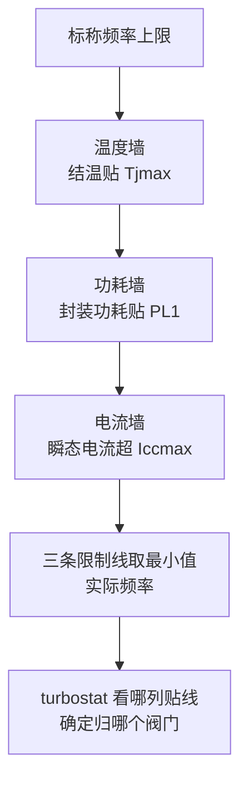
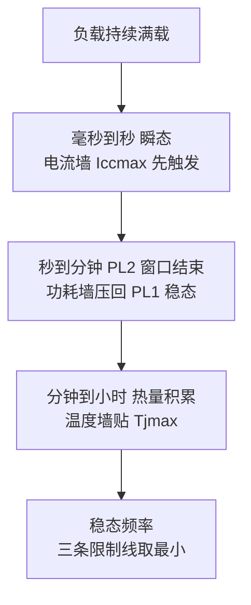

# CPU 降频的三个阀门：温度墙、功耗墙与电流墙

> **要点**：这篇讲 CPU 实际频率被温度墙、功耗墙、电流墙三道限制取最小值决定；读完你能用 turbostat 读出温度、功耗、电流三列数据，一分钟定位降频原因，先于换硬件去调散热与负载整形。

## 要解决的问题：频率是协商的结果，降频原因怎么定位

CPU 的标称频率是**"散热与供电条件理想时"**的能力上限——运行中实际频率由管理子系统按三个阀门实时调节：**热设计的前提**（结温超限即降频保命）、**功耗约束**（整机功耗预算，数据中心与笔记本都按 PL1（长时功耗限制）与 PL2（短时睿频限制）分档）、**电流限制**（瞬态电流超供电能力会掉压掉稳）。**排查的意义**："CPU 满载但性能只有标称的一半"的报告里，**多数是某个阀门在持续触发**——读出是哪个阀门、为什么触发，才知道动散热、动功耗预算还是动负载。

## 三个阀门分别怎么读、为什么会触发？

三个阀门的共同形态是：**占用随负载上升，触到阈值之后系统主动压回**——这里的阀门是比喻：温度、功耗、电流像三道限流（限制单位时间内放行的请求数量）阀，任何一道达到阈值，就由 CPU 管理子系统主动把频率压回安全区间，机器里没有真实的机械阀门，关阀动作由管理子系统执行。降频就是这种**把用量压回可承受区间的动作**。


**温度墙（thermal throttle）**：结温（即 Tjmax，芯片核心允许的最高温度，超过即触发温度墙）触发降频——**读法**：`turbostat` 的 `PKG_TMP`/核心温度列、` Throttle` 计数器（内核 `thermal_throttle` 统计里的触发次数）；`dmesg | grep -i thermal` 看 THM（thermal 温度事件）记录。**成因**：散热器积尘/硅脂老化（长期运行的物理退化）、机房空调与风道问题（**热短路**，即热排风被重新吸回进风口，机柜级尤其常见）、高密度部署的相邻影响——**温度墙是三个里最该优先排的**（它同时是硬件寿命的威胁，本库硬件监控信号分层篇的预警级信号）。

**功耗墙（power throttle）**：封装功耗持续超过 PL1 时压频率——**读法**：`turbostat` 的 `PkgWatt` 对比 CPU 的 PL1 值（`cat /sys/class/powercap/intel-rapl:0/constraint_0_power_limit_uw`）、`MSR_PKG_POWER_LIMIT`；云主机上 hypervisor（宿主机的虚拟化管理层）的限制也要核（买的 vCPU，即虚拟机分到的逻辑 CPU，**其规格与底层限频是两回事**）。**成因**：负载真的吃满功耗预算（持续满载的科学计算/AI 训练，**标称频率本就不可持续**——睿频即短时冲高的加速频率，只在短窗口 PL2 内成立）、或**整机功耗被其他组件挤占**（GPU、网卡抢功率预算）。

Intel 在 datasheet 的 Thermal Management 一章把这套限制画成了四级功率线：**PL1 是可以永久维持的持续功率**（通常等于 TDP，即 Thermal Design Power 散热设计功耗，散热系统按这个值设计），**PL2 是短时睿频功率**（可维持约 100 秒，即 Tau 时间窗），PL3/PL4 是只允许 10ms 量级的瞬态峰值（默认禁用）；黄色曲线是封装的实际功耗，**均值贴着哪条线，频率就被哪个阀门压住**：


*图源：[FCPOWERUP《CPU功耗=TDP=95W？功耗和TDP关系介绍》](https://www.fcpowerup.com/power-consuption-tdp/1000/)转引 Intel datasheet Thermal Management 章节插图。*

datasheet 图解是**「规则怎么写的」**，实测曲线是**「规则怎么执行的」**。下图是 Core i9-13900K 满载 60 秒的实测记录：前 28 秒功耗贴着 PL2=253W、频率顶到 5.6GHz（Tau 窗口内的短时爆发），窗口一过功耗被压回 PL1=125W、频率同步跌到 2GHz 档——**箭头标注的转折点正是功耗墙生效的现场**，而它不是散热问题：


*图源：BottleneckCheck《CPU Throttling Explained》，https://bottleneckcheck.com/?p=1324。实测曲线与上图的 datasheet 图解对照：Tau 时间窗有可观测的频率断崖作证。*

温度墙的物理对象是散热器本体：热管把 die（芯片裸片，热量集中的发热源头）的热量带到鳍片，**鳍片面积与风道决定结温能不能压住 Tjmax 之下**——积尘与硅脂老化让这条通路的热阻（热量传递的阻力，数值越大越难把热带走）逐年上升，**温度墙触发越来越早**，这正是长期运行机器**"越用越慢"**的物理原因：


*图源：Wikimedia Commons，Smial，FAL 1.3，https://commons.wikimedia.org/wiki/File:Cpu_cooler_Supermicro_SNK-P0064AP4_IMGP3440_smial_wp.jpg。*

**电流墙（electrical/current throttle）**：瞬态电流超限（Iccmax，供电模块允许通过的最大瞬时电流）触发——**读法**：turbostat 的 `IA_LOAD`、相关 MSR（型号相关寄存器，Model Specific Register，CPU 把配置与运行状态存在这里）的 current limit 状态位；现象特征是**负载突增瞬间的频率骤降**（burst，突发负载场景）。**成因**：供电模块老化VRM（Voltage Regulator Module，主板上把电源电压降到 CPU 所需值的供电电路）、主板供电设计余量小、超频或 BIOS（基本输入输出系统，主板固件，开机时初始化硬件并持有频率、电压与功耗限制的设置项）的电流设置错误——**云环境少见，物理机与自建设施的旧机器上真实存在**。

**三者取最小的系统读法**：`turbostat --interval 1` 跑一分钟，同时看频率、功耗、温度三列——**降频的原因看"哪个指标贴着限制线"**（温度贴 Tjmax-5 内 = 温度墙、功耗贴 PL1 = 功耗墙、都富余但频率低 = BIOS 或驱动设置问题），**一分钟的数据替代一小时的猜测**。

三个阀门同时约束，实际频率由贴线最低的那个决定：



频率由谁决定：降频机制的本质是三条限制线取最小值——**三条限制线各自独立，谁贴线谁说了算**。温度贴 Tjmax 属于温度墙，**对应动散热**；功耗贴 PL1 属于功耗墙，**对应动预算**；电流超 Iccmax 属于电流墙，**对应动供电**——所以排查时先读哪一列贴线，就知道该归哪个阀门管、该动哪一类。

## 读完能据此判断该动哪个阀门、做哪类动作？

**温度墙 → 散热与布局**：清理与更换散热（物理动作，收益立竿见影）、机柜风道与盲板（挡住空闲槽位的挡板，防止热排风短路回流）、负载迁移（把发热大户分散到不同机柜）——**温度墙的持续触发同时缩短硬件寿命**，处理优先级最高。

**功耗墙 → 预算与整形**：核对负载的功耗画像与采购规格的匹配（**持续满载型负载按 PL1 而非睿频频率做容量规划**——本库"硬件选型的容量留白"的核算把睿频泡沫挤掉）、负载整形（**削峰让 PL2 的短时睿频覆盖突发**）、整机功耗预算重分配。

**电流墙 → 供电与设置**：BIOS 设置核对（**电流限制项被误改是常见根因**）、VRM 老化评估、负载突增的斜率整形（burst 上限：限流控制单位时间放进来的请求数量，超过配额就拒绝）。


**三个阀门不是同时说话的，它们的时间常数不同**——**电流墙在毫秒到秒的瞬态最先触发，功耗墙在秒到分钟的 PL2 窗口结束时压回，温度墙在分钟到小时的热量积累后贴线**，瞬态、短时与长期各管一段，稳态（系统运行指标进入平稳区间后的状态）**频率是三段叠加后的结果**：



正因为三条限制线在不同时间尺度上依次到位，**只看启动瞬间的频率必然高估**——容量规划要取稳态值，基准报告的机器画像里也要带上这一段。

**容量规划的角度**：降频让**"峰值性能"不可靠**——标称频率是理想散热与供电条件下的能力上限，实际频率被三个阀门常态压低，**按标称频率做的容量估算因此天然偏高**，**规划必须取稳态频率**；**基准测试要带长时间满载段**（看稳态频率而非初始频率，本库"基准报告绑定机器画像"的环境描述里加频率稳态一项），**容量留白的另一半理由正是降频的不确定性**。

## 这套说法在哪儿会失效

排查方法在三个场景下会失效：降频有保护意义不能全关、云主机读数不可直接观测、监控缺频率维度，三个场景各需要换成对应的处理方式。

**降频有保护意义，不能全关**：**BIOS 里关闭所有保护换取频率是拿硬件寿命与稳定换短时性能**——**治理的对象是"意外的持续降频"**（散热不良、配置错误），**设计内的降频是系统按物理规律工作**。

**云主机的频率不可直接观测**：**虚拟化层屏蔽了 MSR 与 turbostat 的多数读数**——云环境的性能排查用**基准对比法**（同规格实例跑标准负载，与历史基线比），与历史基线（正常状态下的指标水平、用来对比异常）比差异超过一成（按团队告警口径定具体数值）时，**提工单查宿主机降频**。

**监控里加频率维度**：**CPU 利用率 100% 不代表频率达标**——**基础监控里利用率、频率、温度三项都要有**，频率低于标称 80% 与温度贴线都按预警级告警，**两个预警级信号先于性能投诉到达**。

## 怎么自己动手验证

可复现的验证路径：

1. 温度墙复现：压测同时遮蔽出风口，预期 turbostat 显示温度贴线、频率下降、Throttle 计数增长——**三列联动验证读法**；
2. 功耗墙复现：持续满载超过 PL2 时窗，预期频率从睿频回落到 PL1 稳态——验证"睿频不可持续"的容量含义；
3. 基线对比验证：散热改善前后各跑一次长时满载基准，预期稳态频率与吞吐同步提升、提升幅度可归因；
4. 断言锚点：**频率、温度、功耗三列进基础监控、稳态频率进机器画像与基准报告、温度墙预警有告警**——三件齐备，"CPU 慢了"**从玄学投诉变成三个阀门的状态读数**。

```text
三阀断言 = 温度功耗电流取最小定频
读数断言 = turbostat 一分钟定原因
画像断言 = 稳态频率进基准与容量
```

CPU 的真实性能是三个阀门协商后的结果：**温度、功耗、电流哪个贴线哪个说了算**——**turbostat 一分钟的读数给出降频的原因分类**，**散热、预算、供电三个动作各治各的阀门**，**容量规划从标称频率转向稳态频率才算贴近真实**。

## 想深入温度预警，该接着读哪几篇？

- [[工程知识/性能工程：从用户等待到资源瓶颈/存储与网络/硬件故障的监控信号分层：预警级与失效级分开响应.md]] —— 温度预警进信号分层
- [[工程知识/性能工程：从用户等待到资源瓶颈/存储与网络/硬件选型的容量留白：按峰值负载的一半规划，另一半是波动预算.md]] —— 睿频泡沫与容量核算
- [[工程知识/性能工程：从用户等待到资源瓶颈/观测与诊断/基准报告要绑定机器画像：没有环境描述的数字不可比较.md]] —— 稳态频率进画像
- [[工程知识/缺陷分析：从个案到体系/硬件故障/固件参数决定硬件的真实行为：默认值要按介质特性逐项校核.md]] —— BIOS/固件设置核对的同类纪律
