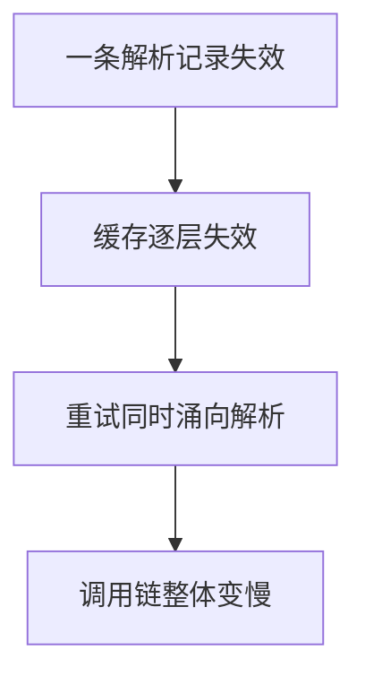
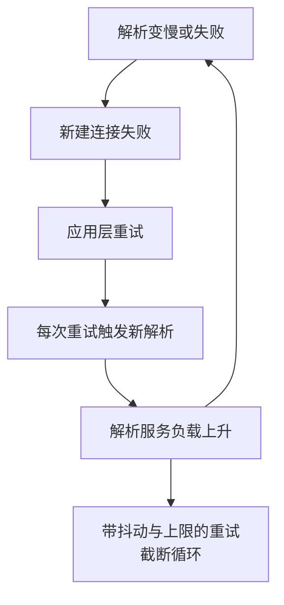

# DNS 故障的放大效应：一条解析记录拖垮一个调用链

> **要点**：DNS 的故障形态是"静默反转与放大"——静默指故障藏在缓存里延迟显现，反转指流量被悄悄送向坏地址，放大指一条记录失效拖垮整条调用链；这篇就讲这三种表现从哪来、怎么查；读完你能按四种失效形态识别 DNS 故障，知道该先取哪三类证据、先动哪三项缓解配置。

## 为什么要单独把 DNS 故障拎出来讲？

要解决的问题是：**一条解析记录失效为何能让整条调用链变慢甚至不可用**。下图先给全局：



放大效应好比**一根水管漏水把整栋楼的水压拖垮**：漏的是一处，塌的是全楼水压。这个比喻只解释"一处失效如何拖垮整体"，流量分配的具体机制不在比喻覆盖范围内。


DNS 是调用链里最容易被当作"理所当然"的一环：服务发现、数据库连接、外部 API 的第一步**都是域名解析**。它失效时的形态**又特别迷惑**——**连接池（复用已建立连接、避免每次请求重新握手的那组连接）里已建立的连接照常工作，只有新建连接失败**。这好比一栋楼的老住户凭门禁卡照常进出、新访客却被拦在门外；比喻只解释"故障为何零散、像随机起伏"，不解释故障从哪来。零散起伏的原因在连接的生命周期上：因为老连接还在工作，只有走新建连接的请求会重新解析、才可能撞上那条失效记录；**随着老连接陆续被新建连接替换，命中失效记录的请求占比逐步升高**，失败比例随之爬升，所以监控曲线上表现为**错误率缓慢爬升而非断崖**。比喻到"零散起伏"为止，再往下的延迟显现要交给缓存逐层计时这个实际机制来解释。**零散只是表面现象**；故障为什么迟迟不暴露，是另一层原因：缓存像层层蓄水池，上游已经切到新地址，下游要等池子里的旧水用完才断流，**所以故障总是晚一步露头**；这个比喻只解释滞后效应，实际**每层缓存各自按 TTL（Time to Live，解析记录的存活秒数）独立计时**，不存在水真的流完这回事。具体机制在下一节四种失效形态里展开。本库另一篇 [[工程知识/后端系统：在并发、失败与变化中维持服务/基础设施/DNS解析的全链路：递归缓存与失效传播]] 讲解析正常时如何逐级查询与缓存，本篇回答故障面：**DNS 失效的四种形态、放大路径与取证顺序**。

## DNS 故障有哪四种形态，又如何沿链路放大？


*图源：Wikimedia Commons《DNS Architecture》，作者 Aaron Filbert，CC BY-SA 4.0，https://commons.wikimedia.org/wiki/File:DNS_Architecture.svg。**解析要沿这棵树逐级问下来**——**每多一级就多一次可能失败的往返，也多一个可能被重试放大的点**。**下面四种失效形态，就长在这条链的不同位置上**。*

**解析失败（NXDOMAIN（域名不存在：DNS 返回的否定应答） / 超时）**：域名不存在或递归解析超时——**新建连接全部失败，已建连接不受影响**。**放大点在重试行为**：**应用层每次重试都触发一次解析**，解析服务过载时重试风暴（重试流量层层放大、让故障雪上加霜）**反过来加重解析故障，形成正反馈**。这条正反馈的循环：



**故障为何自我加重**：应用层每次重试都新发一次解析查询，**大量客户端的重试同时涌向解析服务**，**查询量激增使解析服务过载、响应变慢**，**解析越慢又触发更多重试，负载被自己的重试推高**；**截断点在调用方一侧**，加上抖动（性能指标不稳定的起伏）与上限后循环断开。

**解析结果过期（stale record）**：目标服务迁移、IP 更换后，缓存里 TTL 未过期的旧记录**继续服务**——**故障延迟到 TTL 过期才显现**，**TTL 配得越长，故障窗口越滞后且越长**。上游 BookKeeper（分布式日志存储系统）的一个复现改进是当它的存储节点 bookie 离开集群时清理 address 到 region 的映射，**保证放置决策读到的是新鲜的地址视图**——解析结果过期也是同一类问题：**依赖地址做决策的组件，地址视图的新鲜度必须有显式管理——组件主动监听成员变更并刷新本地映射，而非被动等待过期——不能靠"应该会过期"**。**TTL 不是抽象参数，解析报文里肉眼可见**——Wireshark（网络抓包分析工具）抓一次 DNS 应答，Time to live 字段就是这条记录在缓存里的倒计时秒数：


*图：DNS 应答报文里的 TTL 字段实测（图源：[Wikimedia Commons《TTL of a DNS answer resolving google.com, seen in Ubuntu Linux Wireshark.png》](https://commons.wikimedia.org/wiki/File:TTL_of_a_DNS_answer_resolving_google.com,_seen_in_Ubuntu_Linux_Wireshark.png)，CC0）。TTL 从应答报文下发那一刻开始倒数，缓存链路上每一层各自倒数到零后重新向上查询，在 TTL 倒计时归零前，缓存通常持续返回这条旧记录，**故障因此一直被缓存盖住**；**TTL 配得越长，故障越晚暴露**——**stale record 的滞后窗口长短，就由这个倒计时决定**。*

**解析结果错误（劫持 / 配置错误）**：**解析成功但指向错误目标**——**流量被送错地方**，表现为目标不可达或行为异常。这类故障的取证要害是**在故障现场记录解析结果**（dig 输出、连接日志里的目标 IP），事后重查解析往往已经**"恢复正常"**。

**部分失败（部分记录可用）**：域名有多条 A 记录（域名到 IPv4 地址的映射记录），部分 IP 失效——负载均衡（把请求分摊到多台服务器、避免单点过载）把流量摊到**好坏混合的目标集合**上，**失效 IP 占的流量份额就是实际错误率**。**这条形态最容易误诊为"服务不稳定"**：**错误率稳定在某个百分比、重试后成功率正常，是部分解析失败的特征签名**（用私钥对数据生成可验证的防篡改标记）。
四种形态讲完，解析成功后的下一步是在下游节点间建立 TCP 连接。连接收尾的状态迁移见下图，它与 DNS 取证的衔接在下一篇展开：


来源：[腾讯云《【图解】三次握手，四次挥手 —— 用心看这一篇就够了》](https://cloud.tencent.com/developer/article/2015692)


## 读完这一段你能判断什么：取证顺序与缓解手段

**取证按"现场优先"排序**：**故障进行中先抓三样**——解析结果（在受影响节点上用 dig/nslookup 查询解析结果，记录返回的记录集合与 TTL）、解析链路（用的哪个 resolver、递归路径是否超时）、失败语义（应用日志里是解析失败还是连接失败）。**故障恢复后再取的证据只有"配置现状"，没有"故障现场"**，**很多 DNS 事故查不清是因为取证时故障已经过去**。

**缓解的三项配置**：一是 TTL 按变更需求定——需要快速切流的记录用短 TTL，稳定记录用长 TTL，短 TTL 让缓存更早过期、更频繁回源查询，**切换更快但缓存命中率（请求直接从缓存拿到结果的比例）下降**；二是解析路径冗余——本地缓存（nscd、进程内缓存）+ 备用 resolver；单点 resolver 承担所有客户端的解析请求，负载集中且没有分散路径，**一旦它变慢或宕机，大量客户端的重试会集中压向这一个点**，**冗余的目的就是不让这个单点存在**；三是调用方的失败预算——连接失败的重试**要带抖动与上限**，防止重试风暴反向放大解析故障。

**验证的手段**：受控注入（改 hosts 文件模拟解析错误、用 iptables（Linux 防火墙规则工具）阻断 53 端口模拟解析超时），核对应用表现的形态与上述四形态对得上——**对得上形态才谈得上自动缓解**，对不上的异常表现**说明故障另有原因**。

## 这套说法在哪儿会失效

下面三条说明这套排查方法在哪些情况下不适用、该换什么办法。

**IP 直连不是根治**：绕过 DNS 用 IP 直连，**把服务发现的问题转移到配置管理**——**IP 变更时要改所有客户端配置，变更速度比 DNS TTL 更慢**。**直连只是应急手段**，长期方案是服务发现机制（DNS 或注册中心）的正确配置。

**缓存不新鲜与缓存失效（缓存里的数据过期或不一致、需要回源加载）是两种病**：TTL 内的 stale record 靠缩短 TTL 解决；resolver 本身宕机靠冗余解决——把两者混同（"加个缓存"）**会让第二种病更重**。

**容器环境的 DNS 语义不同**：Kubernetes（容器编排平台，负责容器的部署、调度与自愈）的 Service DNS（平台为每个服务自动分配的域名）、headless service（不做负载均衡、直接返回后端地址的服务类型）、CoreDNS（集群内负责解析的 DNS 服务器）缓存链路有自己的行为——**按虚拟机经验配置的 TTL 与 ndots 在容器环境会产生意外的解析放大**：ndots 是域名内点号数量的阈值，配置过高时**每次查询先走搜索域（一段自动补全的后缀列表，查询会逐个拼接尝试）**。**容器环境的 DNS 参数要按平台的文档重推**。

## 怎么自己动手验证

这篇文章的验证路径有四条，均可复现，每条都写明操作与预期。

1. 形态复现：测试环境分别注入解析超时、stale record、部分 A 记录失效，预期应用表现的形态与四形态签名一致；
2. TTL 验证：改记录后按 TTL 的一半时间探测，预期新旧结果按缓存链路逐步切换，**切换完成时间不超过 TTL 加解析链路延迟**；
3. 重试风暴验证：解析故障注入（主动向系统注入故障来验证容错能力的测试方法） + 高并发重试，预期**带抖动与上限的重试策略下解析服务负载可控**；
4. 断言锚点：**故障取证清单（解析结果、链路、失败语义）在值班手册里、TTL 与失败预算有配置记录、注入演练进过故障演练排期**。

```text
取证断言 = 现场三证据在故障中采集
注入断言 = 四形态可复现且表现一致
预算断言 = 重试风暴不放大解析负载
```

DNS 的可靠性设计**从"当作理所当然"转到"当作有故障面的依赖"**：**TTL 换切换速度、冗余消掉单点放大器、失败预算截断正反馈**，三件配齐，**一条失效记录就拖不垮调用链**。

## 接着读哪几篇：解析成功后的连接建立与失败语义

- [[工程知识/后端系统：在并发、失败与变化中维持服务/基础设施/DNS解析的全链路：递归缓存与失效传播]] —— 解析正常机制层，本篇是故障面
- [[工程知识/后端系统：在并发、失败与变化中维持服务/基础设施/TCP连接建立与断开的状态机：握手挥手与异常路径]] —— 解析成功后的连接建立与失败语义
- [[工程知识/性能工程：从用户等待到资源瓶颈/观测与诊断/连通性诊断的分层顺序：从链路到应用逐层收窄，不跳层]] —— 分层取证的方法来源
- [[工程知识/后端系统：在并发、失败与变化中维持服务/服务设计/RPC框架的通用骨架：序列化连接管理与超时传递]] —— 重试风暴的截断手段
