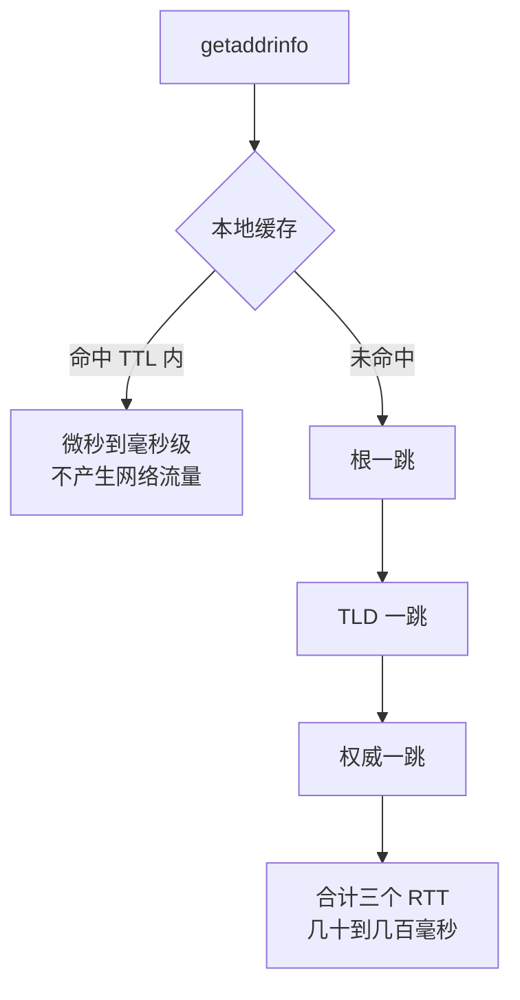
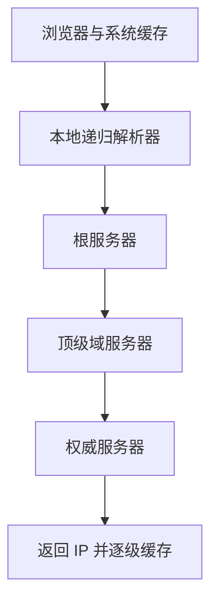

# DNS解析是延迟与故障的隐形入口

页面白屏、SDK（软件开发工具包）连接失败、服务间调用偶发超时——排查半天网络栈，最后发现是域名解析。要解决的问题：**DNS 在请求路径的最前面，它的延迟与失败模式直接以"网络慢"的假象出现，而多数观测体系根本看不见它**。把 DNS 从盲区变成显式监控对象，**是网络可观测性（通过系统对外输出判断内部状态的能力）的第一块拼图**。读完你能判断 DNS 是不是被自己忽视的盲区、怎么把它纳入监控、TTL（记录缓存时长的参数）该取多少秒，以及故障切换时间下限怎么算。

## 一次解析会穿过多少层，又在哪里累积出延迟？


*图示：DNS 的树状分层——根、顶级域、权威服务器自顶向下，一次解析要沿这条链走几跳。图源：Wikimedia Commons《DNS Architecture》，作者 Aaron Filbert，CC BY-SA 4.0，https://commons.wikimedia.org/wiki/File:DNS_Architecture.svg。图上每一层都可能成为延迟或故障的来源，而它们在应用的日志里通常只表现为"一次解析慢了"。*

```text
应用 getaddrinfo
  -> 本地缓存（nscd/systemd-resolved）    命中即返回
  -> /etc/hosts                          手工覆盖层
  -> stub resolver（本机轻量解析器，只把查询转给递归解析器）-> 递归解析器          OS 网络配置决定去向
  -> 根 -> TLD(.com) -> 权威 NS           逐级委托
  -> 权威侧：GSLB（Global Server Load Balancing，全局负载均衡：按地域调度流量）/GeoDNS（按用户来源返回不同 IP 的负载调度机制）按来源返回不同记录
```

**每一层都能贡献延迟或错误**：本地缓存 TTL过期触发完整递归；递归解析器过载或丢包（数据包在网络传输途中丢失）导致 SERVFAIL（DNS 响应码，表示解析过程出错而没有拿到答案）；权威侧按地理位置返回不同 IP（GeoDNS），**跨地域容灾切换靠改这里**。**缓存是双刃剑：TTL 长则故障切换慢，TTL 短则解析负载与延迟上升**——好比灭火器放楼下，取用要跑一段但少补货，放手边随时可取但要常补货；这个比方只到"取舍方向"为止，具体秒数要按切换时效要求定。

看完能判断的量级：递归解析未命中时的耗时按链路跳数累加——根、TLD（Top-Level Domain，顶级域名：如 .com .cn）、权威各一跳，每跳一个 RTT（Round-Trip Time，一个数据包从发出到收到应答的往返时间），公网链路单跳常见几十毫秒，**冷解析几百毫秒是常态量级**（实测命令见验证节 dig +trace）；命中本地缓存后是微秒到毫秒级，**两者差两到三个数量级，这就是「高频域名务必吃缓存」的账**。TTL 取值的两本账：**TTL 从 3600 改到 60，缓存更快过期、命中率（请求直接从缓存拿到结果的比例）下降，原本被缓存吸收的请求重新打到权威侧，权威侧 QPS（每秒查询数，系统每秒处理的请求量）随之涨约一个数量级**（可用旧命中率反推新增查询量），换来**故障切换从小时级缩到分钟级**；Cloudflare 与 Google 公共递归的工程实践中，**生产域名 TTL 常见 60-300 秒档**，切换要求快的（蓝绿发布）取下限、稳定域名取上限。

TTL 的两难在电话号码簿时代就有实物：号码簿一年印一版，家家留存一份（缓存命中率极高，查询成本几乎为零），代价是**谁家换了号码**，全世界要用旧簿子错拨一整年——号码簿的"TTL"是一年，失效传播的窗口也是一年。DNS 把这个窗口从年压到秒，靠的正是让缓存持有者接受"簿子会过期"这件事：TTL 越短，错拨的窗口越小，但每家都要更频繁地领新簿子：


*图源：Wikimedia Commons，公有领域（Self Scanned），https://commons.wikimedia.org/wiki/File:1967_-_Allentown_Telephone_Book_-_Allentown_PA.jpg。*

## 解析请求会踩到哪三类故障

解析请求有两条路径，它们在跳数与耗时上的分岔见下图，冷热两条路的耗时差异随后用账目算清。



冷热两条解析路径的耗时差从哪来：**命中缓存的请求不出主机、不产生网络流量，未命中的请求逐级委托三跳、每跳付一个 RTT，合计三个 RTT 即几十到几百毫秒，量级差两到三个数量级**。

| 模式 | 表象 | 根因层 |
| --- | --- | --- |
| 慢解析 | 首次请求多几十到几百毫秒 | 递归链路 RTT、权威侧慢 |
| 解析失败 | SERVFAIL/NXDOMAIN（域名不存在的响应码）间歇出现 | 递归解析器过载、权威不可达 |
| 解析错 | 拿到旧 IP 或错误 IP | TTL 缓存 + GSLB 策略过期 |

**第三类最阴险：IP 切换后旧记录仍在各级缓存里存活到 TTL 耗尽，客户端持续打向已下线的机器**。**容灾设计必须把 TTL 当作切换时间下限：TTL 60s 的记录，故障切换至少 60s 起步，还要算上客户端不遵守 TTL 的部分**。可以把它想成通知栏里贴的停水公告：写了几点来水，总有人不看成文时间照样去接。这个比方到「不能指望所有人按时看到」为止，公告不会自己改变管道里的水压，缓存却会真的把请求送去已下线的机器。


*图源：Chromium 官方设计文档 NetLog: Chrome's network logging system，https://www.chromium.org/developers/design-documents/network-stack/netlog/。*

这张官方图对应正文说的「多数观测体系看不见 DNS」的出路：**浏览器把 DNS 查询、缓存命中、socket 连接全部作为事件发给 NetLog，取证时用 HOST_RESOLVER_IMPL_REQUEST 条目回放解析的每一步——解析失败不再是「网络慢」的黑盒（不接触代码内部、只看输入输出的测试或分析方式），而是可逐条检索的事件流**。

## 怎么自己动手验证



解析链路的每一跳都可能成为延迟或故障来源，验证环节按下面四条路径展开。


解析耗时要与逐级追踪对账——**冷解析应比命中缓存多出根、TLD、权威三跳 RTT；实测比预期少，说明递归器缓存命中没有逐跳外出；比预期多，说明递归器自身排队或上游慢——差额落点由此定位到递归器一侧**。

- dig +trace www.example.com 逐级看委托链与每跳耗时；dig @resolver domain 指定递归器对比不同 resolver 的延迟差。
- 连续解析同一域名 100 次，统计缓存命中与完整解析的延迟分布（p50/p99）。
- 生产验证看解析成功率的 SLI（服务水平指标，这里指解析成功率这类量化指标）与 SERVFAIL 率按 resolver 分组报警；跨国链路用不同地域 vantage point 对比权威应答。
- 应用侧确认客户端解析库——getaddrinfo、c-ares 这类异步 DNS 解析库，或 JVM DNS caching（JVM：Java Virtual Machine，Java 程序的运行时）的缓存行为与 TTL 遵守情况——**JVM 默认缓存 30s，与 DNS TTL 不一致是常见事故源**。

## 这套说法在哪儿会失效

- **DNS 只管名字到地址，不管地址可达**：解析成功后连接失败要往 [[工程知识/性能工程：从用户等待到资源瓶颈/存储与网络/Socket与TCP把连接可靠性分成多层]] 走。
- mDNS/hosts 文件在容器环境常被忽略：K8s（Kubernetes 的常用简称、容器编排系统） 的 ndots 配置（resolv.conf 里决定何时追加搜索域的阈值参数）会把每个外部域名先按集群内搜索域试一圈，见 [[工程知识/后端系统：在并发、失败与变化中维持服务/基础设施/Kubernetes管理资源状态，不管理业务正确性]]。
- **轮询记录（round-robin）不等于负载均衡（把请求分摊到多台服务器、避免单点过载）**：它不感知健康状态，**故障节点会持续接收流量**，需要与主动健康摘除配合（[[工程知识/后端系统：在并发、失败与变化中维持服务/分布式可靠性/健康检查只能提供有时效的失败证据]]）。

## 效果从哪儿来，要付什么代价

把域名解析纳入观测对象，换来的是首页加载、SDK 连接与服务间调用的偶发失败中，解析这一段有了独立的成功率与延迟数据，容灾切换的时间下限也能提前算出。代价是**解析路径跨越本地缓存、操作系统解析器与权威服务**，需要按解析器与地区分组采集，客户端缓存行为还要与应用侧配置逐项核对。

## 接着读哪几篇：同在性能工程里的相邻问题

- [[工程知识/性能工程：从用户等待到资源瓶颈/存储与网络/端到端网络延迟来自排队、协议、传输与处理]]：DNS 是端到端延迟时间线的第一段，本文展开它
- [[工程知识/后端系统：在并发、失败与变化中维持服务/服务设计/服务发现与负载均衡决定请求发往哪里]]：服务发现是 DNS 思想在服务间的特化，机制同源
- [[工程知识/后端系统：在并发、失败与变化中维持服务/服务设计/流量入口只负责路由与连接，不负责业务正确性]]：域名入口层与业务正确性的责任边界
