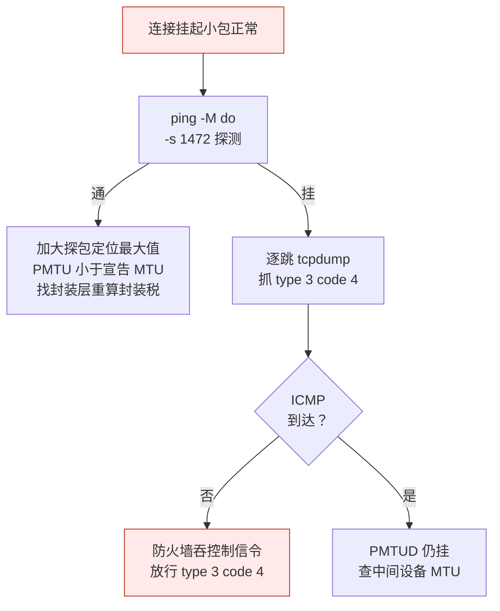

# MTU黑洞的指纹是小包通大包挂：分片黑洞的诊断路径与封装税核算

**MTU（maximum transmission unit，单帧最大传输字节数）黑洞的完整指纹：ping 正常、小包正常、大包挂起——诊断路径全部围绕「哪一跳把大包吞了」展开。** 读完你能回答：为什么隧道叠加会引发 MTU 黑洞、PMTUD 为什么会失效、MSS 钳制在什么位置配、封装税怎么算。

## 要解决的问题

以太网标准 MTU 是 1500 字节。**隧道（VPN、GRE、VXLAN、WireGuard、云厂商的 overlay 网络）在原始包外再包一层头，外层头占用的字节从有效载荷里扣：VXLAN 加 50 字节，内层有效 MTU 剩 1450**。发 1500 字节的包，出口设备要么分片、要么丢弃。IP 头的 DF（don't fragment）位置位时不能分片，只能丢弃并发回 ICMP「需要分片」报文——发送方据此调小包尺寸，这就是 PMTUD（path MTU discovery，路径 MTU 探测，RFC 1191）。黑洞出现在这个回程断裂时：**ICMP 被防火墙丢弃，发送方永远收不到「包太大」的通知，超时重传同一尺寸的大包，连接挂起**。 小包（小于路径最小 MTU）不受影响，于是形成「小包通大包挂」的指纹。

## 机制：三层防线与诊断路径

### 防线一：让 PMTUD 的回程通

**ICMP type 3 code 4（fragmentation needed）是 PMTUD 的控制信令，防火墙必须放行**。**这是最容易被安全策略破坏的依赖：默认拒绝所有 ICMP 的规则直接制造黑洞**。核对点：路径上每个安全组/ACL 对该报文的放行。

### 防线二：MSS 钳制，把协商压在源头

**TCP 的 MSS（maximum segment size，TCP 有效载荷上限）在握手时协商，中间设备可以钳制（MSS clamping）：把双方宣告的 MSS 改小到隧道内层 MTU 能容纳的值**。Linux 上：

```bash
iptables -t mangle -A FORWARD -p tcp --tcp-flags SYN,RST SYN \
  -j TCPMSS --clamp-mss-to-pmtu
```

**对 TCP 有效，UDP 没有 MSS 机制，只能靠应用层控制报文尺寸（QUIC 有自己的 PMTUD 实现）**。

### 防线三：预扣封装税，MTU 按最坏路径配置

**部署隧道时直接把内层接口 MTU 设为 1500 减去全部封装头（VXLAN 场景 1450，多层叠加再扣），让协议栈在源头就按正确尺寸分段**。**封装税（每跳封装的字节开销）要按链路上所有隧道逐层累加——`ip link` 逐跳核对**。

### 诊断路径



**`ping -M do -s <size>` 的 `-M do` 禁止本地分片，强制走 PMTUD 语义，是探测路径最小 MTU 的标准手段**。

## 案例：封装的隐性成本与静默丢弃

[[工程知识/缺陷分析：从个案到体系/正确性/案例十：类型说谎时——静默删数据的 TTL 与算错的比较]] 的教训是「静默失败最难排查」：系统没有报错，只是悄悄做错。**MTU 黑洞是网络层的同构案例——没有连接拒绝、没有错误响应，只有重传超时；`ss -ti` 里能看到 retrans 计数增长与 cwnd 收缩，应用层只看到「偶尔卡住」**。[[工程知识/性能工程：从用户等待到资源瓶颈/存储与网络/心跳与keepalive是活性探测的最小语言：从协议内建到应用层判活]] 的活性探测在这里也有应用：**挂起的连接靠 keepalive 或应用层心跳才能被超时回收——没有判活机制的连接在黑洞面前是永久挂起**。

## 怎么测

- **路径探测：`tracepath`（自动做 PMTUD 并显示每跳 MTU）或逐尺寸 `ping -M do`，画出路径的最小 MTU**。
- **隧道核算：对每条隧道按封装头字节数重算内层有效 MTU，与接口实际配置比对，差额即隐患**。
- **防火墙审计：核对安全组/ACL 对 ICMP type 3 code 4 的放行，从云厂商控制台与主机 iptables 两层都查**。
- **回归测试：CI 里固定一条「大包连通性」用例（HTTPS 下载大文件），黑洞回归时立即暴露**。

## 哪些认识一看就错

- **「ping 通网络就没问题」——ICMP echo 通常 64 字节，探不出 MTU 问题；黑洞的指纹恰恰是小包通大包挂**。
- **「云网络不用管 MTU」——云厂商的 overlay 与网关链路有自己的 MTU 上限，跨厂商互联（专线、SD-WAN）时两头配置不一致是高发区**。
- **「MSS 钳制配上就完事」——它只救 TCP；UDP 业务的报文尺寸要在应用层自控，QUIC 场景依赖其内建 PLPMTUD**。
- **「调大 MTU 就能提升吞吐」——巨帧（jumbo frame）要求路径上每一跳设备都支持，单跳不支持立刻变黑洞；先探测后调整**。

## 效果从哪来、要付什么代价

**封装税预扣让分段在源头按正确尺寸发生，MSS 钳制兜住遗漏的 TCP 场景，ICMP 放行保住 PMTUD 的自适应能力——三层防线把「静默挂起」变成「源头正确分段」**。代价是**配置纪律：每引入一条隧道就重算一次封装税**，每个安全策略变更都要复查 ICMP 放行。**收益以故障率结算：MTU 黑洞类工单（「上传大文件偶尔卡住」「SSH 卡在登录后」）从偶发难查变成部署清单里的一条核对项**。

关系：[[工程知识/性能工程：从用户等待到资源瓶颈/存储与网络/心跳与keepalive是活性探测的最小语言：从协议内建到应用层判活]] —— 黑洞挂起连接的回收依赖判活机制，两篇互为配套。[[工程知识/缺陷分析：从个案到体系/正确性/案例十：类型说谎时——静默删数据的 TTL 与算错的比较]] —— 静默失败在数据面的同构案例。[[工程知识/后端系统：在并发、失败与变化中维持服务/基础设施/TCP连接建立与断开的状态机：握手挥手与异常路径]] —— TCP 层重传与超时行为，黑洞现象在状态机上的表现。
