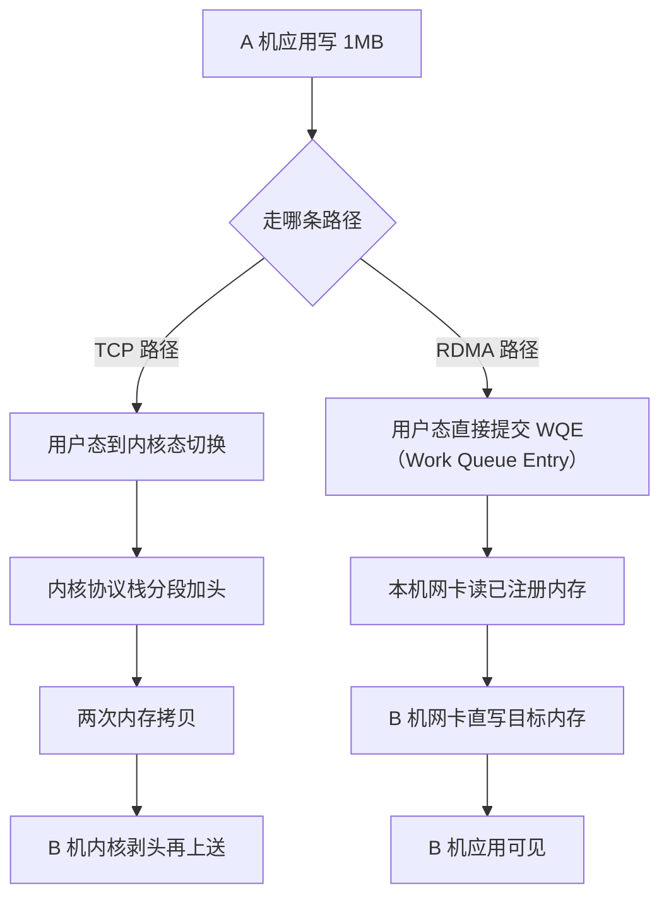

# RDMA绕过内核但要付出可运维性代价

**RDMA（Remote Direct Memory Access，远程直接内存访问）让网卡直接读写对方机器的内存，CPU 和内核全程不参与数据路径，延迟压到微秒级。**读完这篇你能判断什么场景值得上 RDMA，以及要付哪些可运维性代价。

同一个"把 1MB 数据从 A 机搬到 B 机"，TCP（传输控制协议，负责把数据完整、有序地送达）协议栈要经过两侧内核的协议处理与多次拷贝，RDMA 让网卡直接读写对方机器的内存，CPU 与内核全程不参与数据路径。要解决的问题：分布式训练与分布式存储这类机器间大吞吐搬运场景里，TCP 协议栈的 CPU 开销与拷贝延迟成为瓶颈，RDMA 把这条路径压到微秒级、CPU 占用接近零。

## 绕过内核省下的时间去哪了：三层代价

TCP 搬数据像搬家走物流——东西从家里装箱（内核缓冲区拷贝）、物流分拣贴单（协议栈处理）、再卸货拆箱（对端反向重复），两头都有人力（CPU）全程参与；RDMA 像两家共用一条直通传送带——你家的柜子（注册好的内存）直接被对方伸手拿走，中间不装箱不贴单。省下的是两串拷贝与协议处理（零拷贝：数据不经内核缓冲区、不产生内存复制；内核旁路：CPU 不进协议栈），代价也跟着来：柜子必须固定在原位不许挪（内存 pin 住禁止换页）、传送带的格口数量固定，每个格口供一条连接专用（每连接占网卡内存）、传送带不保险（丢包处理依赖网络配置）。这个比喻到"不保险"为止——现实里三层代价各有工程名词与调优手段，下面逐层展开。

RDMA 的执行主体是一块专用网卡HCA（Host Channel Adapter，InfiniBand 网卡）：数据搬运、可靠性、顺序保证全部在这块卡上完成，CPU 只在建立连接时出场：


*图源：Wikimedia Commons，Dmitry Nosachev，CC BY-SA 4.0，https://commons.wikimedia.org/wiki/File:Supermicro_AOC-UIBQ-M2_dual_port_InfiniBand_HCA.jpg。*

**RDMA 的收益来自三件事：网卡直接搬运（zero-copy，零拷贝，数据不经过内核缓冲区）、内核旁路（CPU 不进协议栈）、用户态（普通程序运行的低权限受限状态）直接提交工作请求（verbs API，用户态程序直接下发搬运指令给网卡的编程接口，绕过内核系统调用）。**两条路径的差别可以直观看：


*图源：thebyte.com.cn《深入高可用系统原理与设计》，CC BY 4.0，https://www.thebyte.com.cn/network/RDMA.html。*

省下拷贝的前提是**网卡能直接 DMA**（Direct Memory Access，直接内存访问：设备不经 CPU 直接读写内存）访问内存，所以内存必须提前注册并锁定（物理页常驻、禁止换页）；同时传输可靠性改由网卡与网络保证——后面三层代价都从这里长出来。

绕过内核的代价分布在内存管理、语义约束与运维三层，逐层列如下表：

| 层 | 代价 | 说明 |
| --- | --- | --- |
| 内存管理 | 内存注册（memory registration） | 网卡 DMA 需要物理页常驻且 pin 住，换页被禁止 |
| 语义约束 | 连接资源有界 | 每 QP（Queue Pair，队列对，一条 RDMA 连接的收发端点，收发各一条队列）占网卡内存，连接数受硬件限制 |
| 运维 | 丢包处理是黑盒 | RoCE v2（基于融合以太网的 RDMA 第二版）走 UDP 封装，意味着以太网本身不保证送达，因此要靠 PFC 防丢包，PFC 配置不当会引发风暴，是经典事故源 |

**收益与代价的权衡：微秒延迟与零 CPU 占用换来了内存 pin 的换页损失、连接规模上限、以及以太网融合（RoCE）环境里 PFC（Priority-based Flow Control，基于优先级的流控）/ECN（显式拥塞通知，由网卡在包里标记拥塞而非等丢包后再处理）调优的复杂度。什么场景划算：机器间大块搬运（分布式训练梯度同步、存储副本复制）；什么场景不划算：小块低频请求（verbs 提交本身的固定开销占主导，反而不如 TCP）。**



**两条路径的分岔点在第一跳：TCP 路径从 A 机应用写 1MB 开始就把数据交给内核，后面每一步——用户态到内核态（内核代码运行的高权限状态）切换、协议栈分段加头、两次内存拷贝、B 机内核剥头再上送——都在付协议处理与拷贝的账；RDMA 路径把工作请求直接交给网卡，本机网卡读已注册内存、B 机网卡直写目标内存后 B 机应用立即可见，内核只出现在连接建立与内存注册这些控制面动作里。**下面那张表列的三层代价，就是这条捷径的过路费。


来源：[腾讯云开发者社区《30 张图揭开「内存管理」的迷雾，瞬间豁然开朗》](https://cloud.tencent.cn/developer/article/2671629)（CC 4.0 BY-SA）


## 想自己测一遍怎么动手：验证

```bash
# perftest 工具族直接测 RDMA 带宽与延迟
ib_write_bw（InfiniBand 写带宽测试工具） -d mlx5_0 --report_gbits   # 一侧 server 一侧 client
ib_write_lat -d mlx5_0
# 对照 TCP 同机对同机
iperf3 -c <peer>
mpstat -P ALL 1                        # 观察两侧 CPU 占用差
```
预期：**ib_write_bw（InfiniBand 写带宽测试工具）跑满网卡线速（如 100Gbps 网卡跑到 90+ Gbps）时 CPU 占用个位数百分比；iperf3 同吞吐下多核被打满。延迟对比：RDMA 单程微秒级、TCP 十微秒级起。**数字对不上时先查 PFC 与 ECN 配置（go-back-N：丢一个包就要把其后所有包全部重传，吞吐会断崖）。verbs 接口语义以内核文档为准，Mellanox（网卡厂商，现属 NVIDIA）的 perftest（RDMA 性能压测工具集）是可复现基线（正常状态下的指标水平、用来对比异常）工具。

## 这套判断在哪儿会失效：边界

本篇讲 RDMA 介质与传输机制。分布式训练怎么用 RDMA 做梯度同步（ring-allreduce 对带宽的利用）见 [[工程知识/AI 系统工程：从模型能力到生产能力/模型基础与训练/分布式训练与并行策略如何切分模型|分布式训练与并行策略如何切分模型]]。

存储副本复制走 RDMA 的收益场景见 [[工程知识/数据系统：在并发与故障中保存事实/事务与存储/一致性哈希把再平衡的数据移动量压到平均槽位|一致性哈希把再平衡的数据移动量压到平均槽位]] 的再平衡移动量视角。内核内零拷贝（sendfile 一系，数据仍经内核协调）见 [[工程知识/性能工程：从用户等待到资源瓶颈/操作系统与运行时/零拷贝把数据通路的CPU让给业务|零拷贝把数据通路的CPU让给业务]]——那篇是内核协调下的拷贝消除，本篇是彻底旁路，两档不同。

GPU 侧的互联（NVLink——NVIDIA 的 GPU 间高速直连总线）与网络侧 RDMA 的分工见 [[工程知识/性能工程：从用户等待到资源瓶颈/处理器与内存/GPU性能取决于计算、访存、并行与通信|GPU性能取决于计算、访存、并行与通信]]。

## 接着读哪几篇：内核协调 vs 内核旁路两档对照

- [[工程知识/性能工程：从用户等待到资源瓶颈/操作系统与运行时/零拷贝把数据通路的CPU让给业务|零拷贝把数据通路的CPU让给业务]]——内核协调 vs 内核旁路两档对照
- [[工程知识/AI 系统工程：从模型能力到生产能力/模型基础与训练/分布式训练与并行策略如何切分模型|分布式训练与并行策略如何切分模型]]——RDMA 的最大消费场景
- [[工程知识/后端系统：在并发、失败与变化中维持服务/基础设施/网卡与内核旁路：中断与轮询的取舍.md]] —— 同类旁路取舍的存储场景
