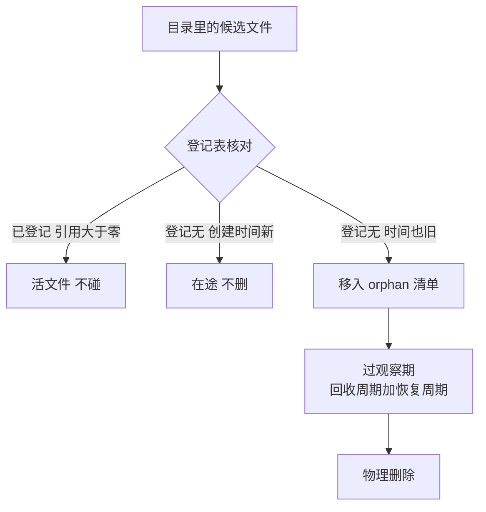
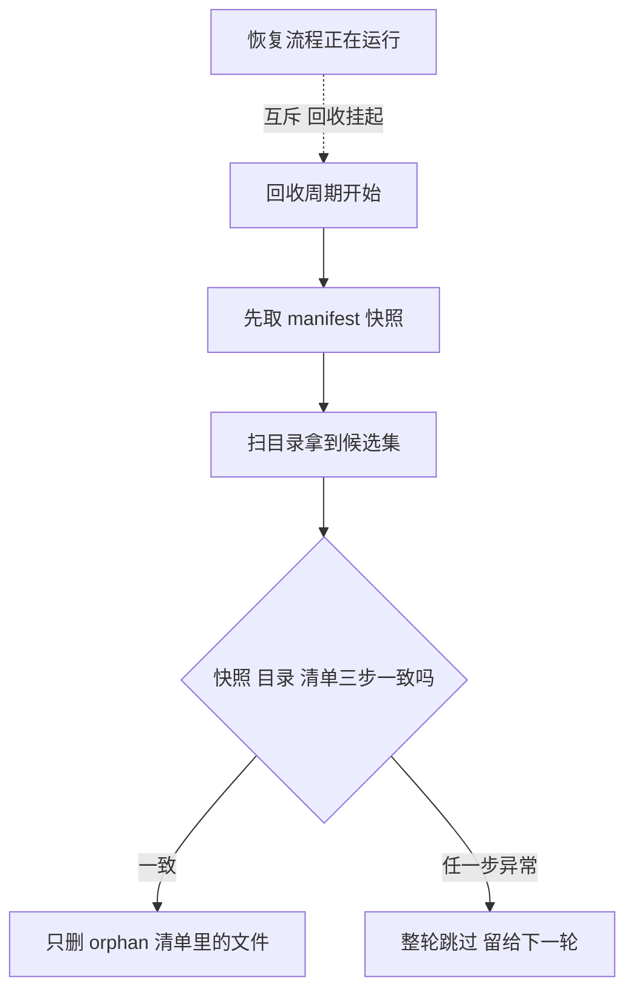

# SST文件回收的对账：回收器要与登记表核对，不能只扫目录

删文件这件事的难点**判断谁有资格删**，而不是删。读完这一页你能看懂回收器为什么不能只扫目录，**会把扫到的文件和引用登记表逐条对账**，也知道**没有主人认领的文件该怎么处理**。

> **要点**：存储引擎的文件回收是"谁有资格删"的判定题——回收器扫目录看到的所有文件都要有人认领：在引用登记表里的（活的）、登记表没有但流程还会用的（初始化中、恢复中的）、登记表漏登的（引用丢失，宁挂垃圾清单待人工也不删）；"扫到不在登记里就删"的回收器会把尚未完成登记的正常文件当垃圾删掉。

## 回收器会犯哪两类误判：误删活文件与漏删垃圾？

LSM（Log-Structured Merge，先把写入攒在内存里、再按批顺序落盘的存储结构）引擎的数据存放在 SST（Sorted String Table，有序字符串表）文件里。**文件的产生由内部流程驱动**：flush 把内存里的数据刷到磁盘生成文件，compaction **把多层文件合并瘦身**，compaction 后**旧文件与 abort 的 flush 即告失效**。

**磁盘空间回收则由独立线程执行**。**两条线并发是误判的惯常成因**——这个比喻只到"时间窗口重叠出误判机会"为止：**并发本身不必然误判，三步一致检查到位就能安全容纳**。

**回收器扫目录的瞬间，可能撞上三种中间状态**：新 SST 正在写（未登记）、compaction 正在切换（旧文件刚失效未除名）、恢复流程正在重建（目录里的文件是中间产物）。

**两类误判**：**误删存活文件（数据丢失，最重）**；**漏删已失效文件**（空间泄漏，缓慢累积，靠本库磁盘三原则即配额、水位告警与临时目录纪律里的水位告警兜底）。本库"空间回收要有对账表"篇给过登记原则；本篇给**回收器侧的判定规则**：**文件的三态与回收器的保守边界**。

## 回收器靠哪三条规则判定文件该不该删？

SST 文件在引擎里的全貌，RocksDB 团队在 FAST'21 论文的官方示意图里画得很清楚：MemTable 刷盘（把内存中暂存的数据写入磁盘持久化）产生 Level 0 的 SST，compaction 逐层向下合并出 Level 1 到 Level N 的 SST——**目录里的每一个白框都是一次 compaction 或 flush 的产物，也都会在未来的 compaction 里失效**，这正是**"目录内容永远在变、登记表才是判据"**的机制背景：


*图源：Dong et al.《Evolution of Development Priorities in Key-value Stores Serving Large-scale Applications: The RocksDB Experience》，USENIX FAST'21 论文 Figure 1，https://www.usenix.org/conference/fast21/presentation/dong，文档引用。*

回收要核对登记表，这跟**「消息里只放凭证、数据另存」是同一个思路**：**消息体本身不携带判断所需的全部信息，判断必须回到登记表上做**。**只扫目录等于只看消息体**。


*图源：Microsoft Learn 中文文档，CC BY 4.0，https://learn.microsoft.com/zh-cn/azure/architecture/patterns/claim-check。*


**第一态：已登记的活文件**。SST 在 manifest（登记表）里且引用计数（有多少个地方正在使用这个文件，归零后才可能被回收）大于零——**回收器不碰**。**判定的依据是登记表，目录内容只是候选集**：目录里出现登记表没有的文件，**第一反应应该是"登记流程还没走完"，而不是"垃圾"**。

**第二态：在途文件（初始化与恢复的中间产物）**。新 SST 写入过程分步：**数据写入磁盘、登记表写入、引用可见**——三步之间崩溃或并发扫描，目录里就有**"数据在、登记无"**的文件。恢复流程同理：**重建 manifest 期间目录里的文件都是候选，回收器此时运行等于干扰**。**判定规则**：回收器认"创建时间在回收周期起点之后的文件"为在途**（不删）**，或者干脆**回收器与恢复流程互斥**（恢复进行时回收挂起）——两个机制选一个，**选互斥更干净，因为时间判据在时钟回拨与长恢复面前不可靠**。

**第三态：引用丢失的孤儿文件**。进程崩溃在"文件已失效、目录已删除"之前，**登记表里已经没有它，目录里还在**——这是真垃圾，但要走**垃圾清单**：回收器把它移入 orphan 清单（重命名或移到隔离目录），**过了观察期（一个回收周期 + 一个恢复周期）才物理删除**——**观察期的作用**：给"其实是活文件但登记异常"的情形**留翻案窗口**，**判错删了活文件的后果（数据丢失）远比晚删几天垃圾（空间暂占）重**。

**回收器的保守边界**：**只在"登记表读取 + 目录扫描 + 清单比对"三步一致时动手**；任何一步异常（manifest 读失败、目录遍历错误）**就整轮跳过**——**回收器是空间卫生员，权限是"删清单里的"，没有"清理一切"的权限**——**卫生员只管清扫已列入清单的东西，不做诊断也不做手术**，对应到回收器就是**不修复登记、不重建 manifest**。上游"Fix SST files not being cleaned up in the locations folder"的缺陷正是反例：**回收器漏扫 locations 目录下的文件，垃圾越积越多**——**漏扫（保守过头）与误删（越界）都要防，两边的判据都来自登记表**。

**回收器扫到一个候选文件后按登记表归到三种归宿，只有一种通向物理删除**：



「谁有资格删」的完整判定链：**三种归宿里物理删除是唯一终点且要过观察期**，**登记异常的活文件在观察期里留有翻案窗口**，**误删的代价设计成远重于晚删**。


来源：[博客园《一文搞懂 LSM-Tree》](https://www.cnblogs.com/zxporz/p/16021373.html)（CC 4.0 BY-SA）


## 怎么判断回收系统是否健康？

**回收系统的健康不能靠「没报错」判断，要有专门的检查端点**，把各项依赖的状态汇总后报给外部探测方。**定期探测这个端点，才谈得上可验证**。


回收器一轮动作的正确顺序是**「先取快照（某一时刻的完整只读副本）再扫目录」**，三步一致才动手，任何一步异常就整轮放弃：



**快照隔离不用在写路径上加锁、不阻塞前台读写，所以比加锁便宜，代价只是垃圾多留一个周期**；而「整轮跳过」这件事本身要能被看见，**连续跳过 N 次就该升级为行动级告警**。

**三个指标分开看**：目录文件数、登记表条目数、orphan 清单条目数——**三者差的走向是健康度**：目录持续多于登记，说明**有文件没进登记表**，可能是写入过程被打断或在途文件堆积；orphan 清单只增不减，说明**回收流程卡住或观察期配置错了**；登记数涨而目录不涨，说明**写路径有异常、登记先行于文件写盘**。**告警的承接位置**：目录与登记的差值超阈值、orphan 清单老化超期属预警级，回收器整轮跳过连续 N 次属行动级——磁盘水位（队列或资源的当前占用程度）告警（本库三原则）是最后一道，**这三个是先行指标**。

**审计的对账动作**：定期（周级）跑一次全量对账——遍历目录、读登记、**比对出三类差异（在途、孤儿、漏登）**，漏登的文件**人工判定后补登或进清单**——**对账报告是空间回收的体检报告**——**体检报告只暴露异常、不自动修复，要人来读、来行动**；等水位告警响再看，**中间的异常已经演化数周**。

**设计新引擎时的取舍**：**登记表（manifest）的原子更新与回收器的互斥窗口是配套设计**——manifest 写入用单事务、**回收器启动先取 manifest 快照再扫描**（快照外的动作留给下一轮），**快照隔离比加锁便宜且够用**，因为**回收多删一轮的代价只是垃圾多留一个周期**。

## 这套说法在哪儿会失效

三条边界防止防线走形。

**回收器不承担数据修复**：发现登记表与目录不一致（活文件缺失）时**只上报不补**——**修复是恢复流程的职责，回收器补登记等于外行改账本**。

**清理限速与 IO（输入输出，这里指磁盘读写）隔离**：物理删除**走限速队列**（本库节流参数篇的同类核算），回收风暴（大批 compaction 后）**不能挤占前台读写**——删除也是 IO。

**快照与版本链的引擎特例**：多版本引擎（快照引用旧 SST）的"引用计数"含活跃快照——**快照泄漏（创建后不释放）时旧 SST 永不回收**，这是**另一类"登记没错但引用没走"**的泄漏，监控要含**"最老快照年龄"**。

## 怎么自己动手验证

回收器的验证路径有四条，全部可复现，覆盖误删、漏删、指标与断言四类：

1. 误删复现：构造"文件在写、回收器并发扫描"的场景，预期**在途文件零删除、扫描结果对得上登记表**；
2. 漏删复现：制造崩溃点使文件成为孤儿，验证**进清单、过观察期后被删、对账报告可查**；
3. 指标验证：对账报告的三差值与告警阈值**联动（目录登记差超阈值触发预警）**；
4. 断言锚点：**回收器以登记表为唯一判据、orphan 有清单与观察期、三差值指标在监控**——三件齐备，文件回收**从"扫目录就删"变成有账可对的例行流程**。

```text
判据断言 = 登记表是删除的唯一依据
清单断言 = 孤儿走观察期不直删
指标断言 = 三差值先行于水位告警
```

文件回收的正确姿势是**把"删什么"变成账目问题**：**登记表管活账，垃圾清单管悬案，对账报告管盘点**——**回收器的每一次删除都有账可查，空间泄漏与数据误删两个方向的错误都有闸门**。

## 接着读哪几篇：引用登记的个案层

- [[工程知识/缺陷分析：从个案到体系/硬件故障/空间回收要有对账表：引用登记让删除不漏不冤.md]] —— 引用登记的个案层
- [[工程知识/性能工程：从用户等待到资源瓶颈/存储与网络/磁盘空间管理三原则：配额水位与临时目录纪律.md]] —— 水位告警的兜底层
- [[工程知识/性能工程：从用户等待到资源瓶颈/存储与网络/存储引擎的文件一致性：元数据与数据块的对应关系要可核对.md]] —— 元数据核对的基础
- [[工程知识/缺陷分析：从个案到体系/资源与容量/案例六：容量与泄漏——连接泄漏和 SST 堆积.md]] —— 泄漏的个案形态
