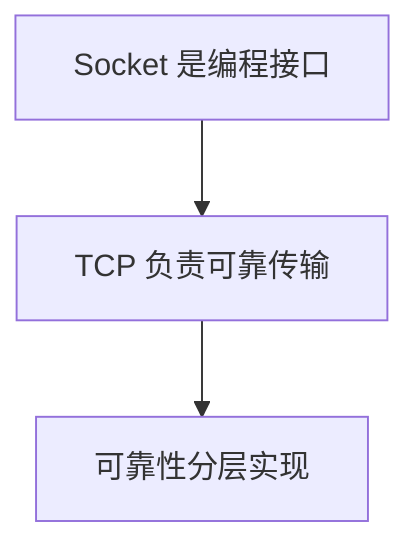
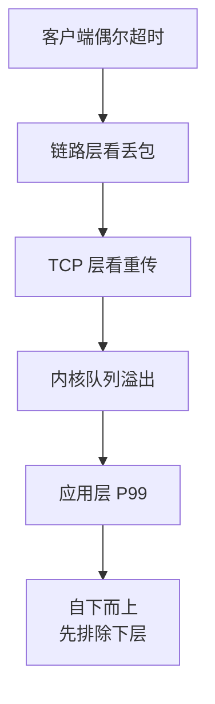
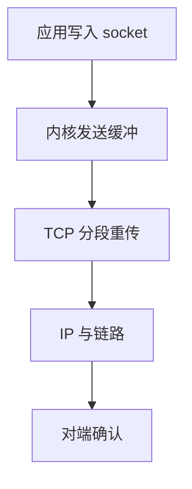

# Socket 与 TCP 把连接可靠性分成多层

这篇讲一个容易被误认的命题：**连接建立成功不等于请求一定完成**。**读完你能按 DNS（Domain Name System，域名系统：把域名解析成 IP 地址）、连接、TCP、内核队列、链路五层定位一次超时，知道 deadline 与重试归哪一层管、故障边界画在哪里**。

核心机制是把 DNS、连接、TLS（Transport Layer Security，传输层加密协议，HTTPS 里的 S）、字节流、应用协议和业务提交分层，并在每层定义 deadline（该层允许等待的最长时间，超时即放弃）、取消和重试；收益是**故障定位和恢复边界清晰**，代价是**状态与观测字段更多**。**排查时可以主动制造半开连接（连接看似建立但对端已断开）、RST（复位报文，用来中断连接）、部分读、连接池（预先建好连接反复取用、省去反复握手建连的开销）耗尽和取消实验，观察各层的资源占用与副作用（操作对外部状态产生的额外影响）是否按预期释放**。

**TCP（传输控制协议，负责把数据完整、有序地送达）提供有序、可靠的字节流和拥塞控制（发送方根据网络状况调整速率、避免压垮网络），不提供消息边界、业务超时、请求幂等（同一次请求重复执行与执行一次效果相同）或「对端一定处理了」**。**Socket（操作系统提供的网络编程接口）还受 DNS、路由、防火墙、连接池、内核队列和应用读写循环影响**。

## 要解决的问题：一次请求依次经过哪些层



**可靠性不是一层做完的，像快递分拣：揽收、干线、派送各管一段，丢件要回到对应环节查——网络里 DNS、TCP、内核队列、链路也各管一段**（这里只比传输相关的四层，应用层的读写循环不属于分拣类比），分工见下图：


连接建立成功被当成请求已经完成，**超时出现时无法判断问题位于 DNS、TCP 握手、内核队列、链路丢包（数据包在网络传输途中丢失）还是应用读取过慢，重试因此作用在错误的一层上**；**若请求不是幂等的（比如创建订单），作用在错误层的重试会把同一个副作用执行多次**。本篇回答：**一次请求依次经过哪些层、每层的可靠性保证到哪里结束、同一个超时症状在四个执行层（链路、TCP、内核队列、应用）分别对应哪个计数器、deadline 与取消由哪一层定义语义、以及分层带来的责任边界位于哪里**。

## 一次请求经过什么


*图示：TCP 连接的状态机——三次握手（TCP 建立连接前、双方交换三个报文确认彼此收发能力的流程）、数据传输、四次关闭各走哪几条边，TIME-WAIT 停在哪个状态。图源：Wikimedia Commons《Tcp state diagram fixed new》，作者 Sergiodc2 / Marty Pauley / Scil100，CC BY-SA 3.0，https://commons.wikimedia.org/wiki/File:Tcp_state_diagram_fixed_new.svg。下面这条链路上的每一层，都只负责这张图里的一段。*

```text
解析/连接 -> SYN/TLS -> send buffer -> 网络/拥塞
           -> receive buffer -> 应用协议解析 -> 业务处理 -> 响应
```

**`read` 可能只返回部分字节；EOF（读到流结束）、RST、超时和连接复用分别表达不同事实**。**HTTP keep-alive（复用同一连接发多个请求）、HTTP/2（HTTP 第二版，多条流复用一条连接） multiplexing（在一条连接上并行交错多个流）、QUIC（基于 UDP——用户数据报协议，只管发、不保证到达与顺序——的新一代传输协议）与 HTTP/3（跑在 QUIC 上的新一代 HTTP）改变连接和队头阻塞边界，但仍需应用 deadline、取消和重试语义**。


来源：[小林coding《TCP 三次握手与四次挥手面试题》](https://www.xiaolincoding.com/os/1_hardware/tcp_interview.html)（CC 4.0 BY-NC-SA）


来源：[博客园《多图详解 TCP 连接管理，太全了!!!》](https://www.cnblogs.com/cxuanBlog/p/14679563.html)（CC 4.0 BY-SA）


## 性能与故障各出现在哪一层

**RTT（往返时延）是任何传输的时间底数，拥塞窗口（TCP 控制一次可发未确认数据量的上限）越小吞吐越低，带宽是单位时间的容量上限，丢包触发重传按秒加延迟，TLS加在连接建立上，Nagle（把小包攒大再发的算法）为省带宽牺牲实时性，队列越长排队时间越多，服务器处理时间是最后一段——这些共同决定延迟**。**连接建立成功不代表服务健康**；半开连接、连接池耗尽、端口耗尽和代理 idle timeout（连接空闲超过阈值就被中间设备静默断开）会制造间歇性错误——**空闲连接被断开后，连接池还当它是活的，复用它发请求就拿到断开报错，表现为偶发失败**。

## 动手跑一遍会看到什么：一次请求的分层故障定位

"客户端偶尔超时"这一个症状，在四层各看一个指标，按下表对号入座：

```text
应用层（Socket 缓冲区）：
  SO_RCVBUF 满套 → 应用读得慢，内核缓冲积压 → 超时
  看：应用处理延迟 

TCP 层（重传与拥塞）：
  丢包 → 重传（RTO——Retransmission Timeout，重传超时：丢包后等多久重发——1s 起，指数退避）→ 该请求延迟+1s 的整数倍
  看：ss -ti 的 retrans 计数、`netstat -s` 的重传段数

内核队列层（连接建立与接收）：
  SYN 队列 / accept 队列溢出 → 握手被丢 → 连接超时（不是读超时）
  看：`netstat -s` 的 "listen queue overflow" 计数

链路层（网卡与缓冲区）：
  环形缓冲区溢出 → 丢包（TCP 层看到的"丢包"源头在这）
  看：ethtool -S 的 rx_dropped / rx_fifo_errors

定位顺序自下而上：链路丢包 → TCP 重传 → 队列溢出 → 应用读慢，
每一层都有专属计数器，症状"超时"在四层是四个不同的病。
```

跑一遍的收获：**分层模型的价值在故障定位时兑现——"偶尔超时"不查分层就只能靠猜，猜不出该调哪一层；逐层计数器对账后每次都指向唯一一层**。分层同时意味着**责任分层：应用层调缓冲区参数救不了链路丢包**，链路换网卡救不了应用读得慢。

同一个超时症状在四层各有专属计数器——链路层看丢包、TCP 层看重传、内核队列看溢出、应用层看 P99——定位自下而上走、先排除下层，见下图：



**超时的归因次序：四层各有一个专属计数器，症状相同而病不同，自下而上逐层排除后每次指向唯一一层，跨层调参救不了别层的病**。

## 这些结论的量级靠什么数字支撑

**延迟的量级账：同机房 RTT 百微秒级，一次丢包重传最少加 1 秒（RTO 初值）——丢包率千分之一、每秒万请求的负载下每秒就有十次重传级延迟，P99（最慢的百分之一请求的延迟，代表长尾毛刺）大多从这里来**。**队列的量级账：accept 队列溢出计数在清零后再次增长是扩容信号（somaxconn——内核允许的积压连接数上限——调大只是推迟溢出），SYN（Synchronize，TCP 建连第一步的握手信号） 溢出在公网入口常伴 SYN flood**。

案例回流：分层定位的实录见 [[工程知识/性能工程：从用户等待到资源瓶颈/存储与网络/网卡丢包先看环形缓冲区溢出：队列、中断与软中断的接力.md]]（链路层的接力链）与 [[工程知识/性能工程：从用户等待到资源瓶颈/存储与网络/连接建立失败先看内核队列：SYN 队列与 accept 队列是两个瓶颈.md]]（内核队列层）；TIME_WAIT 的收尾账见 [[工程知识/性能工程：从用户等待到资源瓶颈/存储与网络/TIME_WAIT是连接收尾的代价与设计.md]]。

## 怎么自己动手验证



验证就按图中每一段逐层注入故障、观察对应指标：从应用写入 socket 出发，经内核发送缓冲，到 TCP 分段重传，再到 IP 与链路，最后等对端确认。


**连接各段耗时要与注入对照对账——预写注入丢包与延迟后变化应集中在传输段；实测变化若出现在处理段，说明耗时大头在服务端处理，下一步应查应用响应路径，而不是调网络或 TCP 参数**。

**用追踪手段 trace 区分 DNS、connect、TLS、request write、server queue、TTFB（首字节到达时间）和 body read——追踪工具会记录请求在每个阶段的起止时间，从而看出时间花在哪一段**；**注入丢包、延迟、半开、RST、连接复用和服务端超时**。**每一项注入都要先写预期（预期变化出现在哪一段、幅度多大），实测与预期对不上时回查上一步的注入是否真的生效——对照注入前后的计数器差值，或检查注入工具的返回值**。**验证重试不会重复副作用，长响应取消会释放 socket 和服务端工作**。

关系：[[工程知识/后端系统：在并发、失败与变化中维持服务/服务设计/HTTP请求穿过浏览器、网络与服务端边界]] · [[工程知识/后端系统：在并发、失败与变化中维持服务/分布式可靠性/超时、重试与幂等共同定义调用语义]] · [[工程知识/性能工程：从用户等待到资源瓶颈/存储与网络/TLS握手与证书链决定连接建立成本]] · [[工程知识/性能工程：从用户等待到资源瓶颈/存储与网络/TIME_WAIT是连接收尾的代价与设计]] · [[工程知识/性能工程：从用户等待到资源瓶颈/存储与网络/RDMA绕过内核但要付出可运维性代价]] · [[工程知识/性能工程：从用户等待到资源瓶颈/存储与网络/TCP不提供消息边界：成帧是应用层协议自己的责任.md]]
- [[工程知识/性能工程：从用户等待到资源瓶颈/操作系统与运行时/io_uring与异步IO演进：系统调用省下的开销]] —— epoll（Linux 的事件通知机制，一个进程用它同时监视大量连接） 复用等待，io_uring（Linux 的高性能异步 IO 接口：提交与完成各用一个环形队列，系统调用次数远少于旧接口） 再把提交收割批量化

