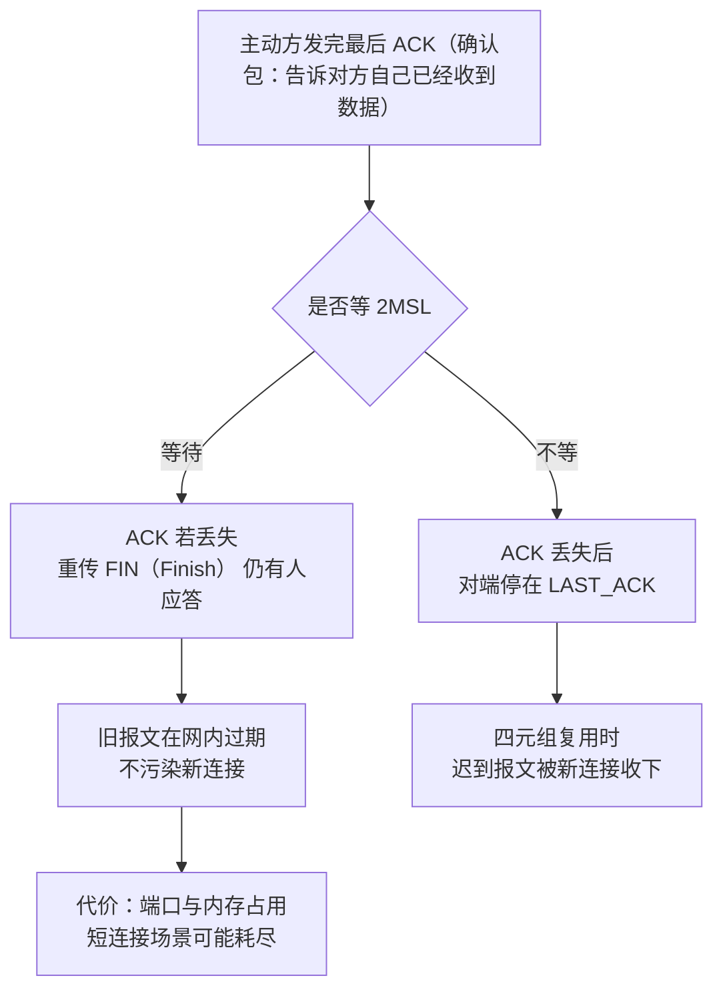
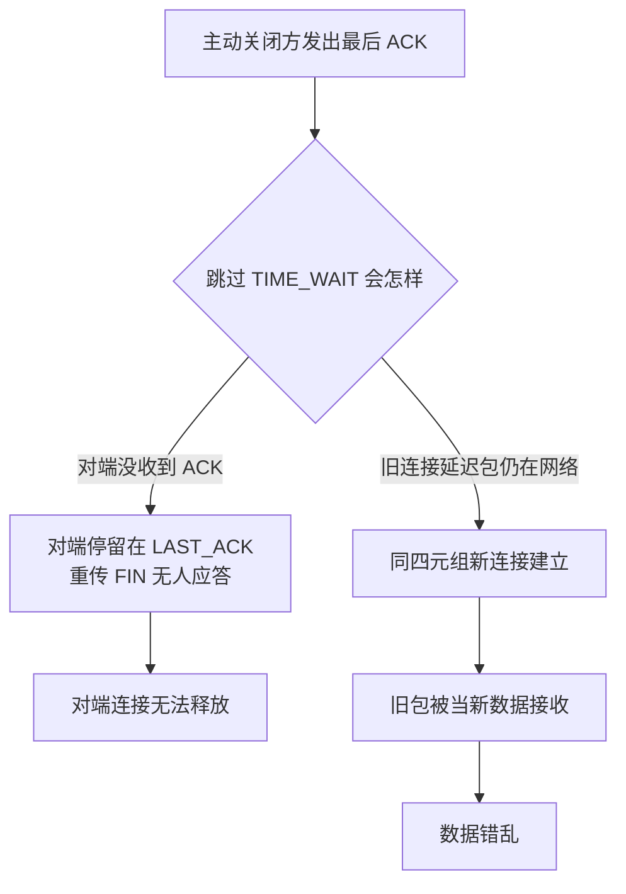

# TIME_WAIT是连接收尾的代价与设计

**连接建立被讨论得多，连接收尾的 TIME_WAIT 状态却是线上事故的常客：短连接高频场景下几万条 TIME_WAIT 把端口耗尽，服务拒绝新连接**。要解决的问题：主动关闭方为什么必须停留 2MSL（最长报文段寿命的两倍，Linux 默认 60 秒），以及这份代价在**什么场景下会从保险变成瓶颈**。**读完你能判断端口耗尽是否由 TIME_WAIT 引起，并知道在什么连接模式下可以安全复用端口而不丢可靠性**。

## TIME_WAIT 为什么必须存在，它又带来什么代价？



**主动关闭方必须留下这一段等待：留下它，对端重传 FIN（Finish，TCP 正常关连的信号）仍有人应答，旧报文在网内过期不污染新连接；不留下，对端停在 LAST_ACK（对端发完 FIN 后等待最后 ACK 的状态）无人应答**。两个理由与它的代价一起看才完整：


*TCP 十一种状态与转换路径全貌（图源：CSDN 博客）*

*图源：Wikimedia Commons《Tcp state diagram fixed new.svg》，作者 Sergiodc2、Marty Pauley、Scil100，CC BY-SA 3.0，https://commons.wikimedia.org/wiki/File:Tcp_state_diagram_fixed_new.svg。*

**全图十一个状态里，TIME_WAIT 是主动关闭路径上唯一长驻的一格：FIN_WAIT（主动方发完 FIN 后等待对方 ACK 的状态，分两态）等对方收尾，TIME_WAIT 等迷途报文过期——正文讨论的两个理由与代价都发生在这一格的 2MSL 里**。

**TIME_WAIT 只出现在主动关闭一方（先发 FIN 的一方）。它有两个存在理由，都源自 TCP（传输控制协议，负责把数据完整、有序地送达）的不可靠信道假设**：

| 存在理由 | 保护什么 | 丢失它的后果 |
| --- | --- | --- |
| 迟到的最后 ACK 丢了 | 对端重传 FIN 时能再回 ACK | 对端滞留 LAST_ACK，无法释放 |
| 旧连接的延迟包到达 | 旧数据不会污染复用同四元组（源 IP、源端口、目的 IP、目的端口的组合）的新连接 | 新连接收到上个连接的迷途报文，数据错乱 |

第二个存在理由的反面场景画得更具体：TIME_WAIT 停留时间不足时，相同四元组的新连接刚完成三次握手（TCP 建立连接前、双方交换三个报文确认彼此收发能力的流程），上个连接被网络延迟的旧报文SEQ（Sequence，序列号）=301恰好抵达，新连接把它当成自己的数据收下——数据错乱就这样发生。这张时序图把「为什么要等旧报文过期」从表格里的文字变成看得见的报文轨迹：


*图源：小林coding《图解网络｜TCP 三次握手与四次挥手（TCP 断开连接时、双方交换四个报文释放资源的流程）》，https://www.xiaolincoding.com/network/3_tcp/tcp_interview.html。*

代价落在同一四元组的三个维度——端口、内存、路由表（决定数据包下一跳去向的转发表）项，量级与场景各不相同：

| 维度 | 量级 | 说明 |
| --- | --- | --- |
| 端口（客户端视角） | 临时端口约 28k-64k 个 | 同目标同端口四元组耗尽即无法建连 |
| 内存 | 每条约 3KB 内核结构 | 10 万条约 300MB，量大但通常不是瓶颈 |
| 路由表项 | conntrack 表项 | NAT（Network Address Translation，网络地址转换：在内外网之间改写地址与端口） 环境下先于端口耗尽 |

**治理选项各有代价：`tcp_tw_reuse` 只对出方向连接安全——依赖时间戳，靠 PAWS（Protect Against Wrapped Sequence numbers，序号防回绕机制）凭时间戳判定报文新旧、把旧包丢弃；`tcp_tw_recycle` 已被内核移除——NAT 环境下多客户端共用出口地址，recycle 的时间戳判据分不清来源，会把合法新连接当成旧连接丢弃，误杀由此发生；连接池（预先建好连接反复取用、省去反复握手建连的开销）与长连接（建立后保持不断开、多次通信复用同一条连接）是从源头减少关闭次数的正解**。收益是**可靠性保险**，代价是**短连接高频场景的端口池消耗——权衡点在于你的连接模式**是否复用同一四元组。



**两条支路就是 TIME_WAIT 存在的两个理由：上面一条——重传 FIN 无人应答时对端连接无法释放——保护「对端能不能正常收尾」，下面一条保护「新连接会不会收到上个连接的迷途报文」**。**停留 2MSL 是在等两件事都不再可能发生——这段等待期吃掉端口，是保险的保费：可靠性保障是这份保险，被占用的端口与内存是买它要付的保费；短连接高频场景里保费按连接数累积——每条 TIME_WAIT 占一个本地端口，连接数超过临时端口上限（约 28k-64k）后新连接就没有端口可分配，端口耗尽由此发生**。


来源：[小林coding《TCP 三次握手与四次挥手面试题》](https://www.xiaolincoding.com/os/1_hardware/tcp_interview.html)（CC 4.0 BY-NC-SA）


## 怎么自己动手验证 TIME_WAIT 的数量与端口耗尽？

```bash
# 观察 TIME_WAIT 数量与增长
ss -s | grep -i timewait
watch -n1 'ss -t state time-wait | wc -l'
# 制造压力确认端口耗尽阈值
for i in $(seq 20000); do curl -so /dev/null http://127.0.0.1:8787/ & done; wait
# 修复后复测
sysctl net.ipv4.tcp_tw_reuse
```
**预期：短连接压测后 TIME_WAIT 数量与并发数同量级，60 秒后自动回落；`tcp_tw_reuse=2`（loopback 之外的自动复用）下出方向连接不再堆积**。**数字对不上（TIME_WAIT 持续超高不回落）时查是否有 `so_reuseport` 之外的异常关闭模式**。Bernat（Vincent Bernat，网络内核参数领域的长期维护者与作者）的文章给出了各内核参数的精确语义与 NAT 陷阱，是这份参数表的权威来源。

## 这套说法在哪儿会失效

本篇讲 TCP 连接状态机的收尾段。连接建立段的握手与状态转换全貌见 [[工程知识/性能工程：从用户等待到资源瓶颈/存储与网络/Socket与TCP把连接可靠性分成多层|Socket与TCP把连接可靠性分成多层]]。短连接风暴的源头治理（连接池把短连接变长连接）见 [[工程知识/后端系统：在并发、失败与变化中维持服务/服务设计/服务发现与负载均衡决定请求发往哪里|服务发现与负载均衡决定请求发往哪里]]。NAT 与 conntrack（Linux 的连接跟踪表：为每条连接在内核里建记录） 的表项消耗属于网络中间盒维度，见 [[工程知识/性能工程：从用户等待到资源瓶颈/存储与网络/DNS解析是延迟与故障的隐形入口|DNS解析是延迟与故障的隐形入口]] 的入口层视角。端口耗尽在监控上的表现（连接失败率突增）属于告警维度，见 [[工程知识/性能工程：从用户等待到资源瓶颈/观测与诊断/排队论给容量一个可推导的模型|排队论给容量一个可推导的模型]] 的容量视角。

## 想从结构上消掉 TIME_WAIT 问题，该接着读哪几篇？

- [[工程知识/性能工程：从用户等待到资源瓶颈/存储与网络/Socket与TCP把连接可靠性分成多层|Socket与TCP把连接可靠性分成多层]]——连接状态机全貌，本篇是其收尾段展开
- [[工程知识/性能工程：从用户等待到资源瓶颈/存储与网络/QUIC把传输握手与加密合流到用户态|QUIC把传输握手与加密合流到用户态]]——QUIC（基于 UDP 的传输协议、自带加密与多路复用、省去队头阻塞） 用连接 ID 替代四元组，从结构上消解 TIME_WAIT 问题
- [[工程知识/后端系统：在并发、失败与变化中维持服务/基础设施/TCP连接建立与断开的状态机：握手挥手与异常路径.md]] —— 状态机整机的握手挥手展开，TIME_WAIT 是其中一个状态的深挖
