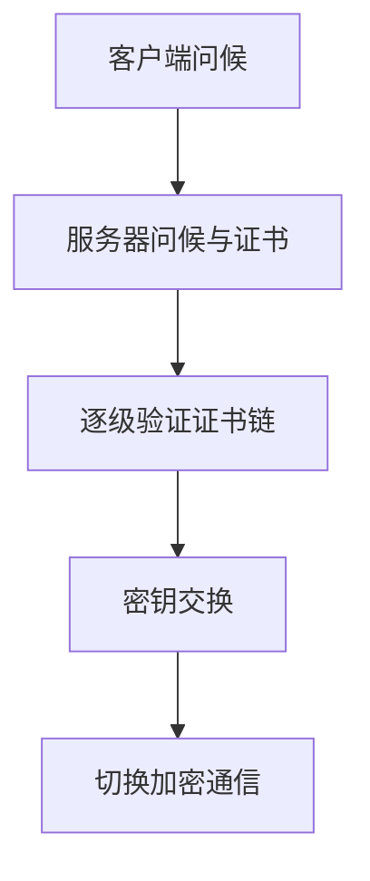
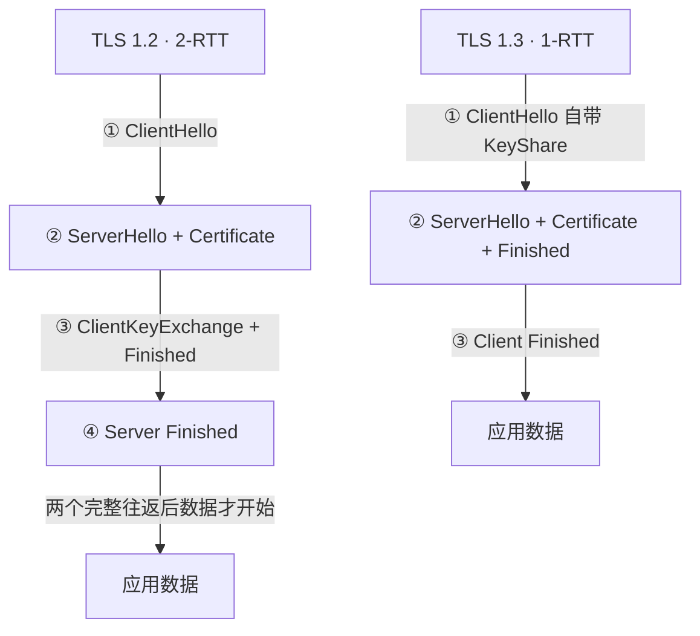

# TLS握手与证书链决定连接建立成本

HTTPS 连接头几十毫秒去哪了？抓包看到的那几十毫秒主要是 TLS（传输层安全协议，负责加密通信与验证身份）握手：1-RTT（TLS 1.3）或 2-RTT 两个往返，加上证书链（从根证书逐级签发到站点证书的信任链条）验证的非对称运算。要解决的问题：**连接建立成本是尾延迟（P99 一类的慢请求耗时指标）与弱网体验的隐藏贡献者**，而握手参数（版本、套件、证书链长度、会话复用）决定了**它是一次性还是每连接反复支付**。读完你能判断自己的连接建立成本卡在握手哪一步，并知道该用 TLS 1.3、会话复用还是补全证书链去压低它。

## 它是怎么做到的：握手在算什么

握手成本到底花在哪两处？**一是往返次数，二是证书链验证**，先看往返：

TLS 1.2 握手两轮往返：ClientHello（客户端问候，开场报文）→ ServerHello+Certificate（服务端应答并出示证书）→ 客户端验证证书链 → Finished（宣告本方握手完成的收尾报文）。**TLS 1.3 压到一轮**：密钥交换与证书同飞，且砍掉了 RSA（一种非对称加密算法，靠一对公私钥加解密，握手期用它加密预主密钥或验签证书）密钥传输（只留椭圆曲线或临时 DH（Diffie-Hellman，密钥交换算法），每次会话临时生成一对密钥），**前向安全性成为默认——即使服务端长期私钥日后泄露，过去抓下的通信记录也解不开**。

两张时序对照着读：1.2 里客户端先空手探路，拿到服务端选择后第二趟才交密钥材料，两个完整往返；**1.3 把密钥份额直接塞进第一个包**（赌服务端会选 x25519 这种当前主流、几乎所有实现都支持的椭圆曲线，几乎总对），证书与 Finished 搭第二趟的车，一个往返完成。RTT 减半之外，RSA 密钥传输被砍掉意味着**前向安全从可选项变成默认项**——这是「砍掉一个往返」与「砍掉一类攻击」同时发生的改造。

往返成本摊到毫秒上是什么样的，可以看这张带时间轴的实测示意：TCP 即传输控制协议，负责把数据完整、有序地送达；TCP 三次握手（TCP 建立连接前、双方交换三个报文确认彼此收发能力的流程）先花掉一个往返（图上 68ms），TLS 1.3 的 ClientHello 与 ClientKeyShare、ServerHello 与证书、Finished 再花掉一个往返（图上又一个 68ms），应用数据在 136ms 之后才发得出去：

*图源：Wikimedia Commons《Full TLS 1.3 Handshake》，CC BY-SA 3.0。*

握手取的是双方见面先对齐条件的意象：交换身份（证书）、确认彼此听得懂的语言（版本与套件）、约定接下来的沟通方式（密钥材料）。这个类比只到"对齐条件"为止，协议里没有社交意义上的寒暄，实际只有报文交换与参数协商。这套对齐每次新建连接都要完整走一遍，成本也就每次都在——**会话复用之所以值钱，是因为它把"重新见面"变成了"老熟人续聊"**：

*图源：Wikimedia Commons，rawpixel.com，CC0 1.0，https://commons.wikimedia.org/wiki/File:Business_agreement_handshake_at_coffee_shop.jpg。*

**证书链验证是 CPU 大头**：叶子证书 → 中间 CA（Certificate Authority，证书颁发机构） → 根（内置于客户端信任库）。**链越长验证越贵**；服务器没发全中间证书，客户端要自己用 AIA（证书里写明的颁发机构信息获取地址）去拉取缺失的中间证书补链，**弱网下多一个完整往返**。

*图示：信任链：每一级由上一级的签名背书。图源：Wikimedia Commons《Chain of trust.svg》，作者 Yanpas，CC BY-SA 4.0，https://commons.wikimedia.org/wiki/File:Chain_of_trust.svg。*
图里每张证书有同样的四格结构，验证就是**逐级用上一级的公钥验下一级的签名（sign 边），直到根证书**——根用自己的钥匙签自己（self-sign）——它之所以算数，是因为**操作系统与浏览器厂商预先审核并把这批根证书内置进客户端信任库，自签名才成为可信起点**。链上少发一张中间证书，客户端就要走 AIA fetching（按证书里写明的地址在线下载缺失的中间证书）现场补链，**这正是弱网下握手变慢的常见原因**。

## 会话复用是怎么把一次性成本摊薄的

| 复用机制 | 剩余往返 | 代价 |
| --- | --- | --- |
| 全握手 TLS 1.2 | 2-RTT + 证书链验证 | 每连接全价 |
| 会话恢复（session ID/ticket） | 1-RTT | 服务器要存状态或发 ticket |
| TLS 1.3 PSK | 1-RTT | 早期数据（0-RTT）有重放风险 |
| TLS 1.3 0-RTT | 0-RTT | 幂等性（同一操作执行多次与执行一次效果相同）要求，见边界 |

表里 0-RTT 的重放风险来自时间差：**早期数据在握手完成前就发出，只能用复用会话的旧密钥保护，服务端无法从密文上区分重放与首次发送，防线只能落在应用层的幂等上**。

复用时省掉的是哪几条消息，看缩写握手的报文流最直观：客户端在 ClientHello 里同时带上 pre_shared_key（TLS 1.3 的预共享密钥扩展）与 key_share（TLS 1.3 握手里携带密钥材料的扩展），服务端认出这张票——session ticket 即会话票据：服务器签发的一张可复用凭证，客户端凭它免掉完整握手就跳过证书与证书验证，直接回 ServerHello 与 Finished，双向各一个包即可收工：

*图源：Wikimedia Commons《Abbreviated TLS 1.3 Handshake》，CC BY-SA 3.0。*

0-RTT 数据是重放攻击面：攻击者原样重发 ClientHello+early data，服务端如果没做幂等（同一个操作执行一次和执行多次的结果相同，重复执行不会产生额外副作用），同一笔请求就会被执行两次。**0-RTT 只用于幂等 GET（HTTP 读取资源的请求方法）或带唯一请求 ID 的写路径**。

## 怎么自己动手验证

建连成本要与握手形态对照对账——**预写完整握手与复用会话之间应差出一个完整往返，实测差异与预期对不上就说明度量点选错了位置**。

- openssl s_client -connect host:443 -tls1_3 看协商版本、套件、证书链与验证耗时分解。
- curl（命令行 HTTP 客户端） -w "%{time_connect} %{time_appconnect}" 分离 TCP 与 TLS 建连时间；弱网模拟（用 tc netem 加 100ms RTT，tc 是 Linux 流量控制工具，负责限速与整形）对比全握手与会话恢复（resumption）的 p99（即 99% 的请求建连耗时都低于该值）。
- 连续 100 次新建连接统计 time_appconnect 分布，会话复用生效则 p50 显著低于全握手基线（正常状态下的指标水平、用来对比异常）。
- 服务端证书链完整性自检：openssl s_client 补链测试，客户端不 AIA fetch 也能验证通过。

## 这套说法在哪儿会失效

- **TLS 只保连接安全，不管应用语义**：超时、重试、幂等仍在调用语义层（[[工程知识/后端系统：在并发、失败与变化中维持服务/分布式可靠性/超时、重试与幂等共同定义调用语义]]）。
- mTLS（双向 TLS，客户端与服务端互相验证证书）把证书验证做对称，服务网格的 sidecar 常驻连接池（预先建好连接反复取用、省去反复握手建连的开销）让**握手成本变成摊销项**，两者配合让"每请求一次握手"的反模式消失。
- 性能视角见 [[工程知识/性能工程：从用户等待到资源瓶颈/存储与网络/端到端网络延迟来自排队、协议、传输与处理]]：TLS 是端到端时间线里"连接建立"段的展开。
- 证书轮换与到期监控是运维问题：cert-manager 类工具的续期窗口与告警，**到期前没换链上的服务集体 525**，故障模式归 [[工程知识/缺陷分析：从个案到体系/稳定性/案例二十一：异常路径上没有完成——永不兑现的 future]] 的"到期事件"簇。

## 接着读哪几篇：同在性能工程里的相邻问题

- [[工程知识/性能工程：从用户等待到资源瓶颈/存储与网络/QUIC把传输握手与加密合流到用户态|QUIC把传输握手与加密合流到用户态]]——TLS 1.3 的 1-RTT 握手是 QUIC（基于 UDP 的传输协议、自带加密与多路复用、省去队头阻塞） 传输/加密合流的前提
- [[工程知识/性能工程：从用户等待到资源瓶颈/存储与网络/Socket与TCP把连接可靠性分成多层]]：TLS 在 TCP 之上叠加安全层，分层视角的邻篇
- [[工程知识/后端系统：在并发、失败与变化中维持服务/服务设计/认证授权决定请求能看什么和做什么]]：握手之后的身份语义在应用层怎么用
- [[工程知识/后端系统：在并发、失败与变化中维持服务/服务设计/流量入口只负责路由与连接，不负责业务正确性]]：入口层终结 TLS 的架构选择
