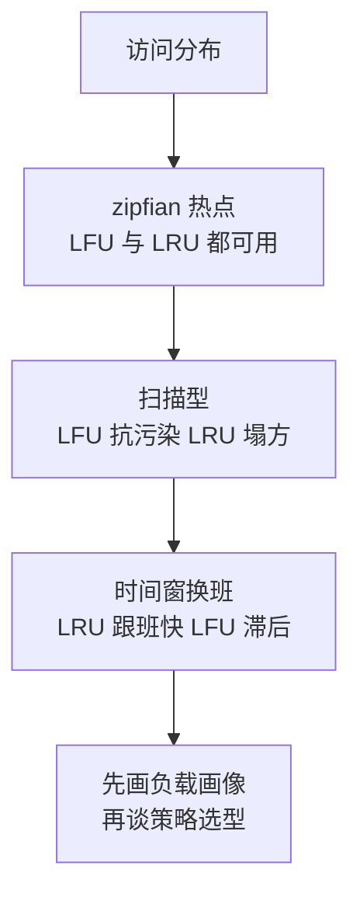
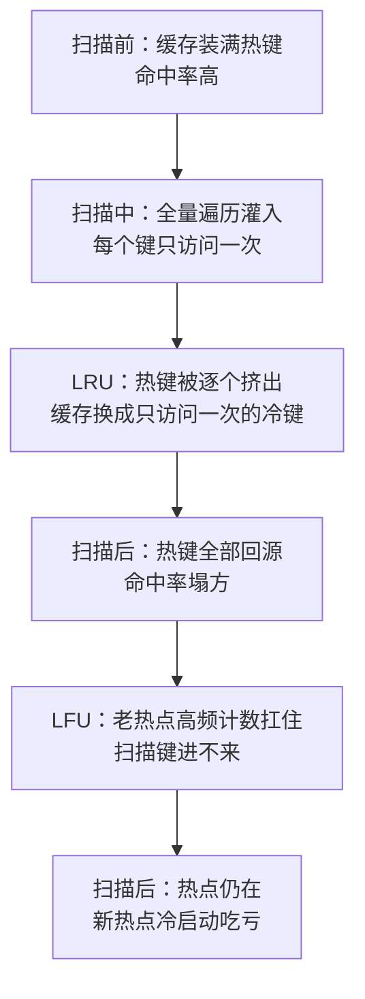

## 为什么选缓存策略不能只靠口头争论？

先看量级意味着什么：假设同一负载下换一个驱逐策略命中率差 20 个百分点，命中率每差 1 个点，就约有 1% 的请求退回源头重查一次，**20 个点等于白付 20% 的回源流量**。

这篇要解决的问题是：缓存驱逐策略到底该怎么选？读完你能**按负载的访问分布直接查表定策略，不再停在派别口头争论**。

而选策略的争论常停在口头：LRU（Least Recently Used，最久未使用的先淘汰的缓存策略）派说"最近用过的还会再用"，押的是时间局部性；LFU（Least Frequently Used，访问次数最少的先淘汰）派说"经常用的才该留"，押的是频率局部性；FIFO（First In First Out，先进先出）派说"简单就是快"。口头争论的盲区：**命中率的决定者是负载的访问分布，策略哲学的争论要排在分布之后**——热点分明的 zipfian 负载（少数几个键占走大部分访问次数）与扫描型负载（周期性全量遍历，无复用）对策略的评价完全相反。

实证对比的方法：把策略放到负载分布维度下测，LRU/LFU/ARC（自适应缓存替换算法）/FIFO 各自的甜点区与盲区就清晰了，**选型从信仰变成查表**。

## 四类策略分别靠什么影响命中率？

缓存要发挥作用，前提是读的路径先查缓存、未命中再回源。分配策略能影响的正是其中两处：命中环节的取舍——谁值得留在缓存里，与驱逐环节的取舍——容量不够时挤掉谁。

**四类策略各自怎么决定留谁赶谁**。FIFO：先进先出，一个队列，不管访问只管进入顺序——实现最便宜，**常数时间完成、不随缓存变大变慢**，但对热点不敏感，最早进的热键会被驱逐（按策略移除条目或实例）。LRU：驱逐最久未访问的，双向链表加哈希（把任意长度数据压成固定长度指纹、不可逆）实现——链表节点记住前后邻居方便摘除挪位，**哈希保证 O(1) 定位**；信时间局部性，**但突发的一批冷访问会污染缓存——扫描把热键全挤出，扫描完热键要重新回源**。LFU：驱逐访问频率最低的，计数加桶实现，比前两种贵一点；信频率局部性，对稳定热点准，**但新键冷启动（缓存或服务刚启动、还没有数据与连接的状态）吃亏——刚进来的热键频率计数低先被驱逐，老键的陈年高频压着新热点，适应得慢**。ARC：把缓存切成最近使用与高频使用两块，两个列表的占比按命中情况实时调节：命中率稳时偏向最近侧追新访问，扫描把命中率拉下来时自动偏向高频侧保热点——**自适应地兼顾时间与频率**。

LRU 的运行过程拆开看，就是访问序列驱动的槽位与计数更新。下图左列是容量为 4 的缓存依次填入 A、B、C、D，括号里是各自的访问计数；右列是缓存满后新访问的两种走向：命中键 D 再次访问时计数抬升，未命中的新键 F 进入时挤掉最久未用的 A：

*LRU 的装入、命中计数与驱逐序列（图源：Wikimedia Commons，Advaitjavadekar 绘，CC BY-SA 4.0）*

**负载分布如何决定胜负？** zipfian 热点（少数键占大头访问）：LFU 与 LRU 都不错，**热点稳定时 LFU 略胜，热点漂移时 LRU 跟得快**。扫描型负载——全量遍历、键不复用：FIFO/LRU 的缓存都被只访问一次的冷键占满，**命中率趋零纯白干**；LFU 抗污染，**老热点的高频计数扛住扫描**，但缓存对新扫描无意义。时间窗负载——工作集随时间换班，上午 A 组键、下午 B 组：**LRU 胜在跟班快，LFU 败在计数是全历史的，换班跟不上**。**扫描抗性与跟班速度此消彼长：LFU 两头都稳但慢，LRU 快但易污染，ARC 用更高的实现复杂度换来两头兼顾**。

三类负载在四类策略间分出高下，同一策略在不同负载下的结局相反：

图：选型的入口次序——负载分布不同，同一策略的评价完全相反，访问分布的画像比策略本身的优劣更靠前。

一次全量扫描灌进来，LRU 与 LFU 的缓存内容各自怎么变，代价是否要等扫描结束才兑现。

**扫描污染的全部代价要到扫描结束才兑现**——扫描期间热键被逐个挤出时命中率已经开始下滑，但回源请求随着每个键被访问陆续发出，要等扫描跑完、被挤出的热键全部回源一轮，统计上的塌方才完整显现。两种策略的差别不止在驱逐序列上——下面要看的是元数据操作本身在延迟路径上的成本。

**元数据操作在延迟路径上付出多少时间成本？** 策略的元数据操作本身就在延迟路径上：LRU 每次访问要移链表节点（无锁实现难，高并发下链表指针的 CAS——Compare-And-Swap，比较并交换：只有值仍等于预期时才写入的原子操作——竞争激烈）；LFU 的计数更新便宜（原子加）**但驱逐时的桶查找要看实现**；Caffeine 是 Java 生态标杆，它用 W-TinyLFU 把 LFU 的准确与 LRU 的敏捷缝起来——频率素描 Count-Min Sketch 用几路哈希把键投进共享的小桶、只记近似频率，加上新键准入窗口：**新键先过观察期，证明不是偶发访问才放进主存储**，靠的是**频次估算换精确计数**（sketch 有 1% 误差，换来 O(1) 且省内存——工程上"大概率的准"胜过"精确的贵"）。延迟敏感路径选策略，**元数据操作的常数项与并发行为要一起测**。

Caffeine 官方 wiki 的设计图把 W-TinyLFU 的分区与流水线画全了：主存储按 Window LRU（准入窗口，1% 容量起步）、Probation（20%）、Protected（80%）三段划开，读写缓冲把元数据操作从调用线程摘走**异步批处理**（把多个请求合并成一批同时计算、提高硬件利用率），访问的键哈希进 Count-Min Sketch 记频率（图中 hash0-hash3 四路哈希到共享桶），HillClimber（爬坡式调参机制：每次微调分区占比，命中率涨了就沿这个方向继续，跌了就回退）按命中率动态调节 Window 与 Protected 的占比——「素描估频率 + 窗口准入」就是图上这两条链路：

*图源：[Caffeine 官方 wiki《Design》](https://github.com/ben-manes/caffeine/wiki/Design)，ben-manes，Apache 2.0。*

**命中率该怎么观测、收益怎么换算？** 命中率也不是越高越好：想装下更多请求就得扩内存，容量无限时命中率能到 100%，内存开销也跟着爆表，命中率抬到某个点之后再扩内存就不划算了——**收益曲线有拐点：容量-命中率曲线（miss rate vs size）的拐点给出"性价比容量"**（再加 1GB 命中率只涨 0.1%，不值得）。实证流程：**记录真实访问序列（key + 时间戳）→ 离线回放各策略（多容量档）→ 曲线对比选型**。线上验证：灰度（新版本先放一小部分流量验证，逐步放大到全量）双跑（新旧策略各一半流量，比命中率与回源量），**A/B（把流量分成两组，一组旧策略一组新策略，同负载下对拍命中率与回源量）的收益才可信**。

## 这些策略的来路和真实代价是什么？

替换策略的研究从操作系统页面置换（1960s 的 Belady 最优解是理论天花板——驱逐"未来最久不用"的，**需要未来知识**）一路下来；ARC是自适应路线的代表；Redis（内存键值数据库，常当缓存与排行榜用） 近年引入 LFU 模式（4.0，2017，带衰减计数对抗陈年高频）；W-TinyLFU 与 Caffeine 把"素描 + 窗口"做进工业标配。W-TinyLFU 出自 Einziger 等 2017 年论文《TinyLFU: A Highly Efficient Cache Admission Policy》，W 前缀是文中的窗口准入变体。

Redis 官方文档用同一负载把理论 LRU、Redis 3.0（10 samples）、Redis 2.8（5 samples）与 Redis LFU（5 samples）四种实现放在一起对比，四个格子就是四张命中率地图：浅灰带是被驱逐的键、灰带是保留的键、绿带是新加的键。理论 LRU 的保留带整齐贴着访问频率；Redis 3.0 用近似采样（只采集一部分数据以控制记录开销）后边缘开始毛糙；LFU 的保留带在最热的区域收得最紧——**「思想实验里的完美策略」与「工程实现的近似策略」的差距，图上一眼可见**：

*图源：[Redis 官方文档《Using Redis as an LRU cache》](https://redis.io/docs/latest/develop/reference/lru-cache/)，Redis Ltd.，CC BY-SA 4.0。*

**W-TinyLFU 用"估算的频率"替代"精确的频率"**：**精确 LFU 的病根在精确**（每个键一个计数器的内存、陈年计数的失效），Count-Min Sketch 用几 bit 的哈希素描以 1% 的误差把每键计数器的内存降掉数量级（每键 32 位计数器对每键若干 bit 的共享桶），加上**计数衰减**（定期把计数器整体右移一位，数值减半，长期不访问的键计数自然滑向零、退出热点候选）解决陈年问题。这是"分布式的精准幻觉"的破解范本——幻觉指"每个键都要一个精确计数器才配得上准确决策"的执念：**多数负载下，1% 误差的近似频率决策出的驱逐序列与精确版几乎一致**，为这 1% 的精度付出一个数量级的内存溢价是策略设计的反面教材。代价：sketch 有误判——**冷键碰巧哈希到热桶，会被误当成热键放进主存储**；**挡住这类误判的是准入窗口**：新键先在窗口区待够一定访问量才能升入主存储，靠偶然碰撞冒充热键的冷键在观察期就被淘汰。

自适应策略（ARC/TinyLFU）的行为难解释——参数调优无理论指导，线上问题的归因多一层黑盒（不接触代码内部、只看输入输出的测试或分析方式）：命中率与回源量这些结果指标可直接观测、能从指标反推，**但参数怎么调出来的没有现成公式**。

**实证对比有环境成本**：访问日志的采集与回放要基建，**离线回放无法重现并发时序与回源延迟的反馈环，结论与线上实况有偏差**。

## 这套说法在哪儿会失效

- **策略选型先看负载画像**：**没有访问分布数据前，一切策略讨论是空谈**。画像的两个必答题：键的复用分布（zipfian 还是均匀）、有无扫描型流量（备份、报表、爬虫的全量遍历）。画像答完，策略的候选集已经缩到一两个。
- **多级缓存的策略分工**：本地缓存（进程内，容量小延迟敏感）与远程缓存（Redis 类，容量大网络往返）的负载形态不同（本地层过滤后的访问模式更热），**策略不必相同**——本地 LRU 挡突发、远程 LFU 保热点是常见组合：本地层先把高频的短期热点拦下，能穿过多级缓存、一直落到远程层（穿透：请求在本层找不到、继续往下层走）的多是持续时间较长的稳定热点，LRU 跟得上换班；远程层容量大、工作集稳定，按频率留人更准。
- **热点 key 的极端形态越过策略问题**：单个 key 打爆容量层（微博明星官宣的 key 集中读写），**驱逐策略无关紧要**（缓存满不了、命中率满的），要的是 key 分开（加后缀哈希打散）或本地缓存挡写。策略解决"留谁"，**解决不了"全都要"**。
- **一致性约束压过命中率**：写多读少的数据上缓存（命中率低 + 失效复杂），**先问该不该缓存（直接读库可能更简单更快），策略优化是缓存已成立后的第二问**。

## 怎么自己动手验证

- **负载-策略矩阵实验**：合成三型负载（zipfian 稳定热点 / 扫描污染 / 时间窗换班）离线回放 FIFO/LRU/LFU/ARC 四策略（同容量多档）。预期：zipfian 下四者接近（LFU 略优）；扫描下 LFU/ARC 显著抗污染（LRU/FIFO 命中率塌方）；换班下 LRU/ARC 跟班快（LFU 滞后）。行为签名表的直接复现。
- **容量-命中率曲线**：真实访问日志回放单策略（LRU），容量从 1% 到 100% 工作集扫描。预期：**曲线前段陡升后段平缓，拐点即性价比容量**；不同策略的曲线对比（**TinyLFU 的曲线在 LRU 上方且拐点更早——同样命中率用更少内存**）。收益换算的方法验证。
- **线上灰度对照**：新策略（如 LRU 换 W-TinyLFU）灰度 50% 流量双跑一周。预期：命中率与回源量（QPS 每秒查询数、带宽占用）的差值即真实收益；注意观察延迟分位数（把耗时排序后取某个百分比位置的值、如 P99）——**策略元数据的操作成本可能吃掉部分收益，决策所依据的证据来自这一层**。

## 接着读哪几篇：CPU 缓存行是硬件级 LRU 的实例

- [[工程知识/性能工程：从用户等待到资源瓶颈/处理器与内存/缓存行与伪共享：64字节里的并发性能.md]] —— CPU 缓存行是硬件级 LRU 的实例，本篇是软件缓存的策略层，两级的驱逐依据都是访问局部性
- [[工程知识/数据系统：在并发与故障中保存事实/查询与索引/列式存储把扫描与压缩交给分析路径.md]] —— 扫描型负载的缓存收益趋零，分析路径的缓存策略是本篇边界条件的案例
- [[工程知识/后端系统：在并发、失败与变化中维持服务/服务设计/连接池的容量数学：池大小与排队等待的权衡.md]] —— 容量-收益曲线的拐点思维与连接池（预先建好连接反复取用、省去反复握手建连的开销）容量同构，资源分配的通用方法
