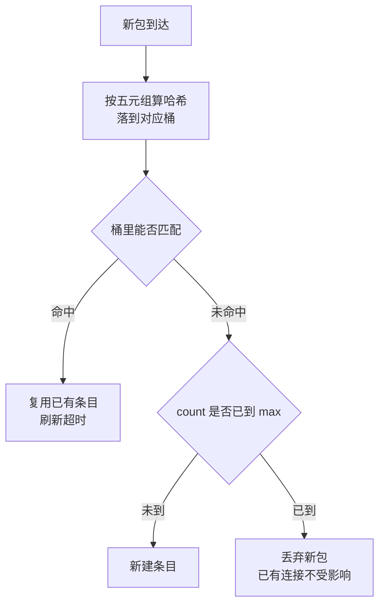
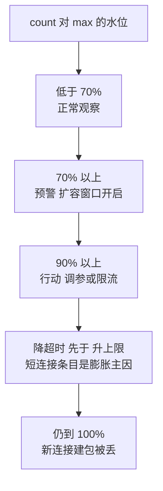
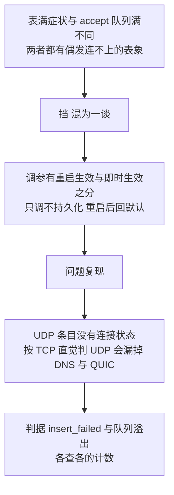

# conntrack表满不丢连接的判定：计数、桶与协议差异

新连接连不上、老连接却一切正常，这种怪现象**往往是连接跟踪表满了**。读完这一页你能**读出水位、按协议拆开看是哪些连接把表撑大，并知道调参要三处一起动**。

> **要点**：连接跟踪表的容量判据是 `nf_conntrack_count` 逼近 `nf_conntrack_max`（水位 70% 预警、90% 行动），溢出的直接症状是"新连接被静默丢弃、老连接正常"——读 `nf_conntrack_count` 对 `nf_conntrack_max` 的水位（两个值分别写在 /proc/sys/net/netfilter/ 下的同名文件里）、用 `conntrack -L` 按协议状态统计条目构成——TIME_WAIT 即 TCP 连接关闭后保留一段等待时间才释放的状态，这类短连接是膨胀主因，调参要三处一起动：`nf_conntrack_max` 上限、`nf_conntrack_buckets` 桶数、各状态超时。

## 要解决的问题：连接跟踪为什么存在，又为什么丢包

Netfilter 的连接跟踪（conntrack）为每条经过的连接在内核里建一条记录（五元组即源 IP、目的 IP、源端口、目的端口、协议号这五个字段，加状态与超时），NAT（网络地址转换，指在内外网之间改写地址与端口的机制）、状态防火墙、有状态负载均衡（按连接而非按包分发、同一连接固定到同一后端）都依赖它——**记录的代价是内存与容量上限**：`nf_conntrack_max` 限制条目总数，表满后新连接的建包被丢弃（默认行为），**表现为"偶发连不上、重试能成功"，流量高峰时变成大面积连接失败**。

**为什么表满了难以发现**：表满不崩进程、不打错误日志，**唯一线索是内核计数器数字的变化**（/proc/sys/net/netfilter/ 下的 count 文件）——发现靠监控（count 水位），症状定位靠**"老连接正常、新连接失败"的特征组合**。

conntrack 在内核网络组件里的位置见下图：它（Connection tracking 块）与 NAT 引擎、日志、队列并列，都架在 Netfilter hook API（内核在网络包经过的路径上预留的若干挂载点，各组件把处理逻辑挂上去）之上，iptables（Linux 防火墙规则工具）/nftables 等用户态（普通程序运行的低权限受限状态）工具依赖它做状态匹配——**这也是为什么表满丢包（数据包在网络传输途中丢失）会同时影响状态防火墙与 NAT**：


*Netfilter 组件体系，conntrack 位于右上（图源：Wikimedia Commons，Jan Engelhardt 绘，CC BY-SA 3.0）*

组件图之外，包在整条路径上的流转次序直接决定 conntrack 在哪一步建账：入站包从网卡经链路层进入 prerouting——**连接跟踪正是在这里登记新连接**，之后才轮到路由决策分胜负（本机收下还是转发），出站与转发路径同样要过 postrouting 的账：


*数据包穿越 netfilter 的路径：五条链与三张表的挂载关系，连接跟踪在此路径上登记每条连接的状态（图源：51CTO 博客）*

*图源：Wikimedia Commons《Netfilter packet flow》，CC BY-SA。prerouting 与 postrouting 两个 hook 链上挂着连接跟踪与 NAT——表满丢的新连接建包，正是在 prerouting 处被拒。*

## 它是怎么做到的：计数、桶与超时怎么决定新包丢不丢

**计数与水位**：`nf_conntrack_count` 是当前条目数，`nf_conntrack_max` 是上限——**水位判定线**：持续 70% 以上预警（扩容窗口开启）、90% 以上行动（调参或限流——控制单位时间放进来的请求数量，超过配额就拒绝）、100% 即丢包。`/proc/sys/net/netfilter/nf_conntrack_count` 与 `cat /proc/sys/net/netfilter/nf_conntrack_max` 两个文件是第一现场，`conntrack -S` 看 per-CPU 统计（per-CPU 指每个 CPU 核心各自记账，避免多核抢同一个计数器）；insert_failed 计数非零即在丢。

count 对 max 的水位决定处置动作的档位，丢包只在最后一级：**表满时内核不为腾空间淘汰旧条目，只在新建连接建账前检查是否已到 max，到了就丢掉这个新包，已有连接不经过检查照常通过**。

这一点常被误解成"表满了会淘汰最老的连接"——实际不会。**连接跟踪表没有按最近最少使用淘汰的机制，表满时内核直接丢弃新连接的数据包，已有的连接照常通过**：



"已有连接正常、新连接超时"这个现象就来自最后那条分支：**它让故障表现得像应用问题，实际发生在网络层，应用层看不到任何错误**。

参考中文资料：[nf_conntrack: table full 排查总结（CSDN）](https://blog.csdn.net/weixin_67553250/article/details/123577294)、[阿里云 ECS 连接跟踪表满导致丢包的处理说明](https://help.aliyun.com/zh/ecs/user-guide/the-application-on-the-ecs-instance-occasionally-suffers-packet-loss-and-the-kernel-log-contains-the-error-message-kernel-nf-conntrack-table-full-dropping-packet)。



**水位分级的处置次序：70% 与 90% 两级预警给的是提前量，动作先降超时再动上限，insert_failed 计数是丢包的实证信号**。

**怎么看是谁把表撑大的**：`conntrack -L | awk '{print $4}' | sort | uniq -c` 按协议状态统计（$4 取 conntrack -L 输出的第四列，即协议与状态字段）——**膨胀的主因通常是 TIME_WAIT/短连接类条目**：每个 HTTP 短请求建一条 conntrack，条目存活到超时（由内核参数 nf_conntrack_tcp_timeout_time_wait 控制，默认 120 秒），**QPS（每秒查询数，衡量服务每秒要处理多少个请求）万级的短连接服务几分钟就能灌满默认 65536 的表**。**分别统计的意义**：确认膨胀来源（短连接 vs UDP 洪水 vs 扫描流量），不同来源的处理动作不同。

**超时参数是另一条调节路径**：条目的生存期按状态分档（`nf_conntrack_tcp_timeout_time_wait`、`_established`、`_close_wait` 等）——**降超时是比升上限更优先的动作**：**TIME_WAIT 120 秒降到 30 秒，同样流量下条目数降为四分之一**；established 超时（默认 432000 秒 = 5 天）**对大量半开失效连接（一方已崩溃退出、另一方还当连接存在继续占表）的表尤其值得压**。**上限、桶数、超时三处一起动**：`nf_conntrack_max` 升高的同时要核 `nf_conntrack_buckets`（哈希桶数，建议与 max 同量级或 max/4 起，**桶太少查表 CPU 飙升**）、按业务超时节奏调状态超时——**单动 max 是最常见的半截调参**。

**不走 conntrack 的旁路（绕开主流程的备用路径）**：纯内部可信流量（监控拨测、健康检查、本机回环）可用 raw（裸格式：不经容器封装的原始数据）表 NOTRACK 豁免（raw 表是 iptables/nftables 里优先级最高的一张表，NOTRACK 动作让包直接跳过连接跟踪）——**豁免减少的是表占用，不等于性能优化**：每条豁免的连接不占表容量，但也不受状态防火墙保护，豁免范围要白名单化并留文档。


来源：[小林coding《TCP 三次握手与四次挥手面试题》](https://www.xiaolincoding.com/os/1_hardware/tcp_interview.html)（CC 4.0 BY-NC-SA）


## 读完这一段你能判断什么：溢出判定的四步

1. **看水位**：count/max 比例与增长斜率——**斜率陡增（分钟级从 50% 到 90%）是短连接风暴或扫描，缓增是业务自然增长（该扩容）**；
2. **看构成**：按协议状态统计条目——TIME_WAIT/CLOSE 类占比高走降超时路线，ESTABLISHED 异常多查半开连接与应用泄漏（连接不关，conntrack 条目陪葬）；
3. **核丢包**：`conntrack -S` 的 insert_failed、`netstat -s | grep -i "listen queue"`——**insert_failed 增长即表满丢包的实锤**；
4. **定动作**：临时止血（降 TIME_WAIT 超时 + 豁免可信流量）→ 中期（升 max 配桶数 + 应用侧连接池复用，从源头减少短连接）→ 长期（水位告警进监控，本库交付清单篇的阶段三第 12 项）。

**两类高发场景**：容器环境（K8s 的 kube-proxy，负责把 Service 流量转发到后端 Pod）走 conntrack，**Service 后端多、短连接密集的集群默认 max 远不够，社区常见把 max 调到百万级**；NAT 网关（出向流量的五元组复用受限，SNAT 即源地址转换、多台内网机器共用公网 IP 出网，场景下连接池小 + 短连接多 = 表满加速）。

K8s（Kubernetes 的常用简称、容器编排系统）场景里 conntrack 在干什么，Kubernetes 官方博客的这张图画得最直白：Client Pod（Kubernetes 调度的最小部署单元，可含一个或多个共享网络的容器） 发往 Service VIP（Virtual IP，虚拟 IP：可漂移到存活节点的服务地址）的包被 DNAT（Destination NAT，目的地址转换：改写数据包的目的 IP/端口再转发） 改写目标地址后到达 Server Pod，回程包再由 conntrack 认出并把源地址改写回 Service VIP——表里的那条记录保存了「改写过的两个方向」的地址映射（去程把目标地址从 Service VIP 改成 Server Pod 地址，回程把源地址从 Server Pod 地址改回 Service VIP），**表满丢的正是建立这条记录的时机（第一个 SYN，TCP 建连第一步的握手信号）**：


*图源：[Kubernetes 官方博客《kube-proxy Subtleties: Debugging an Intermittent Connection Reset》](https://kubernetes.io/blog/2019/03/29/kube-proxy-subtleties-debugging-an-intermittent-connection-reset/)，2019。*

conntrack 认不出回程包时的故障场景也在这张图里：conntrack 不认识回程包时（表满建不了账是原因之一）把包标成 INVALID，客户端收到源地址没改写的包直接回 RST（Reset，TCP 强制断开连接的信号）——**这正是官方博客那篇排障记录里「偶发 connection reset」的完整链路**。

## 这套说法在哪儿会失效

**三条边界，防止把判定用过头或用错方向。**

**conntrack 表满的症状与 accept 队列（内核里存放已完成握手、等待应用调用 accept 取走的连接的队列）满不同**：表满是"新连接的 SYN 被丢"（客户端连接超时、服务端无感）；队列满是"SYN 收到但 accept 不过来"（服务端有计数）——**两者都有"偶发连不上"的表象**，**判据在 insert_failed 计数与队列溢出计数各查各的**，本库"连接建立失败先看内核队列"篇是队列侧的判定。

**调参有重启生效与即时生效之分**：`sysctl -w` 即时生效但重启丢失，持久化进 `/etc/sysctl.d/`——**只调不持久化是复发性故障的经典成因**（换机器、重启后参数回默认，问题复现）。

**UDP（用户数据报协议，一种无连接的传输协议，发送前不建立连接，也不保证数据到达或按序到达）条目没有连接状态**：UDP 的 conntrack 条目按流超时（默认 30 秒单 180 秒多向），DNS（Domain Name System，域名系统：把域名解析成 IP 地址） 高频查询、QUIC（基于 UDP 的传输协议，把 TCP 三次握手与 TLS 握手的往返合并成一次，连接建立的来回更少）大流量场景的 **UDP 条目也是膨胀源**——按协议分别统计时 UDP 单列，别按 TCP（传输控制协议，负责把数据完整、有序地送达）直觉判。

三条边界各自挡住一种把防线用过头或用错方向的做法——这里的「防线」指本文的三条判定边界（哪些情况适用、哪些不适用），不是防火墙一类的安全设备，对照见下表：



第一条最关键：表满与队列满的表象都是"偶发连不上"，但一个是新连接的 SYN 被丢、服务端无感，一个是 SYN 收到却 accept 不过来、服务端有计数。**把两者当成一回事，排查方向就会错**。判据是两个计数分开查：`insert_failed` 与队列溢出各查各的。第三条提醒按协议分别统计——UDP 条目按流超时，没有 TCP 那样的连接状态机。

## 怎么自己动手验证

以下三步在测试环境即可走完：

1. 溢出复现：测试环境把 max 调小 + 短连接压测，预期 insert_failed 增长、新连接超时老连接正常，**验证症状组合的判定法**；
2. 调参验证：降 TIME_WAIT 超时 + 升桶数后重压，预期同流量下 **count 水位降、insert_failed 归零、CPU 无明显上涨**；
3. 告警验证：水位到 70% 预期预警触发、90% 预期行动级告警，交付清单第 12 项的核对有数据支撑；
4. 断言锚点：**count/max 水位监控在管（含 per-CPU insert_failed）、按协议状态的构成统计有面板、sysctl 参数持久化在配置管理**——**三件齐备，"偶发连不上"从玄学变成一张水位图加一个构成表**。

```text
水位断言 = count 对 max 的比例在管
构成断言 = 按协议状态分别统计
持久断言 = 调参进 sysctl.d 不靠现场
```

conntrack 的容量治理要看三个数：水位（还有多少余量）、构成（谁在占）、丢失计数（是否已在丢）——**三个数的组合直接给出动作选择**：短连接占比高先降超时并上连接池（预先建好连接反复取用、省去反复握手建连的开销）复用，扫描或 UDP 洪水先升上限配桶数，可信内部流量做豁免，**表满丢包的排查从内核玄学收敛为一次读表**。

## 接着读哪几篇：水位检查进上线清单

- [[工程知识/性能工程：从用户等待到资源瓶颈/存储与网络/交付前的网络检查清单：二十项逐条过，三项全绿再上线.md]] —— 水位检查进上线清单
- [[工程知识/性能工程：从用户等待到资源瓶颈/存储与网络/连接建立失败先看内核队列：SYN 队列与 accept 队列是两个瓶颈.md]] —— 队列侧的同类判定
- [[工程知识/性能工程：从用户等待到资源瓶颈/存储与网络/TIME_WAIT是连接收尾的代价与设计.md]] —— 短连接条目的来源治理
- [[工程知识/性能工程：从用户等待到资源瓶颈/存储与网络/连接与文件描述符的配额要联动：ulimit 是连接数的隐形上限.md]] —— 应用侧配额的联动核算
