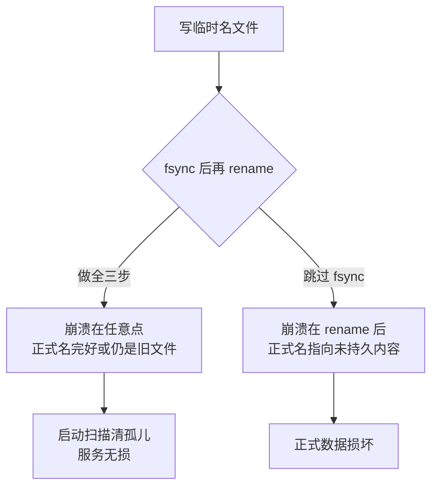
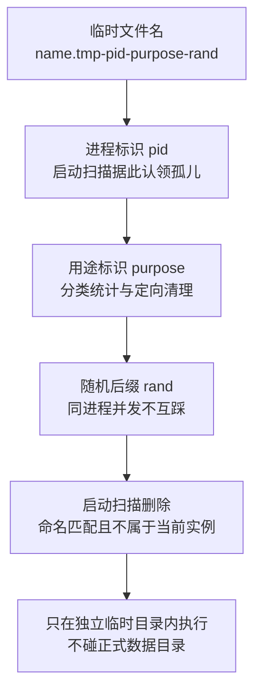

# 临时文件要先写进命名约定：可清理性是写入路径的设计要求

临时文件什么时候可以删，这件事**要在写入的时候就定好，不能等到磁盘满了再猜**。读完这一页你能定出带进程与用途的命名、启动时的孤儿清理，以及**临时名、落盘、原子改名这三步**，并且判断**自己的写入路径是否已经配齐**。

> **要点**：临时文件的可靠性要求是**"随时可安全删除"**——命名带进程与用途标识、启动扫描清理孤儿、写入路径分三步完成（临时名 → fsync → 原子改名）；**三件事配齐，磁盘打满与残留垃圾才从"运维事故"降级成"启动日志里的一行清理记录"**。**三个机制各自掐断事故的一个环节**：命名约定让孤儿能被认领（**知道删谁**），启动扫描让清理自动发生（**不用等人想起**），原子就位让崩溃不留半成品（**不用人工修复**）——**垃圾堆积与半成品损坏这两个来源由此都被堵住**。

## 临时文件为什么会在磁盘上"逃逸"成垃圾？

上游 Apache BookKeeper（一个分布式日志存储系统，同样面对"写入方崩溃后中间文件无人认领"的问题）的一个复现改进是修复了一处缺陷：SST（Sorted String Table，按 key 排好序后落盘的只读文件）文件堆在 locations 目录里不被清理，**垃圾越积越多**。SST是 LSM（Log-Structured Merge，先把写入攒在内存里、再按批顺序落盘的存储结构）树里按 key 排序的不可变数据文件，LSM指先把写入追加成日志再后台合并成有序文件的存储结构。

**临时文件没法指望运行结束自然回收**：运行随时可能中途崩溃，进程在就没有人执行"退出时清理"，**所以回收必须在写入路径里预先设计好**——**写下去容易，收回来要靠设计**。本篇把临时文件的可清理性展开：**命名约定的字段、启动清理的扫描逻辑、文件就位的三步**——目标只有一个：**任何时刻手动或自动删除全部临时文件，服务无损**。

## 它是怎么做到的：命名、清理与文件就位

**清理动作本身也要被盯着**：谁负责清理，清理失败之后由谁接手。这个结构可以借调度-代理-监督者的图来看：调度器对应启动扫描（决定何时清）、代理对应单个清理动作（执行删除）、监督者对应日志与复查（确认清理真的做成、失败重新排期）——借到**"职责分开、有人盯着"**这一层为止，**临时文件的清理并不需要真的引入调度框架**。


*图源：Microsoft Learn 中文文档，CC BY 4.0，https://learn.microsoft.com/zh-cn/azure/architecture/patterns/scheduler-agent-supervisor。*

同一件事不做约定时的对照形态：两条管道各自独立开发，Task B 在两个模块里是**两份不同实现**——**文件名不带元数据时，清理方只能各扫各的，谁的临时文件谁自己认领，跨进程的孤儿没人管**。对照过来：Task B 的两份实现就是**"两个清理方对同一批文件各有一套认领规则"**，命名约定把规则统一成一份，**对照图里的分裂就不存在了**。命名约定把「这是谁的、什么用途、能不能删」写进文件名，**等于给每个文件发了一张随身的说明**：


*图源：[Microsoft Learn 中文文档《管道和筛选器模式》](https://learn.microsoft.com/zh-cn/azure/architecture/patterns/pipes-and-filters)，CC BY 4.0，文档引用。*


**命名约定带三类字段**：进程标识（pid 或实例 id，认领用）、用途标识（purpose：sort-temp、merge-temp、session-upload，分类统计与定向清理用）、随机后缀（协程是用户态调度的执行单元，一个进程里可以同时跑很多个，比线程更轻——同进程两个协程可能同时创建临时文件）写同类临时文件**不互踩**。**命名即元数据**：**约定定好后清理脚本不用读文件内容就能分类**。

**启动扫描清理孤儿**：进程启动时扫描自己的临时目录，**删除"命名匹配 + 不属于当前运行实例"的文件**——**清理的判据来自命名约定**（无约定的目录只能按 mtime——文件最后一次被修改的时间戳——猜，**误删风险高**）。两类工具补位：systemd（Linux 的服务管理器，开机自启与守护进程）-tmpfiles（systemd 自带的临时文件清理工具）按年龄清理（system 侧），应用框架的启动钩子清自己的（应用侧）；**两层各管一段**，注册表（tmpfiles.d 配置与代码约定）保持一致。system 侧的按年龄清理是声明式的：路径、权限、保留时长写进 tmpfiles.d 配置，清理按声明执行，**判据是 Age 字段而非文件名猜测**：


*图源：freedesktop.org systemd-tmpfiles(8) 与 tmpfiles.d(5) 手册页字段说明（整理排版截图），https://www.freedesktop.org/software/systemd/man/latest/systemd-tmpfiles.html，文档引用。*

**原子就位三步**：写入 `name.tmp-<pid>-<rand>` → fsync（强制把内核缓冲刷入磁盘的系统调用）数据 → `rename()` 到正式名——**rename 在同一文件系统内是原子操作（不可分割、要么全做要么不做的操作）**，**读方要么看到旧文件要么看到新文件，永远看不到半成品**；**SQLite（嵌入式单文件数据库）的 journal、LSM 引擎的 SST 就位都是这个模式**。**跳过 fsync 直接 rename 的隐患**：**崩溃后 rename 生效但数据未持久，正式名指向空文件或旧内容**——本库"存储引擎的文件一致性"的元数据核对在这里就是**核对这一步有没有做全**。

写入到就位的两条路径在崩溃点上的分岔，**fsync 的位置决定崩溃后的结局**：



 fsync 的位置为什么不能省：**两条路径的差别只在崩溃时刻的表现**，**跳过 fsync 的隐患平时看不见，崩溃把半成品暴露在读方面前**。


**文件名里三段各有用途**：**pid 段决定孤儿能不能被认领、purpose 段决定能不能定向清理、rand 段决定同进程并发写入会不会互踩**，三段共同支撑**「启动扫描删除」这一个判据**：



**命名约定是清理的地基，认领与分类都不需要读文件内容**；在这个地基上再谈目录与权限的边界。

**权限与目录隔离**：**临时文件放独立目录（不与正式数据混放）**，目录权限按**最小授权**（本服务可写、其他不可读——临时数据也可能敏感）；`TMPDIR`（环境变量，多数程序读它来决定临时目录放哪）重定向是**容器环境的第一课**（容器可写层与挂载卷的容量边界不同）。

## 读完这一段你能判断什么：清理的安全判据

**清理的三个安全判据**：**正在写的临时文件不能删**（按 mtime 与打开状态判断，用 `lsof` 或 fuser 核对文件被哪些进程打开着）、**跨进程共享的临时目录不按名字猜**（按约定前缀）、**删除动作要留日志**（清了什么、多大、为什么——磁盘类事件的取证起点）。**自动清理与手动清理都要过这三条**，差异只在触发时机。

**两个典型的失败模式**：临时文件**写进正式数据目录**（混放后清理脚本不敢删，孤儿永久堆积）；临时文件**命名不带 pid**（崩溃后无人认领，mtime 猜测误删活文件）——**两个模式都违反命名约定**，**约定是清理的地基**。

## 这套说法在哪儿会失效

三条边界，防止把这套做法用过头或用错方向。

**可清理性有前提：内容可再生**。临时文件的语义是**"丢了能重来"**（排序中间结果、会话草稿）——**不可再生的中间状态（用户上传的原始数据）要先持久化再处理，临时区只放加工产物**；**"临时区里的东西删了就没了"是设计错误在先**。

**rename 的原子性有边界：同文件系统**。**跨设备 rename 退化为复制 + 删除（非原子，中断留下两半）**——**临时目录与最终位置必须在同一文件系统**，`TMPDIR` 指到另一块盘时**要么改挂载、要么显式复制**。

**清理频率与 IO 成本的平衡**：启动扫描一次的成本可控；运行中周期扫描（每分钟扫大目录）的 IO 与锁竞争（多个执行流争抢同一把锁造成的等待开销）**要评估**——大目录场景用**"写入时登记 + 定期核对"降低扫描面**，与全量扫描的收益差按目录规模算。

## 怎么自己动手验证

可复现的验证路径：

1. 孤儿复现：进程运行中 kill -9，重启后预期**启动扫描清掉全部孤儿、日志记录清理清单**；
2. 原子性验证：写入路径注入崩溃（kill 在 fsync 前后各一次），预期**崩溃后正式名要么完整要么不存在，读方无半成品**；
3. 磁盘打满演练：往临时目录灌数据到配额触顶，预期**写入降级（拒绝新任务）而正式数据路径不受影响**；
4. 断言锚点：**临时目录与正式目录分离、命名约定带进程与用途标识、启动清理在代码路径里、清理动作有日志**——四件齐备，临时文件**从"迟早打满磁盘"变成"启动时顺手清掉"**。

```text
命名断言 = 临时文件名自含认领信息
就位断言 = fsync 后 rename 才算写完
清理断言 = 孤儿在启动时被清且留痕
```

临时文件的治理思路是**把"以后再清理"变成"写入时就决定怎么清理"**：命名约定、目录隔离、原子就位三个机制一起用，**让每一份临时数据在创建时就自带删除条件**。

## 接着读哪几篇：fsync 与持久化时机的内核层

- [[工程知识/性能工程：从用户等待到资源瓶颈/操作系统与运行时/脏页回写在性能与崩溃丢失窗口间权衡.md]] —— fsync 与持久化时机的内核层
- [[工程知识/性能工程：从用户等待到资源瓶颈/存储与网络/存储引擎的文件一致性：元数据与数据块的对应关系要可核对.md]] —— 就位后的完整性核对
- [[工程知识/后端系统：在并发、失败与变化中维持服务/任务与并发/后台任务不能依赖终端会话维持生命周期.md]] —— 进程生命周期与文件生命周期的托管
- [[工程知识/数据系统：在并发与故障中保存事实/事务与存储/LSM树用写放大换取顺序写和可扩展性.md]] —— SST 类文件的就位实践
