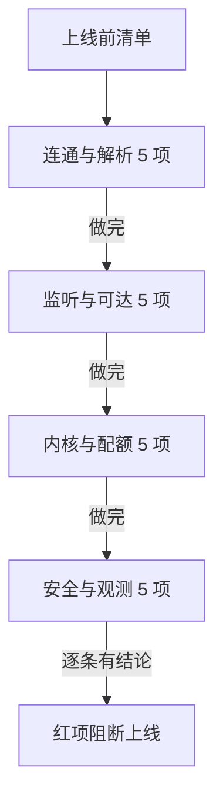

# 交付前的网络检查清单：二十项逐条过，三项全绿再上线

> **要点**：这篇要解决的问题是：服务上线前，网络配置**该怎么核对才不留隐患**？读完你能照着一张 20 项清单逐条检查——连通与解析（5 项）、监听与可达（5 项）、内核与配额（5 项）、安全与观测（5 项），**每项给检查命令与判定标准**。清单的价值在**"上线前 10 分钟逐条过"**，把网络类上线事故**从"事后救火"变成"事前拦截"**。

## 网络配置为什么必须在上线前逐项核对？

网络这一层要过的关，可以照着 TCP 的四块机制列：重传（发出去的包没确认就重发一遍）、滑动窗口（一次最多发多少数据、边收确认边推进）、流量控制（按接收方的处理能力限制发送速度）、拥塞控制（按网络的拥堵程度限制发送速度），**每块都有自己会出问题的地方**。


*图源：小林 coding（博客园）《30 张图解：TCP 重传、滑动窗口、流量控制、拥塞控制》，CC 4.0 BY-SA，https://www.cnblogs.com/xiaolincoding/p/12732052.html。*

网络问题的特点是**"改配置一时爽，出了事难定位"**：DNS（Domain Name System，域名系统：把域名解析成 IP 地址） 配错一个地址、防火墙少开一个端口、内核参数没调，**平时流量小还显不出来，都在上线后的流量高峰爆发**——**高峰时影响面最大、回滚窗口最窄、事后修复的成本最高**，所以上线前这几分钟的检查是**性价比最高的拦截点**。本库已有网络侧的机制文（DNS 全链路、SYN（Synchronize，TCP 建连第一步的握手信号）队列、TIME_WAIT），缺一张把检查动作收拢的**交付清单**：检查什么、用什么命令、判什么标准、不合格怎么处理。本篇按四个阶段组织 20 项检查，供上线评审与发布前核对使用。

## 二十项检查怎么分组、各查什么？

先把形状说成一件事：上线前的网络检查像飞行员起飞前的绕机检查——按清单绕一圈：油量（连通）、舵面（路由）、起落架（端口）、仪表（监听），而**不是凭"昨天还是好的"就起飞**。清单的价值在**"逐条"**：跳着查的检查等于没查，因为出事的总是那条你觉得**"应该没问题"**的。**四阶段就是绕机的四圈：名字能解开、服务在听、内核参数就位、流量真的通**。这个比喻到"四圈"为止——现实里每一项都有具体命令与判定标准，下面逐项给出。

第一阶段的 DNS 检查，判据是**"解析层与缓存层的答案一致"**。DNS 是树状分层结构，**任何一层缓存或配置出错，都会让最终答案与权威记录不一致**——**这正是上线前必须逐层核对的原因**。

*图示：DNS 层级与查询路径。上线前的 DNS 检查要覆盖这条路径上的每一层。*

**阶段一：连通与解析（5 项）**——前两项查解析，后三项查连通，合起来验证**"名字能解开、路能走通"**。

1. DNS 解析正确：`dig +short <内部域名>` 返回预期 IP，核对**解析层与缓存层的答案一致**——本库 DNS 全链路篇讲过四层缓存各自持有一份；
2. 外部域名可达：`dig +short <外部域名>` 在超时阈值内返回，**防只配内网 DNS 的情况**——resolv.conf 是系统读它来决定用哪几个 DNS 服务器的配置；
3. 路由正确：`ip route get <目标IP>` 走**预期网卡与网关**（多网卡机器的经典错配）；
4. 端口连通：`nc -zv <依赖地址> <端口>` **全部依赖可达**（列出依赖清单逐个测，不留"应该通"）；
5. 大包通过：`ping -M do -s 1472 <目标>` 验证 MTU（最大传输单元，一条链路单次能装下的最大包大小）**路径**（VPN（Virtual Private Network，虚拟专用网络：把流量封装进隧道穿越公网），**封装头部会额外吃掉字节数**，与隧道场景的隐形分片故障）。

**阶段二：监听与可达（5 项）**——验证**"服务在听、外面能进来"**。

6. 监听地址正确：`ss -tlnp | grep <端口>` 显示 `0.0.0.0` 或预期地址（**监听 `127.0.0.1` 导致容器外不可达是高频错误**）；
7. 监听进程正确：`ss` 显示的 pid 是预期服务（**端口被残留进程占用**的检测）；
8. 防火墙放行：`iptables -L -n` 或 `firewall-cmd --list-all` 含目标端口；
9. 负载均衡（把请求分摊到多台服务器、避免单点过载）后端健康：控制台或 API 核对**新实例已注册、健康检查通过**（本库健康检查篇的三级探测：**本机自测、平台探测、外部拨测逐级放大**）；
10. 本机回环自测：`curl -s http://127.0.0.1:<端口>/<健康端点>` 返回预期（**服务自身先绿**）。

**阶段三：内核与配额（5 项）**——验证**"内核参数撑得住流量"**。

配额检查的实物原型是配电箱：一排断路器每个标着额定电流，逐个核对**"这条线路带的负载"与"断路器的额定值"是否匹配**——**超载不跳闸的线路最危险，因为过载无信号**；配额检查就是上线前把每个断路器的额定值与实际负载过一遍：


*图源：Wikimedia Commons，作者 Shawn from Airdrie, Canada，CC BY-SA 2.0，https://commons.wikimedia.org/wiki/File:Coloured_Circuit_Breaker_Panel_(1245142933).jpg。*

阶段三的 5 项就是这台"网络配电箱"上的断路器——比喻只到"额定值对负载"为止：**内核不会像断路器那样自动跳闸断流，超载时系统会变慢或随机出错**，正好是无信号的过载，所以更要上线前手动核对：文件描述符（进程打开文件的编号句柄）上限、conntrack（内核里记录每条连接状态的表）上限、SYN 队列、端口范围、缓冲区——每项**有额定值**（`ulimit -n`、`nf_conntrack_max`、`tcp_max_syn_backlog`）、**有实际负载**（当前连接数、水位），上线前逐项核对余量，**清单的红黄绿三色就是断路器的三种状态**。

11. 文件描述符上限：`ulimit -n` 与服务配额联动（本库"连接与文件描述符的配额要联动"）；
12. 连接跟踪上限：`sysctl net.netfilter.nf_conntrack_max` 与 `nf_conntrack_count` 对比，水位（队列或资源的当前占用程度）**低于 70%**（本库 conntrack 篇的溢出形态）；
13. SYN 队列参数：`net.ipv4.tcp_max_syn_backlog` 与 `somaxconn` 达标（本库"连接建立失败先看内核队列"）；
14. 端口范围与 TIME_WAIT：`ip_local_port_range` 足够宽、主动连接多的服务核对回收参数（本库 TIME_WAIT 篇）；
15. 缓冲区参数：`tcp_rmem/tcp_wmem` 与 BDP（带宽时延积，一次往返里链路上同时在飞的数据量）匹配（高带宽长延迟链路核对）。

**阶段四：安全与观测（5 项）**——验证**"出事能看见、访问有边界"**。

16. 监控接入：指标端点、日志出口、Trace 上报**逐项验证**（按本库监控四问分层篇逐层核对齐备）；
17. 告警规则生效：新服务的症状告警在告警平台可见（不是"配了"**是"在管"**）；
18. 拨测覆盖：外部拨测已对新端点**开跑**（本库拨测篇的外部视角）；
19. 访问控制：**管理端点不暴露公网、探测端点有访问限制**；
20. 变更记录：本次网络配置变更全部登记（参数、防火墙、DNS、负载均衡配置），回滚（把系统状态退回到改动之前的版本）**路径写在变更单里**。

## 清单怎么用才不走样？

**四个阶段各拦一类错误，红项阻断、黄项记录后决策**：



 20 项的组织骨架：**四段各管一类错配，检查结论分三色、只有红项有阻断权，跳过的那项就是出事的**。

**逐条过，全绿才上线**：清单的纪律是**"每项有结论（绿/黄/红），红项阻断上线、黄项记录风险后决策"**——**跳项检查的清单等于没查**（跳过的那项恰是出事的），上线评审时逐条念出结论**比"大概看了一眼"可靠一个量级**。

**清单随架构演进**：容器化部署把部分检查**移到平台层**（K8s 的 NetworkPolicy、Service 抽象），清单要区分**"应用自查项"与"平台确认项"**——**维护的收益是检查项永远与部署形态一致，代价是每次平台升级要同步改清单**——**两项的负责人不同**，**应用团队核 6-10、14-20，平台团队核 1-5、11-13 的平台侧等价物**。

**清单与自动化互补**：可自动化的项（11-15 的内核参数、6-7 的监听状态）**进 CI（Continuous Integration，持续集成：代码合并后自动构建与测试）或部署前自动检查**，清单保留**人工核对的部分**（10、18-20 的验证动作需要人看输出）——**自动检查拦截低级错误，人工清单拦截判断性错误**，**两层不互替**。

## 清单拦不住什么？

三条边界防止清单走形。

**清单覆盖不了运行时的突发**：**上线前全绿不保证运行中不出网络故障**——**运行时的故障多来自对端故障、运营商问题这类外部因素，本机的配置与部署管不到它们**，清单只能拦截**"配置与部署类"错误**——运行时的保障**靠监控告警与拨测**（阶段四的存在意义）。

**检查命令有环境差异**：不同发行版的防火墙工具（iptables（Linux 防火墙规则工具）/firewalld/nftables）、DNS 配置路径不同，清单按部署环境**维护分支版本**——**命令不适用时先换命令，跳过检查**是清单失效的开始。

**20 项是基线（正常状态下的指标水平、用来对比异常），按服务类型增补**：对外网关服务加 TLS（Transport Layer Security，传输层加密协议，HTTPS 里的 S）证书（CA 签发的公钥凭证、证明持有者身份）有效期与加密套件核对**，数据库代理加连接数上限核对——**基线统一、增补按类型，增补项进服务类型的部署手册。

## 清单本身怎么验证它真的有效？

验证连接建立，看握手与 RTT（数据发送时刻到接收到确认时刻的差值），握手这一步测出来的值就是后续的基线。


*图源：同上（小林 coding）。*


可复现的验证路径：

1. 清单回放：对最近一次上线做清单回放核对，预期 20 项全部可判定**、发现的历史问题类别与清单条目对应；
2. 拦截演练：故意注入三类错配（监听 127.0.0.1、conntrack 水位超限、DNS 少配），**预期清单逐项检出；
3. 断言锚点：**四个阶段 20 项有命令有判据、红黄绿三色结论有记录、清单按环境维护分支版本**——三件齐备，网络交付检查从"凭经验"变成"过清单"。

```text
覆盖断言 = 连通监听内核观测四段齐全
纪律断言 = 逐条有结论红项即阻断
演进断言 = 清单随平台层演进分工
```

**网络交付的质量下限由清单决定：20 项检查覆盖从解析到观测的完整链路，上线前 10 分钟的逐条核对，**换来的是运行期网络类事故的大幅减少**——清单把**"老师傅的经验"变成"任何人可执行的动作"。

## 接着读哪几篇：阶段三第 13 项的机制层

- [[工程知识/性能工程：从用户等待到资源瓶颈/存储与网络/连接建立失败先看内核队列：SYN 队列与 accept 队列是两个瓶颈.md]] —— 阶段三第 13 项的机制层
- [[工程知识/性能工程：从用户等待到资源瓶颈/存储与网络/连接与文件描述符的配额要联动：ulimit 是连接数的隐形上限.md]] —— 阶段三第 11 项的联动核算
- [[工程知识/性能工程：从用户等待到资源瓶颈/存储与网络/依赖服务的健康检查要带拨测与退避：探测结果决定流量去留.md]] —— 阶段四观测项的机制层
- [[工程知识/后端系统：在并发、失败与变化中维持服务/基础设施/DNS解析的全链路：递归缓存与失效传播.md]] —— 阶段一解析项的机制层
