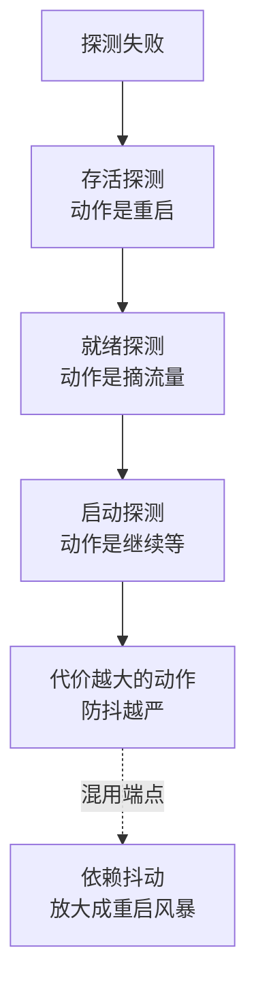
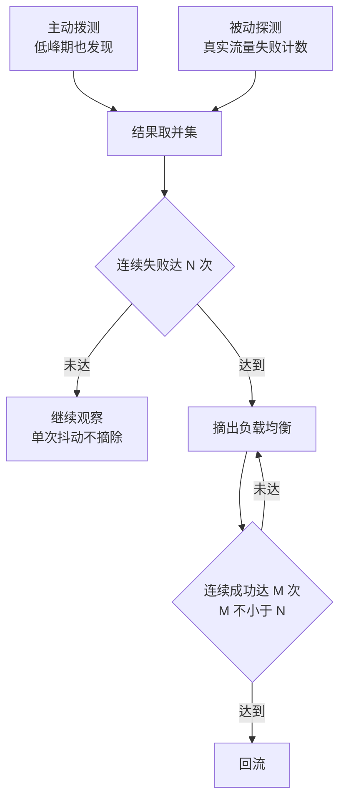

# 依赖服务的健康检查要带拨测与退避：探测结果决定流量去留

> **要点**：这篇要解决的问题是：怎么让健康检查的探测结果**可信到能决定流量去留**？读完你能给自己的服务配出**三级探测的独立端点**、**主动拨测与被动探测的双路组合**、**连续失败才摘除的防抖参数**。健康检查的工程要求是**"探测动作本身要可靠、失败判定要防抖"**——主动拨测（定时探 + 结果驱动动作）、被动探测（流量失败计数）、失败退避（连续 N 次才判定，恢复要宽）；**三级探测（存活、就绪、启动）各管一个决策**，混用一个端点是熔断失效的常见根因。

## 误报漏报各付什么代价：要解决的问题

健康检查的误判有两种代价：**误报**（服务其实健康，探测被网络抖动或瞬时 GC 干扰，**流量被错误摘除、雪崩放大**）；**漏报**（服务已坏，探测还在过——**探测路径与业务路径不同，探测过的路径不代表业务可用**）。上游 Apache BookKeeper（一个分布式日志存储系统）的一个复现改进是"auto-recovery（自动恢复组件）在 bookie（集群里负责存储的节点）下线时降噪日志"（探测与恢复的联动里，**误判的代价是重复恢复动作**）——**探测结果的消费方（负载均衡、熔断器、恢复任务）都依赖判定准确**。本篇展开：**三级探测的分工、主动与被动的组合、防抖（停止触发一段时间后才执行一次）的判定设计**。

## 三级探测各管什么决定：机制与分工

先把形状说成一件事：三级探测像医院里的三道岗——第一道问"还有没有呼吸"——**存活判定要极保守，误判的代价是杀掉一个好进程**；第二道问"今天能不能接诊"（就绪：不能就摘牌，**判错代价小得多**，摘错了再挂回来就是）；第三道问"醒透了没有"（启动：慢启动的病人先别按前两道处理）。**混用端点等于让问呼吸的岗哨兼任接诊分诊**——同一个端点同时供存活与就绪两个判定读取，**依赖一抖动两个判定同时失败**，好病人先被摘流量、再被当成没气了直接送太平间（进程重启），**成片重启就是重启风暴**。

这个比喻到"太平间"为止——现实里没有太平间与枪毙，只有进程重启与摘流量；**误报与漏报的代价不对称**，靠的直觉就是"判死"与"判活"的后果轻重不同：**误判死的代价是把好进程杀掉，误判活的代价是把坏进程留在流量里**。现实里主动拨测与被动计数怎么互相校准，下面展开。


*图示：Consul 的控制面结构——服务注册进目录，健康状态由控制面维护，流量按目录走。图源：HashiCorp Consul 官方文档《Architecture》，CC BY 4.0，https://developer.hashicorp.com/consul/docs/architecture。注意图里"健康状态"是目录里的一项数据：**探测本身不算数，结果写进这张目录、并且真的有人按它改路由，探测才算闭环，否则就只是空转**。下面三级探测的分工，讲的就是**三种结果分别该触发什么动作**。*

**存活探测（liveness）**：进程还活着吗——失败动作是**重启进程**。判定要极保守（**误重启的代价是所有在途请求全灭**）：**只探进程级指标（事件循环是否阻塞），不探依赖（数据库挂了不该重启应用）**。

**就绪探测（readiness）**：能接新流量吗——失败动作是**摘出负载均衡（把请求分摊到多台服务器、避免单点过载）**（不重启）。探的范围包括关键依赖（数据库连接可获取、缓存可达）：依赖挂了摘流量是对的（新请求路由到健康实例），**恢复后自动回流量**——**就绪探测的判定可以比存活激进**（**摘流量的代价远小于重启**）。

**启动探测（startup）**：冷启动（缓存或服务刚启动、还没有数据与连接的状态）完成没——失败动作是**继续等**（不给存活/就绪判定）。**解决重启动服务的误杀**：加载缓存的慢启动进程在就绪探测介入前被启动探测保护，避免**"启动 40 秒被存活探测 30 秒超时杀掉"的循环**。

**三级各自独立端点**：`/healthz`（进程级，探活）、`/ready`（依赖级，探就绪）、启动探测复用就绪端点但放宽超时与失败阈值——**一个端点混三用的失败模式**：依赖抖动使 liveness 探测失败，触发进程重启，**成片服务接连重启（重启风暴）**。

**三级探测各探一层，失败后驱动的动作不同，动作的代价决定判定的保守程度**：



图：三探分工的依据——动作代价从重启到等待依次递减，判定激进度随代价反向排，混用端点会把依赖抖动放大成重启风暴。

## 主动拨测与被动探测怎么搭：组合机制

探测结果决定流量去留，前提是**摘除动作有明确的执行位置**。协调器（服务进程里统一管理对外连接的组件，负责把连接分配给工作线程）管着一批连接，逐个交给线程去用——**哪条连接不健康，就在这层摘掉**；如果连接与线程的对应关系是乱的，**摘除就不知道该摘谁**。


*图源：ToolsBook《干翻 nio，王炸 io_uring 来了，史上最详细说明及最全图解》连接线程绑定一图，CC 4.0 BY-SA，https://www.toolsbook.org/2024/05/nio-iouring.html。*


**主动拨测（active）**：按周期主动发探测请求（HTTP 探针、TCP 连接测试、自定义轻量业务探针）。**主动拨测不依赖真实流量，低峰期也能发现故障**。代价在覆盖面：**探测路径跟业务路径可能不同**，**探测打到的接口缓存命中时，业务路径的数据库依赖就没被覆盖**。覆盖修正的做法：让探测请求**绕过缓存直达真依赖**（穿透缓存：加禁缓存的探测头）或**多层探测**（进程探针 + 业务拨测，本库"拨测与合成监控"的外部拨测是更外层）。

**被动探测（passive）**：从真实流量的失败计数推断（连续 N 笔 5xx / 超时 → **判定不健康**）——**优点是测的就是业务路径**、缺点是**低峰期样本稀疏**（流量少时判定慢）。被动计数的实现按连接级熔断（错误率过高时暂时断开调用快速失败）器模式，涉及 Envoy 的 outlier detection 与 gRPC 的 health protocol——gRPC 是 Google 开源的跨语言调用框架。

**组合的原则**：主动拨测管**"有没有流量都要发现"**（低峰期故障），被动探测管**"业务路径的真实可用性"**——**两者结果取并集进入摘除决策**，各自带独立的防抖参数。



**主动拨测与被动探测各补一个盲区**：**主动探测在低峰期没有真实流量时仍能发现故障，被动探测覆盖的是真实业务路径（探测请求打不到的依赖它能测到）**。两路结果取并集后进防抖判定——**连续失败达到 N 次才摘除，回流要连续成功 M 次且 M 不小于 N，防止在边界上反复摘除回流**。**判定参数按误报代价设定：摘流量代价越高的服务，N 取值越大**。

## 判定怎么防抖才不误杀：设计

健康检查挂在事件循环（反复取出队列里的回调执行的调度机制）上，判定结构是 Reactor（事件驱动模型：就绪事件分发给对应的处理器） 模式（多个来源的事件汇到一个分发点，再按类型分派下去的处理框架）——对应关系是：探测超时与响应到达是事件源，防抖计数器是分发后的处理。健康检查与业务请求共用这套分发，判定本身没有额外的业务逻辑。


*图源：同上（ToolsBook《干翻 nio 与 io_uring》）。*


**失败判定防抖**：连续 N 次失败才判定（单次失败可能是抖动），**N 按误报成本定**（摘流量代价高的服务 N 大）——**恢复判定更宽**：**连续 M 次成功才回流**（M ≥ N，防"抖动边界反复横跳"：摘了回、回了摘）。

**探测超时与间隔的量级**：**探测超时要短于业务超时**（探测在等业务超时，摘除就太晚了），间隔按故障发现速度需求定（秒级探测 + 3 次失败 = 分钟级发现）——**探测频率与探测成本的平衡**：每实例每秒探测 ×千实例规模，**探测本身的流量要进容量核算**。

**判定结果的消费方各自防抖**：负载均衡摘除、熔断器打开、恢复任务触发——**三个消费方对同一探测结果的消费动作不同**，对"抖动"的容忍度也不同（摘除可逆、熔断打断调用、恢复触发要防反复），**共用一套参数会让最激进的判定支配所有动作**，所以**探测判定与消费动作的参数分开调**（熔断器的半开试探与负载均衡的回流判定**不是一个机制**）。

## 这套探法在哪儿会失效：边界

三条边界，防止把这套探法用过头或用错方向。

**就绪探测不等于熔断器**：就绪摘除保护的是**"新请求不再进来"**，在途请求与已建立的连接不归它管——熔断器在调用方侧管**"还敢不敢调"**，两个机制互补，**只用其一的盲区**：只有摘除没有熔断，**调用方在摘除生效前的窗口仍会把请求发到即将下线的实例，这些请求持续失败**。

**依赖健康不等于整链健康**：A 实例就绪探测通过（它依赖的 B 正常）**不代表 B 的容量够全集群用**——**探测是点判定，容量是全局量**，**探测通过与容量告警是两层防线**。

**探测端点自身的安全与隔离**：探测端点暴露内部信息（版本、依赖列表）**要有访问控制**；探测流量与业务流量隔离（独立端口或标记路由），**防探测风暴挤占业务容量**。

## 想自己验一遍怎么动手：验证

可复现的验证路径：

1. 误报复现：注入瞬时抖动（单次超时），预期**单次失败不触发摘除（防抖生效）、连续失败才摘除**；
2. 依赖故障复现：停掉探测覆盖的依赖，预期**就绪摘除在探测周期 × N 内生效、恢复后自动回流，存活探测不误重启**；
3. 慢启动复现：重启带大缓存的服务，预期**启动探测保护下存活探测不误杀、就绪在启动完成后才接流量**；
4. 断言锚点：**三级探测独立端点、主动与被动双路探测、防抖参数（N/M）有文档且按误报成本定**——三件齐备，健康检查**从"配了个端点"变成"探测结果可信、可驱动流量决策"**。

```text
分级断言 = 存活就绪启动三探分端点
防抖断言 = 摘除需连续失败回流需更宽
组合断言 = 主动被动双路互为补充
```

**健康检查的可靠性是整个流量治理的地基**：摘除、熔断、恢复的每个动作**都建立在"探测判定可信"上**——**三级分工、双路组合、防抖判定三件配齐**，探测结果才有资格决定流量去留。

## 接着读哪几篇：摘除动作的消费端时序

- [[工程知识/性能工程：从用户等待到资源瓶颈/存储与网络/滚动重启的摘流量顺序：先停新请求，再让旧请求做完.md]] —— 摘除动作的消费端时序
- [[工程知识/后端系统：在并发、失败与变化中维持服务/基础设施/服务网格控制面与数据面：mTLS与流量治理.md]] —— 网格侧健康检查与熔断的机制层
- [[工程知识/性能工程：从用户等待到资源瓶颈/观测与诊断/拨测与合成监控：在用户之前从外面敲一遍门.md]] —— 更外层的拨测视角
- [[工程知识/后端系统：在并发、失败与变化中维持服务/分布式可靠性/重试的正确姿势：退避、抖动与重试预算.md]] —— 探测失败后调用方的重试配合
