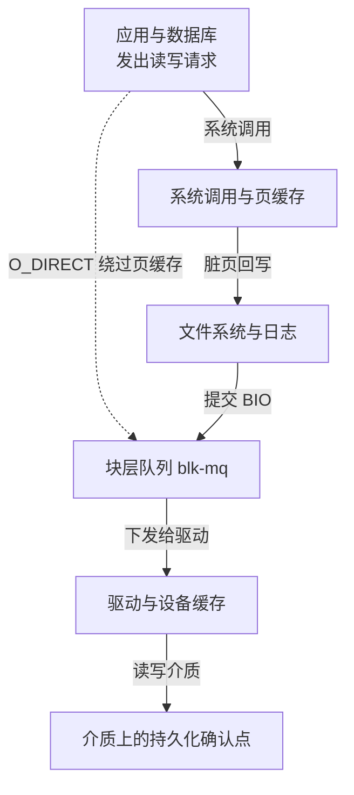
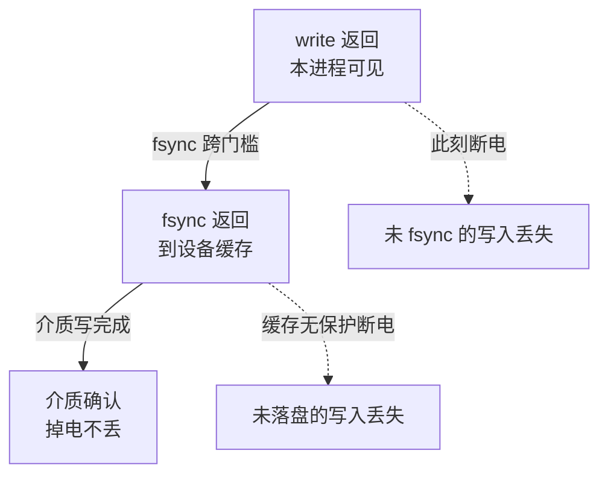
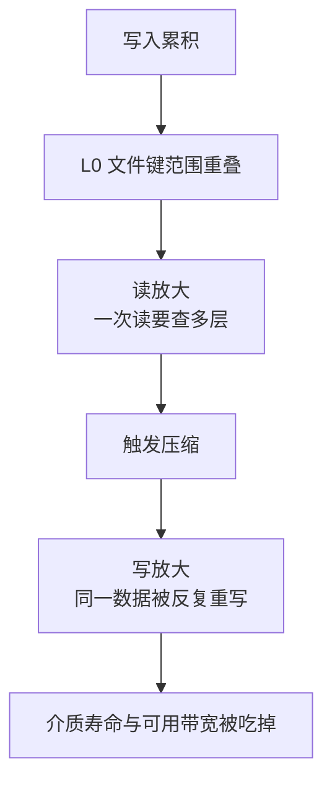

# 存储 I/O 性能取决于访问模式、队列与持久化语义

存储调优从三个问题开始：**应用发出了什么 I/O，I/O 在哪一层等待，可靠性要求允许做什么取舍**。读完这篇你能**按这三个问题的答案选调优动作**——换 SSD（固态硬盘）、调队列只是**答案的落点，不该是起点**。

一个写入返回很快，可能只是**进入页缓存（内核把磁盘数据缓存在内存里、减少重复读盘）或设备缓存**；一个读请求很慢，**可能卡在队列、缓存或配额的任何一层**。**性能数字必须和持久化确认点绑定**，否则吞吐提升可能只是把数据损失窗口扩大。

## 要解决的问题：一次 I/O 依次经过哪些层

一次写入返回很快，事后发现**数据还停留在页缓存里**；一次读取发生等待，却不知道**等待发生在应用队列、文件系统、块层还是远端存储的配额上**；两个存储基准的 IOPS（每秒读写次数）数字相差数倍，原因是**块大小与读写模式并未写清**。本篇回答：**一次 I/O 依次经过哪些层**、每层的"完成"在持久化语义上代表什么、延迟与吞吐由哪几个变量共同决定、并行设备上 %util 为何不能代表饱和度、以及调优应当按什么顺序进行。

## 一次读请求完整走哪些层：路径

一次 I/O 从应用走到持久介质要**穿过六层**，每层的交接动作都不一样——系统调用（程序请求内核提供服务的入口）进页缓存、脏页回写进文件系统、提交 BIO（block I/O，块层的基本请求结构，描述读哪几个扇区）进块层队列——Linux 的块层多队列框架 blk-mq **把提交与完成分到多核各自的队列，避免多核抢一把锁**、再下发给驱动；这条链路的形状决定了**「慢」可能停在哪一层：**


**链路上的每一跳都对应一个可观测点**（页缓存命中、块层队列长度、设备延迟），后文按等待层定位就是在这一条链上从上往下逐层排除，而不是**靠 iowait 猜**。

一次“写完成”可能只到达应用缓冲区、操作系统页缓存、设备缓存或真正持久介质。**性能测试和故障分析必须写清确认点**，否则吞吐数字与可靠性结论都不可比较。

write() 返回、fsync（强制把操作系统缓存里的数据写到磁盘的调用）返回、介质确认这三个时刻的**持久化强度是递进的**——把两个断电点分别插在它们之间，**就能看出每个时刻掉电各丢哪一段**：


写入落进页缓存后**对读方已经可见，但还没到介质，此时断电仍会丢**——断电时丢哪一段，取决于**数据当时停在哪一站：write 返回后只在页缓存**，fsync 返回后到了设备缓存，介质确认后断电不丢。所以 fsync 是**从「可见」到「持久」的门槛**，但不是终点：设备缓存没有掉电保护时，fsync 返回到介质确认之间仍有一段可丢失的写入——fsync 返回**只代表数据交到了设备缓存**，设备缓存靠电容供电维持，掉电保护（电容或电池能在断电后把缓存刷进介质）缺席时，**这段数据断电即失**，这段窗口**要计入 RPO（Recovery Point Objective，最多能容忍丢失多长时间的数据）**，而不是**被「已经 fsync 过」一句话抹掉**。

断电时到底丢哪一段？write 返回只保证本进程读得到，**fsync 返回才跨过断电门槛**，**设备缓存有没有掉电保护决定 fsync 之后还剩多少风险**。


## 哪些关键变量在互相牵动？

| 变量 | 含义 | 常见误区 |
| --- | --- | --- |
| 延迟 | 单个请求从产生到完成的时间；区分排队、提交和设备完成 | 只看平均值，**遗漏 p99/p99.9 尾延迟** |
| IOPS | 每秒完成的 I/O 数 | 不写块大小和读写模式；**4 KiB 与 1 MiB 的 IOPS 不可直接比** |
| 带宽 | 每秒传输字节数，近似 `IOPS × 平均块大小` | **把接口理论带宽当成应用可用吞吐** |
| 队列深度 | 同时在途的 I/O 数 | 越深通常越能压满并行设备，**但排队和尾延迟也会上升** |
| 放大 | 逻辑 I/O 与物理 I/O 的比例 | 忽略文件系统、数据库 WAL（Write-Ahead Log，预写日志：先把要做的改动记下来，再真正改数据）、压缩、GC（Garbage Collection，垃圾回收——在存储语境指闪存腾挪有效数据以腾出可写块的动作）和 SSD 写放大 |
| 持久性 | 断电/崩溃后哪些写入仍存在 | **把 buffered write 返回当作 durable commit** |

Little's Law（利特尔法则）给出稳定系统中的近似关系：`并发在途数 ≈ 吞吐 × 平均响应时间`。用排队打比方：奶茶店每 100 毫秒出一杯、每单平均等 2 秒，**柜前同时站的人数就约是 2 秒 ÷ 100 毫秒 = 20 人**——**吞吐不变时，队伍长度由等待时间决定**。**当吞吐接近设备能力上限时，新增并发主要进入队列，延迟会快速上升**。调优要在业务尾延迟（P99 一类的慢请求耗时指标）和持久性约束下**找到可持续吞吐**，把最高 IOPS 当成唯一目标，会**牺牲尾延迟与数据安全去换数字**，指标好看而系统不可用。

## 不同介质与协议差在哪里？

**应用看到的一次逻辑写在物理层会分叉成多路放大**：文件系统日志、数据库 WAL、压缩与去重各自再写一遍，落到 SSD 上还要叠加写放大（实际写入量是逻辑写入量的多倍）与垃圾回收。形状像公文流转：部门 A 存档一份（文件系统日志）、部门 B 抄送一份（WAL）、月末归档重誊一遍（压缩），誊清前的草稿纸还要反复腾抄（闪存写放大）——**应用只写了一份，柜子里多出五份**。



**放大系数不写进基准，IOPS 就不可比**——同一份逻辑写在不同配置下**物理写次数可以差几倍**，**放大多的系统为同样 IOPS 付出的物理负担大得多，数字相同能力并不相同**；**写放大最终吃掉的是介质的寿命与可用带宽**，这条链也解释了**为什么降低无效 I/O 排在调系统参数之前**。

**访问模式的影响在分层存储引擎里是结构性的**：**L0 的文件键范围相互重叠，读一个键可能要查多个文件**，也是触发向下合并的直接原因。


*图示：RocksDB（一种嵌入式键值存储引擎）分层合并（Leveled Compaction，把键范围重叠的文件层逐级合并压缩的后台过程）的层级结构。图源：[RocksDB Wiki · Leveled Compaction](https://github.com/facebook/rocksdb/wiki/Leveled-Compaction)。*

### HDD 的访问特点是什么

好比一支运输车队每送一件货都要先开到仓库找位置（机械寻道），把同一仓库的货攒成整车一次送（顺序、合并）才划算，来回空跑零散单（随机 I/O）最亏。机械寻道和旋转延迟使**随机 I/O 代价高**；**顺序、合并和较少的并发队列更重要**。碎片（存储空间里零散不连续的小块）、邻道与 RAID（多块磁盘组成的冗余阵列）重建**会改变时延分布**。比喻到「攒整车」为止，SSD 为什么不吃这套看下节。

### SSD 与 NVMe的访问特点是什么

好比后厨改成开放式、出餐口开了一排（NVMe 多队列），不再需要司机找车位，但厨房内部要定期腾挪货架腾出空位（GC、擦除），高峰期腾挪会拖慢出餐（突发尾延迟）。无机械寻道，但**内部仍有闪存页/块、擦除、垃圾回收、FTL（闪存转换层，负责把逻辑地址映射到物理闪存位置）映射和有限写寿命**。NVMe（面向闪存的存储接口协议）/PCIe（外设高速总线）提供更多硬件队列和并行性；**这不代表无限加深队列都有收益**。设备接近满盘、长期写入、温度降频、SLC cache 耗尽（SLC 即 Single-Level Cell，单层单元闪存，下文详述）与 GC **都可能造成突发尾延迟**。SLC cache 指设备把这块高速闪存当写缓存用，**占满后写入回落到慢速闪存，速度掉下来**——SLC 每个存储单元只存 1 bit，**速度最快、容量最小**；GC高峰期同样拖慢写入。比喻到「内部腾挪」为止。

### 云盘、网络盘与虚拟磁盘差在哪里

观察到的延迟**同时包含主机、虚拟化、网络、后端存储和限额**。云产品还可能有 IOPS/带宽配额、突发积分和**邻居噪声**（同一台宿主机上其他租户的负载抢占了共享的磁盘与网络资源，让你的延迟无端抖动）；只在实例内看 `%util` **无法证明物理设备饱和**。

## 页缓存、Direct I/O 与持久化怎么分工

先把形状说成一件事：**四种写法不是同一维度的并列**——Buffered 与 Direct 是**两条 I/O 路径**，fsync 与 mmap（把文件直接映射进内存地址空间，读写内存即读写文件）是**路径上的两种机制**。面馆的比方：Buffered I/O 是先端上柜台暂存（页缓存：熟客直接拿走，快，但柜台没记入账本）；Direct I/O 是后厨直接出餐到你桌上（绕过柜台，慢一点但路线短，可账本照样还没记）；fsync 是厨师确认"这锅已记入总账"（崩溃也不赖账）；mmap是把锅直接端到你桌上自己盛（快，洒了怎么办要自己定规矩）。这个比喻到"自己定规矩"为止——现实里四者的块对齐与崩溃语义，下面逐项展开。

- **Buffered I/O** 经过页缓存，重复读取可能命中内存，写入可先变成 dirty page；适合通用文件访问，但基准容易测到内存而非设备。
- **Direct I/O** 尝试绕过页缓存，通常要求**地址、长度和 offset 都落在设备块边界的整数倍上**；数据库常自行管理缓存，但 direct 并不**自动等于 durable**。
- **`fsync`/`fdatasync`** 请求把相应数据推进到稳定存储语义；**效果仍依赖文件系统、设备缓存和硬件是否正确实现 flush/FUA**。
- **mmap** 把文件映射到虚拟地址空间，首次访问未在内存的页会触发缺页（缺页中断：访问的地址还没对应的物理内存，内核把文件内容读入再恢复执行）触发读取；**写回、崩溃一致性和生命周期必须单独设计**。

调优前先回答四个问题：**数据能否丢、能丢多久、是否允许重放、崩溃后如何恢复**。降低同步刷盘（把内存中暂存的数据写入磁盘持久化）频率**可以提高吞吐**——每次刷盘都要等数据真正写到介质，**刷得越勤等待越多**；但少刷的代价是**断电时未刷出的数据更多**，本质是**改变数据损失窗口**，不是免费优化。

## 怎么从业务等待向下定位：观测

### 第一层：业务现象该看什么

- 哪个请求、事务或后台任务变慢？p50/p95/p99 是否同时恶化？
- 是读取、写入、checkpoint（把内存里累积的改动固化成持久文件的动作）、compaction（把零散数据文件合并重写的后台过程）、日志刷盘还是备份？
- 延迟增加时吞吐、错误、队列和 CPU iowait 如何变化？

### 第二层：进程与文件该看什么

- `pidstat -d 1`：进程读写速率和 I/O delay。
- `lsof -p <pid>`：定位文件、设备和删除但仍打开的文件。
- 应用/数据库指标：buffer/cache hit、WAL/binlog（binlog 是 MySQL 的预写日志，作用与 WAL 类似：先把改动记日志再改数据，用于复制与恢复）、flush、checkpoint、compaction、pending I/O。
- eBPF（内核里的可编程钩子：不改动内核源码就能在内核里跑自己的小程序）/perf（Linux 性能剖析工具，统计 CPU 采样与硬件事件）/trace：当系统级指标不足时，定位同步调用、块请求和文件系统延迟分布。

### 第三层：块设备该看什么

IOPS、带宽（每秒搬运的数据量）、await（排队加服务的完成时间）**各管各的**；%util 是设备忙时间占比——老式串行设备接近 100% **基本等于满载**，并行设备（现代 SSD/RAID）一直忙**不代表已经到能力上限**，直接照搬读法会误判。`iostat -x 1` 的常用字段按下面的表读，每个字段怎么读见下表。

| 指标 | 含义 | 正确解读 |
| --- | --- | --- |
| `r/s`, `w/s` | 完成读写请求速率 | 与请求大小、合并和业务吞吐一起看 |
| `rkB/s`, `wkB/s` | 读写带宽 | 检查设备/云盘带宽上限 |
| `r_await`, `w_await` | 排队加服务的平均完成时间 | **平均值不能替代延迟分布** |
| `aqu-sz` | 平均队列长度 | 持续增长通常表示**到达率超过完成率** |
| `%util` | 有 I/O 在处理的时间占比 | 对串行设备接近 100% 可提示饱和；**对 RAID/现代并行 SSD 不能直接代表性能上限** |

[iostat（查看块设备 IO 统计的命令） 手册](https://man7.org/linux/man-pages/man1/iostat.1.html) 明确指出 `%util` 对并行设备不反映其性能极限。因此“低 util 一定没瓶颈”与“100% util 一定已满”都不是普遍结论。

## 基准测试怎么设计：先定负载再跑 fio

### 基准测试必须固定哪些维度

- 读/写比例，顺序/随机模式；
- 块大小分布，不只一个平均值；
- 同步/异步 I/O engine、job 数和实际队列深度；
- buffered/direct、文件/裸设备、文件系统与挂载参数；
- 工作集大小是否超过内存和设备缓存；
- 预热、运行时长、steady state、数据可压缩性；
- fsync/flush 频率与断电一致性要求；
- 输出 IOPS、带宽、p50/p95/p99/p99.9、CPU、错误和达到的 queue depth。

### 安全示例怎么只测专用文件

跑基准必须**写专用测试文件**，不能在生产数据卷上跑——基准会写坏数据，**专用文件坏了随时可以重建**。参数含义见下方案例。

```ini
[global]
filename=/data/fio-test.bin
size=8G
ioengine=io_uring
direct=1
time_based=1
runtime=60
ramp_time=10
group_reporting=1
randrepeat=1

[random-read-4k]
rw=randread
bs=4k
iodepth=16
numjobs=4
```

破坏性写测试会直接改写设备上的数据块，而**真实数据盘的覆写不可撤销、也没有办法靠备份精确还原到测试前的扇区状态**。所以不要在包含真实数据的裸设备上执行破坏性写测试，只测专用文件。`fio`（Flexible I/O Tester，磁盘 IO 基准测试工具）文档指出：异步引擎也可能因操作系统限制达不到请求的 `iodepth`，**所以必须检查输出里的实际 depth distribution**；**只看配置值会产生错误结论**。

## 常见症状配什么最小实验

| 症状 | 候选原因 | 最小区分实验 |
| --- | --- | --- |
| 高 `await`、队列持续增长 | 设备饱和、限额、GC、下层网络或 flush 阻塞 | 分读写看 await；固定 rate/queue depth；对照云监控和设备日志 |
| 吞吐高但业务 p99 差 | 队列太深、批次过大、后台 compaction/checkpoint | 限制到达率/深度；暂停后台任务；比较尾延迟 |
| 读很快但冷启动（缓存或服务刚启动、还没有数据与连接的状态）慢 | **页缓存掩盖设备性能** | 使用超过内存的工作集；明确冷/热缓存两套结果 |
| 写入周期性尖刺 | dirty page 回写、checkpoint、SSD GC、日志轮转 | **把尖刺时间与上述动作的时间线摆到一起比较**；监控 dirty/writeback、fsync 和设备延迟 |
| CPU iowait 高 | CPU 有未完成块 I/O，**但不自动证明设备本身是根因** | 看进程、队列、设备和虚拟化下层；检查任务是否可运行 |
| `%util` 接近 100% | 串行设备可能饱和；**并行设备可能只是一直有请求** | 改变 queue depth/rate，**看吞吐与尾延迟是否仍能扩展** |
| 数据库读 I/O 高 | buffer pool 不足、扫描、坏计划或工作集变化 | 核对执行计划、逻辑读/物理读、cache hit 和数据分布 |

## 调优按什么顺序下手

1. **固定可靠性语义**：确认**允许的数据损失窗口、恢复方式和 flush 要求**。
2. **还原业务负载**：请求大小、读写比、并发、热点（访问集中在少数键或节点上的现象）和周期性任务。

3. **定位等待层**：应用锁/队列、页缓存、文件系统、块层、虚拟化或设备。
4. **降低无效 I/O**：修查询/索引，**去重、批量、压缩、减少写放大和小文件元数据操作**。

5. **平滑负载**：背压（下游过载时向上游传导的反压信号）、限速、分批 checkpoint/compaction，**避免无限加队列**。
6. **按证据改系统参数**：readahead、scheduler、dirty writeback 和挂载参数**都先做 A/B 与回滚**（把系统状态退回到改动之前的版本）。
7. **最后扩容/换介质**：**验证瓶颈确在设备或配额**，且新介质的耐久、冗余和故障模型满足要求。

## 哪些做法一看就错：反模式

- 看到 iowait 就断言“磁盘坏了”。
- 只比较厂商最大 IOPS，**不固定块大小、读写比、队列深度和持久化语义**。
- 用短时间、可压缩、能完全进入内存的数据做“磁盘基准”。
- 把 `%util` 当成所有设备的统一饱和度。
- 无基线（正常状态下的指标水平、用来对比异常）地修改多个内核/数据库参数，无法知道收益来自哪里。
- 通过关闭 fsync 获得数字，**却不记录数据损失窗口**。
- 用生产裸设备直接跑 fio 写测试。

## 验收看哪几条：验收

- [ ] 业务 SLO（服务等级目标：对内承诺的可用性或延迟目标）与 I/O 延迟、队列和吞吐在同一时间线中。
- [ ] 基准记录 workload、环境、版本、缓存和持久化语义。
- [ ] 优化前后**用相同输入比较**，并确认代价没有转移到 CPU、内存、网络或恢复时间。
- [ ] 变更有**回滚、容量余量和长期 steady-state 验证**（稳定状态：设备写满并经过垃圾回收之后长期能维持的性能水平）。

**持久化结论要与两个时刻对账**——**预写写入返回与数据真正持久之间的时间窗**，实测丢失窗口与预期对不上时**先确认同步刷盘是否真的发出**。

## 想自己验一遍怎么动手：验证

1. 持久化语义：分别记录写入返回与数据真正持久两个时刻，确认两者之间相隔多少时间；**用关闭 fsync 的对照跑法记录数据损失窗口**，不把两者混成一个数字。
2. 基准条件固定：在同一次基准中固定块大小、读写比、队列深度与持久化配置，改变其中一项后重测，确认 IOPS 与延迟的**变化方向与机制描述一致**。

3. 队列与并发：逐级提高队列深度，记录只有一次下发的设备延迟与端到端延迟，**两者的差距即为排队等待**。
4. 饱和度核对：在并行设备上对比 %util 与实测吞吐，确认 %util 达到高位时**吞吐是否仍在上升**。

5. 代价转移检查：优化前后用相同输入比较，确认**耗时没有转移到 CPU、内存、网络或恢复时间上**。
6. 断言锚点：**持久化语义有明确记录，基准条件与版本写清，%util 只作为参考，代价转移经过检查**。

## 接着读哪几篇？

- [[工程知识/性能工程：从用户等待到资源瓶颈/操作系统与运行时/零拷贝把数据通路的CPU让给业务|零拷贝把数据通路的CPU让给业务]]——讲内核数据通路上的拷贝消除技术，补本篇 IO 路径分层的通路层视角
- [[工程知识/性能工程：从用户等待到资源瓶颈/存储与网络/恢复与重平衡的可用性边界：read_only 与自动恢复的开关语义.md]] —— 存储节点有一组防自伤的降级（压力过大时关闭次要功能，保住主流程）机制：磁盘满转只读、副本损坏拒绝服务、检测到异常状态停止写入。
- [[工程知识/性能工程：从用户等待到资源瓶颈/存储与网络/存储格式的版本字段是兼容性的锚：写入时必带，读取时逐级识别.md]] —— 落盘格式要有版本锚：写入时必带，读取时逐级识别，否则旧数据在新代码下无法解释
- [[工程知识/性能工程：从用户等待到资源瓶颈/观测与诊断/性能问题定位]]、[[工程知识/性能工程：从用户等待到资源瓶颈/处理器与内存/CPU性能来自有效执行与数据供给]]、[[工程知识/数据系统：在并发与故障中保存事实/可靠性与运维/数据库基准必须描述负载与资源边界]]、[[工程知识/数据系统：在并发与故障中保存事实/可靠性与运维/InnoDB用日志连接事务、恢复与复制]]。
