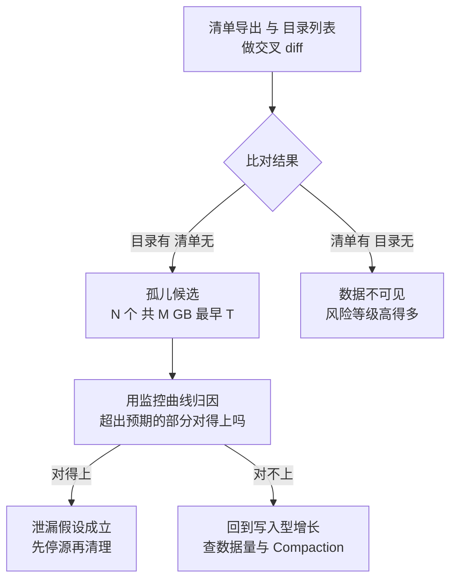
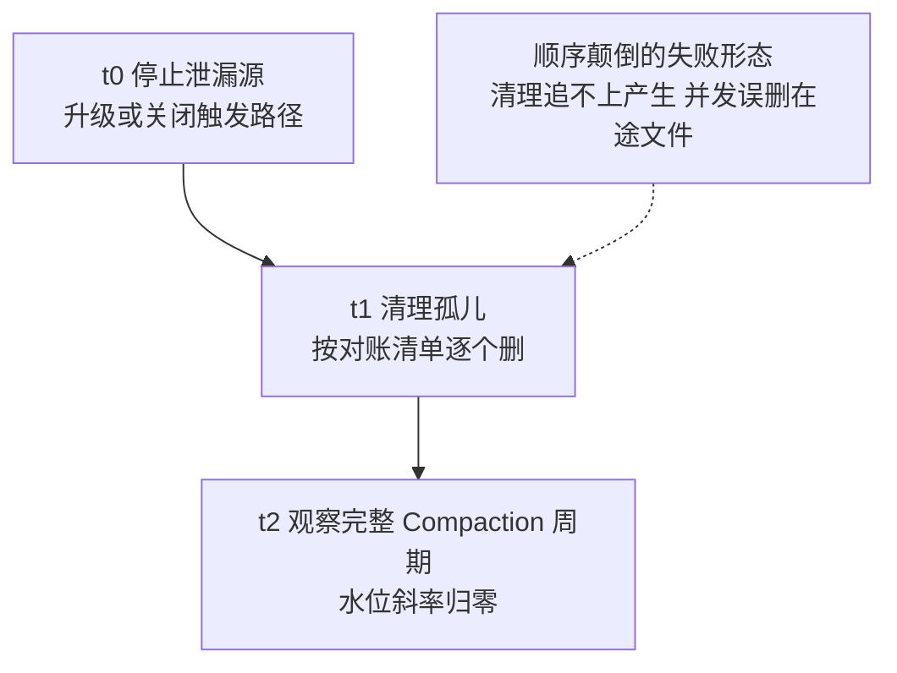

# 存储引擎的文件一致性：元数据与数据块的对应关系要可核对

存储引擎里的数据文件、清单和目录视图，就像账本、台账和库房，**三者对不上就会漏数据或漏磁盘**。这个比方到「三份记录要能对上」这一步为止——账本和库房不会因为忘了记账就自己长出货物，而存储引擎会靠后台 compaction（合并压缩：把多层零散的数据文件重写整理成更少的文件）悄悄补上，补的时机才是这里要盯的东西。顺序修复。

> **要点**：这篇解决的问题是：**磁盘在涨、写入量却平稳**，存储引擎哪里漏了？读完你能**把数据文件、清单（MANIFEST）、目录视图三份账目各自导出后交叉核对**，定位失配环节，并按「先停写入源、再清理」的顺序修复。**三者对得上是 LSM（Log-Structured Merge，先把写入攒在内存里、再按批顺序落盘的存储结构）类存储引擎的活性前提**——任何环节的引用与实物脱节，**都会形成磁盘泄漏或数据不可见**；**顺序颠倒会让泄漏继续生长**。

## 背景与本质：元数据与数据块怎么核对，谁在记账、谁在存货

RocksDB 官方的层级文件图给出了「账目」的实物形态：内存写缓冲 flush（把内存里攒的写入一次性写成磁盘文件）出的键区间文件（key00-key25、key26-key50……）按顺序落在 L0（分层存储的最顶层，新写完的文件先到这里），每个文件有自己的键范围——**清单里登记的就是这些文件与它们的键区间，目录里躺着的就是这些实体，两本账必须逐文件对得上**：


*图源：[RocksDB Wiki · Leveled Compaction](https://github.com/facebook/RocksDB/wiki/Leveled-Compaction)，官方文档图，文档引用。*

FAST'20 论文对 RocksDB 基础架构的测绘图把「清单」在全局里的位置画了出来：每个 Column Family（列族，一个引擎里相互独立的一组键空间）有自己的 Memtable（内存写缓冲，新写入先攒在这里）与各层 SST（SSTable，存键值的不可变数据文件），而 WAL（预写日志，先把改动写进日志再改数据本身）与 Manifest 属于 Shared Data——**清单是所有列族共用的记账本，任何一个列族的文件增删都要先过它**，这正是**「清单与目录必须逐文件对得上」**的结构性原因：


*图源：Zhichao Cao 等《Characterizing, Modeling, and Benchmarking RocksDB Key-Value Workloads at Facebook》USENIX FAST '20 论文 Figure 1，https://www.usenix.org/system/files/fast20-cao_zhichao.pdf（论文引用）。Manifest 在 Shared Data 区与 WAL 并排——两份日志分别管**「改了什么」与「哪些文件有效」**，本篇的三份账目（数据文件、清单、目录视图）里，清单正是图右侧那一只。*

存储引擎的文件一致性要解决的问题是：LSM 类存储引擎把数据组织成三层账目，RocksDB 是代表，BookKeeper 的 KeyValueStorage 与 Pulsar 的 offload 存储都属此类。三层分别是：**数据文件**（SST，真正存键值的不可变块）、**清单**（MANIFEST，记录"当前有效的 SST 是哪些"的元数据日志）、**目录视图**（文件系统里实际存在的文件）。正常路径上三者同步演进：写入产出新 SST **并在清单登记**，Compaction 合并旧 SST 后**把淘汰者从清单移除**，后台清理**按清单删除不再被引用的文件**。

泄漏的样子是**"引用消失、实物还在"**：清单里已经没有某个 SST 的记录，但文件还在目录里躺着——**没有清单引用的文件是孤儿，清理流程只按清单工作，孤儿文件永远不会被删**。这个过程**慢到不可见**（每天几百 MB），直到磁盘水位（队列或资源的当前占用程度）告警才暴露；暴露时的形态与"写入太多"不同：**写入量平稳、Compaction 正常，磁盘却单调上涨**。**诊断的第一步是分清这两种上涨**：**写入型增长伴随数据量与 Compaction 指标同步上涨，泄漏型增长的驱动项只有时间**。

这个机制不绑定特定系统：任何"元数据 + 数据文件"结构的存储（消息队列的段文件、对象存储的分片、Git 的对象库）**都有同构风险**——**引用与实物之间隔着一个可能失败的删除环节**，**失败被吞掉**（清理线程的异常被 catch 后仅记日志，删除没有重试），引用已从清单移除而文件没删成，**文件从此没有入口能被再次删除，泄漏就开始积累**。

## 它是怎么做到的：三个环节各自的失配形态

**Compaction 与清单的不同步**：合并流程选好输入文件、写出新文件、原子切换清单——切换失败（进程被杀、磁盘满）后重启，恢复逻辑要么回滚（把系统恢复到上一个可用版本）到合并前的清单（**新写的文件成为孤儿**），要么推进到新清单（**旧输入成为孤儿**）。**恢复路径决定了孤儿文件的产生，实现质量决定产生频率**；健康的实现会在启动时做**一次孤儿扫描**（目录视图与清单 diff），不健康的实现**依赖下次 Compaction 恰好覆盖到**——泄漏就这样沉淀下来。

LSM 引擎的目录按层组织，L1 及以下每层内文件互不重叠（L0 是刚 flush 的落点，允许重叠），Compaction 就是跨层搬移与重写的过程——上面这张官方层级图给出的正是「清单该记哪些文件」的物理背景：**L0 的键区间允许重叠，L1 及以下每层是一个有序整体**，合并动作把上一层的片段并入下一层。

**清单与目录的对应关系之所以脆弱，正因为这个结构在动态变化**：一次 Compaction 同时涉及多个输入文件与若干新输出文件，**中间任何一个文件写入或登记出问题，清单与目录就会错位**。

**删除引用与删除实物的时序**：清理线程按清单算出"可删除文件列表"，逐个 unlink。这个窗口本身是**安全的**（清单已无引用，文件可删），但**删除动作失败时的处理决定后果**：unlink 报错（文件被其他进程持有、权限问题）后如果只记日志不重试，**这批文件就永远留在"待删除但从未删除"的状态**。上游 BookKeeper 的一个复现缺陷是 SST 文件留在 locations 目录没被清理——形态正是**"引用没了，目录里的实物还在"**。

**外部工具与引擎视图的冲突**：备份工具、巡检脚本、人工误操作直接动了数据目录（复制、移动、恢复旧备份到运行中的目录），引擎的清单与磁盘实物的对应关系**被外力打断**——这类失配没有引擎内因，诊断时要**从"最近是否有引擎外的目录操作"问起**。

「引用决定实物在哪」不只在本地目录成立。Pulsar（分布式消息队列）官方的分层存储图里，Topic Log 的段一个接一个排在 BookKeeper（分布式日志存储组件，负责承载消息的写入与读取），封存后的段被卸载（Offload）到 S3（Simple Storage Service，AWS 的对象存储服务）、gcs 或 filesystem 长期存储——段搬家之后，读取还能透明继续，**靠的正是元数据里"这个段现在指向哪里"的记录与实物位置严格一致**。这份对应关系一旦被外力打断（备份工具直接动了数据目录、清单与实际存储位置脱节），就**退化成本篇要诊断的失配**：


*图：Pulsar 分层存储的段卸载机制（图源：Apache Pulsar 官方文档《Tiered Storage》，https://pulsar.apache.org/docs/concepts-tiered-storage ，Apache-2.0）。段（segment，日志里一段封存后不可变的数据）从 BookKeeper 热层搬到对象存储冷层后，元数据指向新位置——**「元数据说数据在哪，数据就必须在哪」是所有存储引擎文件一致性的共同锚点**。*

把三份账目各自导出后交叉核对，失配就能定位到具体环节：



图：对账的路线——**两份账目的 diff 给出孤儿候选，第三份曲线做归因裁决**，清单有而目录无的反向失配要单独分级（那是数据丢失风险）。


## 怎么诊断泄漏、修复顺序为什么不能颠倒？

诊断按**"先对账、后归因"**的顺序走，对账本身是可复现的核查手段，它的收益是**泄漏从猜测变成可数的清单**，代价是要在引擎侧开放清单导出的离线通道（本身是一个需要审计的运维入口）：

**第一步：把三类账目导出**。引擎侧拿清单的当前有效文件集合（RocksDB 有 `--manifest_dump` 一类的离线工具，BookKeeper 的 KeyValueStorage 有对应的 admin 接口），文件系统侧拿目录的实际文件列表，监控侧拿磁盘用量按时间曲线——**三份数据是核对的原料，缺一不可**。

**第二步：交叉核对定位失配**。目录里有而清单没有的文件集合 = **孤儿候选**；孤儿候选的总大小与磁盘"超出预期的部分"对得上，**泄漏假设成立**；对不上，**回到写入型增长假设**。**这一步的输出是**可数的**：孤儿文件 N 个、共 M GB、最早产生时间 T**——**T 的价值在归因**（对照 T 附近的版本变更、配置变更、故障记录）。

**第三步：先停源、再清理**。**修复顺序不可颠倒：先确认泄漏源已停（升级到修复版、关闭触发泄漏的路径），再清理孤儿文件**。**顺序颠倒的后果：泄漏源未停、触发路径仍在运行，清理删掉一批、新孤儿接着生成，清理速度追不上产生速度，且清理动作与引擎的 Compaction 并发时可能误删在途文件**。清理用引擎提供的离线工具或按"不在清单中的文件"规则生成清单，**逐个核对后再执行**。

停源与清理的先后用一条时间线表达，两个动作的间隔是泄漏产生速度决定的：



图：修复顺序为什么是硬约束——**t0 与 t1 之间泄漏已停，清理量是有限的账目**；**顺序颠倒时清理与产生赛跑，且与 Compaction 并发有误删风险**。

**验证**：清理后观察一个完整的 Compaction 周期，磁盘用量**回到"与数据量匹配的水平"且不再单调上涨**；**水位曲线的斜率归零是泄漏修复的判据**，单次下降不是——一次手动清理也会让水位掉一截，但只要泄漏源还开着，**曲线随后继续爬升**；**斜率持续为零才说明产生源头真的停了**。

## 这套说法在哪儿会失效

三条边界，防止把这套对账做法用过头或用错方向。

**清单损坏比泄漏更严重**：孤儿文件只浪费空间，**清单丢失或损坏则数据不可见**——恢复旧备份、手动编辑清单这类操作的**风险等级远高于清理孤儿**，没有引擎工具支持时不动手。

**快照（某一时刻的完整只读副本）与引用计数会合法地保留"看似孤儿"的文件**：引擎的快照、检查点（定期保存进度、故障后从最近一次保存处恢复）、进行中的迭代器**都是合法引用**，对账工具要**按"当前有效引用集合"判定孤儿**，按裸清单判定会误删被快照引用的文件，等于数据丢失。

**泄漏的根因修复靠上游版本，清理只是止血**：能定位到具体缺陷（如引用未登记、异常路径漏删）的泄漏，**修复动作是升级或打补丁**；**只清理不修复，问题按同样的节奏复发**——**止血与根治的区分要写进修复记录**。

## 怎么自己动手验证

可复现的验证路径：

1. 对账可复现：同一目录跑两次对账，**输出一致（孤儿集合稳定）**；对账工具对已知健康目录**报零孤儿（无误报基线）**；
2. 泄漏复现：在测试环境构造清单切换失败（kill 合并中的进程），重启后**预期出现孤儿文件**——机制的实证，**同时验证引擎是否有启动期孤儿扫描**；
3. 清理验证：对复现出的孤儿执行清理，预期**磁盘回收、引擎读写正常、快照引用的文件未被误删**；
4. 断言锚点：**泄漏型增长与写入型增长的区分判据（驱动项是时间还是数据量）在诊断记录里显式写明**，这是这类问题**最容易被误判**的地方。

```text
对账断言 = 两次输出一致，健康目录零孤儿
复现断言 = 清单切换失败产生孤儿
修复断言 = 停源后清理，斜率归零，快照无损
```

**元数据与数据块的对应关系是 LSM 类引擎的地基**——对账能力（清单导出、目录 diff、曲线对照）**常备**，泄漏**从"磁盘神秘的病"变成"账目可查的错"**。

## 接着读哪几篇：空间治理的防线层

- [[工程知识/数据系统：在并发与故障中保存事实/事务与存储/存储引擎的两大路线：B树与LSM的写读取舍]] —— LSM 的 Compaction 与清单机制背景
- [[工程知识/缺陷分析：从个案到体系/稳定性/案例一：垃圾回收线程的终止——BookKeeper 磁盘写满]] —— 磁盘写满的故障传导链，本篇是它的一种上游病因
- [[工程知识/性能工程：从用户等待到资源瓶颈/存储与网络/磁盘空间管理三原则：配额水位与临时目录纪律]] —— 空间治理的防线层，本篇是泄漏型病例的诊疗层
- [[工程知识/数据系统：在并发与故障中保存事实/可靠性与运维/备份的价值由恢复演练来验证]] —— 引擎外目录操作（备份恢复）的纪律边界
