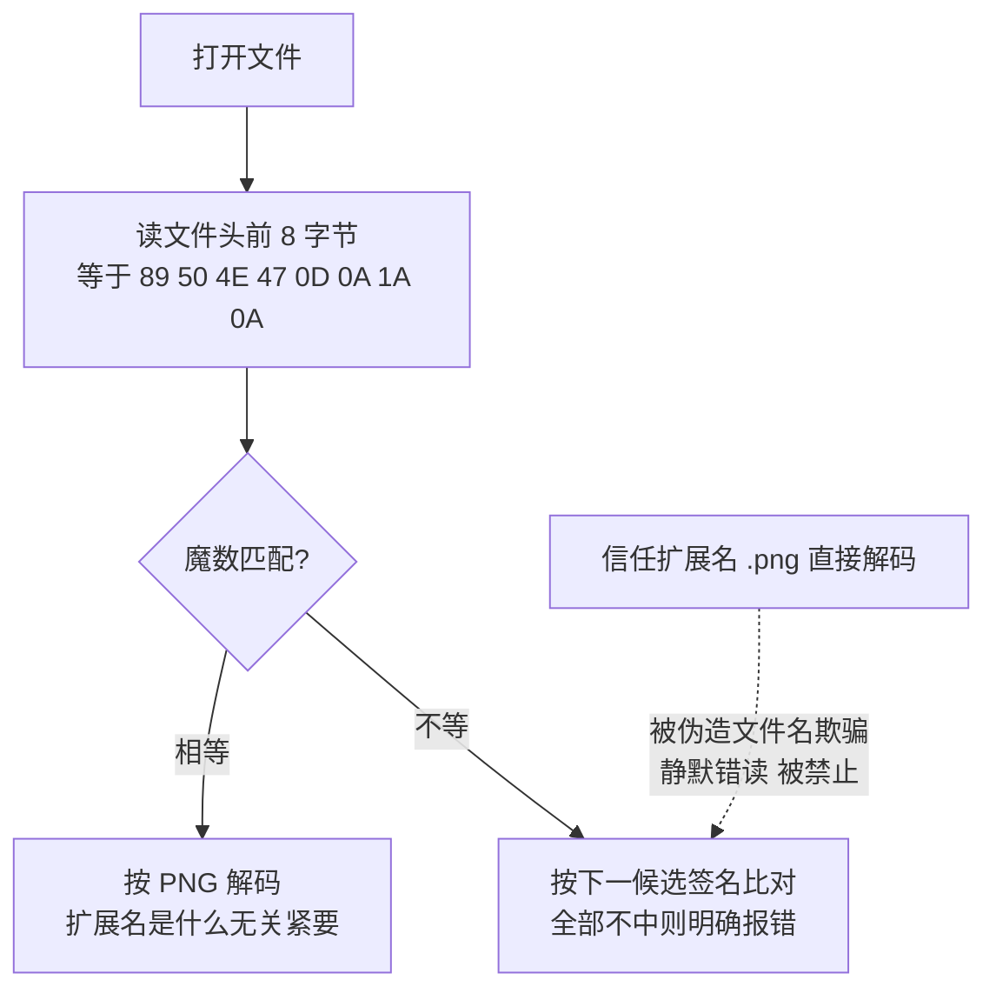
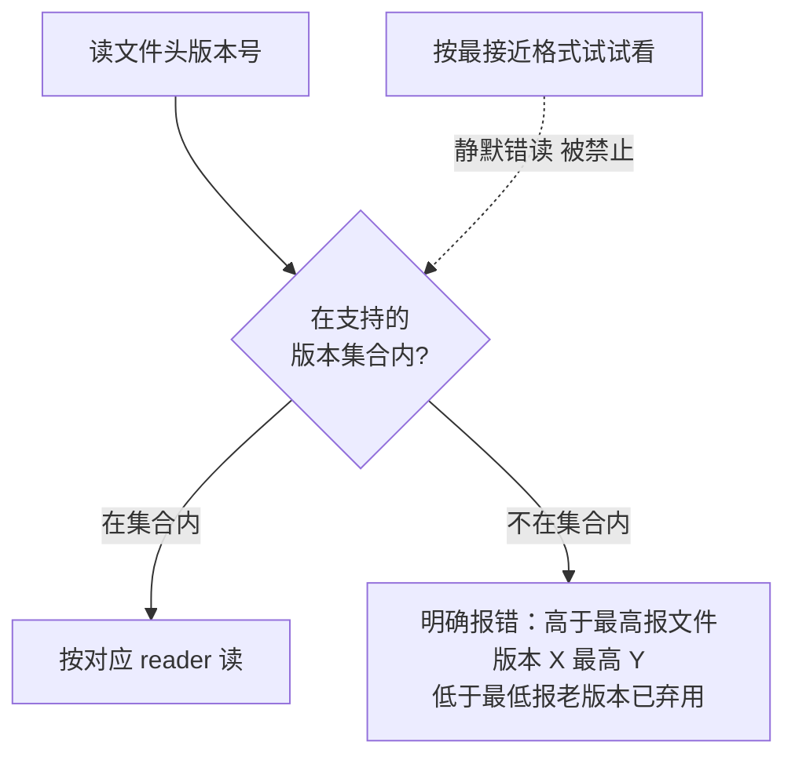
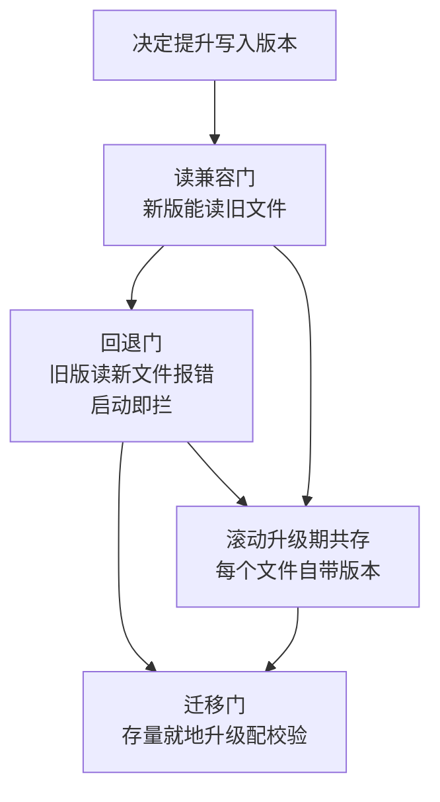

# 存储格式的版本字段是兼容性的锚：写入时必带，读取时逐级识别

> **要点**：这篇解决的问题是：存储格式要加字段、改编码，**怎么保证新旧程序读得懂彼此写的文件**？读完你能检查自己系统的**文件头是否带版本字段**、**读取端是否做到认识才读**，并按三道门安排格式升级。**持久化格式的文件头必须有版本字段**——写入端"必带"（缺省值不算带），读取端"逐级识别"（认识就读、不认识报错、不许猜）；**版本字段的缺席让格式的每次演进都变成赌博**，RocketMQ（Apache 旗下的分布式消息队列）存储 formatVersion 的修复与 RocksDB format_version 的默认值调整是同一课：**格式演进的前提是每个文件自报家门**。

## 要解决的问题：格式演进为什么依赖版本字段

持久化格式一直在变：加字段、改编码、换压缩、字段排布挪位——**演进的安全性取决于读取端能否分辨"这个文件是哪一版格式写的"**。分辨的机制只有一种可靠形式：**文件头里的版本字段**。缺了它，读取端只剩两条路：按"最新格式"读（旧文件炸），按"猜"读（**静默错读，比炸更糟**）。本库"存储格式的跨版本演进"篇讲过演进策略的整体框架；本篇只讲**版本字段本身的三条纪律**：写入必带、读取逐级、升级有门。

## 版本字段的三条纪律是怎么防住演进事故的？

**纪律一：写入端必带，缺省不算带**。**创建文件的每个代码路径都要显式写版本字段**——配置项给默认值（如 RocksDB 的 format_version=5）是兜底，兜底的存在**不豁免"创建路径显式传参"的要求**：**上游缺陷"Ensure that formatVersion is specified for all RocksDB dbs"的根因正是部分 db 的创建路径没传 version，采用了隐式默认**——隐式默认在库里是全局统一的（安全），但在"同一存储上混跑多版本代码"的现场，**每个文件自报家门是唯一可审计的事实**。**判定动作**：**审计格式写入的全部代码路径**（搜"创建文件"的调用点），任何一处依赖隐式默认都算未达标。

「每个文件自报家门」在通用文件格式里早有事实标准：魔数（magic number，文件开头固定几个字节的格式签名）。PNG（Portable Network Graphics，无损压缩位图格式）文件无论扩展名叫什么，开头 8 字节永远是 89 50 4E 47 0D 0A 1A 0A，读取端靠比对文件头字节判定真实格式，扩展名与 MIME（Multipurpose Internet Mail Extensions，标记文件类型的标准）声明都可以伪造，**字节不会**：



这段魔数在十六进制编辑器里的样子——文件头第一行就是 89 50 4E 47 0D 0A 1A 0A 八个字节，右侧 ASCII 列直接可见 ".PNG....IHDR（PNG 文件头里的图像属性块）"：扩展名与文件名标签可以随便改，**这 8 个字节改了文件就不再是 PNG**：


*图：PNG 文件头的十六进制视图（图源：UltraEdit 博客《Identifying Corrupted or Unknown Files with File Headers Using Hex Editors》，https://www.ultraedit.com/blog/identify-corrupted-unknown-files-with-file-headers-hex-editors/ ，UltraEdit 官方博客引用）。魔数是**「每个文件自报家门」的最古老实现**——读取端按字节判定格式，扩展名与 MIME 声明都可以伪造，字节不会。*

**纪律二：读取端逐级识别，认识才读**。读取端维护**"支持的版本集合"**：版本在集合内按对应格式读；超出集合（更新的格式）**显式报错**，错误信息带"文件版本 X，本程序支持最高 Y"；低于最低支持版本**同样报错**。**不许猜**：读文件头发现版本不认识时，按最接近的格式"试试看"**是静默错读的起点**——**错读的后果**（数据算错、崩溃、静默损坏传播）全部重于"拒读并明确报错"。**逐级的实现**：版本号语义按**"单调递增 + 每版一条 reader"**（reader 即读取端，下文两种叫法同义）组织，弃用老版本时**把对应 reader 标记 deprecated（已弃用：代码里保留但不再推荐使用，调用时产生警告）再删，删除前有告警期**。

「每个文件自报家门」的实物原型是宣德瓷器的底款：明宣德官窑在每件瓷器底部写下六字年号款——后世鉴定者拿起瓷器先看底款，**款识在，年代与窑口就有一锤定音的凭据**：


*图源：Wikimedia Commons，作者 King muh，CC BY-SA 4.0，https://commons.wikimedia.org/wiki/File:Ming_Dynasty_Xuande_Archaic_Porcelain_Vase_and_Six_-Character_Mark.jpg。*

没有底款的瓷器只能凭釉色器形去猜——收藏界对"猜"的定价是**捡漏与打眼并存**，恰好对应读取端按最接近格式"试试看"的两种结局。版本字段就是存储格式的底款：**写入时必带，读取时先验款识再开读，陌生的款识宁可拒收**。

**纪律三：升级有门，新旧共存有边界**。格式的写入版本升级（写新版格式）**要过三道门**：**读兼容门**——新版本能读旧格式文件，滚动升级（逐个替换实例、期间始终有实例在服务）期**必然共存**，而滚动升级指逐台逐批替换程序版本、升级全程不停机的部署方式、**回退门**（旧版本读到新格式时**明确报错**——最低支持版本 minReaderVersion 在启动时就拦下不满足的文件）、**迁移门**（需要就地升级存量文件时，**迁移工具与校验配套**，本库格式演进篇的迁移策略）。**共存边界**：**同一存储实例内混存多版本文件是允许的（每文件自带版本）**，同一文件内混多版本记录通常不允许——**文件头版本管全文件**：读取端按头上的单一版本选解析逻辑，混入异版本记录时按错误布局解析，字段值全部错位——边界在哪里**写进格式规范，不靠约定俗成**。

读取端拿到文件头版本后的分流只有三条出路，**报错与拒读都是合法动作，猜是唯一被禁止的**：



读取端纪律的完整形态：**三条出路里两条是报错，报错信息带版本数字可诊断**；虚线那条「试试看」**是静默损坏的起点**，被纪律二明令禁止。


来源：[博客园《一文搞懂 LSM-Tree》](https://www.cnblogs.com/zxporz/p/16021373.html)（CC 4.0 BY-SA）


## 读完这一段你能判断什么：版本字段的现场检查

写版本从旧升到新要走三道门的顺序验收，滚动升级期的新旧共存就发生在这三道门之间：



**三道门都过了，同一实例里 v4 与 v5 文件混存才是可控状态**——缺掉回退门时，**旧版本程序读到新文件的那一刻就是静默错读的开始**。

**三个检查动作**：抽样新写文件**看头部的版本值与配置一致**（写入必带的核对动作）；用"支持范围外版本"的构造文件测读取端（**确认报错信息可诊断，不崩溃不猜读**）；灰度（新版本先放一小部分流量验证，逐步放大到全量）新版写入格式前，用旧版本程序读新文件（**确认回退门的行为是明确报错**）。**配置核对**：多组件共享存储格式时（如 db 层与 compaction 层——compaction 是存储引擎后台把零散数据文件合并重写的过程，它读写的文件同样要带版本），核对各组件的 version 配置**同源**（一份配置多处引用，本库"依赖版本的多处声明"的同类纪律）——**两处独立配 version 是分裂的种子**。

**与序列化格式的关系**：文件内的记录序列化（protobuf 等，protobuf 是一种把结构化数据编码成字节流的序列化格式）有自己的版本演进，字段编号与 unknown fields 是其中一环，unknown fields 即反序列化时遇到的当前代码未定义的字段，**规范要求跳过而非报错**。它与文件格式的版本字段是两层，**两层各自演进、各自带版本**。混淆两层（用记录 schema 变更替代文件版本升级）会让**"文件级不兼容"伪装成"字段级兼容"**。现场的样子是：改了记录布局、没升文件版本，旧程序读新文件时文件头版本没变、顺利通过，**随后在解析记录时才发现字段对不上，报错位置离真实原因隔了一整层**。

## 这套说法在哪儿会失效

三条边界，防止把这套版本纪律用过头或用错方向。

**版本字段不是万能兼容层**：它让"不认识就报错"成为可能，**兼容性本身还是要靠 reader 集合的维护纪律**——版本字段是门牌，reader 是钥匙，**门牌齐了钥匙丢了照样进不了门**——比喻到"两者缺一不可"为止，两者的出错代价不对等：门牌看错（版本字段写错）**整份文件会被所有读取端拒收**，钥匙配错（reader 实现有缺陷）只是那一个读取端出错，**排查对象完全不同**。

**默认值升级是一次显式变更**：把 format_version 默认值从 4 升到 5 是**行为变更**（新文件旧程序读不了），发布说明与升级须知必须单列——**默认值没有"小改动"**——未显式配置的创建路径都自动采用默认值，**默认值一升，这些路径新写的文件悄悄变成新版本格式，旧程序立刻读不了**。

**校验和（对数据算出的指纹，用来发现传输或存储中的损坏）与版本字段配套**（校验和 checksum：对数据算出一个短摘要值，读回时重算比对，不一致说明数据在存储或传输中被改坏）：版本字段被篡改或写坏时，读取端按**"不认识的版本"报错**——校验和覆盖文件头让这类损坏**在更早一层被拦截**，两层防御都要有。

## 怎么自己动手验证

可复现的验证路径：

1. 缺版本复现：构造无版本字段的文件，验证**读取端报错信息明确（含版本与支持范围），不猜读**；
2. 混存验证：同一实例写入 v4 与 v5 文件各一，预期**双版本 reader 各自正确读取、文件头版本与内容对得上**；
3. 回退验证：新版写入后用旧版程序打开，**确认明确报错（非崩溃非错读）**；
4. 断言锚点：**创建路径的显式传参有审计、读取端版本集合有测试覆盖（含越界报错）、默认值变更进发布说明**——三件齐备，**格式演进从赌博变成有锚的迭代**。

```text
必带断言 = 创建路径显式传 version
识别断言 = 越界版本明确报错不猜
升级断言 = 读兼容回退迁移三门齐
```

存储格式的演进能力建立在最朴素的机制上：**每个文件开头写着自己是哪一版**——**写入端不省这个字段，读取端不猜陌生的版本，升级按三道门走**，格式就能在千台机器的滚动升级里安全换挡。

## 接着读哪几篇：格式演进的代价权衡

- [[工程知识/数据系统：在并发与故障中保存事实/数据建模与SQL/编码与演进的三角权衡：紧凑、写入放大与查询代价.md]] —— 格式演进的代价权衡
- [[工程知识/性能工程：从用户等待到资源瓶颈/存储与网络/存储引擎的文件一致性：元数据与数据块的对应关系要可核对.md]] —— 文件一致性的核对层
- [[工程知识/缺陷分析：从个案到体系/兼容与升级/案例四十三：升级把前提带走了——依赖行为变更引发的下游失效.md]] —— 升级前提变化的同类形态
- [[工程知识/缺陷分析：从个案到体系/兼容与升级/依赖版本的多处声明：升级只改一处，其余各处都是分裂的种子.md]] —— 配置同源的纪律
