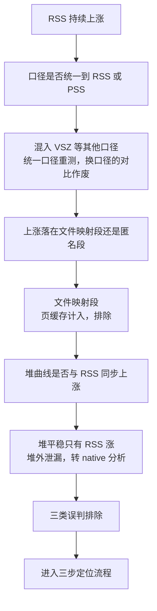
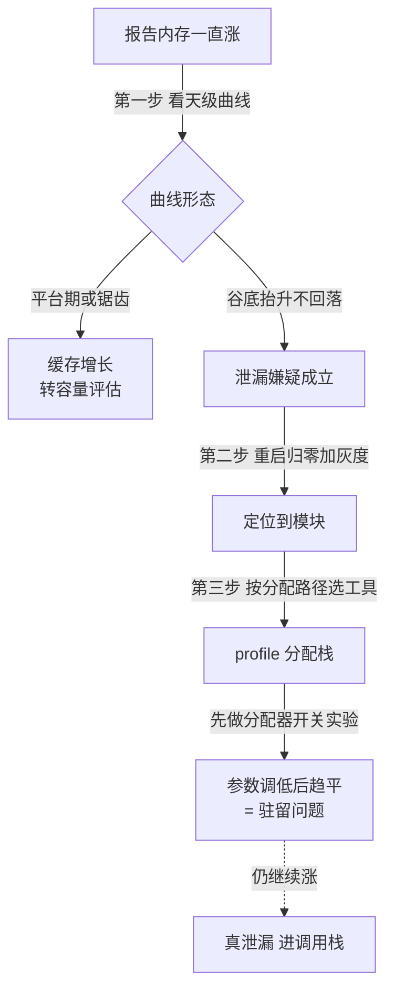

# 应用内存泄漏先用 RSS曲线定位再谈分析：涨势、归零与平台池

> **要点**：这篇解决的问题是：报告说内存一直涨，怎么快速判定是不是真泄漏、漏在哪？读完你能用 RSS（常驻集大小，进程实际占用的物理内存量）**曲线三步走完判定与定位**：**曲线确认"真在涨"**（区分缓存的平台期与泄漏的斜率）、回落实验确认**"泄漏点在哪类分配"**（重启归零 + 分模块灰度）、**按分配路径选分析工具**——tcmalloc 是 Google 的线程缓存内存分配器，与 jemalloc 同属可替换的高性能分配器的**池开关是第一道验证**；**跳过曲线直接上 profiler，分析的往往不是泄漏。**

## 要解决的问题

"内存一直涨"的报告里，**相当一部分最终归类为"缓存增长，符合设计"**——**RSS 曲线的平台期（缓存填满后稳定）与泄漏的斜率（永不回头）需要区分。**本库资源与容量域"案例六"给过连接泄漏与 SST（Sorted String Table，按 key 排好序后落盘的只读文件）堆积的个案（应用层泄漏的形态）；本篇给**判定与定位的通用流程**：**先确认泄漏存在（曲线形态），再定位泄漏模块（回落实验），再选对分析工具（分配路径）**——三步各有明确的判据与动作，**避免"内存涨了就 panic 加内存"或"直接上 profiler 分析半天缓存"**。

## 三步判定与定位是怎么把范围层层收窄的？

**真泄漏在监控图上有一副典型长相**：**内存随运行时间单向上升，重启之后骤降，随后按大致相同的节奏再次爬升，整条曲线呈周期性的锯齿状。**判断依据是**"重启能拿回来、运行还在涨"这两个特征都指向进程内的状态在累积**，与容量不够不同（内存停在高位，请求因资源耗尽被拒绝，而不是持续上涨）。


*图源：OpenResty 中文博客，CC BY-SA 4.0，https://blog.openresty.com/cn/openresty-xray-memory-leak-detection/。*


**第一步：RSS 曲线确认涨势**。**监控面板上看 RSS 的长期曲线（天级以上窗口）**——**泄漏的特征**：**曲线逐级抬升且波谷不回落**（像台阶，一级比一级高，即便带小幅波动也不回到前一级）、**斜率与请求量正相关**、OOM（Out Of Memory，系统可用内存耗尽时内核触发 OOM Killer 终止占用最大的进程）前的加速（换页压力：物理内存吃紧后内核频繁在内存与交换区之间搬页，统计口径里的占用随之跳升）。**非泄漏的形态**：缓存的平台期（**启动后爬升到一个高位持平**——本地缓存、页缓存映射）、锯齿（**周期性 GC 回落**，JVM/Go 运行时的正常呼吸：**涨落都回到同一水平**）。**判定的量化标准**：**连续 3 天的单调上升 + 逐级抬升不回落 = 泄漏嫌疑成立**；**平台期后的波动 = 缓存，转容量评估**。

**第二步：回落实验定位模块**。确认涨势后做两类实验：**重启归零验证**（**重启后 RSS 回到基线**——**确认是进程内泄漏，排除系统层假象如页缓存**）；**分模块灰度（新版本先放一小部分流量验证，逐步放大到全量）**（按功能模块开关灰度流量：**A 模块开启的实例曲线涨、关闭的不涨**——**泄漏点定位到模块**）。**灰度实验的设计要点**：**两组实例同配置同流量模型**（**流量不均会把非泄漏模块误判成嫌疑**）、**观察窗口覆盖泄漏的触发路径**（有的泄漏只在特定请求类型触发，均匀灰度覆盖不到）。**案例六的连接泄漏**在此步的特征：**泄漏量与请求量线性相关**、关闭连接池（预先建好连接反复取用、省去反复握手建连的开销）复用后加速——**分配路径的线索在灰度阶段就已出现**。

**第三步：按分配路径选工具**。**定位到模块后，按运行时选分析手段**：

| 运行时 | 第一工具 | 看什么 |
| --- | --- | --- |
| C/C++ | valgrind（内存检查与剖析工具） massif / jemalloc profile | 分配调用栈的驻留量排名 |
| Go | pprof heap（alloc_space vs inuse_space） | inuse 不降的分配栈 |
| JVM | jmap histo + MAT 支配树 | 对象实例数的增长类 |
| Python | tracemalloc / objgraph | 快照（某一时刻的完整只读副本） diff 的增长对象 |

**分析的第一道验证是分配器开关**：glibc malloc 的 arena（glibc 为多线程各自创建的独立内存池）碎片（存储空间里零散不连续的小块）、jemalloc 的 dirty page（已归还应用但尚未交还操作系统的空闲页）驻留，都会让 **RSS 不降而分配器视角的"泄漏量"远小于 RSS**。这像酒店房间退了房但门牌没翻：客人（应用）确实退了（已释放），前台的登记板（分配器的元数据）还标着占用，房间（物理页）要等保洁按节奏翻牌（分配器的回收参数）才重新可分配。比喻只对应到"分配器延迟归还物理页"这一步：页没有丢失也没有损坏，只是归还节奏由分配器参数决定；**真泄漏是这些页永远等不到翻牌**。**要快速区分两者，可以调整分配器参数做开关实验**——**`MALLOC_ARENA_MAX=2`、jemalloc 的 `dirty_decay_ms` 调低后的曲线变化**是判断**"真泄漏 vs 分配器驻留"**的快速实验：**开关调参后 RSS 曲线趋平 = 驻留问题（调参解决），继续涨 = 真泄漏（进 profile 分析）。**


## 三类误判分别怎么排除？

**排除误判要看占住内存的究竟是什么**。**按对象占用的大小排个序，最大的几项摆出来**，就能分清是一次性读进来的大对象，还是在持续增长——**两者看起来很像，处置方式完全不同**。下面三个误判就是按这个思路逐一排除的。

先说锯齿这一类最容易看错的长相。带垃圾回收的语言里，健康的进程内存本就每次回收都回落的锯齿，而不是一条平线。下面这张是健康应用的堆曲线：锯齿的每个尖峰由一次 Full GC 削平，**谷底始终落回同一个水平，几十个小时里这个下限没有抬升。**


*图示：健康应用的堆内存占用曲线，红色三角为 Full Garbage Collection 事件。图源同上（HeapHero 博客《Symptoms of Memory Leak》，厂商公开技术资料）。*

**泄漏进程的锯齿形状一样，谷底却在往上走。**下面这张是泄漏应用的同一张图：**每次 Full GC 回收后的下限从 4GB 附近逐级抬高到 8GB**——**谷底抬升说明每一轮回收都有对象清不掉、活对象越积越多**；**当存活对象逼近堆上限，回收后几乎没有空间可释放，锯齿被压平成一条贴着上限的实心带**。**两张图放在一起，判据就清楚了**——**看锯齿的下沿是否抬升，而不是看是否在涨。**


*图示：内存泄漏应用的堆内存占用曲线，红色三角为 Full Garbage Collection 事件，回收后的下限持续抬升。图源：HeapHero 博客《Symptoms of Memory Leak》，https://blog.heaphero.io/symptoms-of-memory-leak/，厂商公开技术资料。*


*图源：同上（OpenResty 中文博客），CC BY-SA 4.0。*


**误判一：页缓存（内核把磁盘数据缓存在内存里、减少重复读盘）算进进程**。**`free -h` 的 available 与 buff/cache 的分界**——**应用读取大文件后页缓存增长，`top` 的 RES（进程实际占用的物理内存） 含文件映射部分**——**排除动作**：**`pmap -x <pid>` 按段看**（匿名内存 vs 文件映射），**泄漏只在匿名段（[anon]）**。

**误判二：监控口径混乱**。RSS、PSS（Proportional Set Size，按共享比例分摊的内存占用）、VSZ 三个口径混用（**VSZ 是虚拟地址空间，涨是正常的；PSS 是按共享折算的真实占用**）——**判定的统一口径用 PSS 或 RSS 单一化**，**监控与告警同口径，换口径的对比全部作废。**

**误判三：把 GC 的堆外泄漏当堆内**。JVM（Java 虚拟机，Java 程序的运行时）的 **DirectByteBuffer**、Go 的 **cgo**（Go 程序调用 C 语言代码的桥接机制，C 侧的分配不经过 Go 的内存管理）**分配不在堆统计里**——**堆曲线平稳 + RSS 持续涨 = 堆外嫌疑**，**分析对象转向 native 分配（pmap 的 anon 段增长 + valgrind/jemalloc profile）**。

**RSS 上涨不等于泄漏，三类误判各自对应一个检查维度**——先统一口径（排除 VSZ 混入）、再看段落归属（排除页缓存）、最后核对堆曲线与 RSS 是否同步上涨（排除堆外泄漏被当作堆内处理）——**三问依次通过后，剩下的上涨才有资格进入三步定位流程**：



**三类误判排除干净才谈得上三步定位；顺序本身就是效率，每一步都为下一步收窄范围。**

**三步流程的顺序不可倒**：跳过曲线确认直接 profiler（分析的可能是缓存）、跳过灰度直接全局分析（堆栈排名被正常流量淹没）——**每一步都为下一步缩小范围**，**范围不缩的工具调用会让排障时间成倍拉长**，一晚上不够就再加一夜。



**三步的顺序本身就是效率**：第一步用曲线把「缓存增长」与「泄漏」分开，避免对缓存跑一夜 profiler——**省下的是整夜的无效分析**；第二步用重启归零与分模块灰度把范围从整个进程缩到一个模块——**省下的是对无关模块的逐一排查**；第三步先在分配器参数上做开关实验，**把「分配器驻留」这类假泄漏排除掉**，再进调用栈分析——**省下的是对正常驻留的误读**。虚线是第三步的分岔：开关调参后曲线趋平说明是驻留问题（调参即可），继续上涨才进真正的泄漏分析。**每步省一类无效工作，范围逐层收窄，常规定位时间从数天降到数小时。**

## 这套说法在哪儿会失效

**三条边界，防止把这套判定流程用过头或用错方向。**

**泄漏的修复优先于分析完备**：**灰度定位到模块后，先做止损（该模块限流或降级）再深挖调用栈**。**止损的收益是立即封住泄漏的持续影响，代价是功能暂时降级（压力过大时关闭次要功能，保住主流程）**：**泄漏进程多跑一小时，可用余量就少一小时，分析完备性给止血让路。**

**压测复现要覆盖触发路径**：**泄漏往往只在异常路径触发（超时重试、错误分支的分配未释放）**——**正常路径压测不复现就加故障注入（主动向系统注入故障来验证容错能力的测试方法）**（本库健康检查篇的注入思路同源），**异常注入后的曲线变化才是泄漏复现的正确姿势**。

**驻留调参不是泄漏修复**：**arena 与 decay 参数压低 RSS 驻留，分配失控的代码该漏照漏（只是泄漏得更慢）**——**调参是缓冲，修复要回到分配调用栈**，**把"调参后趋平"当修复完成是复发型事故的起点。**

## 怎么自己动手验证这些判据？

可复现的验证路径：

1. **形态判别复现**：分别跑缓存型（限容 LRU，最久未使用的先淘汰的缓存策略）与泄漏型（**map 只进不出**负载，**预期 RSS 曲线呈平台期与逐级抬升两种形态**，判定法可区分）。
2. **灰度定位复现**：**两实例同流量不同模块开关**，**预期涨势随开关分布，定位结论与注入点一致**；
3. **驻留实验复现**：**glibc 多线程高分配场景下设 `MALLOC_ARENA_MAX=2`**，**预期 RSS 显著下降且曲线趋平**；
4. **断言锚点**：**RSS 长期曲线在监控（天级窗口）、PSS/RSS 口径统一、分配器驻留的快速实验进排障手册**——**三件齐备，"内存一直涨"从需要紧急响应的告警事件变成可按步骤走完的判定流程。**

```text
曲线断言 = 平台期与斜率先区分
灰度断言 = 模块开关定位分配源
驻留断言 = 分配器参数先排除再分析
```

**内存泄漏的排查效率取决于顺序**：曲线确认存在、灰度定位模块、工具分析调用栈、分配器实验排除驻留——每步为下一步收窄范围，**顺序对了，泄漏定位的常规耗时从数天缩到数小时。**

## 接着读哪几篇：RSS/PSS/页缓存的机制层

- [[工程知识/缺陷分析：从个案到体系/资源与容量/案例六：容量与泄漏——连接泄漏和 SST 堆积.md]] —— 应用层泄漏的个案形态
- [[工程知识/性能工程：从用户等待到资源瓶颈/操作系统与运行时/虚拟内存与文件系统把地址和持久化分层.md]] —— RSS/PSS/页缓存的机制层
- [[工程知识/性能工程：从用户等待到资源瓶颈/存储与网络/df 与 du 的差值就是被占住的已删文件：磁盘占用异常的三个来源.md]] —— 存储侧的同类差值排障
- [[工程知识/性能工程：从用户等待到资源瓶颈/观测与诊断/基准报告要绑定机器画像：没有环境描述的数字不可比较.md]] —— 口径统一的同类纪律
