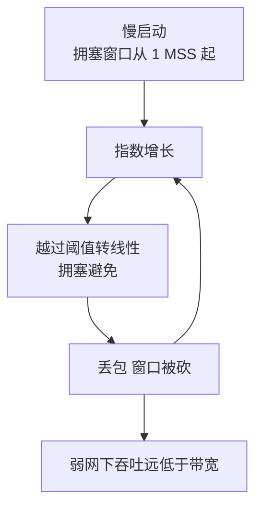
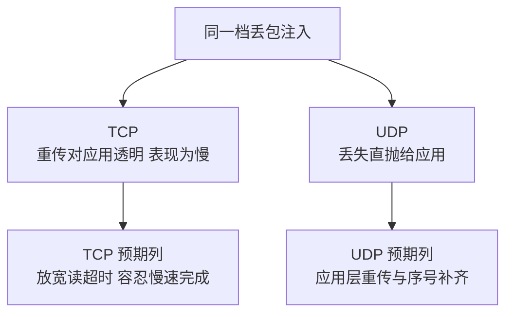
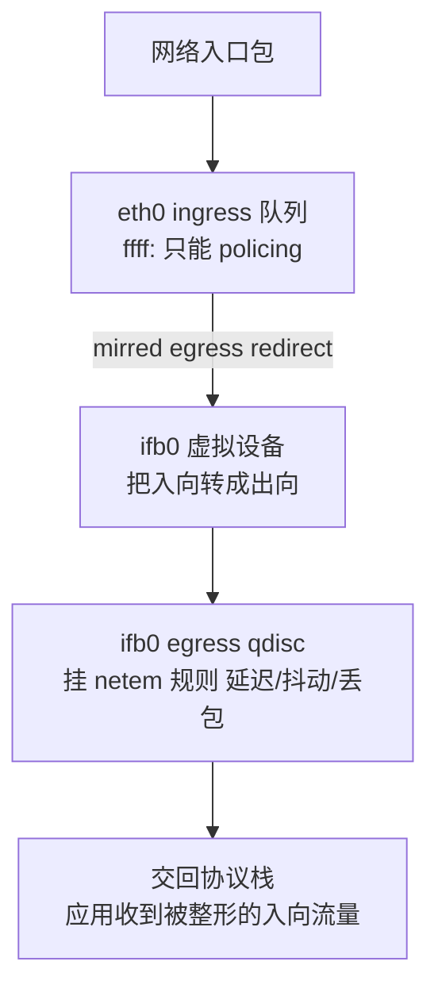
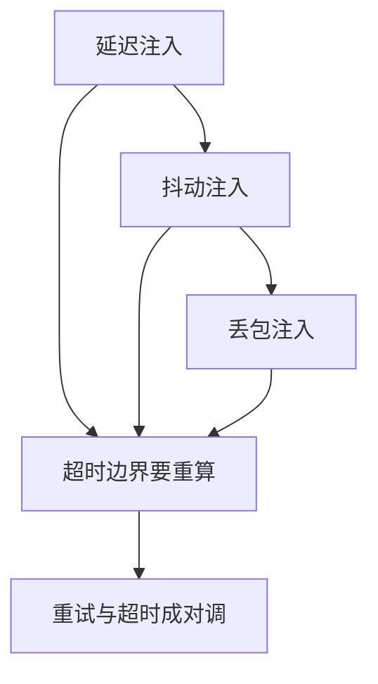

# 弱网测试要把网络当变量：延迟、抖动、丢包三轴注入到超时边界

> **要点**：这篇解决的问题是：内网测试环境里测试全绿，为什么到了地铁与跨境链路全是事故？读完你能把延迟RTT（Round-Trip Time，一个数据包从发出到收到应答的往返时间）抬高、抖动（延迟方差）、丢包（上行与下行分开）三轴逐轴注入测试环境，并对每组注入写出对应的超时预期，验证系统在"慢"与"坏"下给出确定行为（降级、重试、明确报错），避免永久挂起或雪崩——雪崩指故障像雪团滚大：一台慢引发一批调用方超时重试，重试流量又压垮下游，失败范围成倍扩大，与单个请求超时失败的区别在影响面是否连锁放大。

## 要解决的问题是什么：环境全绿掩盖了哪些网络假设

**应用对网络的行为抱着几个从未验证的假定**：RTT 在几十毫秒内、丢包接近零、抖动吞不掉心跳（节点定期互发的存活信号，超时收不到就判定故障）间隔、带宽足够心跳与数据共用。**这些假定在内网测试环境恒成立**，**测试环境因此测不出任何网络问题**——**代码跑通了，可网络这个变量根本没进测试**。**产线现场的真实形态**：**移动端在电梯里丢包 30%、跨境链路 RTT 300ms 抖动 ±200ms、机房间瞬时闪断 2 秒**。

**弱网测试的定义**：**把这三个轴的取值范围显式注入测试环境**，**验证每个注入组合下系统的可观察行为符合设计预期**——**超时触发、重试按退避走、用户拿到明确反馈**。本库"故障注入（主动向系统注入故障来验证容错能力的测试方法）验证的是处理路径"篇讲过注入验证的通用框架；**本篇只讲网络变量的注入方法与超时边界的对账**。

## 三轴注入与超时对账是怎么做的？


*图示：TCP 慢启动与拥塞避免下拥塞窗口的变化——起步指数增长，过阈值后转线性，一旦丢包就被砍回去。图源：Wikimedia Commons《TCP Slow-Start and Congestion Avoidance》，作者 Fleshgrinder，GPLv3，https://commons.wikimedia.org/wiki/File:TCP_Slow-Start_and_Congestion_Avoidance.svg。这张图解释了为什么"丢包"这个轴的杀伤力远大于它的百分比：丢掉的是窗口被打回后整条链路的吞吐，那几个包本身只是表象——弱网下吞吐远低于带宽，瓶颈在窗口与丢包，不在链路本身。*

**轴一：延迟（`netem delay`）**。基线（正常状态下的指标水平、用来对比异常） RTT 上加固定延迟（如 `delay 200ms`），**验证两个边界**：**连接超时（dial timeout）大于注入值时连接照常建立（只是慢），小于注入值时按预期失败并反馈**；**请求级读超时的语义（从发送到收完还是两次读之间）在慢链路下的实际行为**。**常见发现**：**无超时的调用在 200ms 延迟下不坏、在 5 秒延迟下把线程池（预先建好一组线程反复取用、避免频繁创建销毁）占满**——**调用 5 秒才返回，处理它的线程也就被占住 5 秒，新请求持续进来而线程不放回，池子被逐步占满后后续请求只能排队**。——**延迟注入的第一课就是找出"没有超时的调用点"**。

**轴二：抖动与相关性（`delay 100ms 50ms 25%`）**。**延迟带方差后，"平均 RTT 达标"不再保证体验**：**抖动吞掉心跳间隔（抖动毛刺盖过心跳间隔时，对端判定超时断连）**、**重试风暴（重试流量层层放大、让故障雪上加霜）**——**延迟毛刺（延迟曲线上偶发的短时尖峰）让一批请求同时超时同时重试**，**重试流量在极短窗口内集中到来、接近甚至超过原始流量**；**与正常退避重试的界线在时间分布是否扎堆**。**注入验证的边界**：**心跳间隔要明显长于最大抖动**（**常见给心跳间隔留出数倍于抖动峰值的余量**），**该余量在最大抖动下仍安全**；**重试的退避与抖动（jitter）参数让重试时间错开**，验证方法是**观察注入期重试请求的时间分布不扎堆**。

**轴三：丢包（`loss 5%` 与方向分离）**。**丢包分上行与下行注入（`corrupt`/`loss` 加方向规则）**，**两轴验证的失败形态不同**：**上行丢包（请求到不了）表现为超时与重试**；**下行丢包（响应回不来）表现为读等待与部分响应**。**TCP（传输控制协议，负责把数据完整、有序地送达）与 UDP（用户数据报协议，只管发、不保证到达与顺序）的差异**要分开验：**TCP 重传对应用透明但吞吐下降**（**验证应用在慢 TCP 下的超时不要过紧**），**UDP 丢包直接丢**（**验证应用层重传与序号补齐**）。**注入的组合纪律**：**单轴扫过再上组合（延迟 + 丢包）**，**组合注入对准"产线最痛场景"**（如移动弱网 = 高抖动 + 上行丢包），**全部组合矩阵是浪费，按场景挑 3-5 个组合够用**。

**超时边界对账表**：**注入的每个档位对应验证的超时配置**——**连接超时（1s/3s/10s 档）、读超时、心跳间隔、重试次数与退避基数**。**对账的判据**：**每个档位下系统行为有确定的预期描述**（"10s 连接超时在 delay 5s 下正常建连，delay 15s 下超时并反馈"），**实际行为与预期描述一致即通过，不一致要么改配置要么改预期**——**弱网测试的产出就是这张表**，**它让"系统在弱网下的行为"从口头印象变成逐档可查的规格**。

**三轴各对准一个超时参数**：**延迟档压连接超时，抖动档压心跳间隔，丢包档压读超时与重试退避**——**每档配一句可判定的预期描述，实测与描述一致才算通过**：


**注入值与应用的实际感知值可能完全脱节，光看注入参数判断不了测试有没有生效**，于是弱网测试的产出是一张对账表：三档各有一行预期描述，每行对准一个超时参数，**对不上时要么改超时配置、要么改预期**——**两者都是结论，不是失败**。



**所以一个丢包档位要写两句预期**：**TCP 那列写「放宽读超时、容忍慢速完成」**，**UDP 那列写「应用层重传与序号补齐」**。**用同一句预期覆盖两种协议，是这张对账表最常见的错**。

图：丢包档位的对账要按协议分列——TCP 的失败被传输层吸收成慢，UDP 的失败直抛给应用，两张预期表不能混用。


来源：[小林coding《TCP 三次握手与四次挥手面试题》](https://www.xiaolincoding.com/os/1_hardware/tcp_interview.html)（CC 4.0 BY-NC-SA）


## 读完这一段你能判断什么：注入环境的选择

**netem 规则挂在流量控制结构的哪一层，决定它管哪段流量**：**出向包先过包分类进入 HTB（分层令牌桶，Linux 的分层流量整形框架）类**，**类下的叶子 qdisc（队列规则，内核决定包怎么排队、何时发出的机制）才是 netem 的挂点**，**令牌整形（按设定速率逐包放行的机制，令牌用尽则排队等待）通过才送网卡**——`tc qdisc add dev eth0 root netem ...` **挂在根上时对整块网卡的全部出向流量生效，挂到类下时只压过滤器匹配的流量**；**netem 只作用于 egress，入向要 IFB（一种虚拟网络设备，用来把入口流量当作出口流量重新处理）虚拟设备把入口流量转成出口再整形**：


*图源：[linux-ip.net《Traffic Control System Components》](http://linux-ip.net/pages/diagrams.html)（Simplified Linux Traffic Control Scenario with HTB）。*

**三个层次的注入环境**：**本机 netem（tc 命令对网卡加规则，成本最低，验证单服务的网络处理逻辑）**、**容器环境注入（在容器 netns 即容器各自独立的网络视图里加 netem，验证服务在编排环境的完整链路）**、**专门弱网测试机/网关（全流量过网关整形，验证端到端）**。**选择的判据**：**验证目标在哪个边界内**——**服务自身的超时与重试逻辑本机注入够；跨服务调用链的弱网行为容器注入；客户端到服务端的端到端体验（App 弱网表现）要网关或真机工具**。**注入的可控与可逆**：**netem 规则要明确加在哪块网卡的哪个方向**（`tc qdisc add dev eth0 root netem ...`），**清除命令与加规则命令成对保存**——**忘删的 netem 规则**是测试环境"莫名其妙变慢"的经典来源（本库"Linux 调查先收集事实"的同款教训：**先看 `tc qdisc show` 再怀疑代码**）。

**与故障注入的关系**：**弱网注入是故障注入的网络子集，复用同一套纪律**——**注入有计划（注入哪些轴哪些档）、有预期（每档的行为规格）、有观察（注入期的错误率与延迟曲线）、有恢复（注入撤销后系统回到基线）**。**恢复验证常被漏**：**撤销注入后连接池（预先建好连接反复取用、省去反复握手建连的开销）与重试状态要回到正常**（**重试风暴后的连接池污染、退避后的请求堆积**）——**注入结束时的状态清理是弱网测试的收尾动作**。

「入向要 IFB 虚拟设备把入口流量转成出口再整形」这条路径补一张图：**入口包在 eth0 的 ingress 队列被 mirred 动作重定向到 ifb0**，**ifb0 的 egress qdisc 上挂 netem 规则**，**整形完的包再交回协议栈**——**Linux 对入口只支持 policing**（只做超限即丢，不做延迟与排队，因此模拟不了抖动与受控延迟——**shaping 则是排队整形，能控制发包时机**），**想对入向延迟与抖动做受控注入，就必须借道这层虚拟设备**：



## 用了能拿到什么，要付什么代价

**弱网注入的收益是把网络类故障的暴露时间从产线前移到测试环境**（**事故发现成本降一个量级**），**代价是环境搭建与档位维护的持续投入**（**netem 环境半天搭好，档位表按业务流量形态每季度校准**）；**档位过激的代价是测试资源耗在学术场景，档位过缓的代价是产线形态覆盖不到**——**投入的平衡点在"档位来自产线观测"**，**观测数据现成时维护成本极低**。

## 这套说法在哪儿会失效

**三条边界，防止把这套弱网注入用过头或用错方向**。

**弱网测试不替代带宽测试**：**延迟、抖动、丢包之外，带宽（`netem rate`）是第四轴**——**大文件传输与视频类场景带宽是主变量，API 类服务三轴为主**。**按业务流量形态挑轴，不追求全轴矩阵**。

**注入档位来自产线数据**：**档位表（延迟几档、丢包几个点）的依据是产线观测（接入层延迟分布、运营商丢包报告）**，**拍脑袋的极端档（99% 丢包）验证的是学术兴趣，验证不出产线会遇到的形态**。

**netem 在高 pps（每秒包数，衡量包速率的单位）下有精度限制**：**netem 的排队机制在高包率下引入额外延迟与抖动（它自己成了瓶颈）**，**精确测量用专用硬件或分层注入**——**注入工具的自身误差要知道**，**验证结论只信明显大于工具噪声的差异**。

**三轴档位压上去之后，观察到的行为不外乎三类，而三类的处置动作不同**：**完全符合设计的直接进对账表，符合但只在边界档位才触发的说明余量不足，不符合的（幽灵连接、重试扎堆）要修配置或修代码并回归重对账**：


**三类结果都是有效产出**：**前两类让对账表多一行可查的规格，第三类直接暴露设计缺口**。**其中「余量不足」这一级最容易被漏掉**——**它意味着当前配置只在边界档位成立**：**配置的余量刚好等于测试档位，没有富余**；**产线的网络形态一旦比测试档位更差（延迟更高、抖动更大），原本"刚好不触发"的配置就会变成实际不符合预期的第三类**。

图：注入档位与系统行为的对应关系——每一档的观察结果要么进对账表，要么暴露设计缺口，两者都是有效产出。

## 怎么自己动手验证

可复现的验证路径：

1. **档位扫描**：**netem 按对账表逐档注入，每档记录系统行为（建连结果、错误码、恢复时间），与预期列比对**，**预期全对上**；2. **心跳存活**：**注入的抖动幅度给到两个心跳周期的量级**（**超过一整个心跳周期的毛刺，比常规弱网档位更狠**），**预期连接不断（或按设计主动断并快速重连）**，**对端无幽灵连接残留**（幽灵连接指一端已断、另一端仍以为连着并继续占用资源的连接）；
3. **重试不扎堆**：**注入毛刺延迟，观察重试请求的时间戳分布**，**预期错开（退避 + jitter 生效）而非同一毫秒齐发**；4. **断言锚点**：**超时对账表存在且逐档验证过、注入命令与清除命令成对留存、撤销注入后基线恢复**——**三件齐备，弱网从"产线才能暴露的事故"变成测试环境里的常规科目**。

```text
注入断言 = 延迟抖动丢包三轴有档位表
对账断言 = 每档行为与超时配置对得上
恢复断言 = 撤销注入后回到基线
```

**弱网测试把网络当成变量对待**：**三轴注入把它从背景搬进测试用例**，**超时对账表让每个档位下的系统行为有名有姓**——**产线那些"偶发慢、偶发断"的告警，多数能在测试环境的三轴档位里提前找到名字**。

## 接着读哪几篇：注入验证的通用框架

- [[工程知识/软件构建：让变化可以理解、验证与交付/测试与交付/混沌工程验证系统是否真的能处理故障.md]] —— 注入验证的通用框架
- [[工程知识/性能工程：从用户等待到资源瓶颈/存储与网络/交付前的网络检查清单：二十项逐条过，三项全绿再上线.md]] —— 上线前检查与弱网档位的衔接
- [[工程知识/后端系统：在并发、失败与变化中维持服务/基础设施/长连接网关的工程要点：心跳推送与连接迁移.md]] —— 心跳与连接保活的机制层
- [[工程知识/软件构建：让变化可以理解、验证与交付/开发工具/Linux调查先收集事实再改变状态.md]] —— 先看现场再动手的纪律
