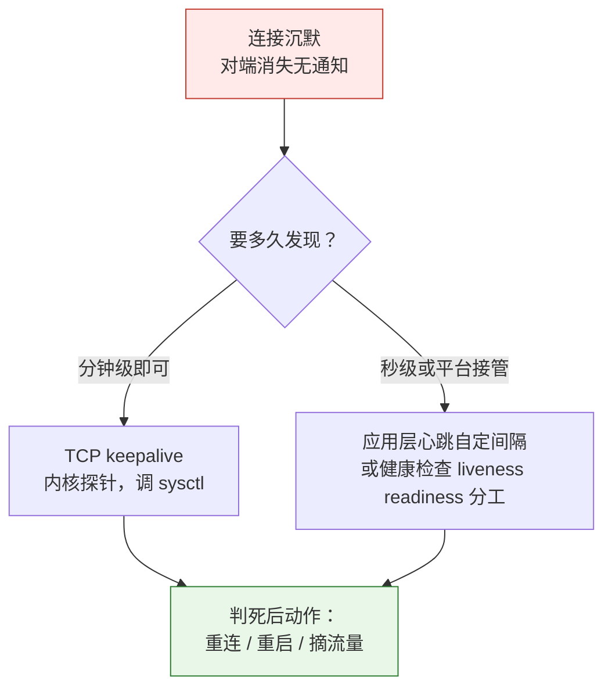

# 心跳与keepalive是活性探测的最小语言：从协议内建到应用层判活

**网络不主动通知你「对面没了」——TCP 半开连接（一方已消失、另一方不知情）可以挂到天荒地老；心跳与 keepalive 是在沉默的连接上造出「活性信号」的三种语言。** 读完你能回答：TCP keepalive、应用层心跳、健康检查三者的分工与时效差异、间隔怎么按故障检测时间倒推、为什么「进程活着」与「服务可用」是两个命题。

## 要解决的问题

**TCP 连接是两端内存里的一组状态，不发包就没有任何流量。**对端断电、网线拔掉、NAT 映射过期、中间设备静默丢弃——**这些失败都不会给存活方送来 FIN 或 RST**，连接在存活方看来一切正常，**发送数据只会撞上无限重传。沉默是网络的默认状态，活性是必须显式造出来的信号。** 三种造法对应三个层次：协议内建的 keepalive、应用层的心跳、平台侧的健康检查。

## 机制：三种语言各有词汇表与时效

### TCP keepalive：协议内建的探针

RFC 9293 内建的保活机制：连接空闲超过 `tcp_keepalive_time`（默认 7200 秒，两小时）后，内核按 `tcp_keepalive_intvl` 间隔发探测包，连续 `tcp_keepalive_probes` 次（默认 9）无响应则断开。默认参数按「探测不该频繁打扰网络」设计，**默认配置的故障检测时间是 2 小时 15 分钟起——多数服务等不了这么久，要么 sysctl 调参（三个值都调），要么上应用层心跳。**

```bash
sysctl -w net.ipv4.tcp_keepalive_time=600
sysctl -w net.ipv4.tcp_keepalive_intvl=30
sysctl -w net.ipv4.tcp_keepalive_probes=3
```

### 应用层心跳：语义与频率自己定

应用层在协议数据里加心跳帧（WebSocket 的 ping/pong 帧、gRPC 的 keepalive、消息队列的心跳包），三点胜过内核探针：**频率自由**（秒级可配）、**带语义**（pong 里可带负载水位、版本号）、**穿透中间设备**（持续流量保住 NAT 映射）。代价是应用代码与协议约定。检测时间的通用公式：

```text
检测时间 ≈ 间隔 × 容忍次数
```

**间隔 5 秒、容忍 3 次，最坏 15 秒判死。**间隔越短判死越快，误判风险（GC 停顿、网络抖动被当成死亡）越高——**容忍次数就是为抖动留的余量，按「业务能接受的最晚发现时间」倒推组合。**

### 健康检查：分层判活，进程与语义分开

平台层（K8s probe、负载均衡 health check）把判活拆成两类问题：**liveness 管进程还活着吗**（失败重启容器），**readiness 管现在能接活吗**（失败摘出负载均衡，不重启）。判活端点的设计纪律：**liveness 探针只查「进程能否响应」，不查下游依赖——下游故障时把全部实例判死重启会造成雪崩；依赖健康放 readiness。「进程活着」与「服务可用」是两个命题，用两个探针分别问。**



## 案例：判活失真与告警语义同源

[[工程知识/缺陷分析：从个案到体系/正确性/日志级别的语义：把提示当告警，告警就成了背景噪音]] 展示信号语义失真的后果：WARN 级别的告警刷屏后，真告警被淹没。判活信号的同构失真：**心跳超时阈值过松（判死太慢，故障发现晚）与过严（GC 停顿被误判，健康实例被反复重启）都会让信号失真——失真的判活比没有判活更糟，它给出错误结论。**[[工程知识/缺陷分析：从个案到体系/复现与回归/断言要锚定在不变量上：注入前后该不变的数字与该变的数字]] 提供判活设计的正确锚点：**心跳验证的是「最小活性」这个不变量，探针端点必须保持最小——任何把业务逻辑加进判活路径的做法都在稀释信号。**

## 怎么测

- **半开复现：用 iptables DROP 掉对端方向流量（模拟静默死亡），计时观察检测时间与 `ss` 状态变化，核对与配置推导的公式一致。**
- **抖动容忍：给服务注入 5-10 秒的 GC 停顿或网络延迟抖动，确认心跳容忍次数吸收了抖动、无误判重启。**
- **探针隔离：手动把下游依赖打挂，确认 liveness 探针不受影响（实例不被误重启）、readiness 正确摘流。**
- **NAT 场景验证：跨 NAT 的长连接在空闲期保持心跳流量，确认映射不超时断连。**

## 哪些认识一看就错

- **「TCP keepalive 默认配置够用」——默认 2 小时起，绝大多数服务场景等不起；用了就要调参，或直接上应用层心跳。**
- **「进程没崩就是健康的」——死锁、事件循环卡住、线程池耗尽的进程对请求毫无响应；liveness 探针存在的意义就是穿透「活着但没用」。**
- **「判活越快越好」——检测时间与误判率是一对定价关系，秒级判死必然误伤抖动；容忍次数按最坏正常停顿设计。**
- **「健康检查通过就能接流量」——readiness 只说明探针端点可用；依赖不健康的部分降级逻辑要在业务层另行处理，探针端点不背业务语义。**

## 效果从哪来、要付什么代价

**活性信号把「静默挂起」变成「可计时的失败」：检测时间从默认的两小时级压到秒级/分钟级，故障发现时长变成显式参数。**代价是三层各一笔：内核参数要按机器角色统一管理，心跳协议要进应用代码与版本约定，探针端点要保持最小语义并持续评审。**心跳本身还有流量成本（频率 × 连接数），万级长连接的服务要按带宽预算定间隔——判活的每一秒灵敏度都是流量与误判率换的。**

关系：[[工程知识/性能工程：从用户等待到资源瓶颈/存储与网络/MTU黑洞的指纹是小包通大包挂：分片黑洞的诊断路径与封装税核算]] —— 静默挂起的另一成因（黑洞）与回收依赖，两篇互为配套。[[工程知识/后端系统：在并发、失败与变化中维持服务/分布式可靠性/健康检查只能提供有时效的失败证据]] —— 平台层判活的证据时效问题。[[工程知识/缺陷分析：从个案到体系/正确性/日志级别的语义：把提示当告警，告警就成了背景噪音]] —— 信号语义失真的共通教训。
