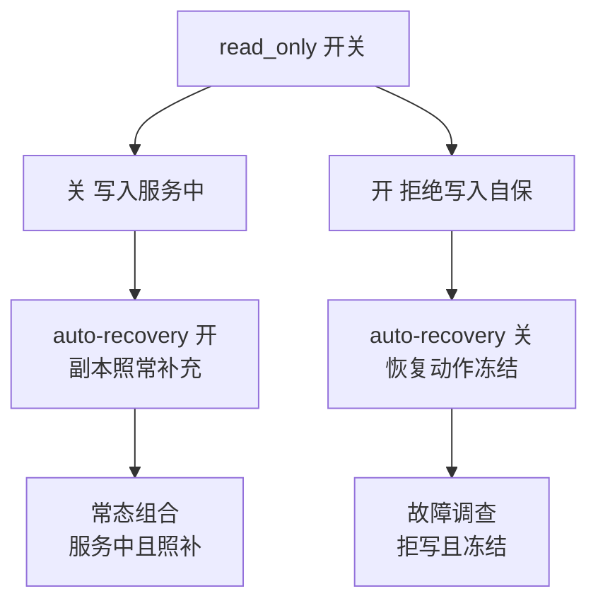
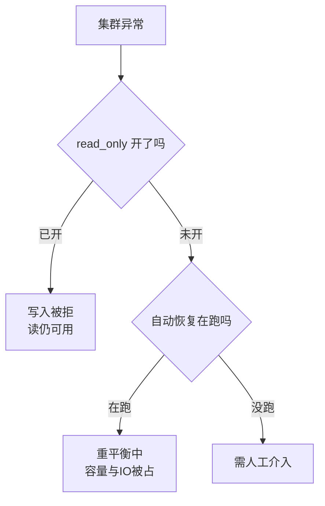
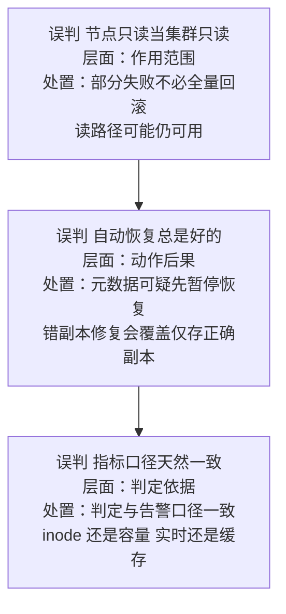

# 恢复与重平衡的可用性边界：read_only 与自动恢复的开关语义

**存储节点卡在只读、或者该自动恢复时不动手，多半是两个开关的组合没搞清**。**读完这一页你能说出四种组合各自的形态**，**把状态机（节点在不同状态间迁移的规则表：什么条件进入只读、什么条件退出）判定条件和人工接管路径写进文档与演练**。

> **要点**：存储节点的"只读降级"与"自动恢复"是两个独立开关，组合出**四种运维形态**；缺陷形态是**"磁盘有空间却卡在只读"与"该自动恢复时不动手"**——**开关语义、状态机判定条件、人工接管路径三件事在文档与演练里显式化，恢复从碰运气变成按图作业**。

## 存储节点为什么会出现"有空间却卡只读"和"该恢复却不动手"？
**本篇要解决的问题是：两个防自伤开关组合出异常状态时，怎么按图判定与恢复**。**存储节点有一组防自伤的降级（主动牺牲部分功能或精度，保住核心链路）机制**：**磁盘满转只读、副本（同一份数据存的多份拷贝，坏一份还有其余的顶上）损坏拒绝服务、检测到异常状态停止写入**。这些机制的意图是**用可用性换数据安全**，**但机制的判定条件与解除路径常出偏差**——**上游 BookKeeper 的一个复现缺陷是：磁盘有可用空间，节点却停留在 read_only 状态不再恢复服务（状态判定的解除条件与进入条件不对称）**；**另一个方向的问题是自动恢复（auto-recovery）该触发时未触发，副本缺失长期存在**。**运维要回答的问题是"这个节点现在为什么不服务、谁有权把它拉回来"**——**开关语义混乱时，这个问题的答案靠猜**。

## 两个开关怎么组合出四种形态、状态机的不对称又藏在哪里？

**两个独立开关**：read_only（本节点是否拒绝写入，磁盘满等自保条件触发）与 auto-recovery（集群是否自动补副本/重平衡）。**开关分离的收益是故障调查期可以冻结现场（保留节点当时的日志、内存状态与数据原样，不再有新写入与恢复动作来搅动它）而不中断副本保护**，**代价是两个开关的组合状态空间要靠文档与演练维持（组合错了就是一次事故）**：组合出的**四种形态各有适用场景**——**正常服务 + 自动恢复**（常态）、**只读 + 自动恢复**（磁盘满，节点退出写入但副本照补）、**正常服务 + 恢复暂停**（计划内维护，避免恢复流量干扰）、**只读 + 恢复暂停**（故障调查期，冻结现场）。

**两个开关各自独立取值，四种组合各对应一种运维现场**，下面是组合示意（展开常态与故障调查两条主干）：



四种形态的组合来源：两个开关各自独立翻转，**运维动作落在具体格子里，冻结现场与常态之间的往返就是开关组合的显式切换**。

**状态机的不对称是缺陷高发区**：**进入只读的判定（磁盘水位过线）与退出只读的判定（水位回落 + 显式解除 + 引用刷新——解除后把本节点的新状态广播给其他节点，让路由与缓存里的旧引用更新）常由不同代码路径实现**，**退出路径缺少"水位（队列或资源的当前占用程度）已回落"的复查、或缺少解除后的状态广播**——**上游复现的"磁盘有空间却卡只读"正是退出路径的判定缺失**：**退出条件没有"水位已回落"这一项，空间清出来后判定依然不满足，状态机不迁移，节点就停在只读不动**。**判定条件对称性检查（进入条件取反是否等于退出条件）应进存储系统设计评审**。

**自动恢复的触发链**：**副本缺失检测（元数据即集群记账本，记录每份数据该有哪些副本、现在谁活着，把里面的副本集合与实际存活节点比对）→ 恢复任务生成 → 限速执行**——**链上任何一环的静默失败（检测周期性抖动、任务生成后 worker 不可用、限速参数失效）都表现为"该恢复时不动手"**。**恢复链的每一环要有独立的可观测信号：缺失副本数、在途恢复任务数、恢复吞吐**——**三路信号齐全，"该恢复时不动手"才能归因到具体环节，而不是一句笼统的"恢复没生效"**。

## 读完这一段你能判断什么：运维处置的决策树



**两个开关的四种组合决定了此时能做什么**，逐格说明如下：

| 组合 | 现场含义 | 此时能做与不能做 |
| --- | --- | --- |
| 正常服务 + 自动恢复 | 常态 | 读写正常，缺失副本自动补齐，无需干预 |
| 只读 + 自动恢复 | 磁盘满自保 | 拒绝写入但读可用，副本照常补齐；只能等水位回落按路径退出只读 |
| 正常服务 + 恢复暂停 | 计划内维护 | 读写正常但缺失副本不补；维护窗口内要盯缺失计数，结束后恢复开关 |
| 只读 + 恢复暂停 | 故障调查期 | 拒写且冻结现场；只做只读调查动作，处置完先恢复开关再验证服务 |


节点不服务时按下面的顺序排查：

**一查降级原因**：**只读状态的原因字段（磁盘满？副本损坏？人工设置？）——原因不明时不解除降级**。**二查解除条件**：**触发原因是否已消除（空间已清理？损坏副本已修复？）**，**消除后按系统的解除路径操作（显式命令、重启、自动复查），解除后验证状态广播生效（其他节点不再把写入路由过来）**。**三查恢复链**：**如果本节点数据有副本缺失，核对恢复任务的状态（生成没有？执行没有？速率多少？），卡住的环节对症处理（重启 recovery worker、修限速参数、手动触发）**。

**人工接管的边界**：**自动恢复暂停期间的人工补副本，完成后要把开关恢复原位**——**"处置动作的收尾是恢复常态配置"**，**冻结现场忘了解冻、暂停恢复忘了重启，是恢复链失效的常见人为原因**。**开关的当前值与预期值要有巡检比对**（配置漂移检测：定期把配置的当前值与预期值比对，发现被意外改动的项——本库"灰度与功能开关的边界"篇讲的开关巡检是同一套纪律）。

## 这套说法在哪儿会失效

**三条边界，防止把这套开关语义用过头或用错方向**。

**read_only 不等于数据只读**：**节点层面拒绝写入时，客户端看到的是部分失败（写不进这台），读路径可能仍可用**——**把"节点只读"误当"集群只读"会触发不必要的全量回滚（把系统状态退回到改动之前的版本）**。

**自动恢复不是无条件的善**：**元数据损坏场景下自动恢复会按错误的副本视图"修复"——把仅存的正确副本覆盖掉**。**元数据可疑时先暂停恢复再调查**，这是冻结现场的价值所在。

**状态判定依赖的指标本身会骗人**：**磁盘水位按 inode（文件索引节点：文件在磁盘上的身份档案，记着权限、大小、时间戳与数据块位置）还是按容量、按实时还是按缓存值**——**判定条件用的指标口径要与告警口径一致，口径漂移会产生"告警说满、判定说没满"的分裂**。

把这三层误判与各自的处置差异画进同一张图：



三条里"自动恢复不是无条件的善"那条**最危险：另外两条的后果是处置动作选错，还有纠正余地；自动恢复这一条是直接销毁证据**——**按错误的副本视图"修复"会把仅存的正确副本覆盖掉，错误一旦发生就不可逆**。**这正是"元数据可疑时先暂停恢复再调查"要排在前面的原因**。

## 怎么自己动手验证

**两条恢复路径都要在演练里走过一遍**：

1. 对称性验证：**测试环境触发磁盘满只读 → 清理空间 → 预期节点自动或按既定路径恢复写入**；**解除失败即退出路径有判定缺失（上游复现缺陷的形态）**；
2. 恢复链验证：**删一个副本节点，预期缺失检测在周期内触发、恢复任务生成、按限速执行**；**逐环断开（停 worker、错配限速），预期对应环节的监控信号可见——"不动手"可归因到环节**；
3. 冻结演练：**人工暂停恢复 → 完成处置 → 恢复开关，巡检比对预期捕捉到任何遗漏的开关漂移**；
4. 断言锚点：**进入/退出条件对称性在评审记录里核对过、恢复链各环节有独立监控、开关值有常态巡检**。

```text
对称断言 = 水位回落可恢复写入
链条断言 = 恢复链上缺失检测、任务生成、执行三个环节的信号都可见
巡检断言 = 开关漂移被比对捕捉
```

**降级开关与自动恢复的语义清晰化，把"节点为什么不服务"从考古题（没有判定记录，只能翻日志、凭残迹一点一点拼出当时发生了什么）变成决策树**——**每个分支有判定条件、有解除路径、有验证动作，恢复作业按图执行**。

## 接着读哪几篇：副本缺失与恢复的动作背景

- [[工程知识/数据系统：在并发与故障中保存事实/可靠性与运维/复制的三种模式：主从、多主与无主的失败形态]] —— 副本缺失与恢复的动作背景
- [[工程知识/性能工程：从用户等待到资源瓶颈/存储与网络/磁盘空间管理三原则：配额水位与临时目录纪律]] —— 只读降级最常见的触发源（磁盘满）的防线
- [[工程知识/软件构建：让变化可以理解、验证与交付/测试与交付/灰度与功能开关的边界：交付节奏与配置漂移]] —— 开关漂移巡检的同构纪律
- [[工程知识/后端系统：在并发、失败与变化中维持服务/服务设计/健康检查的三层语义：存活就绪与深度]] —— 节点状态对外语义的分层
