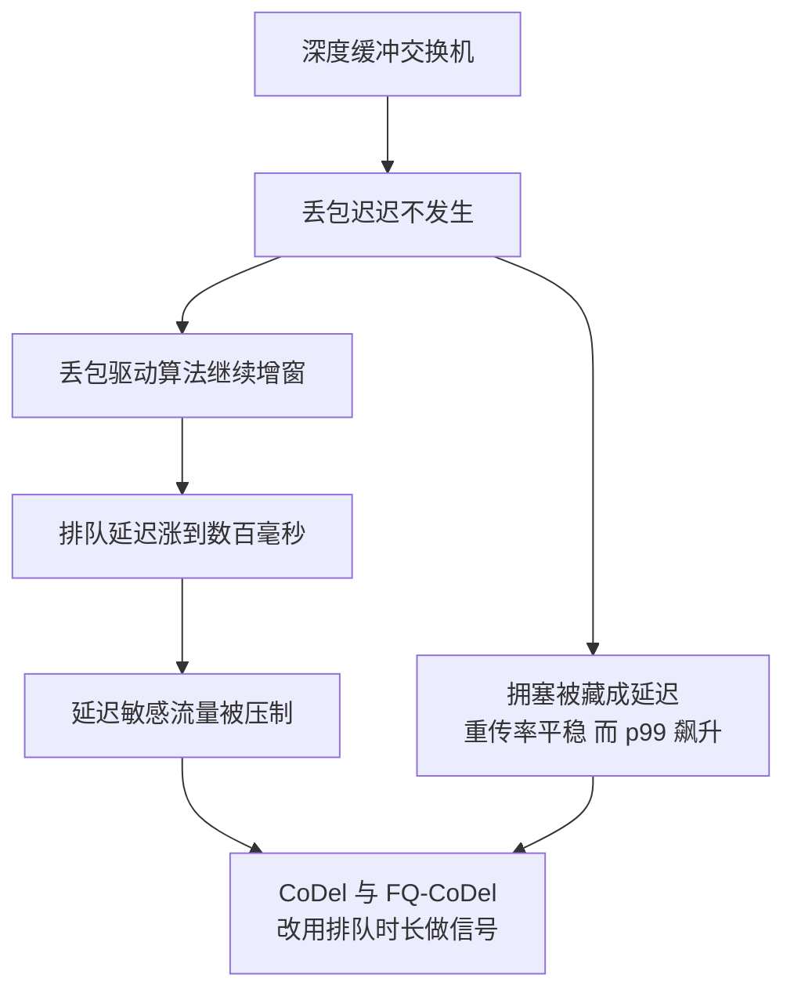

# 拥塞控制在吞吐与公平之间动态调节

这篇要解决的问题是：同一条链路上，一个批量传输把带宽占满、其他人的交互请求延迟飙升，怎么让多条流分好带宽？发送方不知道网络能吃多少、别人在用多少，只能靠丢包（数据包在网络传输途中丢失）或延迟信号探测；读完你能看懂探测策略（经典 AIMD：加性增乘性减，每轮加一点，丢包就减半）、CUBIC（Linux 默认的拥塞控制算法，用三次函数调节窗口）、BBR（Google 的拥塞控制算法，按带宽与延迟主动调节发送速率）各自的窗口调节逻辑，并按"吞吐-延迟-公平"的取舍为你的链路选型。

## 拥塞控制怎么从信号算出该发多少？

拥塞控制由四块拼起来：重传机制有四种：超时重传、快速重传、SACK（Selective Acknowledgment，选择性确认：告诉发送方哪些区间已收到）与 D-SACK，其中 SACK 是选择性确认，让发送方只重传缺口，D-SACK 是重复选择性确认，用于告知收到了重复的块、滑动窗口（发送窗口与接收窗口）、流量控制（窗口关闭、糊涂窗口综合症——发送方反复推送小数据块，把小段数据塞满网络却得不到及时确认的效率问题）、拥塞控制（慢启动、拥塞避免、拥塞发生、快速恢复）。


*图源：小林 coding（博客园）《30 张图解：TCP 重传、滑动窗口、流量控制、拥塞控制》，CC 4.0 BY-SA，https://www.cnblogs.com/xiaolincoding/p/12732052.html。*


```text
信号        经典响应                现代响应
丢包        AIMD: 窗口减半再线性爬升  BBR: 不看丢包，看带宽×RTT（Round-Trip Time，一个数据包从发出到收到应答的往返时间）积
RTT 上升    （忽略）               BBR/DCTCP: 早于丢包的拥塞信号
ECN（Explicit Congestion Notification，显式拥塞通知：路由器标记拥塞而非丢包）标记    （可选）               DCTCP/BBRv2: 显式反馈细粒度响应
```

AIMD 的 RFC 5681（互联网标准的编号体系文档）：每 RTT（Round-Trip Time，一个包从发出到收到应答的往返时间）窗口 +1（加性增），丢包则窗口减半（乘性减）。**锯齿形窗口能收敛到公平份额，代价是永远在过冲与保守之间震荡**。CUBIC用三次函数让高 BDP（Bandwidth-Delay Product，带宽与往返时延的乘积，链路上能容纳的数据量）链路更快回满。**BBR 反向思路：主动测量瓶颈带宽与最小 RTT，窗口 = 带宽×RTT**——把链路想成一条传送带：带宽是每秒传送的件数，RTT 是从这一端到那一端再回话的时间，两者相乘正好是"传送带上同时摆着的件数"，照这个数放货，传送带既不空转也不堆到溢出（不填满缓冲区），尾延迟（P99 一类的慢请求耗时指标）与吞吐兼得。

锯齿形的窗口轨迹放到一张图里看，慢启动的指数爬升、拥塞避免的线性爬升与丢包后的减半各自长什么样：


*cwnd 的慢启动、拥塞避免与乘性减轨迹（图源：Wikimedia Commons，Fleshgrinder 绘，GPLv3 许可）*

**图上两段爬升斜率的差异就是加性增与慢启动的分工，每次回落的垂直落差就是乘性减——「锯齿形窗口在过冲与保守之间震荡」在图上是一条可以直接量斜率的曲线**；BBR 要替代的正是这套以丢包为触发信号的轨迹形状，把探测从「等回落」换成「估计带宽与 RTT 的乘积」。

## 缓冲区填满之后要付什么代价

**发送窗口取的是两者的较小值：接收窗口 RWND（接收窗口：接收方声明自己还能收多少数据）与拥塞窗口 CWND（拥塞窗口：发送方根据网络状况自限速的窗口）**。接收方说还能收多少，网络说还能过多少，哪个小听哪个。TCP 四块机制的图见上一节。


**丢包驱动算法的隐藏前提是"缓冲区溢出才算拥塞"，于是深度缓冲（bufferbloat）链路上窗口持续增长，排队延迟吃掉几百毫秒交互体验**。**BBR 类延迟驱动算法不依赖填满缓冲，但多流 BBR 之间没有 AIMD 那样的公平收敛保证**——AIMD 的减半动作是"谁抢多了谁先退"，各流互相拉扯后趋向均分；BBR 各流各自估带宽、不响应彼此的退让信号，先启动的流把带宽估高后持续占优，后来者估到的份额小，没有拉回均分的机制——BBRv2（BBR 的第二代，在纯延迟探测之外补上对拥塞信号的反应）引入 ECN（Explicit Congestion Notification，显式拥塞通知：路由器标记拥塞而非丢包）与丢包响应就是补这个洞。**选算法选的是这条链路上"吞吐-延迟-公平"三角里你要的位置**——三角是取舍空间的比喻：三者相互牵制、无法同时最优，抬高一个通常要压低另一个；单项速度冠军（只把吞吐做高）在这三角里没有意义，因为另外两项是别人的体验。

## 真实案例给的是什么数：动态调节的实录


**这个隐藏前提在深缓冲链路上会被反噬——从「丢包不发生」到「延迟敏感流量被压制」是一条完整的因果链**：



**这条链的判据就是重传率平稳而 p99（99 分位延迟，最慢那 1% 请求的响应时间）飙升；窗口本身的动态账，则要从丢一个包说起**。

**拥塞窗口的动态账——丢一个包，经典 Reno 砍半窗口（吞吐瞬间掉一半），BBR 改为按带宽与 RTT 乘积估计主动调节（不依赖丢包信号）；长肥管道（高带宽 × 高 RTT）上 Reno 的窗口恢复要几十个 RTT——跨洋与卫星链路的单个 RTT 就有几百毫秒，几十个 RTT 累加起来，一次丢包的吞吐损失以十秒计；跨洋传输与卫星链路正是长肥管道的典型场景，这就是它们换 BBR 的直接理由**。bufferbloat 的账：**深缓冲交换机（在局域网内按地址转发数据帧的设备）把拥塞藏成排队延迟（丢包不发生、延迟暴涨），延迟敏感流量全被压制——调节的公平维度不只在连接之间，还在吞吐型与延迟型流量之间（CoDel/FQ-CoDel 用排队时长而非丢包做信号，FQ 即 Fair Queue 公平队列调度）**。

**案例回流的实录**：[[工程知识/性能工程：从用户等待到资源瓶颈/存储与网络/端到端网络延迟来自排队、协议、传输与处理.md]] 的排队段是拥塞在延迟侧的形态（队列涨、丢包不涨），[[工程知识/缺陷分析：从个案到体系/稳定性/案例二十三：一次抖动变成一次重算——SASL 拉取没有重试]] 是拥塞抖动（性能指标不稳定的起伏）传导到应用层的下游后果——**网络层一次窗口收缩，应用层一次全量重算，跨层的放大链就是要在网络层把抖动压平的理由**。

## 怎么自己动手验证

超时重传的难点在 RTO（Retransmission TimeOut，重传超时：发出包后等待确认的最长时间，超过就重传）定多久。**定长了，丢包之后网络要空等一大段，效率掉下去；定短了，包其实没丢也会重传，反而给网络加负担**。


*图源：同上（小林 coding），（博客园）《30 张图解：TCP 重传、滑动窗口、流量控制、拥塞控制》。*

**公平性结论要与双流竞争实验对账——预写两条流同起应各自收敛到半带宽，实测其中一条长期独占，与预期对不上**。

- **单流 iperf3（网络带宽测试工具）-C bbr 对比 cubic：固定 RTT 与丢包率下测吞吐曲线与重传数，预期 bbr 的尾延迟更低、cubic 在深缓冲下吞吐略高但尾延迟更大**。
- **双流竞争实验：两条流同起，测各自吞吐占比（公平性）与合计吞吐（效率）；AIMD 类应收敛到各半，BBR v1 在深缓冲下可能挤占 cubic 流**。
- **tc qdisc netem 注入 1% 丢包或 20ms 额外延迟（tc 是 Linux 流量控制工具，qdisc 是其排队规则，netem 用来模拟丢包、延迟等网络状况），观察窗口收缩行为与恢复时间，预期 AIMD 类减半后线性爬升恢复、BBR 不依赖丢包信号恢复更快**。
- **生产验证看重传率、retransmit 与 p99 延迟的相关性：重传率平稳但 p99 飙升，优先怀疑 bufferbloat 而非带宽不足**。

## 这套说法在哪儿会失效？

**丢包有两种：数据包丢了，和确认应答丢了。发送方看不见区别，都是等不到 ACK（确认包：告诉对方自己已经收到数据）就重传；接收方凭序列号认出重复包，丢掉再补一个确认**。


*图源：同上（小林 coding），（博客园）《30 张图解：TCP 重传、滑动窗口、流量控制、拥塞控制》。*


- **拥塞控制是端到端传输层行为，代理与服务网格的 L7 限流（限制单位时间内放行的请求数量）是另一层控制（[[工程知识/后端系统：在并发、失败与变化中维持服务/任务与并发/限流熔断与隔离控制故障半径]]），两者叠加可能双重惩罚**。
- **数据中心内 vs 跨互联网：DC 场景 RTT 微小，DCTCP/BBR 的信号粒度设计完全不同，跨公网结论不能直接搬**。
- **QUIC（基于 UDP 的新传输协议，把连接建立与加密握手合并，减少往返次数） 把拥塞控制从内核搬到用户态（普通程序运行的低权限受限状态）可插拔（RFC 9002 默认沿用类 TCP 算法），服务端可按链路类型逐连接调参**，机制差异见 [[工程知识/性能工程：从用户等待到资源瓶颈/存储与网络/Socket与TCP把连接可靠性分成多层]]。

## 接着读哪几篇：同在性能工程里的相邻问题

- [[工程知识/性能工程：从用户等待到资源瓶颈/存储与网络/端到端网络延迟来自排队、协议、传输与处理]]：端到端时间线里拥塞是排队段的主导者
- [[工程知识/性能工程：从用户等待到资源瓶颈/观测与诊断/排队论给容量一个可推导的模型]]：排队论是拥塞行为的数学骨架，本文是它在传输层的实例
- [[工程知识/后端系统：在并发、失败与变化中维持服务/服务设计/服务发现与负载均衡决定请求发往哪里]]：连接层分流减少单流竞争