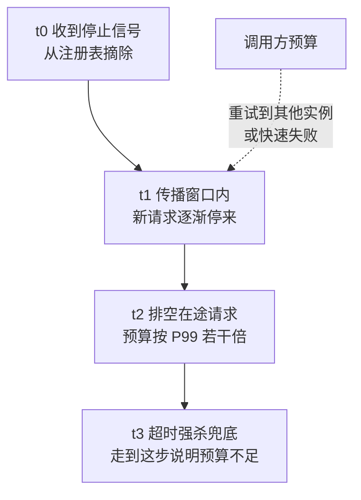

# 滚动重启的摘流量顺序：先停新请求，再让旧请求做完

**重启丢请求，问题常常出在摘流量的顺序上**。**读完这一页你能按先摘注册、再等在途、最后超时退出三步操作**，**并把每步的超时和调用方的重试预算对上**。

> **要点**：实例从服务摘除的正确顺序是三步——**从注册表摘除（新流量不再来）、等在途请求完成（旧流量做完）、超时后退出（残留强杀有兜底）**；**跳过第二步是重启丢请求的主因**，**每步的超时要与调用方的重试和超时预算联动**。

## 滚动重启的零星错误为什么几乎都出在摘流量顺序上？

**滚动重启是最高频的运维动作，也是最常见的"零星错误来源"**：**每次发版出现几笔超时或连接重置**——**原因几乎都在摘流量顺序**：**进程收到停止信号后立刻退出，负载均衡（把请求分摊到多台服务器、避免单点过载）的注册表还没刷新（新请求继续打过来）、连接池（服务预先建好、反复复用的一组对外连接，省去每次握手）里还有在途请求（旧请求被腰斩）**。本库任务与并发域"后台任务的守护链"讲过进程托管；服务设计域"优雅停机（收到停止信号后先停止接新请求、把手头请求做完再退出）的完成语义"讲过排空接口；本篇把**三步顺序的时序、每步超时与调用方预算的联动、长连接（建立后保持不断开、多次通信复用同一条连接）与短连接的差异**展开成可直接执行的流程。

## 三步各解决什么、每步等多久：机制与时间预算

**先把形状说成一件事**：优雅下线像餐厅打烊——第一动作是把门口"营业中"的牌子翻成"打烊"（从注册表摘除，新客人不再进来），但翻牌子不等于店里立刻没人：还在路上的客人会继续推门（注册缓存传播窗口），所以牌子翻完要等一会儿再收台；然后让已落座的客人吃完（在途请求做完，按最慢一桌的时间留余量）；最后到点熄灯锁门（超时强杀兜底）。**丢请求的根因就是跳过第二步直接锁门**。这个比喻到"到点熄灯"为止——**现实里三步各有独立的时间预算且要与调用方的重试预算咬合**，餐厅可以概不赊账，**分布式系统的在途请求走不完就是真金白银的失败**，下面逐步展开。

**第一步：从注册表摘除（停止接新）**。**停机信号到达后第一动作是向服务注册表（或负载均衡配置）摘除本实例**——**摘除生效的传播时间 = 注册表刷新间隔 + 各调用方缓存刷新间隔**，**这个传播窗口内新请求还会来（上一轮的注册信息还在缓存里）**。**第一步的超时要覆盖这个传播窗口**，**否则第二步刚开始就被新请求打断**。

**第二步：等在途请求完成（旧流量做完）**。**新请求停了，已接入的请求继续处理到完成**——**第二步的超时按本服务请求 P99（把所有请求响应时间从小到大排，第 99 百分位的值，99% 的请求比它快）的若干倍定**（覆盖慢请求），**超时到了还没完成的请求按业务语义决定——判据看操作是否有副作用、能否安全重做**：**读操作或幂等（同一操作执行多次与执行一次效果相同）操作（同一操作执行多次结果不变）失败了让调用方重试**；**有副作用（操作对外部状态产生的额外影响）且不可重入的操作尽力完成**。**这一步的实现形态按服务类型**：**HTTP 服务停止 accept 并等待 handler 返回，RPC（远程过程调用，让调用远端服务的代码写起来像调用本地函数）服务关闭监听并等待在途调用，消息消费停止拉取并等待当前消息 ack**。

**第三步：超时强杀兜底**。**第二步超时后进程退出，残留的连接与任务由内核回收**——**第三步由进程管理器执行**——**systemd（Linux 的服务管理器，开机自启与守护进程）的 TimeoutStopSec 是等待服务自行退出的最长时间、到点发强杀**，**Kubernetes 的 terminationGracePeriodSeconds 是宽限期秒数**，**强杀是兜底不是路径：每次走到强杀都说明第二步预算不足，要回头调预算**。

进程管理器按什么节奏走完三步，Kubernetes（容器编排平台，负责容器的部署、调度与自愈）官方文档给了可以直接对号的实物：**Pod 里各容器共享同一份 Volume（挂载给容器的存储卷，Pod 内多个容器都能读写），容器的存在时间短于 Pod 本身**——**终止流程同样按「preStop 钩子 → TERM（终端类型环境变量）信号 → 宽限期 → 强杀」的顺序展开，宽限期就是第二、三步之间的预算**：


*图源：[Kubernetes 中文文档「Pod 生命周期」](https://kubernetes.io/zh-cn/docs/concepts/workloads/pods/pod-lifecycle/)官方配图。terminationGracePeriodSeconds（Pod 从收到停止信号到被强杀之间的宽限期秒数）默认 30 秒——它就是第二步排空预算在 K8s（Kubernetes 的常用简称、容器编排系统） 里的名字；宽限期走到头仍在运行，进程管理器才发强杀。*

**与调用方预算的联动**：**摘流量窗口的每一秒都要位于调用方的超时与重试预算内**——**本实例摘除后，调用方对它的失败请求要能重试到其他实例（重试预算够）或快速失败（超时够短）**。**服务端停机预算比调用方超时长、调用方重试预算覆盖失败窗口**，**三个数字互相咬合，任意一个错位都会从预算传导成实际错误**：**停机预算比调用方超时短，请求还在排空就被调用方判超时报错**；**调用方重试预算不够覆盖摘除传播窗口，失败请求来不及重试到其他实例就直接失败**。

**三步顺序在时间轴上依次展开，每步的预算覆盖前一步的尾巴**：



三步预算的咬合关系：**t0 到 t1 的传播窗口由注册表与客户端缓存刷新决定**，**t2 的排空预算覆盖 P99 慢请求**，**t3 的强杀是预算不足的信号而非常规路径**。

「先停载客，再让船上的人下完」的实物原型是渡口的舢板接驳：靠岸三步——船家先收桨不再接新客（摘除注册表）、船上已载的乘客逐个安全下船（在途请求做完）、全部下完才熄火离位（超时强杀兜底）；跳过第二步直接熄火，乘客就泡在水里：


*图源：Wikimedia Commons，鄧南光摄（1940s），公有领域，https://commons.wikimedia.org/wiki/File:Sampans_at_the_shore_of_Danshui_River_1940s.jpg。*

**三步顺序在渡船上是常识，在进程退出上常被跳过**——**把收桨（第一步）、下客（第二步）、熄火（第三步）写进部署脚本，滚动重启的零星错误就从流程里消失**。


**单实例的三步顺序放到整批实例上，就是滚动更新**：Kubernetes 的 Deployment（Kubernetes 里管理无状态应用副本与滚动更新的控制器） 控制器把它做成了声明式机制——「provides declarative updates for Pods and ReplicaSets」，**新 ReplicaSet（K8s 里管"要维持几个相同副本"的控制器）逐个起 Pod（K8s 的最小部署单元，一个容器组）、旧 ReplicaSet 逐个收**，**官方文档右侧目录里的 Rolling Back、Pausing and Resuming a rollout 就是整批层面对三步顺序的管理入口**：


*图源：[Kubernetes 官方文档 — Deployments](https://kubernetes.io/docs/concepts/workloads/controllers/deployment/)（页面截图，2026-09-27）。**单 Pod 终止走前文的三步顺序（官方 Pod 生命周期图已配），整批滚动由 Deployment 控制器按 maxUnavailable/maxSurge 编排**——**两层各管各的时序，宽限期预算在两层里分别生效**。*

## 长连接与短连接的摘法差在哪：看完能判断

**短连接服务（每请求新建连接）**：**摘除注册表后新请求自然减少，剩余在途请求有限——三步顺序基本够用**，**重点在第一步传播窗口的估算（按注册表与客户端缓存的刷新间隔实测）**。

**长连接服务（连接常驻）**：**注册表摘除不影响已建立的连接**——**客户端不主动断开，连接会一直用**。**补充动作是服务端主动关连接（GOAWAY：HTTP/2 的专门帧，通知客户端"我准备关闭，请改用别的连接"）或同类关闭通知，让客户端迁移到新实例或等待客户端按心跳（节点定期互发的存活信号，超时收不到就判定故障）判定**。**长连接的排空时间 = 客户端重连周期 × 连接数规模**，**预算按这个量级定，比短连接长得多**。算个例：**客户端重连周期 30-60 秒、连接数上万时，全量排空要按分钟级预留，30 秒的默认宽限期远远不够**。

**有状态任务（后台任务、批处理）**：**在途的是任务**——**任务要有检查点（定期保存进度、故障后从最近一次保存处恢复）**（可中断、可恢复），**第二步等任务到检查点后交接状态，不能等任务做完（长任务等到天荒地老）**。**上游 BookKeeper 的一个同类场景是 bookie 退役时的数据迁移与流量摘除配合（先摘写入流量、等副本修复完成、再下线），同一时序原理**：**先停写入、再等存量、最后退出**。

Blue-Green 发布（新旧两套环境并存，流量整体从旧切到新的发布方式）把**「摘流量」的瞬间**画得很清楚：路由先移到新版本，旧版本进程还在运行，只是不再接新请求——**这正是三步顺序里第二步「等在途请求做完」期间的状态**。


*图源：Cloud Foundry 官方文档《Using Blue-Green Deployment》unmap 路由步骤图，https://docs.cloudfoundry.org/devguide/deploy-apps/blue-green.html （Apache-2.0 许可）。图上消失的那条箭头就是「摘流量」：域名（注册表）里先少了 Blue 这条记录，新请求到不了它；Blue 进程本身没有被杀，等在途请求做完、确认无流量后才退役——「先停新请求，再让旧请求做完」两个动作在这张图里是分开画的两步。*

## 这套顺序管不到什么：边界

**三条边界，防止把这套摘流量顺序用过头或用错方向**。

**健康检查要反映摘除状态**：**注册表摘除后健康检查的语义要一致（摘除即不健康），否则负载均衡按健康检查把流量又分回来**——**健康检查与注册表状态同源**，**两处各说各话是摘流量失效的常见根因**。

**发布批次与容量挂钩**：**滚动重启每批摘除 N 个实例，剩余实例承接全部流量**——**批次大小按剩余容量够不够过高峰定**（本库容量域"留白"原则），**高峰期滚动要缩批次**。

**启动失败不能进流量**：**新实例启动后先过就绪检查再注册（不是注册后再检查）**——**就绪检查挂在注册之前**，**失败实例不进流量，滚动不因坏实例扩散错误**。

## 摘流量做对了怎么验证：验证

可复现的验证路径：

1. 零丢失验证：**压测持续打流量时触发滚动重启，预期全程零请求失败（超时或错误计数为零）**——**这是摘流量顺序的终验标准**；
2. 传播窗口实测：**摘除注册表后按秒探测新请求停止时间，预期与"注册表刷新 + 客户端缓存"的估算一致**，**第一步超时据此校准**；
3. 长连接迁移验证：**长连接场景下发 GOAWAY，预期客户端在重连周期内完成迁移、无请求发送到已关闭连接上**；
4. 断言锚点：**三步顺序在部署脚本或框架配置里固化、三个时间预算的数字有文档且联动、零丢失演练进过发布流程**——三件齐备，滚动重启从"零星错误的常态来源"变成"无感操作"。

```text
顺序断言 = 摘新、等旧、兜底三步固定
预算断言 = 停机预算与调用方预算咬合
终验断言 = 滚动全程零请求失败
```

**滚动重启的每一次"零星错误"都在说同一件事：摘流量顺序或时间预算有一处错位**。**三步顺序固化、三个预算联动、零丢失演练常态化，发版的错误率就从"每次几笔"归到零**：**顺序固化让"腰斩在途请求"这类人为失误失去入口，预算联动让每个超时都有足够的重试兜底，演练常态化让预算数字跟着流量形态更新而不是停留在上一次发版的假设里**。

## 接着读哪几篇：排空接口与任务交接的机制面

- [[工程知识/后端系统：在并发、失败与变化中维持服务/服务设计/优雅停机的完成语义：排空连接与任务交接]] —— 排空接口与任务交接的机制面
- [[工程知识/后端系统：在并发、失败与变化中维持服务/任务与并发/后台任务的守护链：进程托管与会话脱离是可靠性的底线配置]] —— 进程托管与强杀兜底的执行者
- [[工程知识/后端系统：在并发、失败与变化中维持服务/基础设施/长连接网关的工程要点：心跳推送与连接迁移]] —— 长连接迁移的专门场景
- [[工程知识/后端系统：在并发、失败与变化中维持服务/服务设计/服务发现与负载均衡决定请求发往哪里]] —— 注册表与缓存刷新的机制层