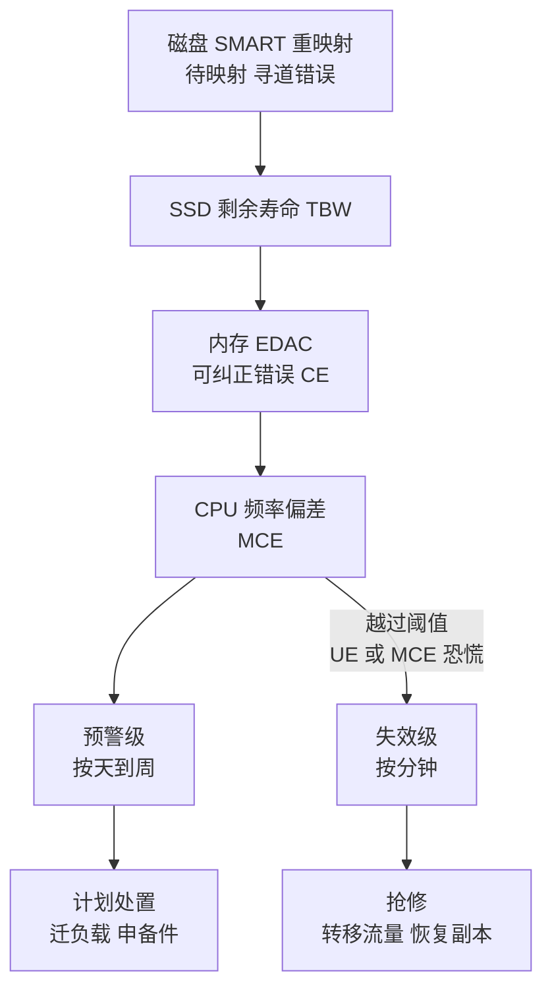
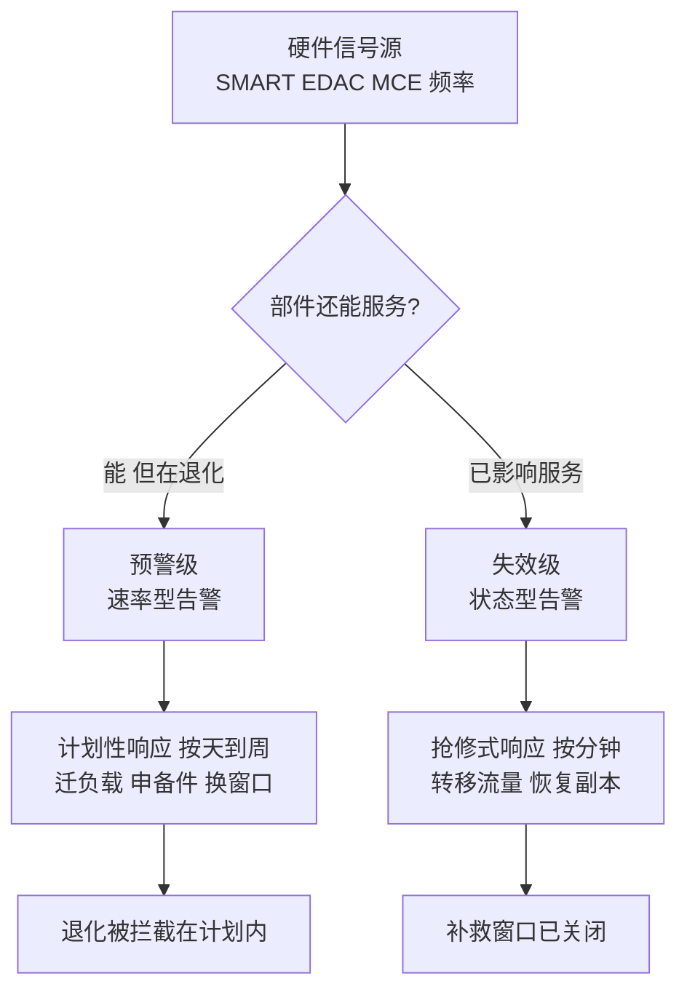

# 硬件故障的监控信号分层：预警级与失效级分开响应

**硬件在彻底坏掉之前会先给信号**。**把预警当噪音忽略，退化就会继续发展，等真正坏掉的告警响起，剩下的只有停下服务抢修**。**读完这一页你能把预警级和失效级的响应动作分开，提前安排预防性处置**。

> **要点**：硬件在"彻底坏"之前先发出预警信号——SMART（硬盘自检数据：盘自己上报健康指标）硬盘自检体系暴露健康指标漂移，ECC（Error-Correcting Code，能自动发现并纠正单比特错误的内存校验机制）内存纠错计数上升，CPU **频率受限降级**。**预警级与失效级的响应动作完全不同**——把预警当噪音忽略，等到失效级告警时剩下的只有抢修；**分层监控把"预防性处置"与"紧急抢修"分开**。

## 为什么"快要坏了"的信号总是没人理会？

**硬件监控有一类结构性的响应错位**：**系统只监控"已经坏了"（服务挂了、盘 IO 报错、网卡掉线），不监控"快要坏了"**——**SMART 的重映射扇区计数在数周内爬升、ECC 纠错次数从每旬一次涨到每小时一次、CPU 频率从睿频退到基准**，**这些预警信号全部可见却无人响应，直到部件彻底失效触发"故障转移（把服务切换到备用节点继续跑）+ 数据恢复"级的事故响应**。本库性能工程域"基准结果的可复现性"讲过环境状态对测量的影响（降频是测量噪声），本库正确性域"静默数据损坏靠校验与副本投票检出"讲过损坏的检出；本篇补**监控响应的组织层**：**预警级信号与失效级信号分层，各自的响应动作、时间预算、责任路径完全不同**——**混在一个告警池里，预警被淹没是必然结局**。

## 预警级与失效级的信号源、响应动作差在哪里？

预警级信号（部件在退化，还能工作）各部件的典型源：

**磁盘**：SMART 的重映射扇区数（Reallocated_Sectors，已被换到盘内备用区的坏扇区计数）、待映射数（Current_Pending_Sector，等待换到备用区的可疑扇区计数）、寻道错误率——**重映射计数上升意味着介质在退化，盘还能用但剩余寿命在缩短**；**SSD（固态硬盘）还有磨损度指标（剩余寿命百分比、TBW（Total Bytes Written，固态盘寿命周期累计写入量上限）的消耗进度）**，**写放大（实际写入闪存的量远大于上层请求写入量的现象，碎片整理与擦除前的搬运都会放大它）重的负载下磨损加速**（HDD 即机械硬盘，靠盘片旋转与磁头寻道读写——SSD 即固态硬盘，靠闪存芯片存取）。

**内存**：EDAC（Error Detection And Correction，Linux 的内存纠错上报框架）的可纠正错误CE（Correctable Error，已纠正的错误：硬件上报但已自动修复）计数——**单比特翻转被 ECC 纠正后系统无感，但 CE 计数的上升速率是内存条退化的先行指标**；**速率骤增常常先于不可纠正错误UE（Uncorrectable Error，无法纠正的错误：连纠错码也修不回来的错误）数周出现**。

**CPU 与电源**：**cpufreq（Linux 的 CPU 频率调节子系统）的实际频率与 governor（调频策略模块，决定请求 CPU 跑多快）请求值的偏差（热节流或供电不足）**、机器检查日志MCE（Machine Check Exception，CPU 检测到硬件错误时抛出的异常）——**频率持续受限说明散热或供电在退化**。

**失效级信号（部件已影响服务）**：IO 错误、链路 down、UE 内存错误触发进程被杀、MCE 恐慌——**这些信号代表"补救窗口已关闭"，响应是抢修：故障转移、数据恢复、备件更换**。

**两级响应的时间预算完全不同**：**预警级按天到周响应（计划性：把该部件上的负载迁走、备件申领、窗口内更换），失效级按分钟响应（抢修式：转移流量、恢复副本）**。**预警响应的成本是计划内的零头，失效响应的成本是事故级的全额**——分层监控的经济逻辑就在这个成本差上。

**不同部件发出的信号要分别归到两级，归错级就会用错时间预算**：



同一部件的信号按恶化程度分层，两层的响应动作与时间预算不同：



**分层的依据：判据是部件还能不能服务，两层的时间预算差着数量级**。**预警被淹没的结局是全部成本走到失效级那一列**：**预警没人处理，退化继续进行，部件终会跨过阈值进入失效**，**此时响应从事先安排好的换件窗口变成抢修，成本从计划内的零头涨到事故级的全额**。

**预警与失效两级信号的分级传递，在数据中心的告警系统里有直接对应**：**SMART 重映射计数缓慢上涨走预警通道（工单、次日处理、纳入换盘计划），预测性失效或阵列掉线走失效通道（电话、立即响应、启动备件替换）**——**级别决定通道与响应时间预算**：


*图源：Wikimedia Commons，Hijerovit，CC BY-SA 4.0，https://commons.wikimedia.org/wiki/File:Data_center_hall_1.jpg。*

这套分级两千年前就有成熟原型：长城烽燧按敌情规定燃烟数目，白天举烟夜间举火，下一座按信号组合决定再传什么——**把狼烟当炊烟忽略的烽台，等大军压境时只剩贴身肉搏，正如把 SMART 计数当噪音忽略的运维，等失效级告警时只剩抢修**。**比喻到此为止：监控里的预警判据是可量化的速率与绝对值条件，不依赖瞭望经验**。

**信号采集层之后，两级的告警在面板世界里有直接的对照形态**。下图是 Grafana（监控面板工具）官方文档的服务层级监控示例：**顶层是 Demo App 的整体 QPS（每秒查询数，系统每秒处理的请求量）与延迟，往下按 load balancer、App service、DB service 三层展开**——上层看「服务还好吗」，下层看**「哪一层在退化」**，这正是**预警级（趋势异常但服务可用）与失效级（服务已受损）**在监控组织上的分野：


*图源：Grafana 官方文档《Best practices: Use a hierarchical navigation structure》，https://grafana.com/docs/grafana/latest/dashboards/build-dashboards/best-practices/#organize-dashboards-with-hierarchical-navigation。层级导航把「总—分」的服务健康视图与分层响应的组织方式对应起来。*

失效级信号长什么样，把盘开盖看一眼最直观。下图是机械硬盘磁头损坏（head crash，磁头与旋转的盘片表面接触）后的盘面：同心圆轨道上被剐出一圈圈肉眼可见的划伤，划伤处的数据扇区彻底不可读：


*图：硬盘磁头损坏后的盘片实物（图源：[Wikimedia Commons《Hard disk head crash.jpg》](https://commons.wikimedia.org/wiki/File:Hard_disk_head_crash.jpg)，作者 Alchemist-hp，CC BY-SA 3.0）。**磁头悬停在盘面上方纳米级的高度飞行，物理接触即意味着磁头与盘片同归于尽**（这是对"两者同时报废"的形象说法，不存在谁毁谁的意图——磁头剐坏盘面、盘面碎屑又反伤磁头）——**这类失效没有预警缓冲，SMART 的重映射计数爬升（预警级）就是要在这种失效发生之前把盘换掉的理由**。*


## 监控与响应该怎么组织才能各就各位？

**信号采集层**：**SMART 定期轮询（smartd 的周期自检）、EDAC 计数入监控、MCE 日志采集、频率偏差采样（只采集一部分数据以控制记录开销）**——**采集本身便宜，缺的是把这些计数变成带趋势的告警**。**预警级告警的判据用"速率"而不是"绝对值"**：**重映射数从 0 涨到 8 不重要，一周内从 8 涨到 200 才重要**——**退化速率比退化存量更能预测剩余寿命**。

**响应路径**：**预警级告警进计划性工单（负载迁移 + 更换窗口），失效级告警进值班即时响应**——**两条路径的 SLA（服务等级协议，对外承诺的可用性与响应目标）、责任人在响应预案里分开写**。**混用的后果是双向错位：预警被当抢修处理（浪费值守精力）或失效被当预警处理（延误抢救）**。

**副本与冗余的联动**：预警级信号在冗余系统里还有一个动作——**提前把退化部件上的副本迁走**（**对象存储把重映射上升的盘摘出放置策略——RAID 把介质错误超限的盘踢出阵列后用热备盘自动重建**），**冗余的存在让"计划性更换"可以零影响执行，这是冗余成本的第二重回报（第一重是故障时的可用性）**。

## 这套说法在哪儿会失效

**三条边界，防止把这套分层监控用过头或用错方向**。

**预警信号有误报率**：**SMART 指标的厂商实现差异大，个别型号的重映射计数天然不归零**——**判据按型号校准基线（正常状态下的指标水平、用来对比异常）**，**"速率 + 绝对值"双条件降误报**；**误报的代价是一次计划性检查，漏报的代价是数据恢复，两边代价不对称，校准要偏向敏感**——**宁可多几次误报换来检查，也不漏掉真预警**。

**预警不替代失效级监控**：**部件可能跳过预警直接失效（电源突断、固件 bug 触发）——两级监控都要在，预警级降低概率，失效级兜底**。

**云环境的信号可见性分层**：**云主机的硬件信号被虚拟化层屏蔽，租户侧看到的是"宿主机迁移通知"与性能异常**——**云环境的预警响应动作变成"响应迁移通知 + 校验性能画像"**，**信号源从 SMART 变成云平台的事件流，分层的响应逻辑不变**。

## 怎么自己动手验证这套分层是否到位？

可复现的验证路径：

1. 信号采集验证：**核对每类部件的采集项在监控面板可见（SMART 计数、EDAC 计数、频率偏差），采集周期与文档一致**；
2. 趋势告警验证：**构造计数上升序列（测试数据注入），预期"速率"判据触发预警级告警、平稳基线不触发**；
3. 响应路径验证：**预警级告警生成的工单走计划性流程（含迁移与更换窗口），失效级走值班即时流程**——**两条路径的时效可度量**；
4. 断言锚点：**四类信号源采集齐备、预警判据含速率条件、两条响应路径分离且有 SLA**。

```text
采集断言 = SMART/EDAC/MCE/频率 四源可见
判据断言 = 速率条件触发，平稳不误报
路径断言 = 预警走工单，失效走值班，时效可度量
```

**硬件故障的监控分层把"坏之前先动"变成流程**：**预警级信号的速率判据 + 计划性响应 + 冗余联动，让大部分硬件失效在成为事故之前就被消化**——**剩下真正突发的部分，才是抢修体系的真实工作量**。

## 接着读哪几篇？

- [[工程知识/性能工程：从用户等待到资源瓶颈/处理器与内存/ECC内存把单比特错误挡在报告之前]] —— CE 计数作为预警信号的机制背景
- [[工程知识/缺陷分析：从个案到体系/硬件故障/磁盘坏道与静默损坏的检测修复路径]] —— SMART 信号与坏道的对应关系
- [[工程知识/性能工程：从用户等待到资源瓶颈/存储与网络/硬件选型的容量留白：按峰值负载的一半规划，另一半是波动预算]] —— 衰减留白与预警监测是同一件事的选型面与运行面
- [[工程知识/数据系统：在并发与故障中保存事实/可靠性与运维/复制的三种模式：主从、多主与无主的失败形态]] —— 副本迁移动作的机制背景
- [[工程知识/性能工程：从用户等待到资源瓶颈/存储与网络/磁盘退役要提前演练：退役检查单与数据销毁的合规边界]] —— 预警与失效分级之后的退役动作序列
- [[工程知识/性能工程：从用户等待到资源瓶颈/存储与网络/硬件退役前的容量腾挪：退役计划与扩容计划要一起做]] —— 批量退役的容量核算面
