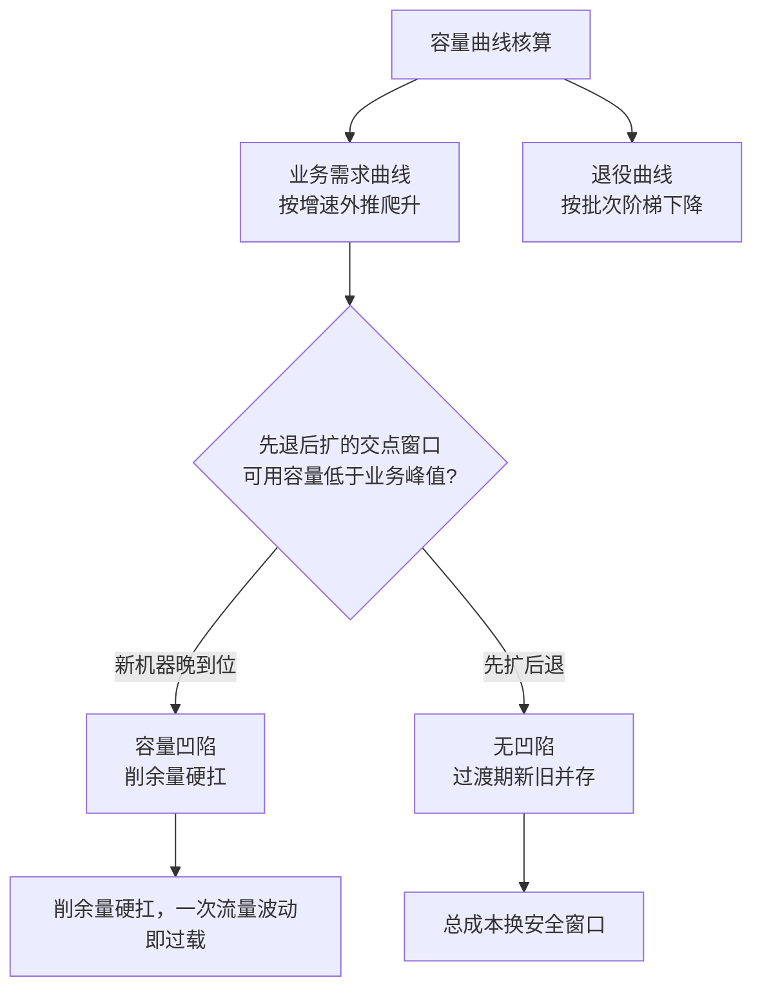
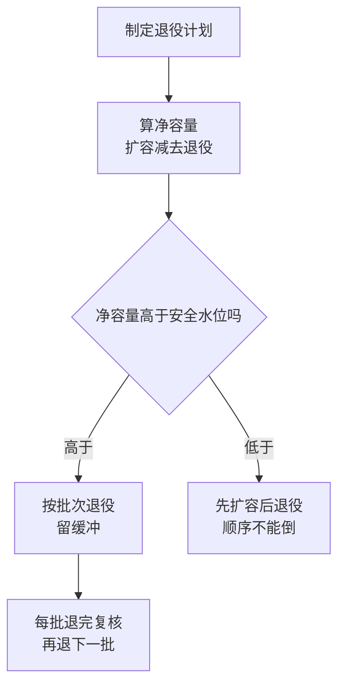

# 硬件退役前的容量腾挪：退役计划与扩容计划要一起做

> **要点**：**批量退役使集群容量曲线下降，业务增长使它上升**——**两条曲线的交点决定腾挪顺序**：**先扩后退窗口最安全，先退后扩出现容量凹陷**；**退役与扩容同一张计划表管理，凹陷才不会在生产容量上真实出现**。

## 为什么退役的容量账经常只算一半？

**本篇要解决的问题是：退役释放容量、扩容补容量的两笔账怎么合起来算**。**硬件退役的容量账经常只算一半**：**退掉 N 台机器释放的负载，由剩余节点按放置策略（决定负载分配到哪些节点的规则）承接**——**承接能力的前提是剩余节点有余量**，**而批量退役 + 业务增长的组合最容易出现"退完才发现余量不够"**。

**读完这一页你能按交点核算排出退役与扩容的先后，避免容量凹陷真的出现在生产上**。本库硬件域"节流参数与容量匹配"讲过恢复流量的容量预算；本篇讲退役的容量面：**退役曲线与业务曲线的交点核算、腾挪顺序的选择、退役批次与安全水位（可用容量相对业务峰值的余量红线，算式见后文）的联动**——**容量凹陷（可用容量跌破业务峰值加余量）是一段时间窗内的真实风险**，**它在监控曲线上表现为"水位缓升，退完后某天突然越线"**。

## 两条曲线的交点为什么决定腾挪顺序？

**两条曲线的核算**：**机制在于两条曲线各自独立变化，交点位置没人安排、只能算出来**。**退役曲线按批次阶梯下降（每退一批，可用容量减去该批承载的峰值负载）**；**业务曲线按增长预测爬升（近三个月的增速外推，高峰日校准）**。**交点 = 容量凹陷的起点**——**先退后扩的顺序里，新机器到位晚于退役完成，交点窗口内可用容量低于业务峰值，集群只能靠削余量硬扛**——**吃掉安全余量维持运转——余量是给波动准备的缓冲，被日常负载吃掉后，集群已经在满负荷运转**，**此时任何额外负载都无处承接，一次流量波动就是一次过载**。

可用容量与业务需求两条曲线在时间轴上的关系，凹陷是两条线交叉出的窗口：



**顺序选择的依据：先扩后退把交点窗口消掉，先退后扩是否成立取决于交点核算，到货延期时退役顺延**。

**腾挪顺序的选择**：**先扩后退**（新机器入池、承接部分负载、再退旧机器）**把凹陷消除，代价是过渡期新旧并存的总成本**；**先退后扩**只在两种场景成立：退役释放的容量大于业务增长（净富余），或退役分批到每批退完余量仍充足。**顺序的选择按交点核算定，不按采购到货时间将就**——**到货延期时退役必须顺延**，**把"机器到货时间"当退役计划的锚，是把主次搞反了：到货时间只是输入条件，交点核算才是决策依据**。

「先并新变，再撤旧变」是借变电站的话打比方（新变压器先并入电网带载，再撤下旧变压器），它在机房供电上的实物是 PDU（机柜电源分配单元，给一排机柜分电的设备）与供电链路的换装：**新 PDU 先上电并入供电系统带载一部分机柜，确认输出平稳、母线（机柜上方汇集电流的主干线，PDU 从母线上取电再分给各机柜）没有过载，再逐柜切换、最后撤下旧 PDU**——**切换期间双路供电并存，任何时刻机柜都有电**：


*图源：Wikimedia Commons，Derrick Coetzee，CC0 1.0，https://commons.wikimedia.org/wiki/File:UPS_Power_Management_Module,_racks_with_network_cabling_in_NERSC_data_center.jpg。*

变电站的变压器换装是同一套顺序：**新变先并网带载、确认平稳，再逐级转移负荷、撤下旧变**——**「先拆旧变等新变」的操作，会先让旧变撤下、新变还未带载，负荷瞬间失电**——**失电的瞬间就是事故现场：在变电站会造成一大片区域停电，在机房只影响一个机柜**。**比喻到此为止：机房换装按机柜逐台切换，粒度比变电站细得多，失败影响面也小得多**。

「先扩后退」在容器编排平台里是内建语义：Kubernetes（容器编排平台，负责容器的部署、调度与自愈）的滚动更新（逐个替换旧版本实例、不中断服务的方式）官方示意图里，**新旧两代 Pod（Kubernetes 里最小的部署单位，包含一个或多个紧密协作的容器）副本在切换期间并存，新副本逐个就绪后旧副本才逐个退出**——**任何时刻服务容量都不低于预期值**。**这套时序与退役批次「退一批前新一批必须已带载」的要求一致**——**两者都要求新资源先就位、再撤旧资源，所以是同一张时序**：


*图源：[Kubernetes 官方文档《kubectl rolling-update》](https://kubernetes.io/docs/home/)，Apache-2.0。*

**先扩后退就是并网换装的顺序：新机器入池带载（新变并网）、负载迁移（逐级转移）、旧机器退出（旧变撤下）**——**过渡期双份并存的成本，买的是"任何时刻可用容量都高于负荷"的安全窗口**。

**迁移负载的过渡账**：**退役批次的负载迁移到剩余节点，迁移期（数据搬迁 + 流量切换）内新旧双份资源并存**——**迁移期的容量占用按"双份"计**，**退役批次的"释放"要等迁移完成才兑现，容量计划按这个时点核，不按下架时点**。


来源：[博客园《解密 Raft 算法》](https://www.cnblogs.com/traditional/p/12588733.html)（CC 4.0 BY-SA）


## 退役批次划多大才安全？



**顺序的判据是净容量（扩容新增的容量减去退役释放的容量）与安全水位的比较**。**倒过来做（先退役后扩容），顺序不能倒的原因在此：扩容到位前可用容量先跌破水位，缺口出现的时间就是两条曲线的交点窗口**：


**批次大小的约束**：**每批退役后剩余集群的安全水位（峰值负载 ÷ 可用容量）不高于既定上限（一般 50-60%，本库容量域"容量留白"的同一原则）**——**批次大小由这个安全水位约束倒推**：**单台机器承载的峰值负载去除既定水位上限内可让出的余量，就是这批最多能退的台数**。**N+1 冗余（平时多备一台，任一节点故障仍够用的配置）的集群还要核：任何一批退完后，单节点故障的容忍能力不变**——**N+1 本身留了一台的余量，只要每批退役不超过这一台的容量，坏一台时仍有节点能承接（退一批后坏一台的容量账要单独过一遍）**。

**退役与高峰日历的联动**：**批次错开业务高峰（大促、季度结算、周期性峰值）**，**退役窗口按低谷日历选**——**低谷期迁移流量对业务的影响最小，且高峰日的容量账不用把"迁移中的半退役状态"算进去**。

**回退预案**：**每批退役有明确的回退条件（水位越线、错误率抬头）与回退动作（重新入池、回迁负载）**——**退役的机器在下个批次开始前保持可回退状态**（数据已清但可重入池），**回退是挽回凹陷的最后手段**。

## 这套腾挪顺序在哪儿会失效？

**失效集中在三个地方，各有一条边界守住**。

**退旧与买新不是一比一替换**：**新机型容量密度高于旧机型时，"退 10 台买 10 台"是净扩容，容量账按实际容量算不按台数**；**反过来按密度下降的机型做等量替换是净缩容**——**替换计划按容量等价核，台数只是表象**。

**负载不均匀放大退役影响**：**退役批次恰好承载热点分片（把数据按规则切开存到不同节点）时，迁移压力集中在承接节点（本库数据系统域"热点副本与流量倾斜"的形态）**——**退役批次的选择要看负载分布**，**热点集中的批次单独处理（先调放置再退）**。

**退役的隐性依赖要排查**：**监控采集、日志收集、定时任务的 agent 按机器名单工作，退役机器从名单移除的时点与下架一致**——**名单遗漏产生幽灵节点**（监控还在报已销毁机器的数据，或者任务还在往已下线的机器投递）。

## 怎么自己动手验证

可复现的验证路径：

1. 交点核算验证：**按历史增长与退役批次画两条曲线，预期交点窗口与计划一致、批次间安全水位均低于上限**；
2. 批次演练：**测试环境退一批（模拟下线），预期放置策略把负载迁到剩余节点、水位符合核算、热点（访问集中在少数键或节点上的现象）分布无集中恶化**；
3. 回退演练：**退役一批后触发回退条件，预期机器可重入池、负载回迁、水位恢复**；
4. 断言锚点：**两条曲线的核算文档在管、批次安全水位有数字约束、回退条件与动作成文、退役窗口避开高峰日历**——**四件齐备，批量退役的容量凹陷从"事后发现"变成"事前规避"**。

```text
曲线断言 = 交点窗口内水位不越上限
批次断言 = 每批退完冗余能力不变
回退断言 = 可重入池且回迁可行
```

**退役与扩容是同一张容量计划表的两栏**：**顺序按交点定、批次按水位定、窗口按低谷日历定——三处都按数字核算，退役的容量风险在计划阶段就已经排除**。

## 接着读哪几篇：坏盘预警信号与故障退出的衔接

- [[工程知识/性能工程：从用户等待到资源瓶颈/存储与网络/硬件故障的监控信号分层：预警级与失效级分开响应]] —— 坏盘预警信号与故障退出的衔接
- [[工程知识/性能工程：从用户等待到资源瓶颈/存储与网络/硬件选型的容量留白：按峰值负载的一半规划，另一半是波动预算]] —— 安全水位的原则来源
- [[工程知识/数据系统：在并发与故障中保存事实/可靠性与运维/热点副本与流量倾斜：读写热点要按分片维度分开治理]] —— 负载不均匀对退役批次的影响
- [[工程知识/数据系统：在并发与故障中保存事实/可靠性与运维/分区再平衡的三种策略：固定取模与一致性哈希]] —— 负载迁移的机制层
