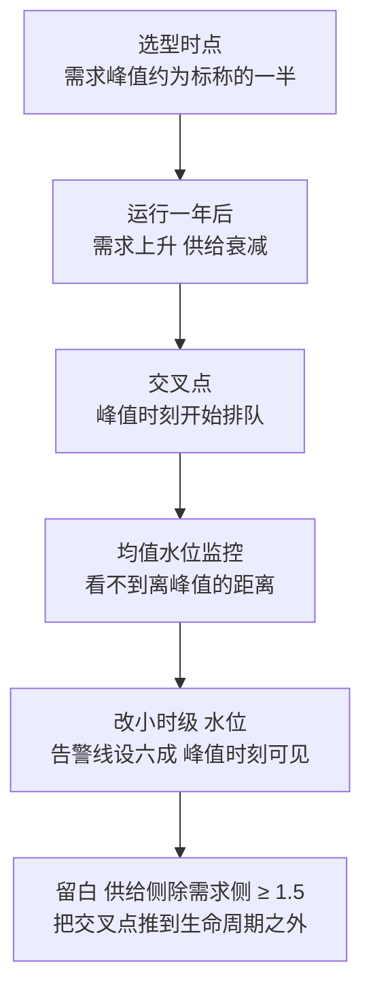
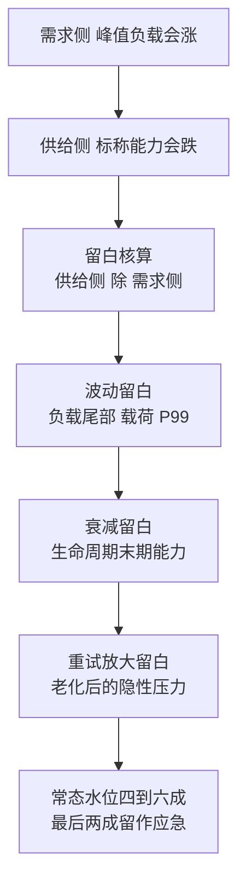

# 硬件选型的容量留白：按峰值负载的一半规划，另一半是波动预算

> **要点**：**硬件层的能力数字（带宽、IOPS（Input/Output Operations Per Second，每秒能做多少次读写）、容量）是理想条件下的上限**，**真实负载永远带着波动与衰减**——**按峰值规划意味着峰值那天系统就到极限**，**留白是给波动、衰减与超预期增长买的保险**——**保险有保额上限：它解决容量不足，解决不了单条路径的瓶颈，留白耗尽后仍要扩容**。**读完这一页你能用三行算式核算留白比例，并把容量监控从均值口径改成峰值口径**。

## 为什么按峰值选型也会在峰值时刻排队？

**本篇要解决的问题是：选型时按什么口径留余量，才能扛住波动与衰减**。硬件选型有一类高频事故：**按实测峰值负载恰好选型，上线后不久就在峰值时刻排队**。数字本身没错——峰值 500 MB/s 的负载选 600 MB/s 的盘，账面有余量。问题在**"峰值"这个词的语义**：记录到的峰值是**过去**的最大值，未来流量、数据量、并发度都会超过它；同时硬件能力在衰减（盘写入放大增长、网卡降速、内存故障降容）。**一个会涨的需求量，对着一个会跌的供给量，按"刚好相等"配置——交叉点必然到来，只是时间问题。**

**两条线一个向上一个向下：需求侧按峰值继续涨，供给侧按衰减曲线往下走，交叉点就是峰值时刻开始排队的时点**；**留白的作用是把交叉点推出生命周期，而均值水位（队列或资源的当前占用程度）监控那条虚线根本看不到离峰值的距离**：



**留白买的是把交叉点推出生命周期的可能性**。**这笔账要从阶梯成本那一侧算起**：**阶梯成本指排队超时、违约赔偿、紧急扩容这类事故后一次付出的高代价，闲置差价则是多买一点硬件匀摊在每年的低代价**——**用低代价买掉高代价的风险，方向就对了**。

**这类事故在存储上最常见也最隐蔽**：**SSD（固态硬盘）的标称持续写带宽是全新盘的数字，长期使用后 SLC（单层单元，SSD 上速度最快的高速缓存层）缓存耗尽、写入放大上升，持续写能力可跌至标称的一半以下**——**按标称选型的盘，用一年后峰值时刻开始排队**，而排查时查监控，**"磁盘水位 60%"看起来一切正常，瓶颈卡在 IOPS 与带宽的水下部分**。

## 留白由哪三块组成、各占多少？

**留白由三块组成，各有独立依据，合出常态水位区间**，构成见下图：

**波动留白（最大头）**：**负载的日峰周峰与均值差数倍，记录到的峰值还会被突破（业务增长、促销、热点事件）**——**留白依据是负载分布的尾部载荷，也就是 P99 这一档**。留白的量按负载分布定：**如果监控显示峰值 P99（百分之九十九分位，最慢的百分之一请求对应的数值）是均值的三倍，留白至少要让"未来半年的 P99"仍然跑在硬件能力的六成以内**——**留白依据是负载分布的尾部，不是均值**。

**队列能让入口与处理端解耦：请求先入队，处理端按自己的速率取走，峰值的瞬时压力被队列吸收成等待时间**——**这正是波动留白在架构上的实现方式**，也是"供给侧按稳态（系统运行指标进入平稳区间后的状态）规划、波动由缓冲层接住"的典型形态：


*图源：Microsoft Learn 中文文档《基于队列的负载均衡（把请求分摊到多台服务器、避免单点过载）模式》，CC BY 4.0，https://learn.microsoft.com/zh-cn/azure/architecture/patterns/queue-based-load-leveling。*

**衰减留白**：**硬件能力随时间下行——SSD 写放大（实际写入量远大于逻辑数据量的现象）、盘片坏道重映射消耗备用空间、内存 ECC（错误纠正码）降容、网卡降速协商**。**每一项都有一条衰减曲线，选型时按"生命周期末期的剩余能力"算账，按新盘标称算账等于把衰减风险全留给运维**。**衰减量的权威依据是厂商的耐久指标：TBW（总写入字节数，盘的寿命额度）、MTBF（平均无故障时间）与运行经验**。

衰减留白有个看得见的实物：水库水位标尺。胡佛坝拦出的米德湖在坝体上刻着水位线（标记进度或积压程度的阈值位置）——**多年下探的水位把"供给衰减"从抽象数字变成肉眼可见的刻度差，按丰水年水位设计的取水口，枯水年够不着水面**：


*图源：Wikimedia Commons，作者 Raquel Baranow，CC BY-SA 3.0，https://commons.wikimedia.org/wiki/File:Hoover_Dam_08sept09_showing_water_elevation_of_Lake_Mead.jpg。*

选型文档里的"三行算式"就是把这条刻度搬进表格：**供给侧按生命周期末期的剩余能力记（枯水年水位），需求侧按未来峰值记（丰水年用水），两个数一除，剩余留白随时可读**——**取水口装多高，按看得见刻度差的水位线定，不按最丰那一年的水面定**。

**错误与重试放大**：**硬件层故障不是静默的——重映射、重试、降速运行都会放大实际负载（一次坏块写入在物理层可能变成十次操作）**。**这部分留白比例小但不可省，它是老化后的隐性压力：同样的逻辑负载，硬件压力随老化上升**。

"硬件压力随老化上升"的判断有现成的模式依据：**外部依赖抖动（性能指标不稳定的起伏）时，客户端按退避间隔（每次重试的等待时间逐次加长）重试，一次失败的逻辑请求会变成多次物理请求，硬件层压力因此被放大**，下图是这个机制的标准形态。


*图源：Microsoft Learn 中文文档《重试模式》，CC BY 4.0，https://learn.microsoft.com/zh-cn/azure/architecture/patterns/retry。*

**三块留白合起来，经验区间是硬件能力的四到六成作为常态运行水位**。**推导是直白的：峰值按满载计算，常态只用到四到六成，倒过来讲就是留出了四到六成的余量，折中记成"按峰值的一半规划"**。水位不是浪费：**硬件能力的最后两成是应急资源**，故障转移（把服务切到备用节点）、数据重建、备份恢复时短暂用到，平时闲着是设计意图。

三块的关系与合出的水位区间见下图：



**"一半"的构成：波动、衰减、重试放大三块各有依据，常态水位落在四到六成区间，最后的两成是故障转移与重建的应急资源**。

## 为什么"买大了浪费钱"这笔账算错了？

**"买大了浪费钱"的账本算错了一边**：**硬件闲置的成本是线性的（差价），容量不足的成本是阶梯式的——排队超时、SLA（服务等级协议，对外承诺的可用性与响应目标）违约、紧急扩容（临时采购 + 迁移 + 停机窗口），一次事故的代价超过全年差价**。**留白买的是把阶梯成本变平的可能性**，**这笔账在云时代以预留实例（预先锁定容量换折扣价）与按需实例（用多少付多少的原价）的差价形式继续成立**。

**反直觉的另一半在监控口径**：**水位监控显示 60% 时，工程直觉是"还有四成余量"；实际余量要按"峰值时刻的带宽/IOPS 余量"算——平均水位与峰值水位的差，正是波动留白被吃掉的部分**。**按均值监控的系统，看不到自己离峰值的距离。**

## 选完型之后靠什么防住复发？

**选型计算用三行算式**：需求侧（峰值 × 增长系数），供给侧（标称 × 衰减系数），留白 = 供给侧/需求侧 ≥ 1.5——**算式进选型文档，每个系数的依据（监控数据、厂商指标）写在注释里，评审有对象**。

**峰值水位监控**：**监控口径改成小时级水位——按峰值时刻的硬件利用率（每小时的 P99），告警线设在硬件能力的六成**——**均值水位监控留给趋势分析，峰值水位才是容量告警的正确口径**。

**定期重估**：**负载分布每季度重估一次（P99 峰值、增长趋势），衰减按硬件服役时长推算——两个数一除，剩余留白随时可见，扩容决策在留白耗尽前做出而不是在事故后**。

**写入负载画像先于选型**：**存储选型前先画负载画像（读写比例、顺序随机、块大小、写入总量与 TBW 的比值）**——**画像决定衰减曲线的形状，重写入负载的衰减留白要加倍**。

## 这套留白算法在哪儿会失效？

**三条边界防止防线走形**。

**留白比例按负载性质调整**：**批处理（把多个请求合并成一批同时计算、提高硬件利用率）类平稳负载留白可以收窄（波动小），在线交易类宽尾部负载留白放宽**——**1.5 是经验锚点，负载分布才是依据**。

**云环境的留白形态变化**：**云盘的 IOPS/带宽是购买的配置项，留白表现为"配置档位留一档"，扩容成本从采购周期变成一次配置变更**——**留白的经济逻辑不变，形态从"买大"变成"买可升"**。

**留白不替代瓶颈定位**：**容量留白解决"能力不够用"，解决不了"单条路径的瓶颈"（单连接带宽、单队列深度）**——**留白是容量问题，排队是结构问题，混在一起会误判**。

## 怎么自己动手验证

每一步都有预期结果，照着走就能亲眼看到留白怎么起作用：

1. 画像验证：**选型前跑写入负载画像（fio（Flexible IO Tester，磁盘基准工具）按真实负载参数），确认画像与标称场景的差异幅度**；
2. 衰减验证：**对服役中的盘重跑同一画像，持续写带宽与选型时的数字对比，衰减幅度进入留白预算内即为健康**；
3. 峰值验证：**监控的每小时 P99 水位长期低于六成，峰值时刻无排队超时**；
4. 断言锚点：**选型文档含三行算式与系数依据；峰值水位告警线常驻；剩余留白每季度可读**。

```text
算式 = (标称 × 衰减) / (峰值 × 增长) ≥ 1.5
监控断言 = 小时级 P99 水位 < 60%，有告警线
复审断言 = 季度重估输出剩余留白数字
```

**三行算式 + 两个监控口径 + 一次季度重估，把"买大一点"的直觉变成可审计的决策**——**留白的具体数字可以争论，留白的必要性没有争论空间**。

## 接着读哪几篇：负载画像决定衰减曲线的机制背景
[[工程知识/性能工程：从用户等待到资源瓶颈/存储与网络/心跳与keepalive是活性探测的最小语言：从协议内建到应用层判活.md]]
[[工程知识/性能工程：从用户等待到资源瓶颈/存储与网络/MTU黑洞的指纹是小包通大包挂：分片黑洞的诊断路径与封装税核算.md]]

- [[工程知识/性能工程：从用户等待到资源瓶颈/存储与网络/存储IO性能取决于访问模式、队列与持久化语义]] —— 负载画像决定衰减曲线的机制背景
- [[工程知识/性能工程：从用户等待到资源瓶颈/观测与诊断/市面Benchmark的设计读法：宏微与中间层基准]] —— 标称数字与实测画像的方法来源
- [[工程知识/后端系统：在并发、失败与变化中维持服务/服务设计/容量估算的通用骨架：从峰值QPS到机器数的推导演练]] —— 需求侧峰值推导的姊妹篇，本篇补供给侧衰减
- [[工程知识/数据系统：在并发与故障中保存事实/可靠性与运维/数据库基准必须描述负载与资源边界]] —— 容量数字的负载边界描述纪律
- [[工程知识/后端系统：在并发、失败与变化中维持服务/基础设施/容量水位线要换算成缓冲期：从百分比阈值到时间预算的六域通用读法]] —— 留白消耗的运行时读数：把剩余留白按消耗速率换算成缓冲期
