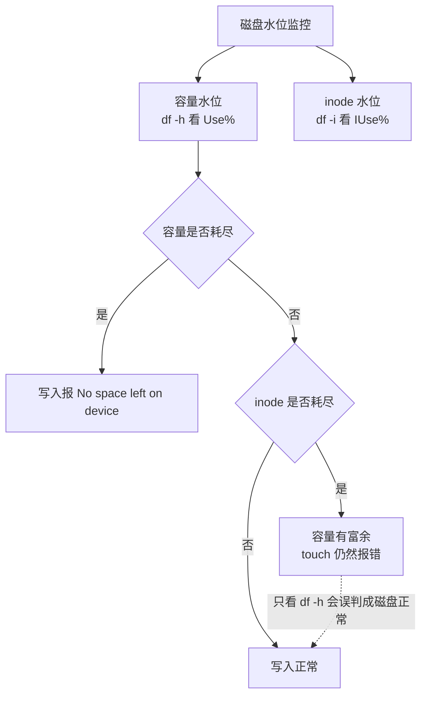
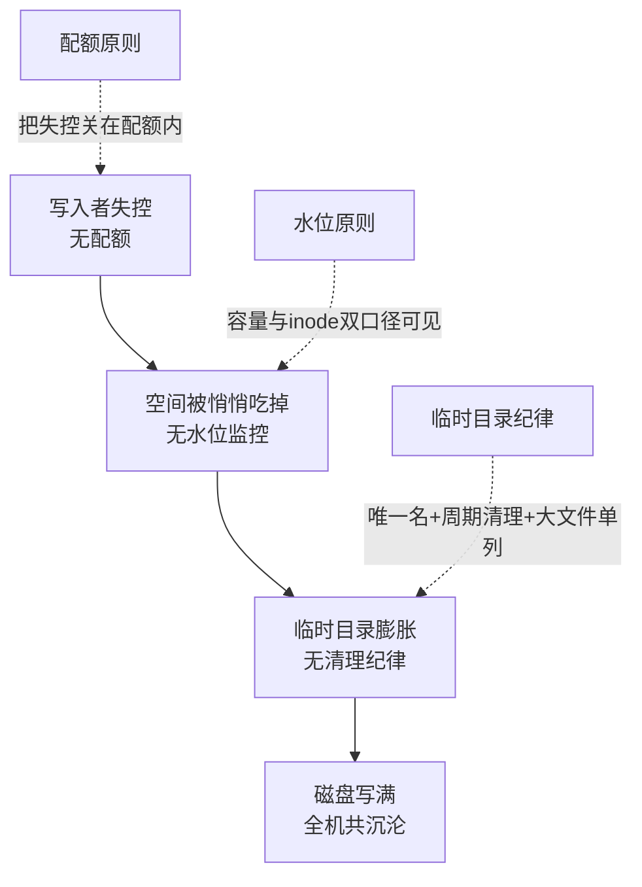
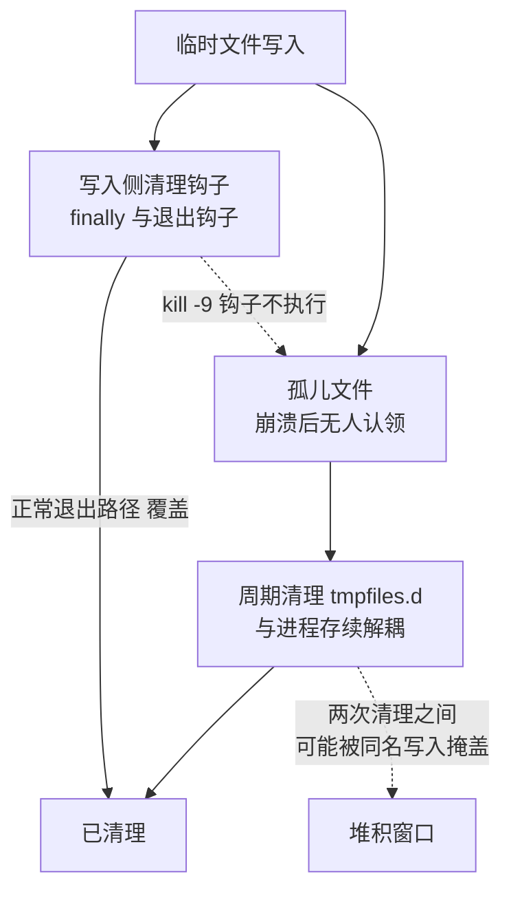

# 磁盘空间管理三原则：配额水位与临时目录纪律

**磁盘写满从不突然，写入者没有空间上限（配额）、监控看不到空间余量（水位）、临时目录没人清理三件事凑齐的结果**。**读完这一页你能把这三处各自管住，在空间耗尽之前接到告警**。

> **要点**：**磁盘写满的事故链是"无配额的写入者 × 无水位的监控 × 无纪律的临时目录"**，**三原则在写满发生前把三个环节各自管住**——**空间是共享资源，共享资源不设边界必然耗尽**。

## 磁盘写满为什么总在某个写入者失控后拖垮全机？

**本篇要解决的问题是：怎么在写满发生前把三个失控环节各自管住**。磁盘空间是运维事故里形态最经典的一类：**平时无事，某个写入者失控后全机共沉沦**。

本库稳定性域"案例一：垃圾回收线程的终止——BookKeeper 磁盘写满"已解剖过写满后的故障传导（日志写不进、数据库崩溃、服务雪崩）；本篇把防线前移，回答**"怎么让磁盘写满不发生"**这个运维普遍面临的问题——三条原则各管一个环节：**配额管写入者的边界，水位管空间的可见性，临时目录纪律管最容易失控的那类写入**。本库缺陷分析域"资源泄漏的三段式排查法"解决泄漏类缺陷的排查，本篇解决存储空间这一特定资源的系统性治理，两篇共同覆盖"资源被悄悄吃光"的故障家族。

## 三个环节各自怎么失控？

**配额与水位的意义在于把上限摆到明处：资源占用随写入量上升，达到阈值就开始拒绝，把负载挡在磁盘真正写满之前**。**写满之后的清理成本，远高于提前拒掉一部分写入**。


**无配额的写入者**：**一台机器上跑着日志、数据库、应用缓存、任务产物等多种写入，任何一种失控（日志轮转配置丢失、任务产物堆积、调试输出未关）都会吃掉别人的空间**。失控的放大器是**共享文件系统的"先到先得"（没有配额时，谁写得快谁就把空间占满的竞争规则）**：**没有边界时，写得快的进程获胜，写日志的把数据库的空间挤掉，数据库空间被挤占后无法写入而崩溃，依赖它的服务随之雪崩，故障从"某个组件失控"升级为"全机不可用"**。**配额（用户级 quota、目录级限额、容器存储限制、日志轮转上限）把每个写入者的最大占用显式化**，**失控被限制在配额内，不外溢**。

**无水位的监控**：**磁盘从 80% 到 100% 可以只差一次大文件写入（数据库大事务、全量备份、日志风暴），按天看水位的监控在几小时内错过整个窗口**。水位的两个口径都要有：**使用率（df 看容量水位）与 inode 水位（inode 是每个文件的索引节点，文件多到索引节点用完，再创建新文件就没有名额）**——**海量小文件（会话文件、任务产物）先把 inode 耗尽，系统无法为新文件分配索引节点，于是创建文件（touch）直接报错，尽管容量有富余、还没满**。**df 正常而 touch 仍然报错的形态就是 inode 耗尽**。

**两个口径是两条独立的耗尽路径，只盯一条就会在另一条上失守**：



**右边那条是最容易漏的：容量还有几十 GB，inode 却先被海量小文件吃光了**。**排查时两个口径一起看，才不会把 inode 耗尽当成"磁盘没问题"**。阿里云官方中文文档把这两条路径并列为两个独立场景（[解决 Linux 实例磁盘空间满问题](https://help.aliyun.com/zh/ecs/user-guide/resolve-the-issue-of-insufficient-disk-space-on-a-linux-instance)）。

**无纪律的临时目录**：**临时文件是磁盘事故的高发源头，失效形态三种——异常退出留下的孤儿临时文件（进程崩溃后无人认领，清理逻辑没跑到）、"临时"文件从未被清理（写入时没设计清理路径）、清理周期远长于产生周期（产生快于清理，净增长为正）**。**临时目录的失控概率与其"无主"程度成正比**：**谁都能写、没人负责清理的目录，必然走向膨胀**。

临时目录纪律在系统层有现成的官方实现。**systemd（Linux 的服务管理器）的 tmpfiles.d（一张声明"哪个目录、怎么清理、保留多久"的清理规则表）把清理规则写成声明，由系统统一按表清理**——**清理判据来自声明本身，不靠人记住每个目录的来路**：


*图：systemd-tmpfiles 官方文档的策略声明表。`d /var/tmp/myapp 0700 app app 3d` 一行声明了目录、权限、属主与保留期（3 天）——注意按手册约定，d 行本身只建目录并声明属性，配合按龄清理的条目类型才真正按 3 天期限清扫；**应用把临时目录登记进这张表，崩溃留下的孤儿文件也由系统统一清扫，正是「临时目录有主、清理有据」的最小形态**。*

*图源：systemd 官方文档，[tmpfiles.d(5)](https://www.freedesktop.org/software/systemd/man/latest/tmpfiles.d.html)。*

**三个环节首尾相接（写入失控，空间被吃掉，临时目录膨胀，最后写满），串成一条事故链，三原则各拦一个环节**：



三原则与事故链的对应关系：三个环节各对应一条原则——**配额管边界、水位管可见性、纪律管高发源头，各拦在写满之前，缺任何一条，链条都通到最底部**。

## 三原则生效后靠什么防住复发？

**写入者配额化**：**日志按轮转策略限量（logrotate 的 size 上限 + 保留份数）、数据库按表空间配额、容器按存储限制、共享用户按磁盘 quota**——**每个长期写入者都有声明的上限**，**上限值按"该写入者合理的最大空间"定，超限即该写入者自己的问题，告警指向它而不是全机**。

冷数据的归档层有现成的实物参照：各种规格的磁带盒——LTO（Linear Tape-Open，磁带存储技术）线性开放磁带、DDS（Data Distribution Service，数据分发服务中间件）数字数据流磁带、Dat 等常见归档磁带规格，单盒容量从数十 GB 到数百 GB 不等排开，容量、介质寿命、读取设备各自独立——归档按访问频率与保留期分开，各自成为独立的存储层。磁盘空间治理的第一步是把"该走的数据"从在线盘上请到这一层：


*图源：Wikimedia Commons，Mister rf，CC BY-SA 4.0，https://commons.wikimedia.org/wiki/File:Magnetic-tape_data_storage.jpg。*

**双水位监控**：**容量与 inode 两条水位线（80% 警告、90% 严重）进监控告警**；**大文件写入密集的机器加"增速"监控（小时级增量），增速异常先于水位到达报警**——**水位管余量，增速管趋势，趋势告警比水位告警早数小时**。

**清理职责从应用里分出去、交给独立一层统一承接，是这套纪律能生效的关键**：**应用只管业务写入，清理作为外围任务由系统层按声明执行**——边车模式（把日志、清理等外围任务作为独立进程挂在主应用旁的设计）把外围任务从主应用分离出来单独承载，临时目录纪律是同一种分离在存储治理上的应用：


*图源：Microsoft Learn 中文文档《边车模式》，CC BY 4.0，https://learn.microsoft.com/zh-cn/azure/architecture/patterns/sidecar。*

**临时目录三纪律**：**写入时用带唯一名的文件并在 finally/退出钩子里清理（孤儿文件的源头治理）**；**目录按 tmpfiles.d 或等价机制定期清理（清理机制与进程存续解耦）**；**超大临时文件不进默认临时目录**（**进专门的带配额与监控的大文件区**）——**三条让"临时"名副其实**。

**写满演练**：**定期在测试环境填满磁盘（fallocate 大文件），核对告警按预期触发、关键服务按降级（主动牺牲部分功能或精度，保住核心链路）路径运行**——**写满的预案（本库稳定性域"磁盘写满的连锁反应"）没演练过就只是文档**。

## 这三原则在哪儿会失效？

**三条边界防止治理走形——例如配额过紧把正常增长变成故障、监控只看容量漏掉 inode 耗尽**。

**配额不是越紧越好**：**数据库、消息队列（生产者写入、消费者读取的缓冲中间层）等组件需要空间弹性（峰值与回收周期），配额按其峰值画像定并留余量，过紧的配额把组件的正常增长变成故障**——**配额的依据是写入者的画像，统一系数会给慢写入者松、快写入者紧**。

两条清理路径各有一块盖不住的地方：写入侧钩子在「kill -9」这条虚边上失效，周期清理在「两次清理之间」这条虚边上留着堆积窗口：



**两层的缺口互不重叠，谁也替不了谁——缺了周期清理，孤儿文件就只能等到下次进程启动才可能被扫到**。

**清理不能只靠 cron（Unix 的定时任务调度器）**：**定时清理与写入侧清理钩子是互补的两层**——**只有 cron，异常退出产生的孤儿文件在两次清理之间堆积且可能被后续同名写入掩盖；只有写入侧钩子，进程被 kill -9 时钩子不会执行**。**两层都要**。

**空间问题有非磁盘形态**：**tmpfs（把存储空间放在内存里的文件系统）的"磁盘"是内存（/tmp 挂 tmpfs 的机器写满 /tmp 等于吃光内存）、overlayfs（容器常用的叠加文件系统）的配额在镜像层**——**不同文件系统形态的空间语义不同，治理规则按挂载形态核对**。

## 怎么自己动手验证

可复现的验证路径：

1. 配额验证：**给测试写入者配额后制造超限写入，预期该写入者报错受控（fail-fast）、同机其他写入不受影响**；
2. 双水位验证：**fallocate 填满测试分区，容量告警触发；用 stress 或循环创建小文件耗尽 inode，inode 告警触发而容量告警不触发——两条水位各自独立生效**；
3. 孤儿文件验证：**kill -9 一个写临时文件的进程，临时目录按 tmpfiles.d 周期清理后孤儿文件消失**；
4. 断言锚点：**每个长期写入者有配额声明、双水位告警常驻、临时目录有周期清理机制**；**三者齐备后写满类事故的复发面收敛到"未配额的新写入者"，新写入者上线时的配额评审堵住最后的口子**。

```text
配额断言 = 超限写入者受控，他人不受影响
水位断言 = 容量与 inode 告警各自独立触发
清理断言 = 孤儿文件在周期内消失
```

**空间治理的三原则把"磁盘写满"从随机事故变成有边界、有可见性、有纪律的受管资源**——**事故不发生，排查链（本库稳定性域）就永远只是预案**。**验证的预期对照提前写明：配额超限时预期写入者自身受控报错而同机他人不受影响，对不上（他人空间被挤占）即配额没有作用在正确的层级**；**双水位的注入演练预期两类告警各自独立触发，对不上（inode 耗尽无告警）即监控只看了容量口径，这是最常见的漏报形态**。**治理的收益是写满类事故的复发面收敛，代价是每个写入者的配额评审与水位告警的维护投入，两者都在上线清单里显式核算**。

## 接着读哪几篇：泄漏类缺陷的排查方法

- [[工程知识/缺陷分析：从个案到体系/稳定性/案例一：垃圾回收线程的终止——BookKeeper 磁盘写满]] —— 故障传导链的实例解剖，本篇是它的前置防线
- [[工程知识/缺陷分析：从个案到体系/资源与容量/资源泄漏的三段式排查法：预筛确认与归因]] —— 泄漏类缺陷的排查方法，与本篇的治理规则互补
- [[工程知识/软件构建：让变化可以理解、验证与交付/开发工具/词汇即接口：Linux与容器命令的词源与设计]] —— df/du/logrotate 等命令的设计语义
- [[工程知识/后端系统：在并发、失败与变化中维持服务/任务与并发/后台任务的守护链：进程托管与会话脱离是可靠性的底线配置]] —— 长期任务的日志归属与轮转配置
- [[工程知识/后端系统：在并发、失败与变化中维持服务/基础设施/容量水位线要换算成缓冲期：从百分比阈值到时间预算的六域通用读法]] —— 磁盘水位读数的时间侧方法：按消耗速率换算缓冲期再定响应档位
