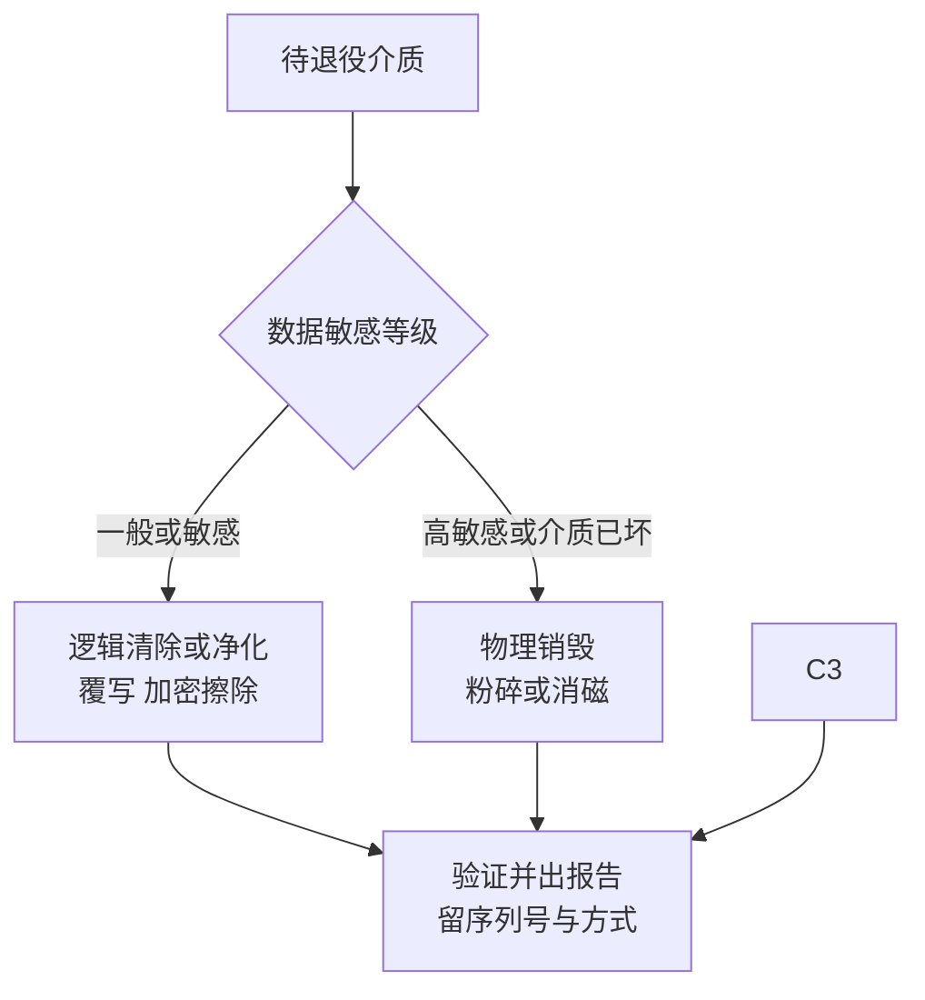
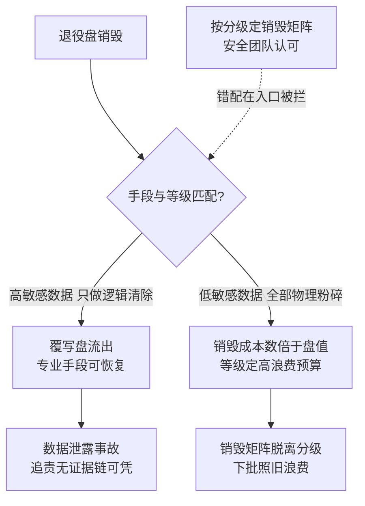
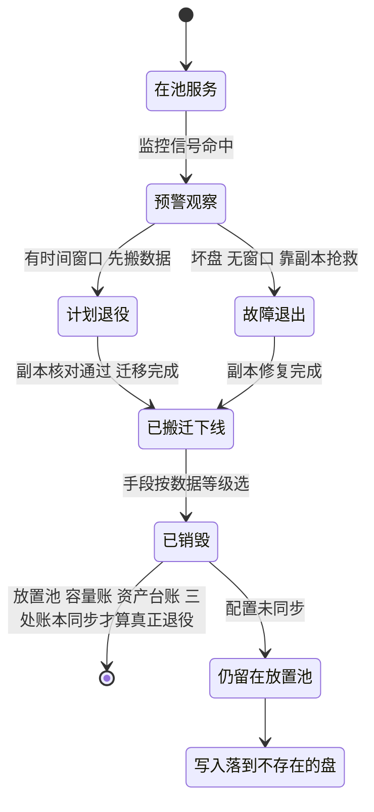

# 磁盘退役要提前演练：退役检查单与数据销毁的合规边界

**这一页讲退役检查单怎么列、销毁手段怎么选、证据链怎么留**。**读完你能把一次磁盘退役从应急动作变成有预案的计划动作**。

> **核心结论**：**磁盘退役是数据有位可搬时的计划动作，不是坏盘后的应急动作**——**退役前完成数据迁移与副本核对，退役时执行与数据等级匹配的销毁手段并留证据链，报废磁盘的去向要可追溯**；**坏盘退出集群的正确姿势在退役预案里预演过**。

## 退役为什么要提前计划，等盘坏了再抢救行不行？

**本篇要解决的问题是：退役与坏盘退出两条路径怎么走才不丢数据、不漏销毁**。**磁盘从集群退出的场景有两类，处理方式完全不同**：**计划退役**（扩容替换、机型下线、机房迁移）有时间窗口，可以先把数据搬走；**故障退出**（坏盘）没有窗口，数据靠副本机制（同一份数据保留多份拷贝以防单点失效）抢救。

**两类的共同收尾是同一件事：这块盘上的数据怎么处置、盘本身怎么处置**——**退役流程缺失的团队，坏盘时常出现两个方向的失误：急着下架忘了副本数还不足（数据丢），或者盘修好重新入池（坏盘上的残留数据成了安全隐患）**。本库性能域"硬件故障的监控信号分层"讲过坏盘的预警信号；本篇讲退役面的流程：**从预警到退役的动作序列、销毁手段与数据等级的匹配、证据链的留存**。

## 退役前要核对哪三道？

**退役动作的物理对象是盘面上的数据：一块硬盘由多张盘片组成，每张盘面划分成磁道，磁道再切出扇区**——**数据迁移搬的是这些扇区里的内容，销毁手段要覆盖的也是它们**：


**逻辑清除（逐扇区覆写，让数据无法轻易读出）与消磁（强磁场打乱磁介质的排列）针对的都是图中标注的磁介质层；固态盘没有这些部件，销毁手段换成块擦除**——**介质形态决定可选的销毁手段集合，按数据等级选手段的对应表就是销毁矩阵（后文给标准版）**。

**第一道：副本健康核对**。退役盘上的数据要能安全撤离，前提是**每个数据单元在其他盘上有足够副本**——**逐个核对待迁数据的副本数与放置（是否与源盘同故障域——同一机架或同一供电下的盘归同一个故障域，同域一起损坏不算增加冗余），副本不足的先补副本再迁移**。**顺序不可反**：**盘一旦拔下，盘上的数据就取不到了，这时才发现副本不足，再没有别的可用副本可以补，抢救窗口就交给运气了**。

**第二道：迁移路径的带宽预算**。**退役搬数据用的集群内部带宽与正常业务共享**——**迁移速率按"不伤害线上"的余量定**——**像给高速公路留一条应急车道，迁移只占剩下的带宽，不把带宽占满（本库硬件域"节流参数与容量匹配"的同一套推导）**，迁移完成时间 = 数据量 ÷ 迁移速率，**完成时间要在退役窗口内**，超窗口的要么提速（扩余量）要么延后退役。

**第三道：坏盘应急与计划退役的路径一致性**。**坏盘退出的动作（标记下线、触发副本修复、从放置池移除）应该就是计划退役流程的子集**——**用计划退役的机会把坏盘路径演练一遍**——本库数据系统域"备份的价值由恢复演练来验证"是同一原则：**在数据安全这类不可逆操作上，没演练过的流程等于没有可靠流程**。

## 销毁手段怎么和数据等级匹配？



**手段由敏感等级决定，等级判错会让可恢复的数据流出**，对应关系见下表：


**数据销毁按等级选手段**，NIST SP 800-88（美国国家标准与技术研究院的数据销毁指南） 的框架给出了三档：**逻辑清除**（覆写、块擦除——数据可被专业手段恢复的概率低但非零，适合低敏感数据或继续使用的盘）、**密码擦除**（适合整盘加密的存储：整块盘用同一把密钥加密，销毁密钥后盘上只剩解不开的密文，数据同样读不出来，适合大批量退役）、**物理销毁**（消磁、粉碎——密级数据的终点手段）。**手段与等级错配的两个方向都是事故**：**漏档是安全事故——高敏感数据只做逻辑清除，覆写后的盘流出，专业手段还能把数据恢复出来，泄露随之发生，追责时没有证据链可凭**；**超额是成本事故——低敏感数据全部物理粉碎，销毁成本数倍于盘值，本来还能用的介质被毁掉，预算被白白浪费，下一批照旧浪费**。**按数据分级定销毁矩阵，矩阵要得到安全团队的认可**。

同一块退役盘，销毁手段与数据等级的两种错配各走一条事故链，见下图：



**错配的两个方向：漏档是安全事故、超额是成本事故，销毁矩阵与安全团队认可是入口处的拦截手段**。

销毁矩阵在权威标准里有现成形态。**NIST SP（Service Processor，服务处理器：带外管理芯片） 800-88 的官方决策流程按三个问题走完全程：数据密级（低/中/高，对应前文的低敏感/一般或敏感/高敏感三档）、介质是否离开组织控制、介质是否复用**——**每个组合对应明确的手段（Clear 对应清除、Purge 对应净化、Destroy 对应销毁三档），且每个终点都汇入 Validate 与 Document 两个节点，销毁动作没有验证与文档就不算闭环**：


*图源：NIST SP 800-88 Rev.1《Guidelines for Media Sanitization》Figure 4-1（PDF 第 17 页渲染截取），https://nvlpubs.nist.gov/nistpubs/SpecialPublications/NIST.SP.800-88r1.pdf，公有领域（美国政府出版物）。*

物理销毁档落到实物上是什么样：**一块退役的 WD（Western Digital，西部数据，硬盘厂商） 1TB 盘被拆解并击碎，盘片、磁头臂、外壳与电路板分离——盘片一旦碎裂变形，磁介质上的数据就失去了被读出的物理载体**：


*图源：Wikimedia Commons「Damaged Hard disk drive for data protection .JPG」（作者 Stefan Bellini，2014 年摄，CC0 公有领域），该盘为报废电脑回收前的数据保护销毁实物。*

**证据链的要素**：**销毁动作做完要验证并出报告——销毁记录 = 盘的序列号 + 销毁手段 + 执行时间 + 执行人 + 结果核验（覆写校验、消磁报告、粉碎照片）**。**证据链在审计与追责时兑现价值："这块盘销毁了吗"要能凭记录回答，不能凭记忆**。

**回收的边界**：**送修、转售、降级（把高端口的性能盘降作冷存储盘用，牺牲速度换容量成本，保住仍在线的核心业务）使用的盘，销毁等级按新用途重估**——**转售盘的销毁要求不低于原用途**（**原用途只是内部测试，不代表新主人不会拿它存敏感数据，销毁要求只能升不能降**），**修理送出的盘默认按最高敏感度处理（多数组织直接禁止送修存储介质）**。

## 这套退役流程在哪儿会失效？

**三条边界防止防线走形**。

**坏盘的第一动作是保护数据不是盘**：**坏盘有可读余量时的"抢救数据"动作要在副本机制保护下进行——直接反复读坏盘会加速介质恶化**——**故障磁头反复通电寻道会刮擦盘面，越读盘面损伤越重，副本修复系统按健康盘重建才是正路**。

**快照（某一时刻的完整只读副本）与备份不在退役盘上原地销毁**：**退役盘承载的快照、备份副本在退役清单里单独列出**——**它们的销毁手段按备份介质的等级走**，**混在业务盘清单里按业务等级销毁，会留下备份链的缺口**。

**退役完成的状态要同步到资产账**：**集群的放置池、容量账、资产台账三处的盘状态一致**——**放置池还认一块已物理销毁的盘（配置没同步），下一次放置决策就会把副本写到不存在的盘上**。

## 怎么自己动手验证

**退役流程靠两种演练验证**：

1. 计划退役演练：**测试环境按退役检查单走一遍全流程（副本核对 → 迁移 → 下线 → 销毁记录），预期每步有产出物、总时长与预算一致**；
2. 坏盘应急演练：**注入一块"坏盘"（标记故障），预期自动副本修复按既定速率完成、放置池移除该盘、告警链路触发——演练数据与预案核对**；
3. 销毁核验：**对覆写盘抽样取证（专业工具扫描），预期无可恢复数据；对密码擦除盘验证密钥已销毁（密文不可解）**；
4. 断言锚点：**退役检查单在管、销毁矩阵经安全团队确认、证据链要素齐全、坏盘路径演练过**——**四者齐备，磁盘退役从应急动作变成有预案的计划动作**。

```text
核对断言 = 副本足额才开迁移
销毁断言 = 手段与等级匹配且留证据
演练断言 = 坏盘路径在退役演练中走过
```


**一块盘的状态要在几个账本里保持一致**：**「已销毁」之后有两条出口，三处账本同步才算真正退役，配置未同步的那条支路会把副本写到已经不存在的盘上**：



**磁盘全周期里最容易被省略规划的就是退役这一段**——**提前演练的收益是坏盘来时按图作业，代价是每次退役多花半天走流程，一次成本远低于无数次侥幸**。

## 接着读哪几篇：迁移带宽的余量推导

- [[工程知识/性能工程：从用户等待到资源瓶颈/存储与网络/硬件故障的监控信号分层：预警级与失效级分开响应]] —— 坏盘预警信号，本篇接退役动作
- [[工程知识/性能工程：从用户等待到资源瓶颈/存储与网络/节流参数与容量匹配：全局限流值要按单点容量乘副本数算]] —— 迁移带宽的余量推导
- [[工程知识/数据系统：在并发与故障中保存事实/可靠性与运维/复制的三种模式：主从、多主与无主的失败形态]] —— 副本机制是退役与坏盘的共同安全网
- [[工程知识/数据系统：在并发与故障中保存事实/可靠性与运维/单机备份与多机副本要分开看：副本不是备份]] —— 备份介质的销毁等级单列
