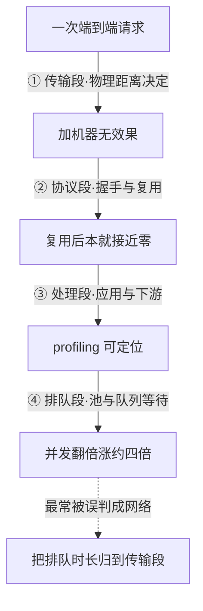

# 端到端网络延迟来自排队、协议、传输与处理

端到端网络延迟由排队、协议、传输与处理四段叠加而成，应用排队、连接建立、协议处理、链路 RTT（往返时间：一个包发出去再回来一共花的时间）、拥塞、丢包（数据包在网络传输途中丢失）、服务端调度和客户端消费都会贡献延迟。读完你能把一次「慢」的请求拆成四段，并指出该从哪一段下手。

浏览器或 SDK（软件开发工具包）测到的 800 ms 里可能装着连接池（预先建好连接反复取用、省去反复握手建连的开销）排队、TLS（传输层安全协议：给网络通信加密并验证对方身份）、服务端队列、下游调用、重试和客户端读取，**把整段耗时归因于网络是误判的开头**。一条请求的时间线拆开之后，才能看出该优化链路、协议还是服务实现。

## 要解决的问题：一条请求的端到端时间由哪些段组成

**把整段响应时间归因于网络的代价：网络侧的参数调整对实际瓶颈毫无作用。**本篇回答：一条请求的端到端时间由哪些段组成、带宽与吞吐、RTT、丢包各代表什么、分层定位按什么顺序逐段拆开时间线、以及重试策略在什么条件下会把网络抖动（性能指标不稳定的起伏）放大成雪崩（一处故障沿依赖链放大成级联失效）。

## 请求到响应路上每段各花多久？


*图源：Wikimedia Commons《OSI-model-Communication》，作者 Runtux，公有领域，https://commons.wikimedia.org/wiki/File:OSI-model-Communication.svg。分层模型常被当成背诵题，但它的用处在这里：一次请求的延迟是逐层叠加的，每一层加的那一段归该层所有。下面把端到端时间拆成若干段，拆的依据就是这张图的层次。*

~~~text
应用排队 -> DNS（Domain Name System，域名系统：把域名解析成 IP 地址）/连接池 -> TCP/TLS -> HTTP/gRPC（远程过程调用：像调用本地函数一样调用另一台机器上的功能）
         -> 服务端队列/线程 -> 下游调用 -> 响应传输/客户端读取
~~~

- TCP（传输控制协议，负责把数据完整、有序地送达）提供有序可靠字节流，但重传、拥塞窗口和队头阻塞（前面的请求卡住、导致后面排队的请求都被拖住）会增加尾延迟（P99 一类的慢请求耗时指标）。
- UDP（用户数据报协议，只管发、不保证到达与顺序）只提供数据报传输；可靠性、顺序、拥塞和重试必须由上层协议负责。
- HTTP/2（HTTP 第二版，多条流复用一条连接）多路复用（一条连接上同时承载多个请求、互不阻塞）减少连接数量，但共享连接上的队头阻塞和流量竞争仍需观察；HTTP/3/QUIC（基于 UDP 的新传输协议：把连接建立和加密握手合在一起，重连更快）的收益依赖客户端、网络和服务端支持。
- **带宽是容量，吞吐是实际完成量**，RTT 是往返时间，丢包和重传会放大延迟；四者不能互相替代。

**带宽封顶之后延迟还在涨，是排队延迟最直观的形状**——路由器缓冲区塞满后，多出来的包只能排队，吞吐不再上涨，延迟却随队列长度线性上升：


*图源：Wikimedia Commons《Bufferbloat.svg》，作者 Francis lede，CC BY-SA 4.0，https://commons.wikimedia.org/wiki/File:Bufferbloat.svg （原图标注为德文：Durchsatz 吞吐量、Verzögerung 延迟、Pakete 数据包）。两幅图在同一时刻分叉：吞吐到顶走平，延迟开始爬坡——这正是「带宽加够了延迟还是降不下来」的机制答案，缓冲区里排的队就是延迟本身，也解释了为什么逐段定位要先看每一段的队列水位（队列或资源的当前占用程度）。*

## 怎么逐段定位延迟在哪

1. 用 trace 和 access log 逐段核对 DNS、连接、TLS、服务端处理、下游等待和响应发送时间。
2. 用 ss（查看套接字统计的命令）、ip（Linux 网络配置命令）、ping（探测目标主机是否可达的基础命令）、mtr（把 ping 的往返时间按网络路径逐跳展示的工具）、tcpdump（抓包工具，按条件截获网卡上经过的报文）/Wireshark 观察连接状态、RTT、重传、窗口和丢包；抓包注意隐私和权限。

`mtr` 把 ping 的 RTT 按路径逐跳摆开，中间路由器不回应 ICMP（网络层的控制报文协议，ping 靠它发探测包测往返时间）时显示 `???` 但流量照常穿过——**末端可达即路径通**。逐跳 RTT（2.1 → 2.5 → 5.1 → 4.6 → 7.8 → 8.4ms）就是传输段的真实开销，延迟突变出现在哪一跳一眼可辨：


*图源：`mtr -r -c 10 223.5.5.5` 输出报告渲染。读法：`???` 行的 100.0% 是路由器不回应探测包，后续跳正常到达说明流量仍在通过——「中间跳丢包」只有在它之后的所有跳都持续丢包时才成立；Avg 与 Best 的差值大（如第 7 跳 7.4 到 16.5）提示该跳有排队。*
3. 用 iperf3（测量网络带宽与吞吐的压测工具）或业务级压测建立容量基线（正常状态下的指标水平、用来对比异常），分离网络链路瓶颈与应用/数据库瓶颈。
4. 检查连接池、keep-alive（连接保活：复用已建立的连接，避免每次请求都重新握手）、超时、重试、并发上限、代理、负载均衡（把请求分摊到多台服务器、避免单点过载）、MTU（最大传输单元：单个网络包能承载的最大数据量）和内核队列。
5. 在单变量改变后比较 p50/p95/p99（百分位延迟：分别有 50%/95%/99% 的请求快于该值，用来描述尾延迟）、吞吐、重传、CPU、软中断（由网络收包等事件触发、在正常进程之外处理的底层中断）和错误率。

最小网络实验：固定响应大小和服务端处理时间，分别复用连接、重建连接、注入 1% 丢包、增加 RTT 和限制客户端读取速率；记录 DNS/TCP/TLS、排队、服务端处理、首字节和完整响应时间。若只有完整响应变慢，优先检查传输/消费；若首字节已变慢，检查服务端或入口队列。

## 调优的边界在哪里

- **先确认瓶颈层，再调 TCP、内核或代理参数**；参数优化不能修复错误的重试和超时策略。
- **重试必须有上限、退避、幂等**（同一个操作执行一次和执行多次的结果相同，重复执行不会产生额外副作用）和总预算；否则网络抖动会放大成雪崩。
- 大响应采用分页、压缩或流式协议；限制单请求大小并支持客户端取消。
- 负载均衡只改变流量路径，不自动提供一致性、幂等、故障恢复或应用级健康检查。

## 想继续深入还能看哪些材料
- [[工程知识/性能工程：从用户等待到资源瓶颈/观测与诊断/tcpdump与抓包定位网络问题的现场方法|tcpdump与抓包定位网络问题的现场方法]]——抓包是「协议与传输」段的现场取证手段
- [[工程知识/性能工程：从用户等待到资源瓶颈/存储与网络/交付前的网络检查清单：二十项逐条过，三项全绿再上线|交付前的网络检查清单：二十项逐条过，三项全绿再上线]]——上线前把延迟风险逐项过一遍的检查清单

- [[工程知识/性能工程：从用户等待到资源瓶颈/性能工程：从用户等待到资源瓶颈]]
- [[工程知识/后端系统：在并发、失败与变化中维持服务/服务设计/流量入口只负责路由与连接，不负责业务正确性]]
- [[工程知识/后端系统：在并发、失败与变化中维持服务/分布式可靠性/健康检查只能提供有时效的失败证据]]
- [[工程知识/软件构建：让变化可以理解、验证与交付/软件构建：让变化可以理解、验证与交付]]
- [[工程知识/性能工程：从用户等待到资源瓶颈/存储与网络/DNS解析是延迟与故障的隐形入口]]
- [[工程知识/性能工程：从用户等待到资源瓶颈/存储与网络/TLS握手与证书链决定连接建立成本]]
- [[工程知识/性能工程：从用户等待到资源瓶颈/存储与网络/拥塞控制在吞吐与公平之间动态调节]]
- [[工程知识/缺陷分析：从个案到体系/并发/时间型缺陷的判定树：过期竞态与时钟依赖.md]] —— 延迟测量与排序的时钟选择，同一主题在观测侧

## 动手跑一遍能验证哪些延迟分解结论？

```text
一次跨机房请求 45ms 的分解账（通用量级）：

传输：单程光速传播 ≈ 8ms（北京到上海光纤绕行系数 1.5）
协议：TCP 握手 0（长连接复用）+ TLS 握手 0（会话复用）= 0ms
处理：服务端应用处理 ≈ 5ms
排队：负载均衡队列 ≈ 2ms + 数据库等待锁 ≈ 25ms ← 大头在这里
合计：8 + 0 + 5 + 2 + 25 + 观测误差 ≈ 40-45ms ✓

分解的意义：四个成分的优化手段完全不同
  排队 25ms → 查锁竞争与慢查询（应用侧问题，占 55%）
  传输 8ms → 物理距离决定，加机器没用（换机房才有效）
  处理 5ms → 代码优化空间（profiling 定位）
  协议 0ms → 已复用，无需动
```

不分层猜延迟的实录——"接口慢"先被怀疑网络，换专线（成本翻倍）延迟只降 8ms 里的 2ms；分解后才发现 25ms 在数据库锁等待，一个慢事务拖住一批请求——**排队是延迟的隐形大头：链路接近饱和时，并发翻倍把利用率推向更满，等待时间近似按平方放大，流量涨一倍排队涨四倍**。队列效应与 [[工程知识/性能工程：从用户等待到资源瓶颈/存储与网络/连接建立失败先看内核队列：SYN 队列与 accept 队列是两个瓶颈]] 的队列层衔接，传输与协议层的账见 [[工程知识/性能工程：从用户等待到资源瓶颈/存储与网络/Socket与TCP把连接可靠性分成多层.md]] 的分层模型——**分解是所有延迟优化的第一步，不分解的优化是随机下注**。

「消息一站一站传，时间一段一段加」的实物原型是烽火台接力：烽燧从边关传到京师，每座台都要"望见前火—举火—下一座望见"三步，敌情到京的总时辰是各台点火与观望的时辰之和——想缩短总时辰，减的是"观望确认"的环节（协议握手），加多少座台（加机器）都减不了光速传播那一项：


*图源：Wikimedia Commons，作者 danmairen，CC BY-SA 3.0，https://commons.wikimedia.org/wiki/File:Great_Wall_Beacon_Tower_-_panoramio.jpg。*


端到端延迟与烽燧接力同构：传输段是烽火的光程（物理距离决定，加台无用）、协议段是举火前的一应确认（握手，可复用归零）、处理段是各台点火的动作（代码优化）、排队段是同刻多路军情挤一处烽燧时的等待（并发平方涨）——逐段拆账之后，优化手段才对得上段。比喻到此为止：网络里的每一段耗时都能用探测工具单独量出来，烽燧只能靠估算。

端到端延迟是传输、协议、处理与排队四段之和，**本质问题在于并发提高时排队段以平方速度吞掉其余三段的收益**。



四段按顺序拆开，各段的优化手段互不通用：传输段由物理距离决定，加机器无效果；协议段在连接与握手复用的前提下本来就接近零；处理段靠 profiling 找；只有排队段会随并发以平方速度上涨。虚线那一条标出最常发生的误判——把排队段的时长归到传输段上，于是去换专线，成本翻倍而延迟只降一点点。

## 怎么自己动手验证

1. 延迟分解：把一次请求的端到端耗时分成传输、协议、处理与排队四段，逐段与观测数据核对，确认各段之和与实测总时长吻合。
2. 排队验算：在并发提高一倍的情况下复测排队时长，预期其增长幅度明显大于处理与传输段，与排队模型预测的方向一致。

3. 传输对照：在不改变应用与并发的前提下更换链路路径，预期传输段变化而排队与处理段保持不变；若整体延迟变化主要出现在排队段，说明调整方向不对。
4. 重试放大：注入一次短时丢包并开启重试，记录请求量与实际到达服务端的请求量，确认重试是否按倍数放大流量。
5. 断言锚点：各段耗时有独立来源，排队段与并发的关系可复测，重试放大效应有数据记录。

