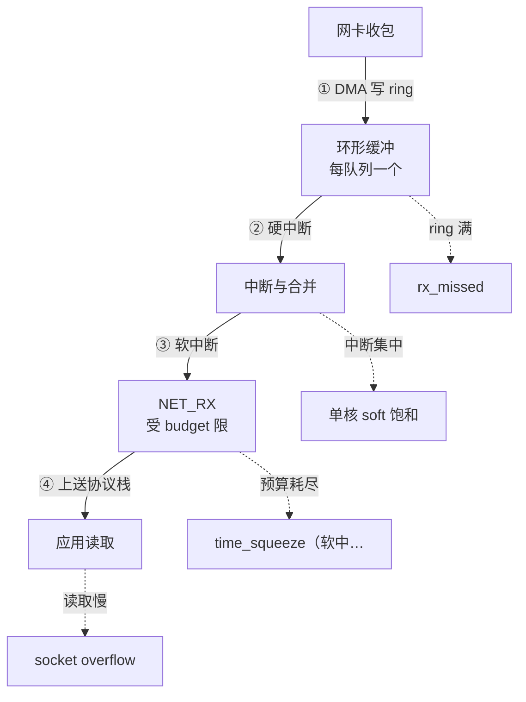
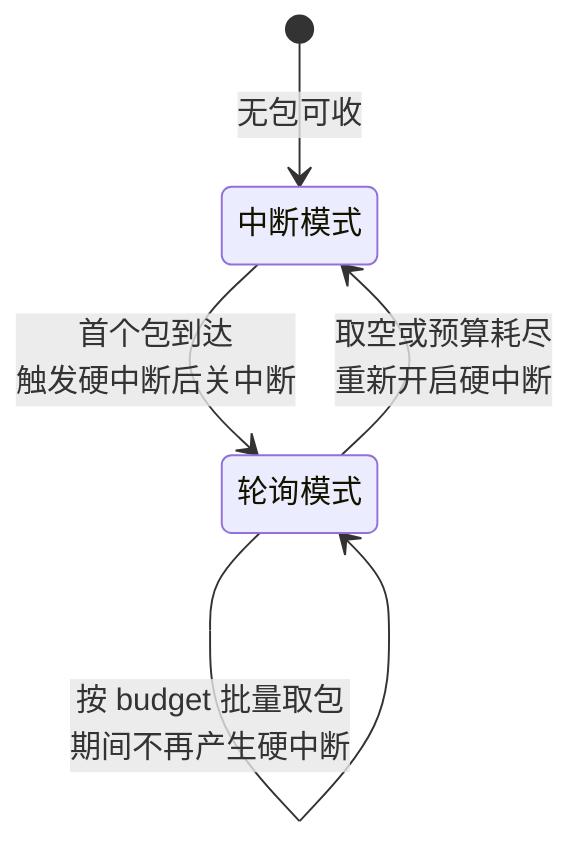
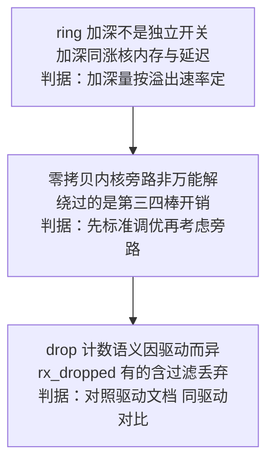

# 网卡丢包先看环形缓冲区溢出：队列、中断与软中断的接力

> **要点**：**网卡收包是一条接力链——DMA（网卡直接把收到的包写进内存、不经 CPU）写环形缓冲区、硬中断触发软中断、软中断取包上送协议栈，丢包发生在接力赛的每一棒（ring 满了丢、中断没来丢、软中断处理慢丢）**，`ethtool -S` 的 drop 计数按队列定位丢在第几棒；**调优动作按瓶颈所在的棒次选**（ring 加深、RSS 分流、软中断亲和与 budget，budget 即单次软中断最多处理的包数量）。

## 要解决的问题是什么：丢包发生在收包路径的哪一棒

**排查网络丢包（数据包在网络传输途中丢失）常停在交换机（在局域网内按地址转发数据帧的设备）没问题、ping（探测目标主机是否可达的基础命令） 也不丢这一步**——**主机侧的丢包发生在内核收包路径里，不出网卡**。

**读完这一篇你能拿到一份主机丢包的定位顺序：先读哪张表、再改哪个参数**。**收包像一条四人接力赛，四个阶段各算一名队员、各跑一棒**：**网卡把包写进环形缓冲、硬中断喊一声（硬中断的职能只是通知内核有包到达，不做别的处理）、软中断成批取走、协议栈交给应用**，**四棒任何一棒跟不上都会掉包，而每一棒都有自己的计数器，查丢包就是看哪一棒的数字在涨**。

定位顺序的依据是**接力链的四棒**：网卡 DMA 收包写 ring buffer → 硬中断通知内核（理想是每包一中断，高流量下合并）→ 软中断（NET_RX，内核处理收包的软中断类型）批量取包 → 协议栈处理上送应用。这个比喻到**"按棒次定瓶颈并选动作"**为止——**接力棒掉在哪要按棒次去读计数，光看"总共丢了多少"分不出该调哪一棒**。比喻失灵的地方也要点明：**接力赛是固定顺序的被动交接，收包各棒由中断与调度主动触发，软中断可能被别的任务抢占，这一点接力赛里没有对应物**。

**丢包的形态**：ring 满（软中断来不及取，网卡通丢）、**中断丢失/合并过度（延迟堆积后集中丢）**、**软中断 CPU 饱和（单队列打满单核，多核闲着）**。**本库网卡与内核旁路（绕开主流程的备用路径）篇**讲过中断与轮询的设计取舍；本篇给**丢包的定位与调优**：按队列读计数、按棒次定瓶颈。

收包是一条四棒接力，掉棒各有各的计数：


**四棒是一条递进链，每棒各挂一种丢包计数，计数能反映拥堵的原因在因果本身**：**ring 满时网卡无处放新包，所以 ring 满看 `rx_missed`**；**单核 `%soft` 饱和说明软中断处理不过来，所以中断集中看单核 `%soft`**；**单次软中断的处理预算耗尽提前收工，所以预算耗尽看 `time_squeeze`**；**应用读取慢导致 socket 缓冲积压，所以应用慢收看 socket overflow**。**排查动作按链的顺序走，哪一棒的计数在涨就是瓶颈所在**——**这就是「按棒次读计数定瓶颈」的具体形态**。

## 四棒接力各自的计数怎么读

**第一棒：ring buffer 溢出**。**ring buffer（网卡与驱动之间的环形队列，用来暂存刚收到的包，处理完一个就腾出一个位置）是第一棒的工作台**。`ethtool -S <网卡> | grep -E "rx_dropped|rx_no_buffer|rx_missed"`——**`rx_missed`/`rx_no_buffer` 增长即 ring 满的判据（网卡没地方放新包）**。**判定细节**：**按队列看（`ethtool -S` 输出按 rx_queue_N 分列），单队列涨 = 该队列的软中断跟不上**——**每个队列的软中断由固定的核处理，一队列涨说明那一核吃不下**；**全队列均匀涨 = 总处理能力不足——各核普遍吃力，属整体算力不够**。**当前 ring 深度**：`ethtool -g`（预设/最大值），加深用 `ethtool -G rx <值>`——**加深是缓冲不是根治**（软中断处理能力不变时只是推迟溢出，且增大内存占用与延迟），配合第三棒的 CPU 调优才构成完整解法。

发送方向的队列结构值得一看，下图出自 Dan Siemon《Queueing in the Linux Network Stack》一文，画出了**驱动队列在整条收发路径里的位置**：**IP 栈产出的包经排队规则（qdisc）进入驱动队列，队列里存的是指向内核 SKB（内核里表示网络包的数据结构）的描述符，网卡按描述符取数据上链路**；**接收方向大体是同构的逆过程——网卡 DMA 把包写进描述符指向的缓冲区，软中断按描述符取走上送**；**不完全对称的地方在发送侧有 qdisc 排队规则，接收侧没有对应的一层**：


*图源：[Queueing in the Linux Network Stack](https://www.coverfire.com/articles/queueing-in-the-linux-network-stack/)，Dan Siemon，2012（原载 Linux Journal）。*

接收方向的环形结构可以看得更具体。ixy 用户态（普通程序运行的低权限受限状态）网卡驱动的研究论文把接收侧的两个核心数据结构画了出来：图一是 DMA 描述符环——**环里的每个描述符指向内存池（预先分配大块内存、由程序自己切分管理）中一块预分配的缓冲区，网卡收到包后直接把数据写进这些缓冲区**——**在这类用户态驱动场景下全程不经 CPU 拷贝，普通内核路径仍有一次内核态（内核代码运行的高权限状态）到用户态的拷贝**：


*图源：[ixy: A user-space packet processing framework](https://www.net.in.tum.de/fileadmin/TUM/publications/2020/ixy-ludwig.pdf)（Bächer 等，TU Darmstadt，实为 2019 年版论文），Figure 3。*

图二是 RX（Receive，接收方向）队列的完整结构：描述符环（RDH 即接收描述符头指针，由网卡推进；RDT 即接收描述符尾指针，由驱动推进）与缓冲区表配合工作，**第一棒的「ring 满」本质就是这个环的可用槽位被耗尽**：


*图源：同上，Figure 4。RDH（receive descriptor head）由网卡硬件推进，RDT（receive descriptor tail）由驱动推进——两个指针之间的距离就是还能接收多少包的余量。*


**第二棒：中断与合并**。**`/proc/interrupts | grep <网卡>` 看硬中断的分布与速率**——**中断全打在一个 CPU**（IRQ（中断请求：硬件向 CPU 发出的需要处理信号） 亲和指把中断固定绑定到指定 CPU 的设置，未配置；RSS 指网卡按哈希把流量分到多个队列，也未启用）时，**该核软中断饱和后其他核无法分担**。**中断合并**（`ethtool -c`）的两面性：**合并降低中断频率（省 CPU），但增加延迟与突发（攒一批一起软中断）**——**低延迟场景调低合并、高吞吐场景适度合并**，**合并参数的验证看 drop 与延迟的联动**：**合并过度时攒批过大，超出 ring 或 budget 的承受范围，表现为 drop 上升且延迟抖动（性能指标不稳定的起伏）**；**调低合并后两者应同步回落**。

**中断与轮询的切换是这一棒的关键**，**NAPI（New API，内核收包的中断加轮询混合机制）的做法是"一次中断换一批包"**：



**关中断的这段时间里新包不再打断 CPU，代价是延迟取决于轮询批次**；**低流量下退化成"每包一中断"反而是最优的，所以两边都不是固定配置**。参考中文资料：[从 NAPI 说一说 Linux 内核数据的接收流程](https://sniffer.site/2020/05/12/%E4%BB%8Enapi%E8%AF%B4%E4%B8%80%E8%AF%B4linux%E5%86%85%E6%A0%B8%E6%95%B0%E6%8D%AE%E7%9A%84%E6%8E%A5%E6%94%B6%E6%B5%81%E7%A8%8B/)、[Linux 系统收包流程](https://www.thebyte.com.cn/network/networking.html)。

**第三棒：软中断的处理能力**。`mpstat -P ALL 1` 的 `%soft` 列——**单核 `%soft` 持续 80%+ 且 `rx_dropped` 增长 = 软中断瓶颈**。**分流手段**三种各有适用条件：**RSS（Receive Side Scaling，网卡按哈希把流分到多队列，`ethtool -x` 看分流表）靠硬件分流，优先启用**；**RPS（Receive Packet Steering，软件层把包分流到其他核）在队列少或没有 RSS 时用，队列少的虚拟网卡靠它**；`irqbalance` 做策略核对——**自动均衡有时把关键中断挪走，要核对**。**budget 与时间片**：`net.core.netdev_budget` 与 `netdev_budget_usecs` 限制单次软中断的处理量（budget 的含义见篇首）——**大量流量时"处理到时间片用尽就停"，下一轮再续**，**预算不够的表现**是 `time_squeeze` 计数增长（`/proc/net/softnet_stat` 第二列）——**time_squeeze（软中断一次处理不完留下的计数） 的字面意思是时间被挤掉：软中断因预算或时间片耗尽提前收工，剩余的包留到下一轮**。

**第四棒：协议栈与应用**。`netstat -s | grep -i "pruned\|collapsed\|overflow"`（receive buffer 不足的剪裁）、`ss -m` 看 socket 缓冲占用——**应用读取慢导致 socket 缓冲满，向上游反压为 buffer 剪裁与丢包**。**接力链的判定顺序**：**从第一棒往后逐棒排除（ring 计数 → 中断分布 → softnet_stat（内核软中断网络统计） → socket 缓冲）**，**计数增长的那一棒就是瓶颈**。

下面的全景图把前四棒放进内核收包路径：包从网卡进入后沿链路层、网络层逐级上溯，途中经过的每一关卡（prerouting、routing、postrouting 等）都可能是丢包点，接力链的四个棒次对应图右侧的上行通道：


*数据包穿越 netfilter 的路径：PREROUTING、INPUT、FORWARD、OUTPUT、POSTROUTING 五条链与 filter、nat、mangle 三张表（图源：51CTO 博客）*

**对照这张图读 `ethtool -S` 与 `/proc/net/softnet_stat` 的计数，丢包位置就能从「某个数字在涨」落到「链路上哪一段」**。上面的全景图画的是整条收包路径，接力链的四个棒次对应图中右侧的上行通道。**从泛化的收包路径往里聚焦，第四棒把包上送协议栈后最先遇到的队列瓶颈是连接建立那一关**——下面这张图画的就是协议栈入口的双队列，它引出的是另一篇主题（连接建立失败先看内核队列），此处只作位置参照：


来源：[小林coding《TCP 三次握手与四次挥手面试题》](https://www.xiaolincoding.com/os/1_hardware/tcp_interview.html)（CC 4.0 BY-NC-SA）


## 读完这一段你能判断什么：按瓶颈棒次该做什么

| 瓶颈棒 | 计数特征 | 动作 |
| --- | --- | --- |
| ring 满 | rx_missed/rx_no_buffer 涨 | `ethtool -G` 加深 + 第三棒联动 |
| 中断集中 | 单核 %soft 饱和 | RSS/多队列 + IRQ 亲和 |
| 软中断弱 | time_squeeze 涨 | budget 加大 + RPS 分流 |
| 应用慢收 | socket overflow/pruned | 应用读取提速 + 缓冲调大 |

**虚拟化环境的修正**：virtio（虚拟化半虚拟化设备标准） 网卡的队列数默认少（`ethtool -l` 看组合，`ethtool -L` 调整）——**虚拟机丢包的第一动作是把队列数调到与 vCPU（虚拟机内分配的虚拟 CPU）数匹配**——**队列数与核数匹配后，各队列的软中断能分到不同核并行处理，单核饱和导致的丢包随之消失（单队列虚拟机在高流量下的丢包是标配问题）**；**Overlay 网络（VXLAN，一种在普通网络包外面再套一层包头做隧道封装的协议）的封解开销让第三棒更重——封包与解包各占一次 CPU 处理，budget 相应加大**。


**监控的承接位置**：**drop 计数按网卡按队列进监控（增量速率而非累计值）、softnet_stat 的 squeeze 与 drop 两列、单核 %soft 的饱和告警**——**三个监控点覆盖前三棒**，第四棒在应用侧的缓冲指标里。

## 这套说法在哪儿会失效

**ring 加深不是独立开关**：**加深 ring 的同时核内存（每队列每 descriptor 约 2KB 的预留）与延迟（队列长=排队久）**——**加深的量按溢出速率定**（够撑住软中断的突发处理即可，不是越大越好）。

**零拷贝（数据不经用户态中转、由内核直接转发以省去复制）/内核旁路不是丢包的万能解**：**DPDK/AF_XDP 绕过内核栈，绕过的是第三四棒的开销，代价是可运维性（本库 RDMA 篇的同类取舍）**——**先做完标准调优再考虑旁路**，多数丢包问题在标准路径内可解。

**drop 计数的语义因驱动而异**：`rx_dropped` 在不同驱动里含义不同（有的含 filter 丢弃、有的只计缓冲不足）——**判定时对照驱动文档**，跨机器对比用同一驱动的同名计数。三条误用逐条看：



**ring 加深不是免费开关：核内存与延迟随深度同涨，加深量按溢出速率定，够撑住软中断的突发处理即可**。**跨机器对比必须用同一驱动：`rx_dropped` 在不同驱动里含义不同，跨机器对比用同一驱动的同名计数，否则数字看起来在涨，实际量的不是同一件事**。

## 怎么自己动手验证

可复现的验证路径：

1. ring 溢出复现：**把 ring 调到最小 + 高流量压测，预期 rx_missed 增长、加深后归零——验证第一棒判定**；
2. 单核饱和复现：**关闭 RSS/多队列压测，预期单核 %soft 飙升与丢包同步，开 RSS 后分散且丢包停止——验证分流动作**；
3. squeeze 复现：**压低 netdev_budget（软中断单次处理包的预算）压测，预期 time_squeeze 增长、加大后回落——验证第三棒判定**；
4. 断言锚点：**drop 计数按队列进监控、softnet_stat 两列在管、队列数与 vCPU 匹配进部署基线（正常状态下的指标水平、用来对比异常）**——**三件齐备，主机侧丢包从"ping 不丢但业务说丢"的悬案变成四棒接力的一张计数表**。

```text
接力断言 = 四棒计数逐棒排查
分流断言 = 队列与核数匹配基线
监控断言 = drop 增速按队列在管
```

**主机侧丢包的定位是把接力链显性化：ring、中断、软中断、协议栈四棒各有计数、各有动作**——**按棒次读计数定瓶颈，调优动作就不散打，"网络偶尔丢包"的最后一站常在主机的第一棒**。

## 接着读哪几篇：第一二棒的设计取舍层

- [[工程知识/后端系统：在并发、失败与变化中维持服务/基础设施/网卡与内核旁路：中断与轮询的取舍.md]] —— 第一二棒的设计取舍层
- [[工程知识/性能工程：从用户等待到资源瓶颈/存储与网络/连接建立失败先看内核队列：SYN 队列与 accept 队列是两个瓶颈.md]] —— 协议栈入口的队列瓶颈
- [[工程知识/后端系统：在并发、失败与变化中维持服务/基础设施/DNS解析的全链路：递归缓存与失效传播.md]] —— UDP 小包高QPS（每秒查询数）的同类路径压力
- [[工程知识/性能工程：从用户等待到资源瓶颈/存储与网络/交付前的网络检查清单：二十项逐条过，三项全绿再上线.md]] —— 队列基线进交付清单
