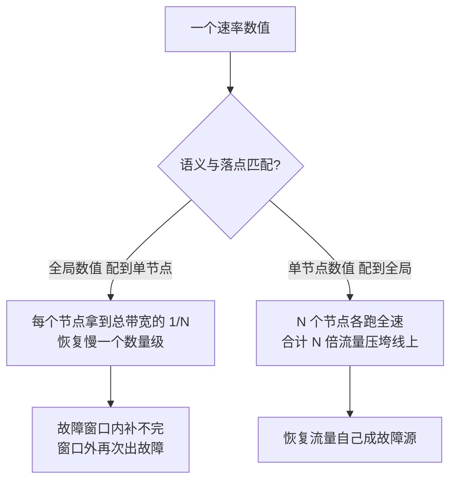
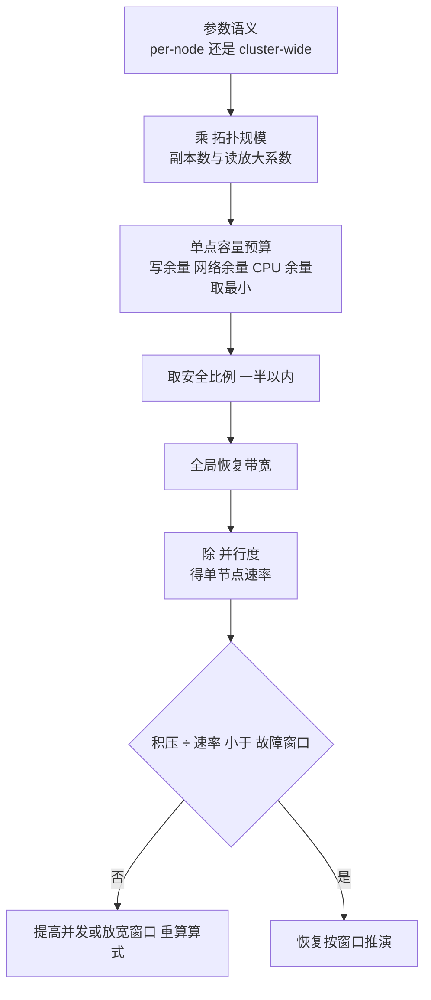

# 节流参数与容量匹配：全局限流值要按单点容量乘副本数算

同一个速率参数，**配在集群全局和配在单节点上是两个数量级**——例如全局带宽 400MB/s 的系统有 10 个节点，把 400 误填到每个节点的单节点参数上，合计就是 4000MB/s 的恢复流量，**直接压垮线上**。读完这一页你能**按参数语义、拓扑规模和单点容量三个量推出该填多少**，避免恢复流量自己变成故障源。

> 恢复类后台动作（副本修复、数据重平衡、GC 补偿）的**速率参数有两套语义——集群全局与单节点**。**把全局数值配到单节点上，动作慢一个数量级**；**把单节点数值配到全局上，恢复流量自己变成故障源**。**节流参数必须按「参数语义 × 拓扑规模 × 单点容量」三个量推**。

## 为什么限流参数经常被配错？

本篇要解决的问题是：**恢复类动作的限速参数按什么语义与口径配置、配完怎么验证生效**。分布式存储都带一类"补作业"的后台动作：副本数不够时补副本、节点离开后重平衡（成员增减时把分区重新分配给消费者的过程）、垃圾回收时的补偿写、快照（某一时刻的完整只读副本）后的对账读。这类动作的共同特征是**平时不跑、故障后集中跑，且跑的时候系统刚受过伤**——**恢复流量叠加在剩余节点的正常负载上**，不节流（把高频操作压缩到固定频率执行的手段）会把"单节点故障"放大成"集群过载"，节流过头则**恢复周期长到故障窗口之外**——**下一处故障发生时上一次恢复还没补完**，损坏一层层累积，再次出故障。

节流参数的配置有一个高频错误：**把集群全局的速率数值填到单节点的参数里**（或反向）。上游 BookKeeper（Apache 的分布式日志存储系统）的一个复现缺陷是 **recovery 命令的限速参数不生效**——运维按文档给了速率，但**参数在命令行到执行层限速器的传递链上丢失**，限速器收不到这个值，**实际动作以默认速率全速跑**；更早的案例是全局吞吐参数被误读为单 Bookie（BookKeeper 中承担存储的单个节点）吞吐，**副本恢复慢了十倍**。

**两类错误的共同根源是参数语义（per-node 单节点还是 cluster-wide 集群范围）与配置者的心智模型脱节**，而文档往往一句话带过。

## 限流值按什么顺序推出来？

限流（限制单位时间内放行的请求数量）值不是凭空定的，**它取决于流量在哪个位置被拦、以及被拦之后往哪里去**。网关（站在客户端与后端服务之间的入口层，集中处理路由、鉴权与协议转换）按请求路径把流量分到不同后端服务，限流点放在网关上时，**一个值覆盖的是全部后端**：

维基媒体基金会的限流架构把这个「位置」问题摊开成三层：边缘层（Edge Layer）按 IP 挡爬虫、API 网关按用户挡应用层滥用、MediaWiki 内部再做按用户的兜底限流——**同一套容量语义，在不同层配的值、覆盖的流量、看到的身份各不相同**：


*令牌桶限流：上方按时间步发放令牌入桶，下方请求依次取令牌，取到则放行、取不到则拒绝（图源：知乎 @王瑞宁，CSDN 转载）*

*限流点与限流键随层变化的实例（图源：Wikimedia Commons，DKinzler (WMF) 绘，CC BY-SA 4.0）*

分层解决了「在哪拦」，**每一层用什么算法计数，决定请求怎么被拦**。JavaGuide《如何设计接口限流》引用的三张机制图把常见算法画到最小：固定时间窗口把时间切成整段计数，**窗口内的请求超量即弃、边界处可能漏进双倍突发**：


*图源：[JavaGuide《接口限流》](https://javaguide.cn/high-availability/limit-request.html)（原载 InfoQ 作者王国维《分布式服务防雪崩熔断器》，CC BY-SA 4.0）。*

漏桶（请求先入队、再按固定速率放行的整流算法）**把请求先存进桶再按固定速率匀速执行，突发被削平**；令牌桶（按固定速率发放令牌、请求消耗令牌才放行的限流算法）反过来，令牌按固定速率生成攒在桶里，请求取到令牌就走，**攒下的令牌允许短时突发**：


*图源：同上，JavaGuide。漏桶匀速出水的严格与令牌桶攒令牌的弹性，是限流语义的第一分岔——选哪种，取决于下游扛不扛得住突发。*

限流点的选择只是第一维，**全局限流值本身要按单点容量乘副本数算**，推导顺序是语义、规模、容量：

全局限流值要按单点容量乘副本数算。顺序是语义、规模、容量：

**第一件：参数语义**。读文档回答"这个数值作用在哪个范围"——单节点参数（每个 Bookie 的磁盘写入限额、每个恢复 worker 的读速率）与集群参数（整个恢复任务的总带宽）**在效果上差一个副本数倍数**。**文档含糊时用实验定语义**：把参数调大一个数量级，看生效范围是一个节点的指标还是全集群的合计。

**第二件：拓扑规模**。**参数语义 × 当前副本数 = 集群总恢复带宽**。补副本场景还要多算一笔：**一个副本的写入 = 副本修复目标节点收到 1 份 + 其他副本节点的读流量**，读放大（一次逻辑读触发多倍实际读取）系数与写放大（实际写入量是逻辑写入量的多倍）系数同阶（写放大指每笔写入实际触发的磁盘读写次数，写放大为 3 的配置恢复读约为恢复写的三倍——读放大同理指每笔读取触发的实际读次数）——**只算写不算读，恢复流量被低估一半以上**。

**第三件：单点容量预算**。恢复流量的分配原则是**用富余量，不用容量**：目标节点的磁盘写入余量（总带宽 - 正常业务峰值）、网络余量、CPU 余量，**三者取最小值，恢复速率配在这个最小值的一个安全比例**（一般一半以内——另一半留给业务峰值波动与突发，取一半是常见经验值，可按业务波动幅度调整）。**恢复速率的上限是"不伤害线上"，下限是"在预期的连续故障窗口内补得完"**——窗口估算按故障率与恢复时长推：**故障率取倒数得到平均故障间隔**，间隔时长乘以恢复速率得到这段时间内能恢复完的节点数 N，**N 要大于恢复目标**。

**同一个速率数值配到两套语义上，结局走两条链**：



图：两类配错各自的失败路径——慢一个数量级与放大 N 倍方向相反，根因同是语义与落点脱节，实验定语义就是为堵住这个分岔。

限流器满时的去向对应线程池（复用固定数量工作线程的执行容器）满时的四种拒绝策略：抛异常、静默丢弃、丢最旧、调用者自跑——**被拒绝的流量往哪去，同样是容量语义的一部分**：


来源：[美团技术团队《Java线程池实现原理及其在美团业务中的实践》](https://tech.meituan.com/2020/04/02/java-pooling-pratice-in-meituan.html)（CC 4.0 BY-SA）


## 参数配好之后怎么验证它生效了？


三个量有固定推导顺序：**先定参数语义，再乘拓扑规模（含读放大系数），最后被单点容量预算里最小的那一项卡住**；**末端的窗口判定不通过，整条链要回头重算**：



推导链的出口是窗口判定而不是某个速率数值，窗口判定不通过时，**动作是提高并发或放宽窗口、回头重算整条算式**——所以配置模板里每个数都要留算式，半年后调参的人不必重新推一遍。

**配置模板**：**全局恢复带宽 = min(节点写余量 × 可同时恢复的节点数, 网络余量)**；**单节点恢复速率 = 全局 ÷ 并行度**（同时跑的恢复线程数）；**写放大系数照实计入读流量**。**每个数都写推导依据**，配置注释里留下"这 40MB/s = 节点写余量 100MB/s × 40%"这样的算式，**半年后调参的人不需要重新推理**。

**生效验证三步**：一是限速参数变更后立即看速率指标（**很多缺陷的形态是参数静默不生效**——上游复现的 recovery 限速参数问题，改了参数动作照样全速）；二是注入验证（测试环境拔一个节点，**观察恢复速率是否按配置走、业务延迟是否在预算内**）；三是恢复时长推算（**按当前积压量 ÷ 实测速率**，对照故障窗口检查"补得完"的下限）。

**窗口与并发的联动**：多节点同时故障（机房级、交换机级）时，恢复带宽按"剩余容量"重新分配而不是按节点数平摊——**并发恢复的速率上限依然受单点余量约束**，**把全局带宽平摊到 10 个故障节点不等于每个节点能拿到 1/10 带宽**（受限于它们共同的瓶颈位置）。

## 这套推导在哪儿会失效？

**三条边界防止防线走形**。

**节流参数不改变恢复优先级**：**先补谁后补谁是放置策略的问题**（按数据重要度、按副本危险度排序），速率参数只管"跑多快"——**两个旋钮混用会出现在低优先级数据上耗尽带宽的形态**。

**限速生效依赖参数传递链**：命令行参数 → 进程配置 → 线程级限速器的**传递链上任何一环缺失，限速静默失效**——上游复现缺陷的形态正是 CLI（命令行界面）参数没传到执行层；**升级后重跑一次限速验证**应进升级检查单。

**恢复流量有自己的监控维度**：按"恢复读、恢复写、业务读、业务写"四个维度分开计数——**混在一起的吞吐指标看不出恢复流量占了业务多少头寸**，容量预算也无从核对。

## 怎么自己动手验证

可复现的验证路径：

1. 语义：测试环境把限速参数调大一个数量级，**预期恢复速率按参数语义的范围变化**（单节点参数只动一个节点的指标）；
2. 注入验证：拔一个存储节点，**预期恢复速率 ≈ 配置值 ±10%，业务延迟在预算内**；参数篡改为超大值时，**限速器生效、速率被封顶**；
3. 时长推算验证：给定积压量与实测速率，**恢复完成时间与推算一致**（误差以内）；
4. 断言锚点：**配置里每个速率值有推导算式、限速生效验证进升级检查单、恢复流量独立计数**——三件齐备，恢复类故障从"意外"变成"按窗口推演的事件"。

```text
语义断言 = 参数影响范围实测与文档一致
注入断言 = 恢复速率按配置走，业务不受伤
窗口断言 = 积压 ÷ 速率 < 故障窗口
```

节流参数的配置从"照抄文档"变成"语义 × 拓扑 × 容量的推导题"，**恢复动作就从不可控的后台洪水变成有预算的工程行为**——洪水的边界在配额：**恢复流量压在单点余量以内是灌溉，超出余量漫到业务负载上才是洪水**。

## 接着读哪几篇：副本修复的动作背景

- [[工程知识/数据系统：在并发与故障中保存事实/可靠性与运维/复制的三种模式：主从、多主与无主的失败形态]] —— 副本修复的动作背景
- [[工程知识/后端系统：在并发、失败与变化中维持服务/服务设计/分布式限流的四种算法：计数漏桶令牌与滑动窗口]] —— 限速器的机制层
- [[工程知识/性能工程：从用户等待到资源瓶颈/存储与网络/硬件选型的容量留白：按峰值负载的一半规划，另一半是波动预算]] —— 余量预算的原则来源
- [[工程知识/性能工程：从用户等待到资源瓶颈/存储与网络/磁盘空间管理三原则：配额水位与临时目录纪律]] —— 同属"后台动作与容量匹配"的治理家族
