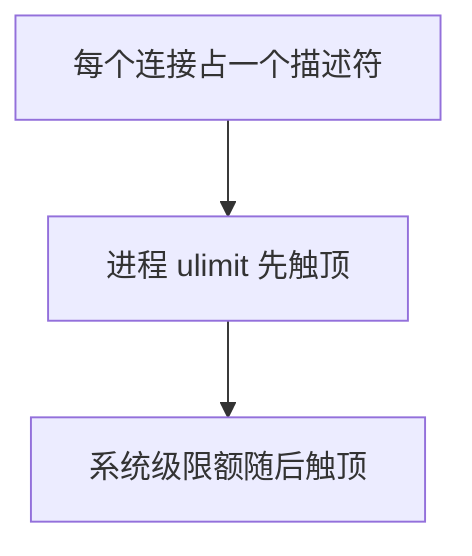
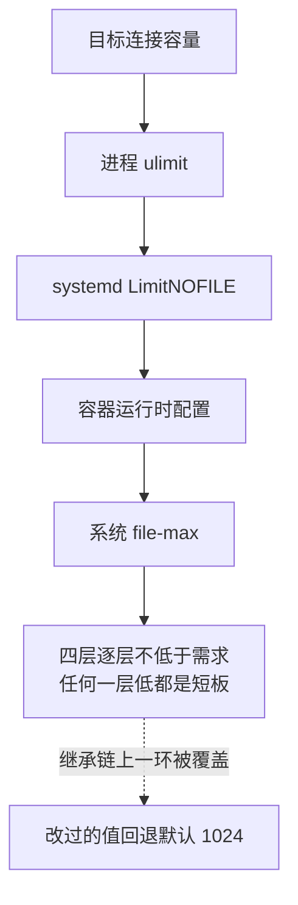
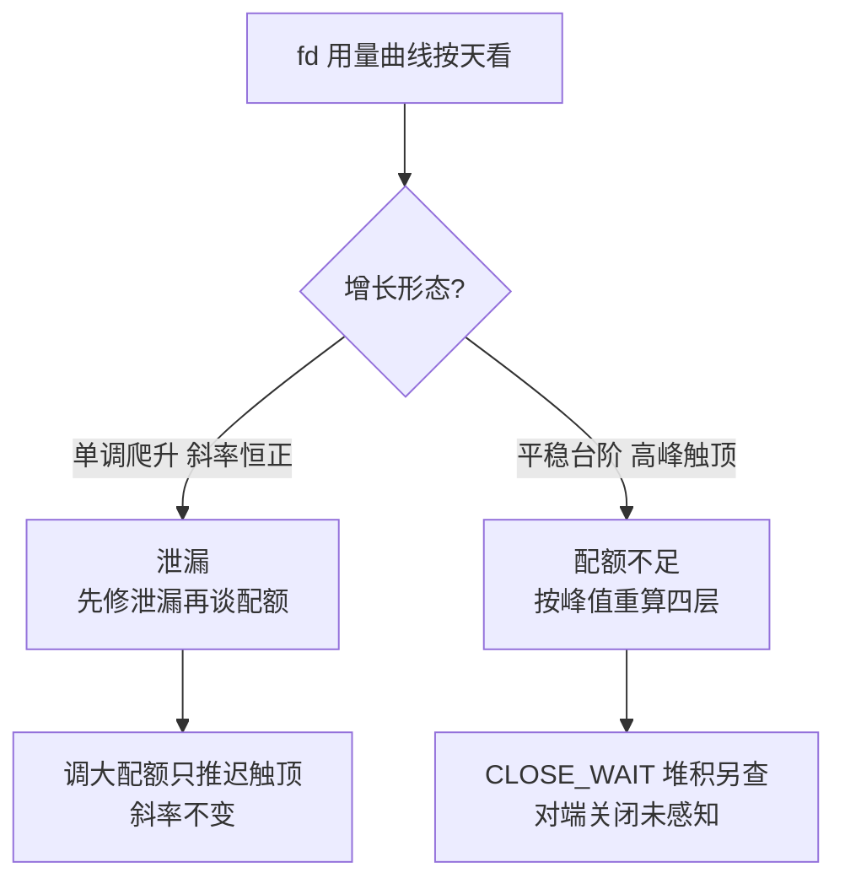

# 连接与文件描述符的配额要联动：ulimit 是连接数的隐形上限

连接数配额还够，服务却在拒绝新连接——**卡住的往往是文件描述符**（进程用来指代打开文件的整数编号）。读完这一页你能**把进程级和系统级的三层配额一起算进容量规划，并把核对做成自动检查**。

> **要点**：每个连接、监听套接字、打开的文件都占一个文件描述符，**进程级 ulimit 与系统级 file-max、fs.nr_open 三层配额中任何一层卡住**，**服务在"连接数配额远未用完"的错觉下拒绝新连接**；容量规划**把描述符配额当一等公民与连接数一起算**，部署配置**把三层配额的核对自动化**。

## 为什么连接数没满却拒绝新连接？

本篇要解决的问题是：**连接配额与描述符配额怎么联动核算、触顶之后怎么诊断**。先看问题形态：



三层配额由内向外生效：

每个描述符背后是一次完整建立的连接，**客户端与服务端要一来一回交换三个报文，连接才算立起来**；**此后这条连接在存活期内始终占着一个文件描述符**：


*TCP 三次握手（TCP 建立连接前、双方交换三个报文确认彼此收发能力的流程）：SYN（Synchronize，TCP 建连第一步的握手信号）、SYN+ACK、ACK 三个报文与客户端、服务端状态变化（图源：博客园）*

配额核算的对象就是这张图反复发生之后的稳态（系统运行指标进入平稳区间后的状态）数量——**峰值期每秒新增多少次握手、存量多少条存活连接**，**两者折算成的描述符占用才是容量规划的真实输入**。


长连接（建立后保持不断开、多次通信复用同一条连接）服务（网关、消息推送、数据库代理）的**容量规划通常按内存与 CPU 算连接数上限**，**文件描述符配额经常被当作"调大一次就完事"的环境参数**——**直到某天服务开始拒绝新连接、日志报 "Too many open files"**，而**连接监控显示数量远低于设计容量**。一个日常比方帮着建立直觉：把文件描述符想成图书馆的借书卡——**卡数（描述符配额）和书架空间（内存）是两套独立的限额**，卡发完了人进不来，书架却还有空位，所以只加书架不增发卡没有用。**比喻只覆盖"限额彼此独立"这一点，具体数值仍要按下文逐项核对**。本库基础设施域"长连接网关（维持大量客户端长连接、并把服务端消息推给客户端的入口服务）的工程要点"提过描述符与连接数的关系；本篇把配额体系讲完整：**三层配额各自的语义、联动核算的方法、静默触顶的诊断路径**——描述符是最常见的隐形上限，因为它在四层（进程、用户、系统、容器）各有一份且默认值彼此独立。

## 三层配额怎么逐层卡住连接、又为何静默触顶？


*图源：Florida State University COP4610 课程讲义 I/O Redirection（引自《Operating Systems: Three Easy Pieces》Figure 5-2），教学用途，https://www.cs.fsu.edu/~cop4610t/lectures/project1/io_redirect/io_redirection.pdf。*

这张图解释「三层配额」里的第一层为什么按进程算：每个进程有自己的文件描述符表，**ulimit 限的就是这张表的长度**；表项逐级指向系统级的打开文件表与 inode 表（内核记录每个文件的元数据与实体的索引结构），后两者的总量上限分别是 fs.nr_open（单个进程能设置的描述符上限）与 file-max（整个内核的描述符总量上限）。**每条 TCP（传输控制协议，负责把数据完整、有序地送达）连接在左边的表里占一格**——**容量规划按这条链逐层核算**。

**进程级（ulimit -n / LimitNOFILE）**：**单个进程能打开的描述符上限**。**它的隐蔽性在继承链**：**shell 的 limit 传给 systemd（Linux 的服务管理器）传给服务进程**，**任何一环的配置覆盖都会让"改过的值"悄悄回退到默认 1024**——上游 BookKeeper（Apache 的分布式日志存储系统）的一个复现改进是日志记录 GC（垃圾回收，自动释放不再使用的内存的后台线程）的所有错误，**其中包含因描述符耗尽被吞掉的清理失败**——这与 ulimit 的教训是同一条：**资源耗尽的失败多发生在清理与后台路径，不记日志就完全静默**。

**系统级（file-max / fs.nr_open）**：整个内核的描述符总量上限与单进程可设置的上限。容器化部署时还要算上**容器运行时自己的限制**（Docker 的 default-ulimit 描述符限额——Kubernetes 的 securityContext 安全上下文资源限制）——四层里任何一层的值低于目标容量，目标就作废。

**静默触顶的机制**：**描述符泄漏（连接未关闭、文件流未释放、第三方库的隐藏句柄）让用量缓慢爬升**；**触顶后的失败形态取决于代码路径**——**accept 失败（新连接被拒）、connect 失败（出向调用全断）、open 失败（日志文件都打不开，故障最黑的时刻连日志都没有）**。**"日志突然消失"本身是描述符耗尽的诊断信号之一**。


来源：[博客园《多图详解 TCP 连接管理，太全了!!!》](https://www.cnblogs.com/cxuanBlog/p/14679563.html)（CC 4.0 BY-SA）


## 怎么核算三层配额、又怎么诊断触顶？

**联动核算四步**：一是算需求——**并发连接数 + 每连接的内部描述符**（上游连接、日志、本地 socket、epoll 实例——Linux 的事件通知接口，让单个线程同时监视大量连接的就绪状态）+ 库的隐藏句柄，**按峰值乘安全系数**；二是核四层——进程 limit、systemd 配置、容器运行时配置、系统 file-max，**四层的值逐层 ≥ 需求，任何一层低于需求都是短板**，配额核到位的收益是**触顶从生产事故变成压测场景**，代价是每次部署多一道四层核对；三是留增长余量——**配额按一年后的容量定，改配额要重启进程，机会成本高**；四是建监控——**进程的当前描述符用量（/proc/self/fd 计数）与配额的比值进监控**，**80% 告警**，**触顶后再告警就晚了**（失败已经发生）。

**诊断路径**：服务拒绝连接时按顺序核——进程实际 limit（/proc/<pid>/limits，**配置文件的值不算数**，**运行时实值才是事实**）、当前用量（/proc/<pid>/fd | wc -l）、用量构成（fd 链接目标分类统计：socket 多还是文件多）。**socket 异常多 → 连接泄漏（对端关闭未感知）；文件异常多 → 文件流泄漏**——**两类泄漏的修复方向不同**。



配额的串联结构：**连接要建立，四层配额逐层都要放行**，任何一层低于目标容量，目标就作废——**这是「连接数配额远未用完却拒绝新连接」的成因**。虚线是继承链的隐患：shell 传 systemd 传服务进程的任何一环被覆盖，改过的值就回退到默认 1024，所以**核对要按运行时实值（/proc/<pid>/limits），配置文件的值不作数**。

**泄漏的定位**：**lsof（列出进程已打开文件的命令）按进程列出 fd，按类型分组看增长源**；对 socket 看 TCP 状态分布，CLOSE_WAIT（对端已关闭、本端应用还没关闭连接的状态） 即对端已关闭、本地迟迟不发关闭报文的半关状态，**其堆积是经典的"应用没调 close"签名**（用私钥对数据生成可验证的防篡改标记），本库 TCP 状态机篇的异常路径。**增长曲线按天看**——**泄漏是斜率，配额不足是台阶（流量高峰触顶）**。**两条曲线形态不同，处置方向完全不同**：



曲线形态与处置的对应：**斜率问题靠代码纪律与压测，台阶问题靠容量核算**，**把台阶当泄漏修或反向，都会在下次高峰复发**。配额不足那条分支里的 CLOSE_WAIT 堆积要另查——**对端已关闭而本地未感知，属于连接泄漏的另一形态**，处置方向与配额重算不同。

## 这套说法在哪儿会失效

三条边界防止防线走形。

**调大配额不修复泄漏**：**泄漏型触顶调大配额只是推迟触顶时间，斜率不变**——**先修泄漏再谈配额**，**配额是容量规划工具，防泄漏靠代码纪律与压测**。

**file-max 不是越大越好**：**每个描述符在内核有内存开销，总量上限按机器内存定**——单机几十万连接的服务把 file-max 配到千万级，每个描述符在内核对应约几 KB 的结构开销，千万级就是数十 GB 内存，**内存被描述符结构吃掉，触发的是另一种 OOM**（内存耗尽：系统内存用光，内核挑一个进程杀掉腾地方）。

**连接池（预先建好连接反复取用、省去反复握手建连的开销）的描述符也要算**：**应用内每个连接池、每个 HTTP 客户端的连接上限各自独立，总量是各池之和**——**池化组件的"每池上限"配置分散在代码各处**，**总量核算要遍历配置，漏算一个池就是漏算一类触顶**。

## 怎么自己复现并验证触顶与泄漏？

可复现的验证路径：

1. 触顶复现：把 limit 调到小值压测连接建立，**预期 accept 失败、日志报 Too many open files、fd 用量停在配额值**——**形态与生产事故对得上**；
2. 泄漏复现：构造不关闭响应体的 HTTP 调用，**预期 fd 曲线按请求量线性爬升、CLOSE_WAIT 堆积，修复后斜率归零**；
3. 四层核对验证：故意在容器运行时配低于 systemd 的值，**预期部署核查脚本报出短板层**；
4. 断言锚点：**fd 用量与配额比值进监控（80% 告警）、部署核查脚本核对四层配置、描述符容量写进容量规划文档**。

```text
触顶断言 = 实值与用量在 /proc 可核
泄漏断言 = 斜率归零为修复判据
监控断言 = 80% 比值告警在管
```

描述符配额从"环境参数"升格为容量规划的一等公民：**四层核算、运行时实值核对、用量监控三件齐备**，**"Too many open files"从事故变成演练过的场景**。

## 接着读哪几篇：连接容量的主场景

- [[工程知识/后端系统：在并发、失败与变化中维持服务/基础设施/长连接网关的工程要点：心跳推送与连接迁移]] —— 连接容量的主场景
- [[工程知识/后端系统：在并发、失败与变化中维持服务/基础设施/TCP连接建立与断开的状态机：握手挥手与异常路径]] —— CLOSE_WAIT 等异常状态的机制层
- [[工程知识/后端系统：在并发、失败与变化中维持服务/任务与并发/后台任务的守护链：进程托管与会话脱离是可靠性的底线配置]] —— systemd 与进程托管链上的 limit 继承
- [[工程知识/后端系统：在并发、失败与变化中维持服务/服务设计/连接池参数的联动校验：池大小、超时与队列深度是一组约束]] —— 连接池上限的联动核算
