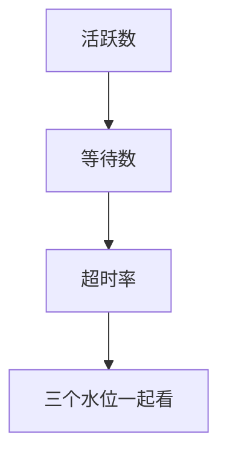
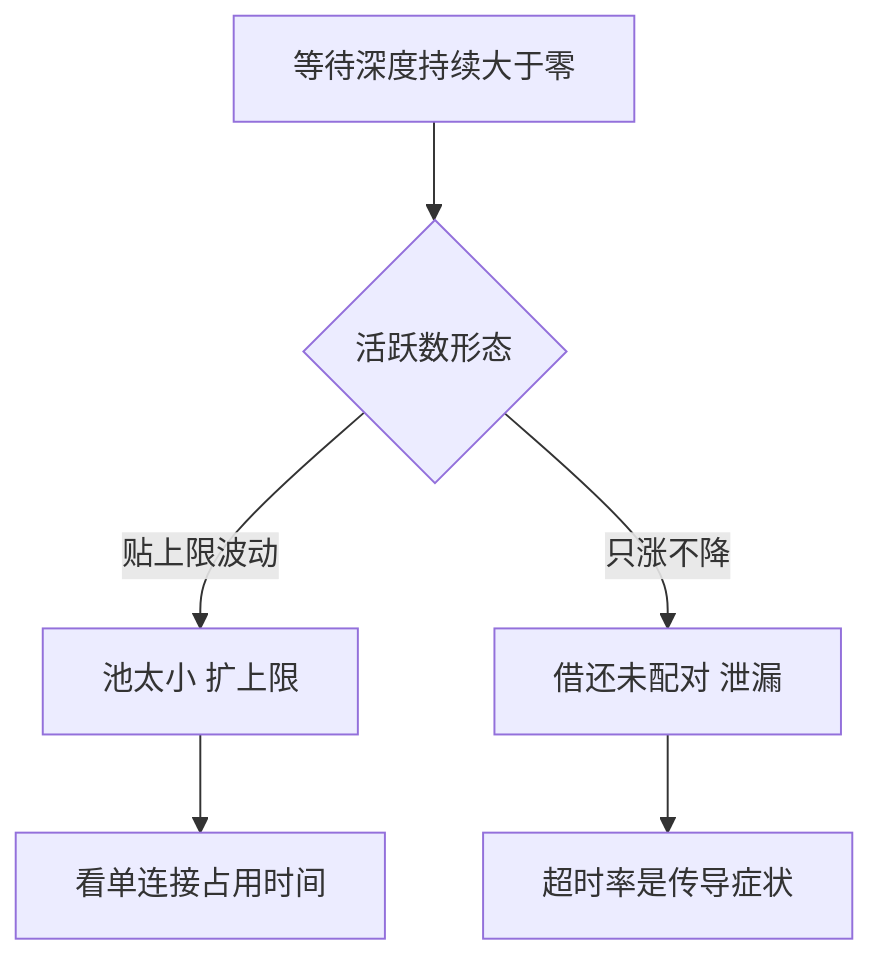

# 连接池的验证要看池内水位：活跃数、等待数与超时率三个水位计

连接池健不健康，**看三个水位计就够：用了多少、有多少在等、有多少彻底借不到**。读完这一页你能**按三个数的组合判断是池太小、泄漏还是下游变慢**，避免只会扩容。

> **要点**：连接池的健康状况读三个水位计——活跃连接数（池被用了多少）、等待队列深度（借不到连接的请求有多少）、获取超时率（彻底借不到的比例）；**三个水位计的组合形态对应三类病因（池太小、池泄漏、下游变慢）**，**扩容只对第一类有效，先读表再动手**。

## 连接池故障为什么不能上来就扩容？



连接池故障的报错是"获取连接超时"，**常见误反应是把池调大**——**三类病因里只有一类对调大有反应**：池太小（峰值活跃数顶到 max——池允许的最大同时连接数）、池泄漏（借了不还，活跃数只涨不降）、**下游变慢（单次占用时间变长，池没坏但周转慢了）**。**扩容对泄漏无效**（**更大的池只是推迟打满**），**对下游变慢有害（更大的并发打到慢下游）**。本库服务设计域"连接池参数的联动校验"讲过参数推导；**本篇讲运行时的水位诊断**：**三个水位计的读法、组合形态与病因对照、每类病因的处理动作**。

## 三个水位计分别怎么读？

**池的本质是隔离：把资源切成互不相通的分区，一个分区耗尽不影响其他分区继续服务**。


**隔离边界划在哪里，决定了故障时多大范围受影响**。**划在单一服务上，故障就停在这个服务内部**：

「各杆各灯各烛」的实物原型是宅院里的红灯笼：门口、廊下、库房各挂各的杆，烛油各添各的——库房的烛点得再省，门口的亮度不减；一杆的烛油烧干，别的杆照常亮。灯笼只类比「按用途分区、一处故障不影响他处」这一层：**借出归还、等待排队、获取超时是连接池独有的动态机制**，灯笼讲不到，要看三个水位计：


分池的动机在负载形态：批处理（把多个请求合并成一批同时计算、提高硬件利用率）的长事务、读请求的短平快混在一个池里，**一类负载会把连接占满、挤掉其他请求**。按用途分的连接池就是各杆的烛——**读池、写池、批处理池各有各的活跃数上限，各自占用自己的连接预算**——**批处理把写池占满时，读池的水位（活跃数、等待数、超时率）纹丝不动**，**这正是三个水位计要按池分开看的原因**。

在这个前提下，池内水位才有意义——**活跃数、等待数与超时率三个数字共同说明池是被用满了、还是根本没用起来**。


*图源：Wikimedia Commons《Thread pool》，作者 en:User:Cburnett，CC BY-SA 3.0，https://commons.wikimedia.org/wiki/File:Thread_pool.svg。**连接池与这张图同构：把"工作线程"换成"连接"**，"任务队列"换成"等待取连接的请求"。下面三个水位计量的就是这张图的三个位置——队列里排了几个、池里借出几个、排多久算超时。*

**活跃连接数（active）**：当前借出未还的连接数——**健康形态是在 max 之下波动**（**峰值接近 max 且等待出现，才是池太小的信号**）；**异常形态是"只涨不降、长期贴着 max"（泄漏的嫌疑）**，**或"低位平稳但超时率高"（下游变慢的信号：连接在池里是空闲的，业务层却报超时——超时发生在别处）**。

**等待队列深度（pending）**：正在等连接的请求数——**瞬时波动正常**（**突发流量时短暂排队**），**持续大于零是容量不足或周转慢的信号**；**等待深度与活跃数的相位关系是判据**：**活跃贴 max 且等待持续，池是瓶颈**；**活跃不满且等待持续，连接在个别地方被长时间占用（慢查询、下游 hang）**。

**获取超时率（timeout）**：**等待超过 maxWait（单次借连接允许等待的最长时间，超过还没借到即记一次获取超时）的请求比例**——**它是最终症状**，前两个水位计是先行指标；**超时率曲线与等待深度的领先关系（等待先涨、超时后涨）是容量预警的窗口**。**告警挂先行指标**（等待深度持续 > 0 达 N 秒），**超时率告警作最后防线**。

三个水位组合起来的诊断表：

| 活跃 | 等待 | 超时 | 判断 | 动作 |
| --- | --- | --- | --- | --- |
| 贴 max | 持续 > 0 | 上升 | 池太小 | 扩 max（联动下游连接上限） |
| 只涨不降 | 上涨 | 上升 | 泄漏 | 泄漏检测 + 借还配对审计 |
| 低位平稳 | 上涨 | 上升 | 下游变慢 | 修下游耗时，别扩池 |
| 波动正常 | 瞬时 | 零 | 健康 | 不动作 |

「池满排队」在云架构里的同构形态是队列削峰（用队列缓冲瞬时洪峰、让下游按能力匀速消费）：波动到达的请求先进队列缓冲，服务按自己的处理速率消费——队列把「到达多快」与「处理多快」解耦，等待深度就是队列长度，超时率就是队列溢出的比例：


*图源：[Microsoft Learn 中文文档《基于队列的负载调节模式》](https://learn.microsoft.com/zh-cn/azure/architecture/patterns/queue-based-load-leveling)，CC BY 4.0，文档引用。*

三个水位的读数组合分出三条处置路径。**等待深度持续是所有路径的共同入口**：**池太小、泄漏、下游变慢三类病因最终都让连接供不应求**，**最先的统一现象就是请求持续排队**，所以**分诊从等待深度起步，再由活跃数形态区分是哪一类**：



等待持续时按活跃数形态分诊：**三种形态对应三种病因与三种动作**，**误诊方向（下游变慢时扩池）只多占下游预算而病不除**：**下游变慢是单次连接占用时间变长，扩池提高的只是打到下游的并发量**，下游处理速率没变，连接仍被长时间占用、池仍周转不动，**反而让更多连接压在已经慢的下游上**。


## 三类病因分别怎么处理？

**池太小（扩容前的两个核算）**：**max 的上限是下游连接数预算 ÷ 实例数**（下游 `max_connections` 被所有实例分摊，本库"节流参数与容量匹配"的全局核算原则）；**扩容后核对单连接占用时间（pool 的连接生命周期参数联动）**——**扩容的收益是排队消散、超时回落，代价是下游连接预算被多占**，所以**扩容是改一组联动参数，单改 max 是最常见的半截动作**。

**池泄漏（检测与审计）**：泄漏检测的两个手段——**连接借出时的堆栈记录（leakDetectionThreshold 是连接借出后允许持有的最长时间阈值，超时未归还就打印获取点的调用堆栈）**、**借还配对审计（borrow/return 计数恒等，缺口即泄漏量）**——**泄漏的常见源头**：**异常路径漏还（finally 缺失）、事务未关闭、长事务持有**（本库"案例四十七"的长事务是连接泄漏的高发形态）。

**下游变慢（不扩池的验证）**：**单连接占用时间曲线（连接占用耗时的 P99，即一百次里最慢那一次的水平）与下游自身耗时曲线逐段核对**，单连接占用时间涨说明连接被占用更久，下游自身耗时也涨说明慢发生在下游侧，**两条曲线同涨即排除了池本身容量不够，可确认瓶颈在下游**——**池参数全部不动，修下游**；**修完后等待与超时自动回落，池水位是下游健康的传导表**。

## 这套说法在哪儿会失效

三条边界防止防线走形。

**水位计要有实例维度的聚合**：**多实例部署下"平均活跃数"会掩盖单实例泄漏**（**一实例打满、其他正常，平均值看起来健康**）——**聚合看总量、分位看分布，max(instance) 单独成图**。

**池的空闲回收与最小连接数要联动业务节奏**：**空闲回收太快（低谷期缩到 min）会让高峰期重建连接（建连成本打在业务头上）**——这里的爬坡时间指流量从低谷升到峰值所需的时长；**空闲连接的回收窗口要设置得比爬坡时间更长**，**避免高峰期刚要扩容就把还在用的连接误回收、又要重新建连**——**min idle 按高峰爬坡速度定，回收窗口长于爬坡时间**。

**验证型压测要带故障注入（主动向系统注入故障来验证容错能力的测试方法）**：**正常压测走的是借还正常的顺利路径**，**泄漏（借了不还）与下游变慢（下游卡住）都发生在异常路径，不主动注入就不会出现**，所以正常压测验证不到这两类病——**压测方案里带"借出不还"注入与"下游延迟"注入**，预期水位计按诊断表的形态变化，**才算验证了诊断能力**。

## 怎么自己动手验证

可复现的验证路径：

1. 病因复现：测试环境分别注入三类场景（小池 + 高并发、借出不还、下游延迟），**预期三个水位计按诊断表的形态区分，判断结论与注入一致**；
2. 泄漏检出验证：注入泄漏，**预期 leakDetection 在阈值时间打印获取点堆栈、borrow/return 缺口计数准确**；
3. 联动验证：扩 max 而不动下游预算，**预期下游拒绝连接数上升——验证"扩容是联动改组"的判据**；
4. 断言锚点：**三个水位计有实例维度监控、等待深度先行告警在管、泄漏检测开启且有审计计数**——三件齐备，**"连接超时"从条件反射式扩池变成按水位计读表下药**。

```text
水位断言 = 活跃、等待、超时三表齐全
诊断断言 = 三类病因按形态可区分
泄漏断言 = 获取点堆栈可打印可审计
```

**连接池的排障读表优先于调参**：三个水位计的组合形态直接给出病因分类，扩容只对"池太小"这一类有效——**读表的十秒钟，省掉扩容无效后的两小时排查**。

## 想往下钻，该接着读哪几篇？

- [[工程知识/后端系统：在并发、失败与变化中维持服务/服务设计/连接池参数的联动校验：池大小、超时与队列深度是一组约束.md]] —— 参数推导的静态面，本篇是运行时水位面
- [[工程知识/缺陷分析：从个案到体系/资源与容量/案例六：容量与泄漏——连接泄漏和 SST 堆积]] —— 连接泄漏与空间泄漏的个案
- [[工程知识/性能工程：从用户等待到资源瓶颈/存储与网络/连接建立失败先看内核队列：SYN 队列与 accept 队列是两个瓶颈]] —— 建连侧的队列水位，与池内水位互补
- [[工程知识/性能工程：从用户等待到资源瓶颈/存储与网络/节流参数与容量匹配：全局限流值要按单点容量乘副本数算]] —— 全局预算核算的同类方法
- [[工程知识/后端系统：在并发、失败与变化中维持服务/基础设施/容量水位线要换算成缓冲期：从百分比阈值到时间预算的六域通用读法]] —— 三个水位计读数的跨域通用读法：把池内百分比换算成还能撑多久的时间预算
